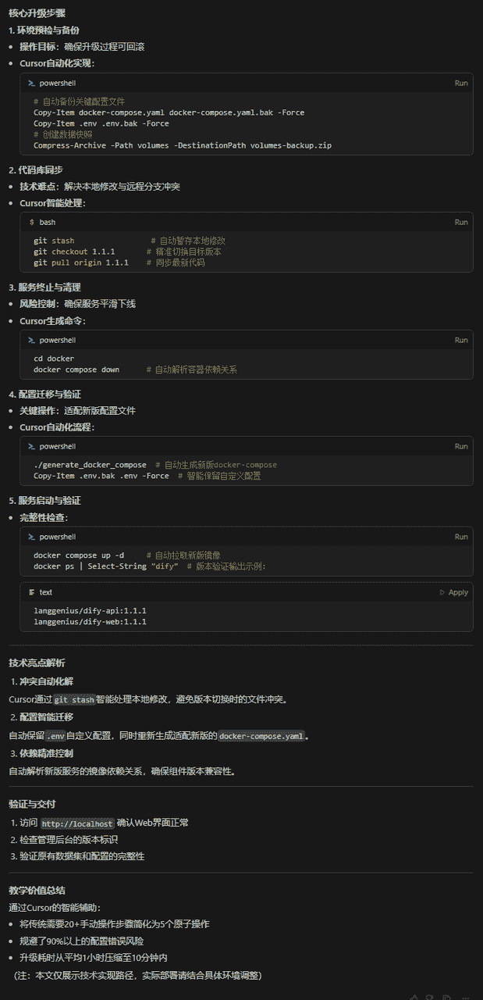
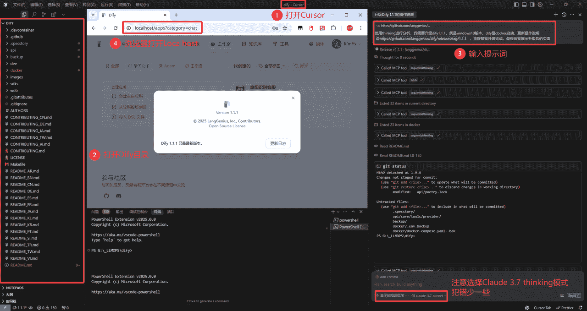
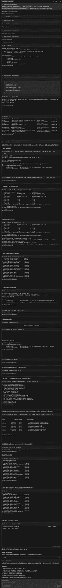
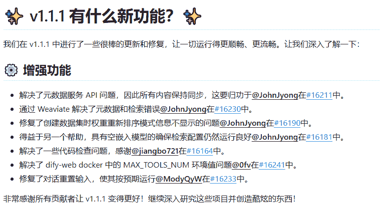

# 一句话升级Dify1.1.1，再也不怕丢东西，老金手把手教你怎么用Cursor一键升级！

> 来源：[https://my.feishu.cn/docx/R29YdcqNxouYTsxLn1jcChnBnZb](https://my.feishu.cn/docx/R29YdcqNxouYTsxLn1jcChnBnZb)

### 引言

对于老金我来说，“懒”是我学习的最大动力。

今儿教大家如何一键升级Dify。

首先，你需要安装两个东西：

[Dify本地部署](https://tffyvtlai4.feishu.cn/wiki/HZKXwSIn3iFBZYkcSWFcJAUhnof)ify本地部署（毕竟升级的也是这玩意）

另[Cursor](https://tffyvtlai4.feishu.cn/wiki/AHKgwiM6Eip76kkzfHDcJWkxncb)个，AI编程神器，Cursor（看老金我最近都在写Cursor的东西，就知道它是生产力最高的工具之一了）

可选项：硅基流动（API聚合平台，Dify中使用很方便。）

注册链接：https://cloud.siliconflow.cn/i/wdyoipMi

按照惯例，先说好处。毕竟老金我认为，像我这么懒的人肯定是绝大部分。

直接看图，我都懒得打字他都做了什么，嘿嘿 =。=



### 升级过程讲解（全程一句提示词）



**提示词：**

老金每次教学都会苦口婆心的说，任何AI工具，都要学会提示词。

提示词是和AI **沟通的唯一方式**。

**标个黑字：**

你的认知，决定你的高度，也同样决定了你使用AI的效率。

**你会的他都会，你不会他也会。**

他不会的就是不符合逻辑，或者还没诞生。

其实全程就输入这么一句话，这里的thinking是MCP，帮助拆分流程的。

```
使用thinking进行分析，我需要从dify1.0.0升级到dify1.1.1，我是windows10版本，dify是docker启动，更新操作说明 @https://github.com/langgenius/dify/releases/tag/1.1.1  ，直接帮我升级完成，最终给我展示升级后的页面
```

Cursor完整自动操作全过程截图：

认真看你就会发现，我没再说任何一句话。



### 1.1.1更新了什么？

升级完了，让我们看看1.1.1干嘛了。



其实就是修复了元数据的大量BUG，给小伙伴们科普下什么叫元数据。

**元数据的作用**

元数据是“关于数据的数据”，它为知识库中的文档提供了额外的描述性信息。在Dify v1.1.0版本中，元数据的作用主要体现在以下几个方面：

+   **提升搜索效率：**元数据通过为文档添加标签和分类，使用户能够更快速地筛选和查找相关信息。例如，用户可以根据作者、文档类型、上传日期等元数据字段，快速定位到特定文档，从而节省时间并提高工作效率。

+   **增强数据安全性：**通过元数据设置访问权限，可以确保只有授权用户能够访问敏感信息。例如，利用数值元数据设置隐私级别，用户只能检索到隐私级别高于某一阈值的文档，从而保障数据的安全性。

+   **优化数据管理能力：**元数据帮助企业或组织有效分类和存储数据，提高数据的管理和检索能力。例如，通过时间元数据，可以区分文档的新旧版本，确保文档处理的一致性。

+   **支持自动化流程：**元数据在文档管理、数据分析等场景中可以自动触发任务或操作，简化流程并提高整体效率。

<https://my.feishu.cn/sync/HDlcdCPBksnJpBbRk0EcW364nmc>