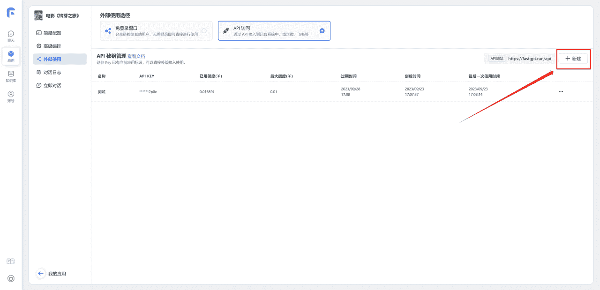

# FastGPT

> 来源：[https://my.feishu.cn/docx/VM1sdrkuFosEBKxde83cIe🐧nlg](https://my.feishu.cn/docx/VM1sdrkuFosEBKxde83cIe🐧nlg)

# 1 分钟对接 chatgpt-on-wechat

由于 FastGPT 的 API 接口和 OpenAI 的规范一致，可以[无需变更](https://doc.fastgpt.in/docs/course/openapi/)原来的应用即可使用 [FastGP](https://doc.fastgpt.in/docs/workflow/intro/)T 上编排好的应用。API 使用可参考 这篇文章。编排示例，可参考 高级编排介绍

1.  获取 OpenAPI 秘钥

依次选择应用 -> 「API访问」，然后点击「API 密钥」来创建密钥。

# warning

密钥需要自己保管好，一旦关闭就无法再复制密钥，只能创建新密钥再复制。



1.  创建 docker-compose.yml 文件

只需要修改 OPEN_AI_API_KEY 和 OPEN_AI_API_BASE 两个环境变量即可。其中 OPEN_AI_API_KEY 为第一步获取的秘钥，OPEN_AI_API_BASE 为 FastGPT 的 OpenAPI 地址，例如：https://api.fastgpt.in/api/v1。

随便找一个目录，创建一个 docker-compose.yml 文件，将下面的代码复制进去。

```
**version**: &#x27;2.0&#x27;**services**:c**hatgp****t-on-wechat:im****age: zhayuji****e/chatgpt-o**n**-wechatcontaine**r_name: chatgpt-on-**wecha**t**security_opt**:- sec**comp:**unco**nfinedenvi**ronment:OPEN_AI_API_KEY: &#x27;fastgpt-z51pkjqm9nrk03**a1rx2funoy&#x27;OPE**N**_AI_API_BASE:** &#x27;https://api.fas**tgpt.in/ap**i/v1&#x27;MODE**L: &#x27;gpt-3.5-tu**rbo&#x27;**CHANNEL_TYPE: &#x27;**wx&#x27;PROXY: &#x27;&#x27;HOT_RELOAD: &#x27;False&#x27;SINGLE_CHAT_PREFIX: &#x27;[&quot;bot&quot;, &quot;@bot&quot;]&#x27;SINGLE_CHAT_REPLY_PREFIX: &#x27;&quot;[bot] &quot;&#x27;GROUP_CHAT_PREFIX: &#x27;[&quot;@bot&quot;]&#x27;GROUP_NAME_WHITE_LIST: &#x27;[&quot;ChatGPT测试群&quot;, &quot;ChatGPT测试群2&quot;]&#x27;IMAGE_CREATE_PREFIX: &#x27;[&quot;画&quot;, &quot;看&quot;, &quot;找&quot;]&#x27;CONVERSATION_MAX_TOKENS: 1000SPEECH_RECOGNITION: &#x27;False&#x27;CHARACTER_DESC: &#x27;你是ChatGPT, 一个由OpenAI训练的大型语言模型, 你旨在回答并解决人们的任何问题，并且可以使用多种语言与人交流。&#x27;SUBSCRIBE_MSG: &#x27;感谢您的关注！\n这里是ChatGPT，可以自由对话。\n支持语音对话。\n支持图片输入。\n支持图片输出，画字开头的消息将按要求创作图片。\n支持tool、角色扮演和文字冒险等丰富的插件。\n输入{trigger_prefix}#help 查看详细指令。&#x27;EXPIRES_IN_SECONDS: 3600USE_GLOBAL_PLUGIN_CONFIG: &#x27;True&#x27;USE_LINKAI: &#x27;False&#x27;LINKAI_API_KEY: &#x27;&#x27;LINKAI_APP_CODE: &#x27;&#x27;
```

1.  运行 chatgpt-on-wechat

```
docker-compose pull
docker-compose up -d
```

+   运行成功后会提示扫码登录

+   随便找个账号，私信发送: bot问题 会将 问题 传到 FastGPT 进行回答。

<https://my.feishu.cn/sync/HDlcdCPBksnJpBbRk0EcW364nmc>