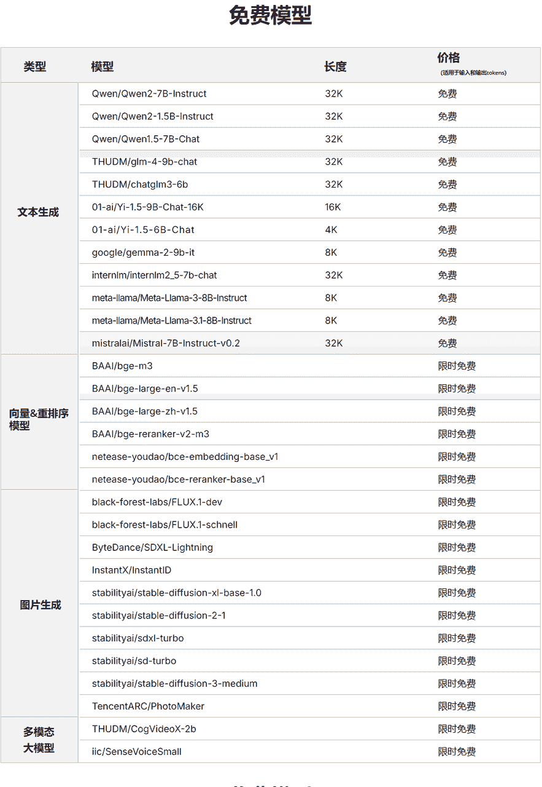
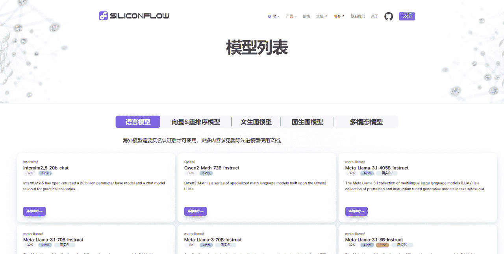
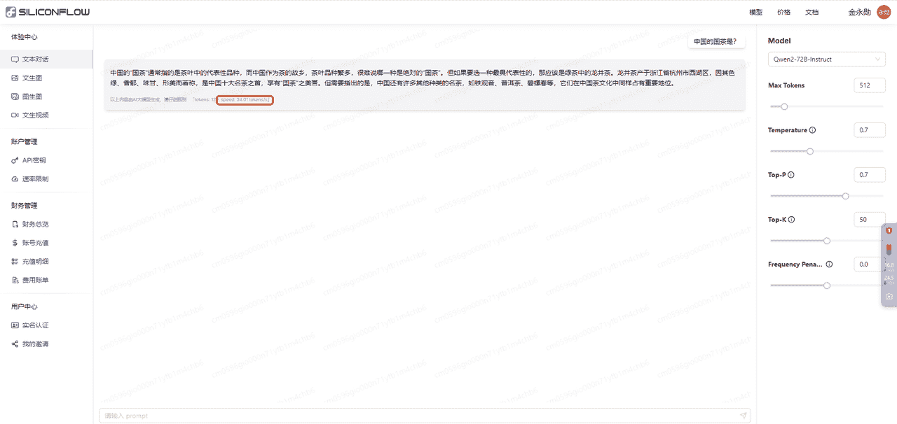
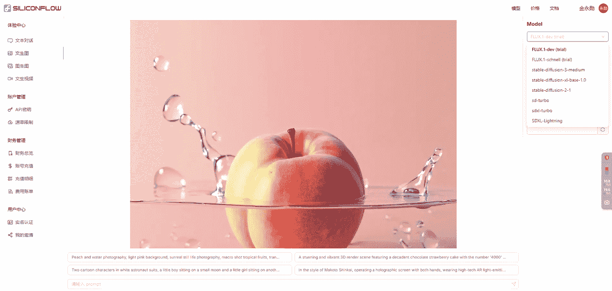
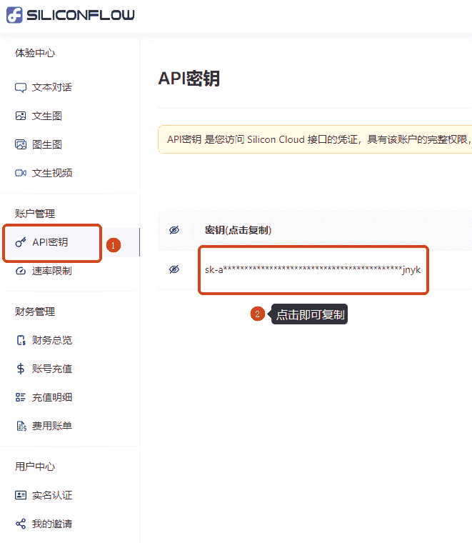
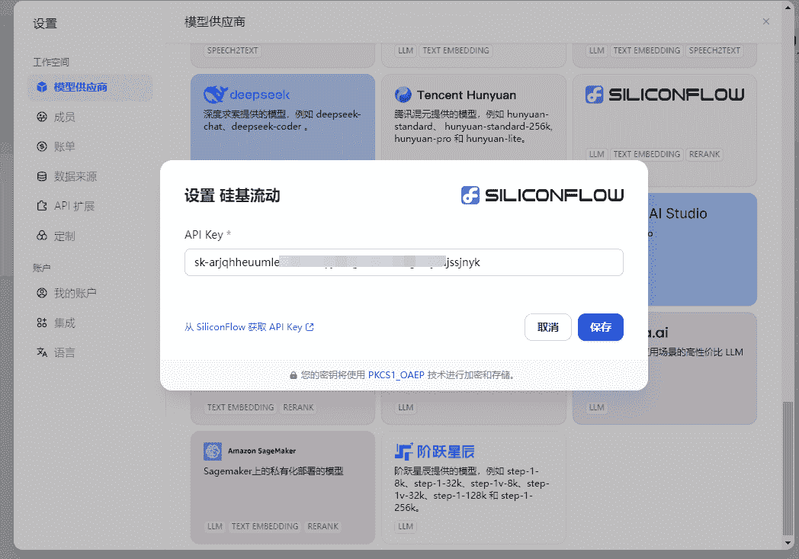
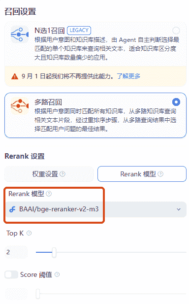
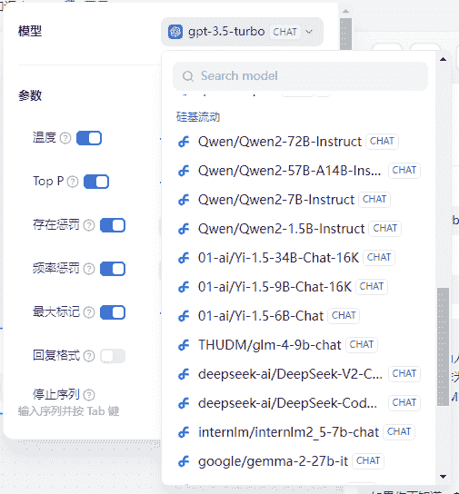
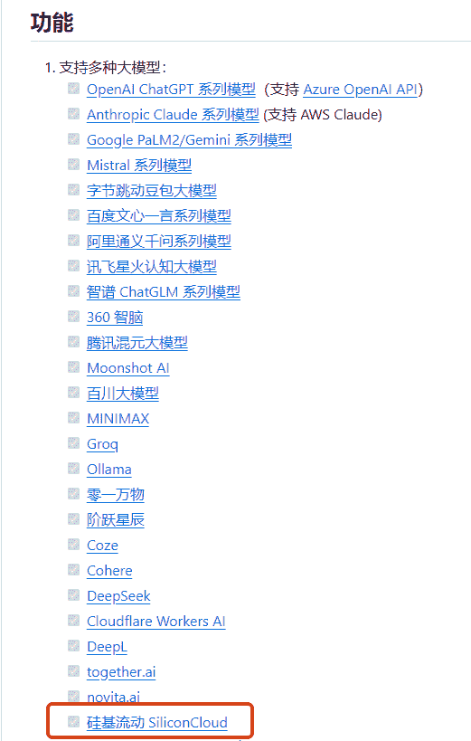

# 硅基流动 SiliconCloud

> 来源：[https://my.feishu.cn/docx/FN3tdGYsEoQlKLx1BwFcALnGnce](https://my.feishu.cn/docx/FN3tdGYsEoQlKLx1BwFcALnGnce)

这两天又发现个黑马选手 - 硅基流动（SiliconFlow）推出了一站式大模型 API 平台 SiliconCloud。

作为一个Infra（基础设施）团队，硅基流动的的核心目标是实现Token自由，成为AI应用的“卖铲人”。

注册链接：https://cloud.siliconflow.cn/i/wdyoipMi

看到这里估计有人会先问一句，为什么不直接用厂商的API？而是选一个套了一层壳的API？意义在哪？

用了Siliconflow之后，发现它带来的好处至少有以下3点：

1、无需自建服务，即享高性能模型API，如GPT-4o！

2、原厂API速度升级，SiliconFlow优化模型响应，快人一步！

3、 统一接入多厂家API，一个key，配置一次，效率翻倍！

**话不多说，直接看**下面，直观感受下我为什么推荐，先来感受下免费的视觉冲击！

SiliconCloud汇聚了众多主流大模型，包括阿里旗下的通义大模型Qwen2、智谱旗下的GLM-4、幻方量化旗下的DeepSeek V2系列开源模型，以及文生图模型SDXL、SDXL Lightning、PhotoMaker、InstantID等。

即使是 Qwen2-72B，官网显示只要 4.13 元 / 1M Token。新用户还可免费畅享 2000 万 Token。

**所以它的核**心点，在老金我看来就俩，便宜！快！

这就要回过头来，先来看看硅基流动是个什么样的企业了。

硅基流动的云服务平台叫SiliconCloud，该平台致力于提供高效能、低成本的多品类AI模型服务（MaaS）。

SiliconCloud不仅集成了全球最新、最顶尖的开源模型，还通过自研的推理引擎套件（SiliconLLM & OneDiff）显著降低了大模型推理的成本，为用户提供了卓越的性能体验。

硅基流动自主研发的SiliconLLM大模型推理引擎，经过对内核、框架、机制及模型的深度优化，实现了业界顶尖的推理效率，其速度相较于同类开源产品，显著提升超过十倍。

在应对MoE架构、超长上下文处理和超低延迟等复杂场景时，也展现出业界领先的实力。

这使得开发者能够专注于产品创新，无需担忧大规模推广所带来的高昂算力成本。

直观上图，感受一下 Qwen2-72B-Instruct 在 SiliconCloud 上的响应速度，34 tokens/s。

图片领域，Flux Dev和Schnell也都有了，其他SD模型也都不缺。

视频领域的是Cogvideo-2B的视频模型，略少了点儿，期待能把最近开源的新模型速度接入了。

那么我们如何在外部使用呢？首先，我们需要先获得硅基的API，主页上点这里。

主页地址：https://cloud.siliconflow.cn/i/wdyoipMi

然后我们就可以通过代码对接一下硅基流动的API，就能放入任意我们想接入的地方了。

比如Dify中，我就看见了它已经支持直接接入了。放入硅基API，搞定。

然后你就能随意使用了，真是非常方便。

看了下COW项目目前还没有接入硅基流动的API，但是我们可以通过OneAPI转一手，可以从OneAPI的Git主页上看到，它已经支持了硅基流动。

[OneAPI-接口管理和分发神器：所有大模型一键封装成OpenAI协议](https://tffyvtlai4.feishu.cn/wiki/NFKcwI25EiXiRFkNrUqcezETnF3)neAPI的使用说明可以点击这里查看，这里我就不过多陈述了：

这样，我们就可以在任意平台使用了，实现Token自由，硅基自由！

<https://my.feishu.cn/sync/HDlcdCPBksnJpBbRk0EcW364nmc>