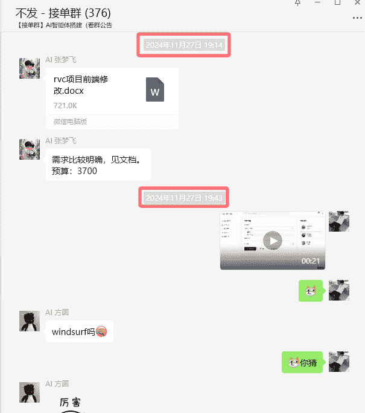
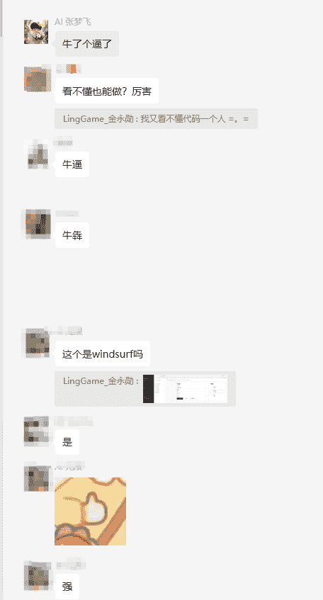
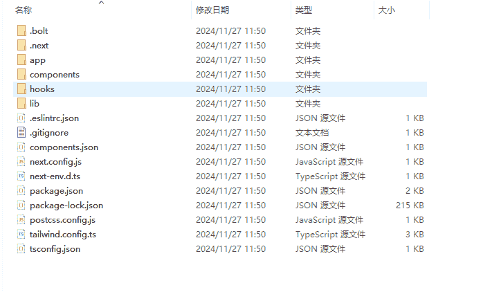
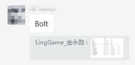
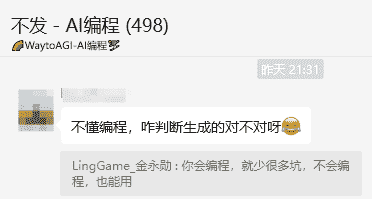
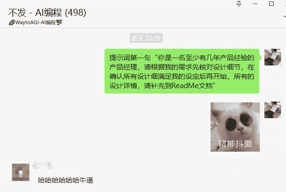
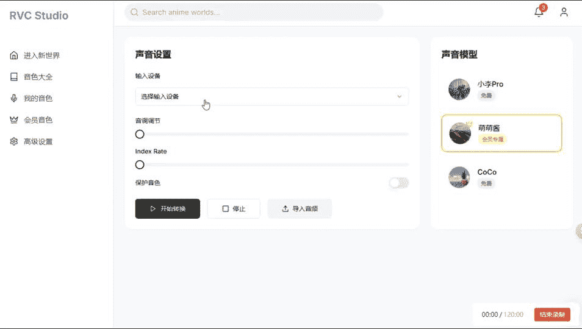

# 我是怎么用10分钟的AI编程挣钱的？

> 来源：[https://my.feishu.cn/docx/KexYdWzA5olfjFxJTavcKlTDnWt](https://my.feishu.cn/docx/KexYdWzA5olfjFxJTavcKlTDnWt)

### 引言

最近Cursor更新了0.44版本，增加了YOLO模式。

emm……就是我一直说的Windsurf那个丝滑的功能都有了，现在不得不承认Cursor比Windsurf强了，毕竟还多了@Web功能和@Git功能。

但是！Windsurf的10刀/月的价格是真香，所以老金我还是选Windsurf。

Cursor虽然加了设备码，但是还是可以白嫖的方法我是知道的。

话说回来，既然用了，尊重一下是该有的，一个月的订阅费用也就几顿饭钱而已。

想象一下如果是我自己付出开发的项目，被别人白嫖，也会很不爽。

方法老金在我自己的群里也有讲过，其实就是Git上有人开源了个修改设备码的东西。

据说还是用Cursor写的，真是用Cursor打败Cursor。

今儿老金我主要给大家讲讲，小白是怎么通过AI编写代码的，我就问问你们，想不想自己弄个APP？

---

### 正文

言归正传，梦飞的文章相信有些小伙伴已经看过了。

嗯，我就是那个打了把王者，10分钟搞定前端页面那个人。

今儿老金我将教大家，我是怎么做到的。

这里讲个前提，老金我英语没过4级，不会写代码，那密密麻麻的英文字幕，老金我看不懂。

需求是一个月前梦飞发的一个通告，一个RVC的前端页面。

注意这个时间，半小时，其中我打了一把王者。。也就是说，整个完成时间约为10多分钟。

然后一帮小伙伴就惊了。。

这里老金其实就用了俩工具，当然，这里对于产品的认知是很重要的一步。

早在10月31号，老金就发了一篇介绍Bolt.new的文章。

[Bolt.new：AI全栈Web开发工具，0代码基础5分钟从0到上线新网站](https://tffyvtlai4.feishu.cn/wiki/XdAkwKpC4igttikNCw2c0KwknYg)

这里第1个对于AI编程软件的认知，目前老金已知的是这些工具。

1. Cursor

2. Bolt

3. v0

4. Windsurf

5. Replit Agent

6. Loveable

7. DevinAI

8. Pear AI

9. Github Copilot inside Vscode

10. Github Spark

11. IDX by Google

12. webfraw.ai

13. UIzard

14. Amazon Q Developer

15. ChatGPT inside Mac app

16. Softgen AI

17. onuro.ai

18. Databutton

19. Wrapifai

20. Tempo labs

标红的其实老金我都亲测过，很多没发，是因为没必要，老金所有给大家介绍的，都是老金我自己觉得好用的。

这里先讲一下，Bolt其实和Vo、 Replit Agent、Loveable、IDX by Google 都是一样的全栈开发工具。

但是老金用下来，Bolt最丝滑，审美程度也最好。

所以所有的设计工作=初创工作，老金都会选择让它来。

通过Bolt生成的项目，我们先下载到本地。

嗯，有个细心的小伙伴发现了，第一个文件夹就是bolt。

这里讲第2个对于AI编程的认知，没有任何一个AI编程工具，能让你一句话，就出来完整没BUG的项目，那叫许愿（或者做梦），不叫人工智能。

项目下载到本地后，使用Windsurf/Cursor打开。

关于**Windsurf的使用说明**，老金我写了很多，**文章末尾的合集**里，基本都是。

嗯，紧接着，这第3个认知，不论老金我给多少人**上过课，都发现**一件事，我讲什么到最后都是**给人教学提示词，**大家都很难表达清楚自己的需求/逻辑/规则。

比如这里有人问，不懂编程（这不说我呢么 - - ）

我直接给的方案如下，否则你会经历AI编程给你写的各种屎山一样的死循环。

这里老金我只是随手写的，如果想好好用，自己需要补充更详细的规则。

回到正轨，然后老金用Windsurf开始修改，怎么做呢。。。

其实就一句话，“帮我部署到本地，是HTML页面”。

然后就给我了个地址，浏览器直接打开就行了。

再然后，就是无聊的打开网页，反馈修改哪里，当时Windsurf还没出截图，反馈还是不直观的。

不过修改一共也就不超过10次，一个完美的页面就出现了。

废话不多说，上视频，大家自己看下效果。

[WeChat_20241227192808.mp4](https://internal-api-drive-stream.feishu.cn/space/api/box/stream/download/all/B9rQbLR1zootsixZeRBchAF9n3g)

### 结语

最后，老金还是想总结下本文的重点：

这句话我在我的群里说过很多次，AI在老金的认知中，只是提效工具，使用好的前提是认知，没有认知是用不好的。

在本文中，老金对各类AI编程工具其实都具备了认知，其次是关于使用AI核心中的核心 - 提示词，老金我知道要如何表达。

当然这里有小伙伴会说，“我看过很多AI可以教人的呀”，是，没错，老金我给你举个例子，如果你不知道1+1=2，那么你能问出来100次1+1等于多少吗？

AI不是许愿（做梦）的工具，不是你一句话，他就能知道细节详情都什么样，就像前两天我一个同事来和我说，有时候一个单词都是模糊的概念一样，就比如“战神”，西方战神和东方战神，完全是两码事一样。

你看我这么说你可能很难理解，我放个图你就懂了。

显而易见，这三个角色都可以是战神，但是给人的感受完全不同。

那怎么让它变得清晰呢？就是把每个细节，都尽可能的讲清楚。

这就是老金在文中提到的3个词，**需求/逻辑/规则****，**再浓缩一下，可以称之为 **目标** 和 **原则****。**

<https://my.feishu.cn/sync/HDlcdCPBksnJpBbRk0EcW364nmc>