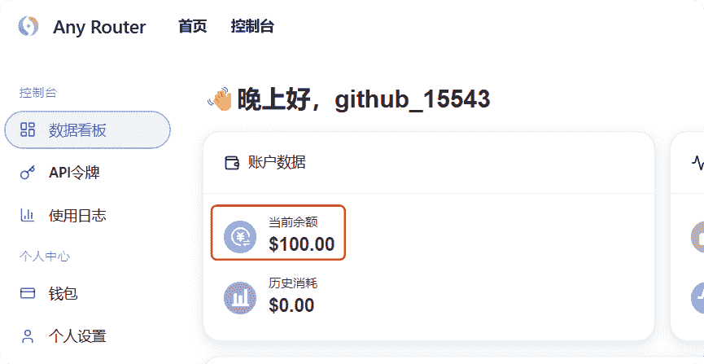
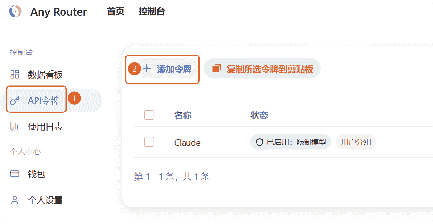
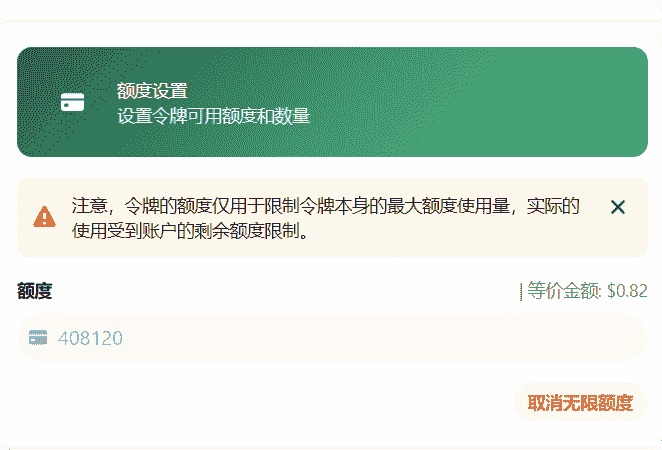
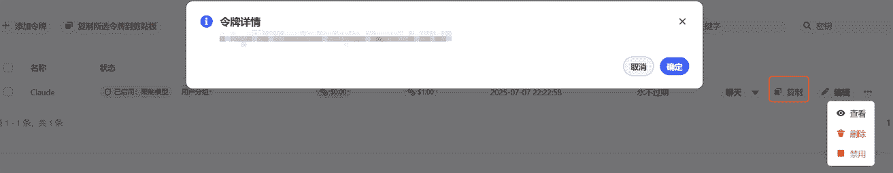
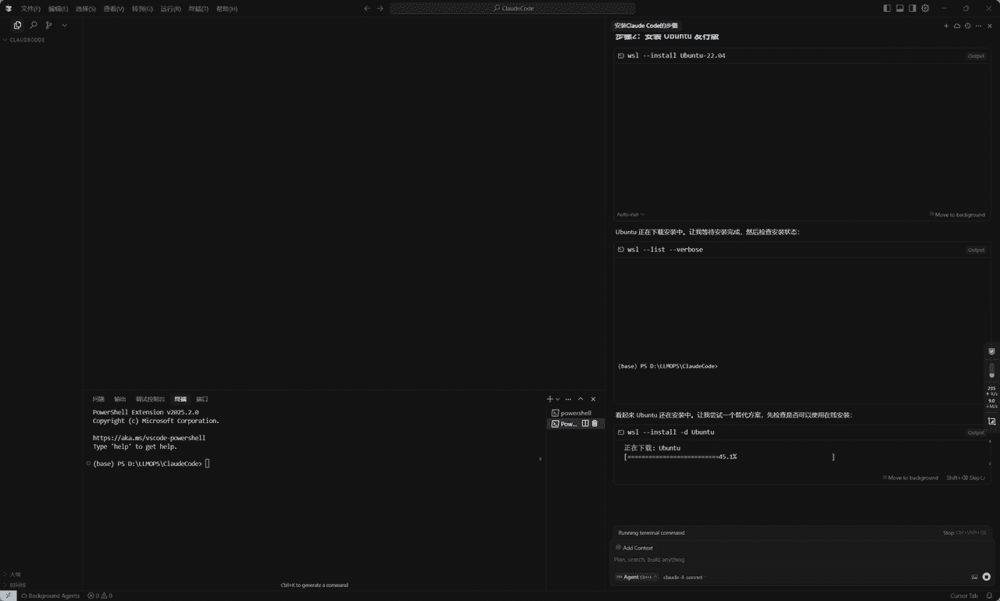
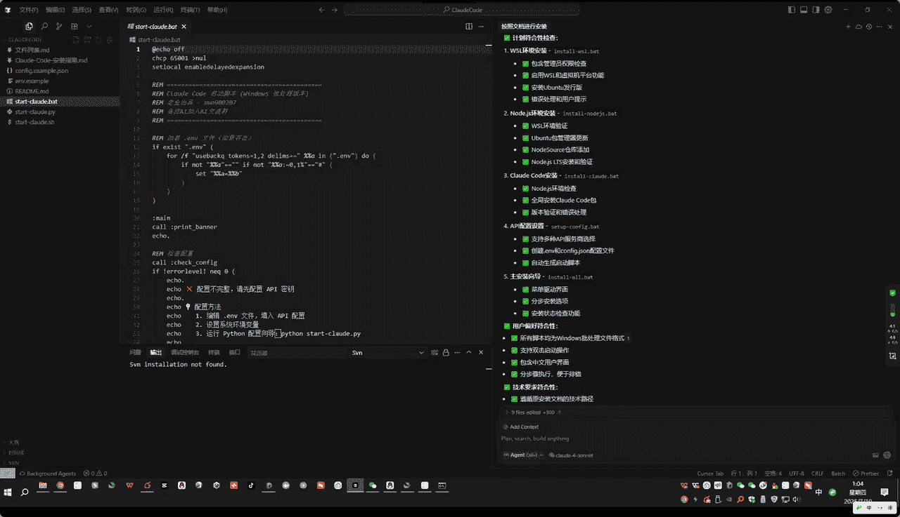
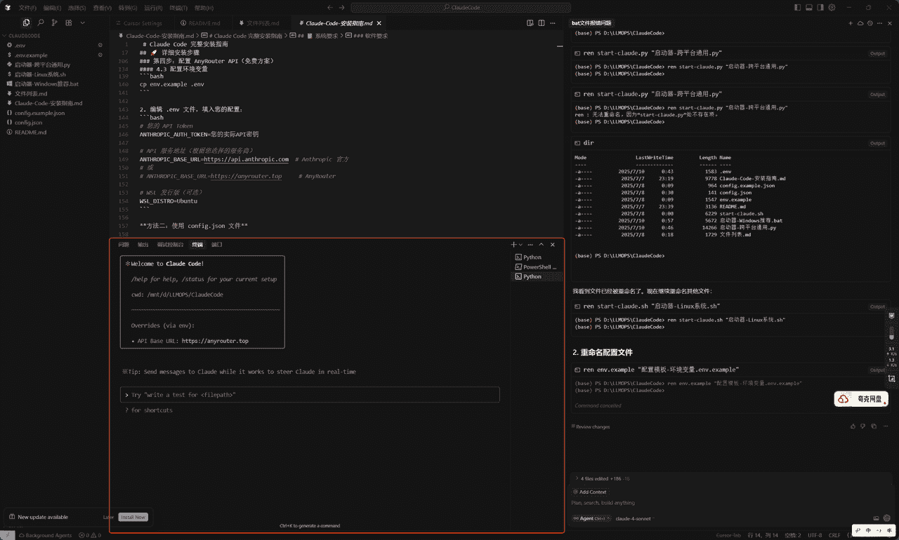
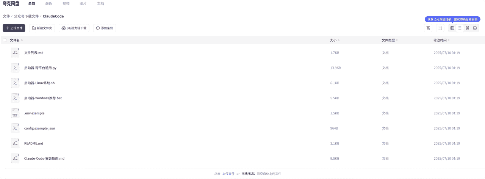

# Claude Code一键安装及白嫖方法

> 来源：[https://my.feishu.cn/docx/YPzSdZQcPonQnpxDjblcP0MXnJg](https://my.feishu.cn/docx/YPzSdZQcPonQnpxDjblcP0MXnJg)

Claude Code （简称CC）是由 Anthropic 开发的可在本地运行的自动化 AI 编程工具，可以理解代码库、执行命令、自动化管理 Git 仓库，调用 MCP等等。

相信大家或多或少都看过它了，已经出了很久了，老金一直没推给大家的原因，是因为它对于我这样的非码农，纯娱乐的人来说，是贵的，一直也不愿意用的原因也是因为它的消耗太高。

但是经老金采访N多专业码农后，他们纷纷表示实际上CC要更合适，因为MAX的性价比更高，出错率更小，对比Cursor更合适。

毕竟作为上游产业，模型厂商具备了绝对的控价权，他们无非是要消耗算力，但是能获取他们想要的信息，也能拿到对应的训练资料，是个一举多得的行为。

站在下游的各个软件就会叫苦连篇了，如Cursor，最近也修改了定价，导致X上各种谩骂层出不穷，逼得CEO都出来道歉了。

无可厚非，因为作为下游的他们为了抢流量，只能靠低价，但是低价，他们打不过上游的模型厂商的。

所以，老金推测，未来的形式已经定局，当模型厂商下场制作工具后，这些本身在下游的软件商，将会片甲不留。

---

言归正传，老金这回看见又有人再白给送钱了，这就代表大家都能试用下CC了。

老金出品，必须是最懒最无脑的方式了。

**一共2步就搞定：**

## **1、申请可以白嫖的API**

打开链接：https://anyrouter.top/register?aff=0FzF

注册好这里就有100刀使用额度。

这个最近这几天已经转发很多，相信大家可能都看到了。

老金我多一句嘴，玩玩可以，注意安全，免费发钱的，都需要注意一下隐私安全。



申请后，创建API令牌。



取消额度限制，不然默认是1刀。



模型如果需要限制在这。


直接点击复制，或三个点查看Key。



第一步完成。

## **2、下载并配置好CC**

使用Cursor一键安装：

```
帮我安装 https://www.anthropic.com/claude-code
```


依旧全自动：


还是和上次的Gemini Cli时候说的一样，自己检查，自己安装，图的就是一个省事儿。


下载卡住了的话，记得跳过（对话框右下角的Skip）一下。可能是网络环境等等导致的，它自己会尝试其他办法。



没一会儿就全搞定了。



然后 开始->cmd->cd 项目路径->claude 就直接启动了。

当然，你也可以使用老金提供的这几个脚本一键启动，key就保存在env文件或者json文件就好，说明在 文件列表里。


老金把**这些文件放到文末**了，方便大家使用，有兴趣的可以下载下来，以后直接双击bat就行了，很快。


以下是一些简单的用法说明。

通常你也可以使用 **cd 项目路径** 进入，然后使用 **claude** 启动 CC。

## 3、核心功能

**代码生成与修改**：根据您的需求生成新的代码片段、修改现有文件以及修复整个代码库中的错误。

**代码理解与问答**：回答关于代码架构、逻辑和关键数据模型的问题。

**Git 工作流集成**：搜索 git 历史记录、解决合并冲突、创建提交和拉取请求 (PR)。

**测试与调试**：执行和修复测试、代码检查以及其他命令行任务。

**互联网搜索**：利用网络搜索浏览相关的文档和资源。

**图像处理**：分析视觉输入，并根据图像生成文本和代码。

## 4、常用命令

Claude Code 提供了丰富的命令行参数和交互式命令。

#### 命令行标志 (CLI Flags)

#### 斜杠命令 (Slash Commands)

在交互模式中，可以使用 / 开头的命令来执行特定操作。

同样的，可以在cursor终端里直接使用。



今儿就教学到这了。上面老金拿curso**r生**成的一些启动文件，可以通过后台关键词CC获取网盘链接。



老金在唠叨两句，CC是目前编程最强的，原因还是最开始提到的，因为它是LLM厂商，MAX在手，比别人便宜的多，有绝对的控价权。

虽然咱们今天用的是“白嫖”的路子，但通过体验，你能清晰地感受到“上游玩家”的实力。

<https://my.feishu.cn/sync/HDlcdCPBksnJpBbRk0EcW364nmc>