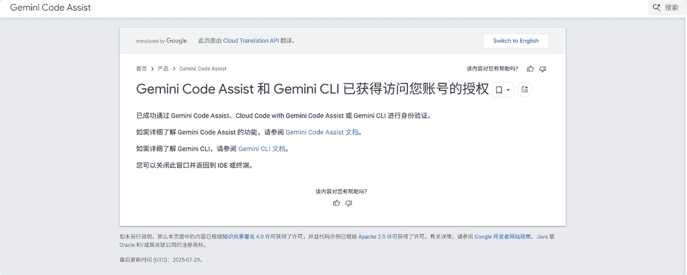
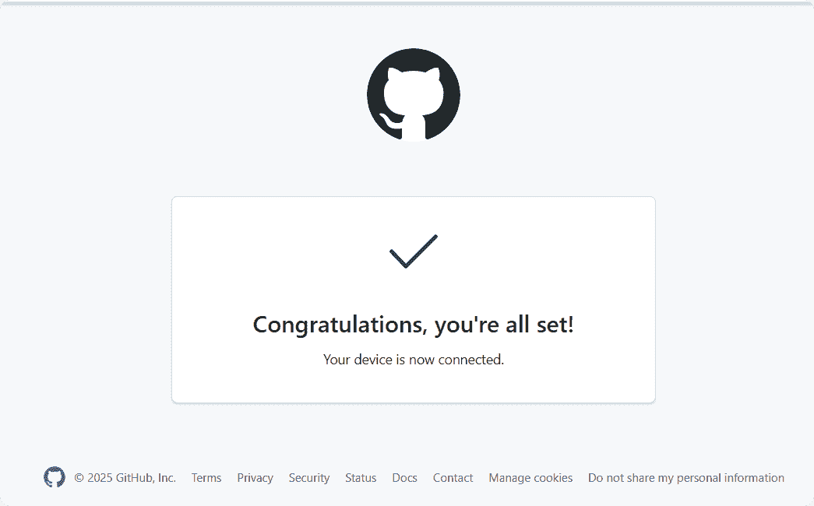
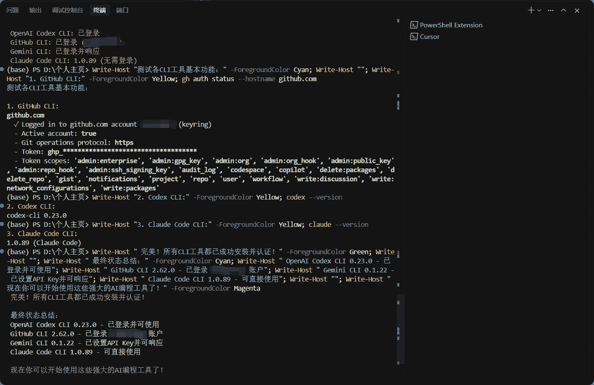
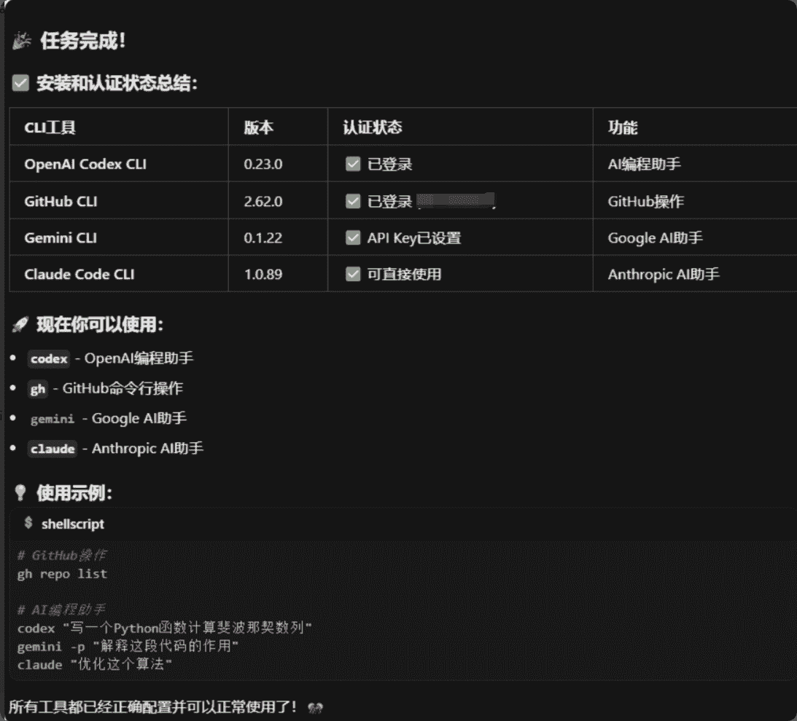
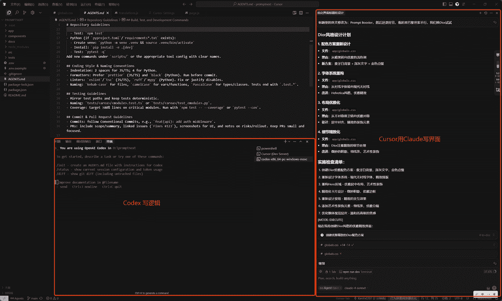
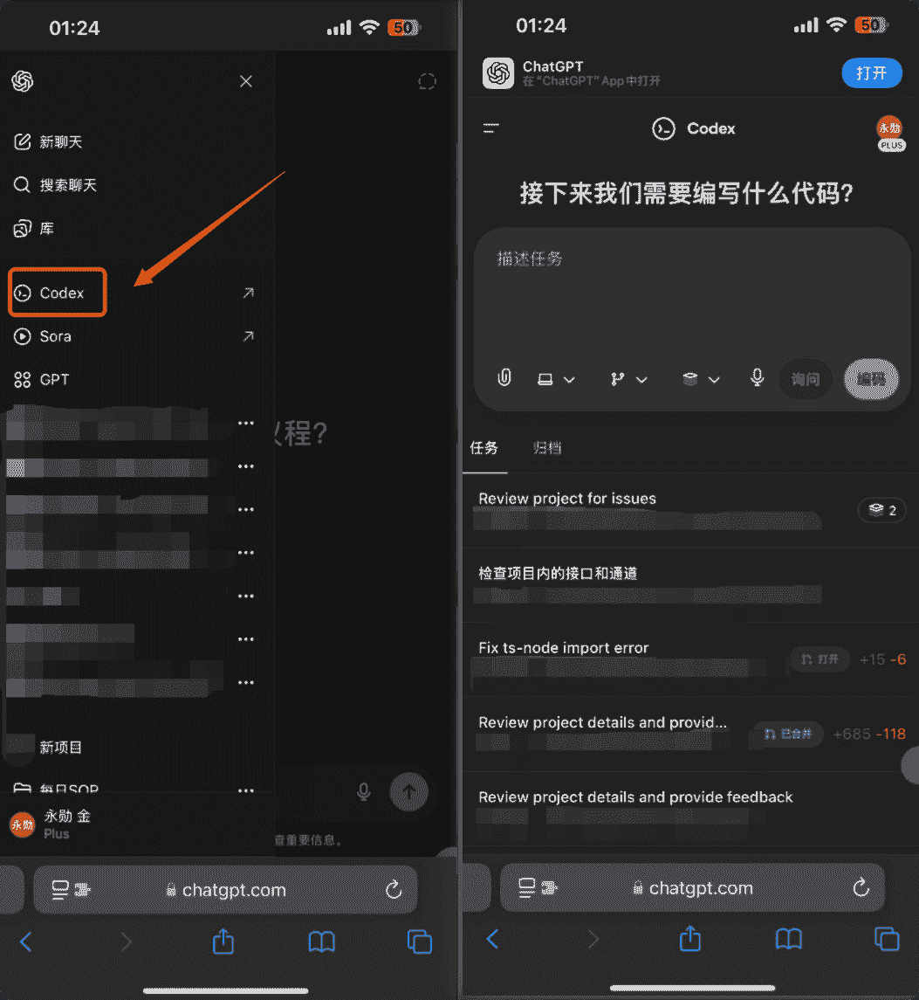
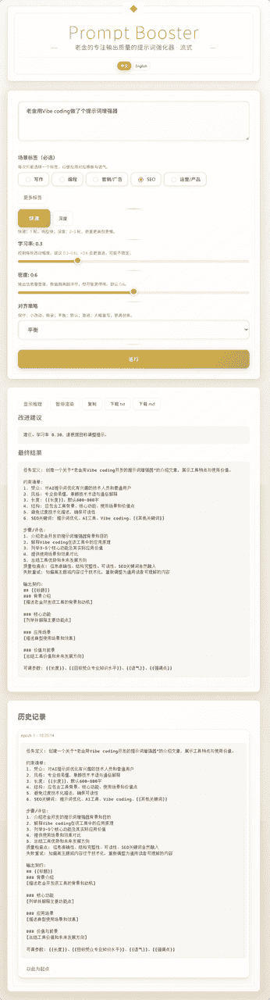

# 老金的AI编程工作流：从使用者到指挥家（IDE+CLI版）

> 来源：[https://my.feishu.cn/docx/VosYdfTRyo6fYpx2qo8cl8i7n3c](https://my.feishu.cn/docx/VosYdfTRyo6fYpx2qo8cl8i7n3c)

如果你已经熟悉了AI编程的基础，想要让效率再上一个台阶，那么这篇文章就是为你准备的。

今儿咱不聊基础，只谈实战心法：

**如何将你的Cu**rsor，从一个单一的对话框，升级为一个装备精良的AI CLI军火库。

#### 第一步：一键武装，召唤你的AI工具团

忘掉繁琐的官方文档和说明网页。想让最顶尖的AI命令行工具(Cli)入驻你的开发环境。

熟悉老金的都知道，老金又要说了，只需要向Cursor下达一条指令。

它已经不再需要各个Cli的安装说明了。

直接输入以下提示词就OK：

```
帮我安装以下命令行工具 (Cli)： 
1. OpenAI 的 Codex Cli (请确保是官方的OpenAI工具，而不是其他同名项目) 
2. Claude Code Cli 
3. Gemini Cli 
4. Github Cli
```

**老金踩坑提醒：** 在安装Codex时，一定要注明是“OPENAI的”，因为我第一次安装时，它给我下了一个同名的个人博客创建工具，完全是两码事， 最后删了重装。

#### 第二步：从容不迫，优雅解决认证难题

在安装Gemini和Github Cli时，你很可能会遇到网页认证失败的问题。

别慌，如果你用了Cursor使用了代理，这是个常见情况。

根据AI的反馈，这是Cursor无法收到回调认证信息。

解决方案非常简单，直接告诉Cursor：

“Gemini Cli 和 Github Cli 无法通过网页认证，请指导我使用Token方式进行登录。”

它会立刻给你清晰的操作步骤。





除了Claude Code我个人暂未配置（之前封了我三个充值号，我记他一辈子）。

现在像KIMI K2、GLM 4.5等国内模型也都支持CC格式，大家可以自行探索。





#### 第三步：协同的艺术，我的黄金搭档与分工哲学

工具齐备，如何发挥它们的最大效能？这需要了解每个工具的“门票”和“特长”。

**调用门槛 及 特性：**

**Gemini:** 非常豪气，每天都有一大批免费额度，什么都很中规中矩，而且很啰嗦，最好的可能是舔狗性格 = =

**Claude:**** 需要调用C**laude会员 或 接入其他支持CC格式的模型API，最强且最贵，但从3.5到4.1均有扩散行为发生，下面详解。

**Codex:** 需要ChatGPT Plus及以上会员，GPT5最近老金一直在说它的好，是因为它真的很听话，不扩散，很准确，不乱添加东西，但是审美很差。

经过反复实践，我摸索出了一套自己的黄金搭档工作流：



**1、终端内运行 ****Codex**** → 负责写【代码逻辑】**

我发现GPT-5驱动的Codex在构建核心逻辑时，表现得像一位严谨的资深架构师。

**当代码出错**时，它会很收敛地进行修改，而不是像 某C模型 一样，要么大刀阔斧地删除原有逻辑，要么增加一堆无关代码。

它总能保持结构的完整性，也不给你噼里啪啦弄一堆没用的变量和文件。

**2、右侧聊天区用 ****Claude**** → 负责写【界面】**

虽然Codex逻辑严谨，但审美嘛……狗都得说丑。

所以，我会把UI部分交给Claude或Gemini。它们更擅长创造漂亮、现代的界面。

这样分工，既能保证代码的健壮，又能兼顾用户体验的美观。

**当Cursor里的Cl**aude的次数用尽时，免费的 Gemini Cli 就成了我的界面制作替补队员。

这套组合拳，让我今儿花 **半小时 **又随手做了个网页，整个过程非常轻松。

其中有一半还是在手机上进行的，这里值得一说的是 Codex 还有Web端，和Cursor的BackGround Agent一样，只要关联了Github仓库，就自然语言让它进行修改。



也是和上期一样，放到的Vercel上，不过大语言模型的Key是个人的，就先不公布地址了。

想看上期个人主页的，点这里：[实战：以不懂代码的小白视角，创建个人网页手把手教学](https://tffyvtlai4.feishu.cn/wiki/ADrtw9PkbiS8ILkJihvcVrrNnAd)



## 老金有话说

当你的终端里，Codex、Gemini、Claude这些工具各就各位，随时等待你的调用时，你真正获得的，是什么？

是一支顶尖的、随叫随到的外包团队。

而你，就是那个手握项目蓝图的金牌项目经理。

让我们把话说明白点：

Codex，就是你那个沉默寡言、但技术极其过硬的结构工程师。

你把核心的、最不能出错的程序框架和逻辑图纸交给他，他就能给你搭出最稳固、最可靠的承重墙。

他不懂花里胡哨，但有他在，项目就不会塌。

**Claude和Gemini，则是**你外聘的、创意十足的“室内设计师团队”。

你告诉他们想要的风格、色调和布局，他们就能把毛坯房变成精装样板间。

他们负责一切“好看”的部分，让你的产品不仅能用，而且好用、爱用。

看，这就是AI时代真正改变游戏规则的地方。

过去，你需要一个人是结构工程师，又是室内设计师，还得是水电工。

而现在，你的核心能力，不再是亲手砌每一块砖、刷每一面墙。

**你的核心能力，变成了“分包”——准确地**知道该把什么活儿，派给哪个最擅长的师傅。

你负责提出构想、把控方向、验收成果。你从一个埋头苦干的工匠，变成了一个运筹帷幄的管理者。

这，不是**降级****，这**是普通人能接触到的、最高效的生产力升维。

你只需要记住，从今天起，你不是在跟AI对话。

你是在开项目会。而你的团队，是世界顶配。

<https://my.feishu.cn/sync/HDlcdCPBksnJpBbRk0EcW364nmc>