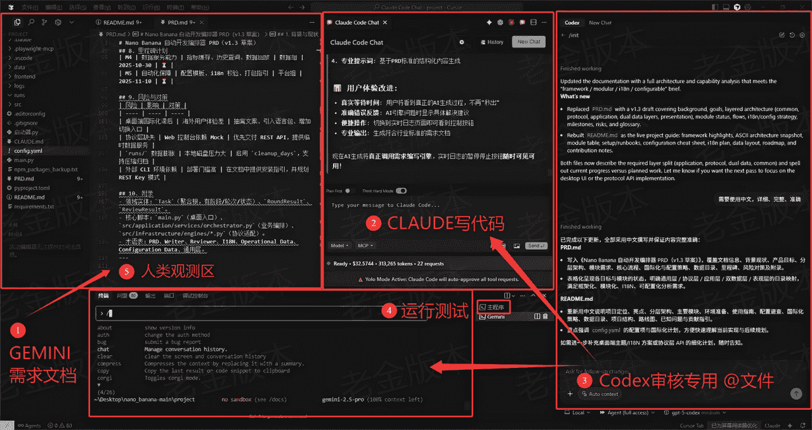
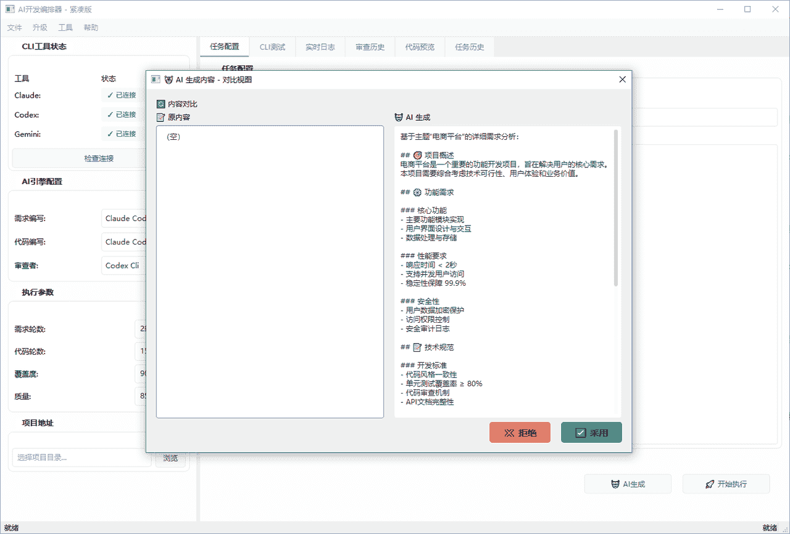
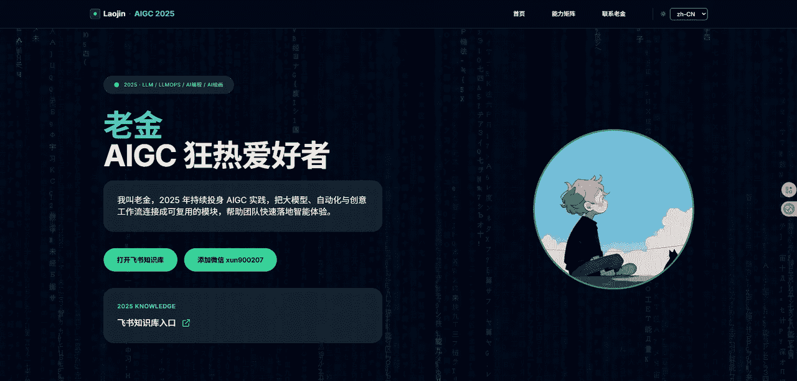
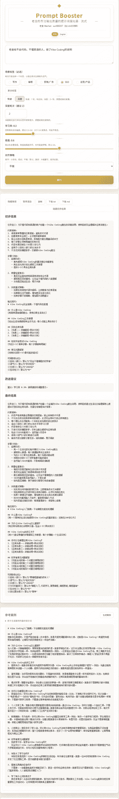
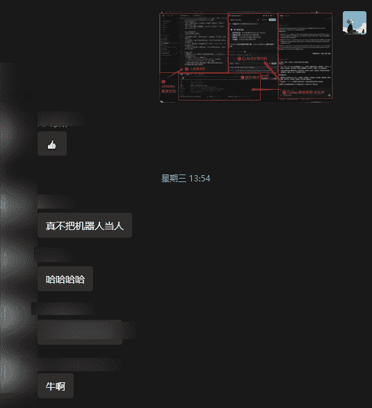
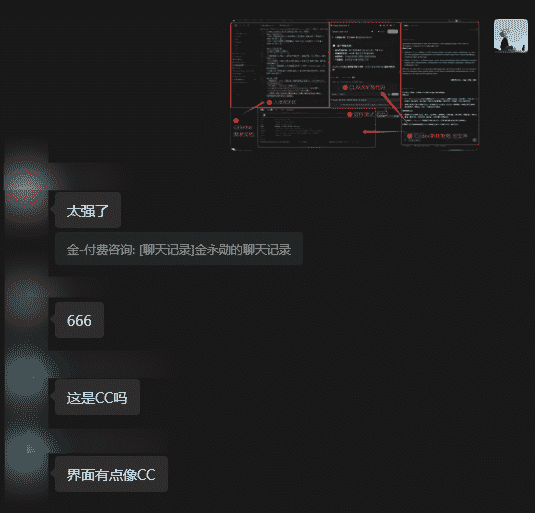
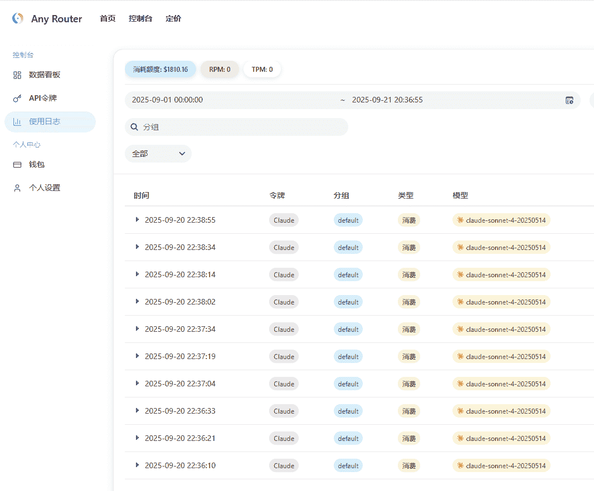
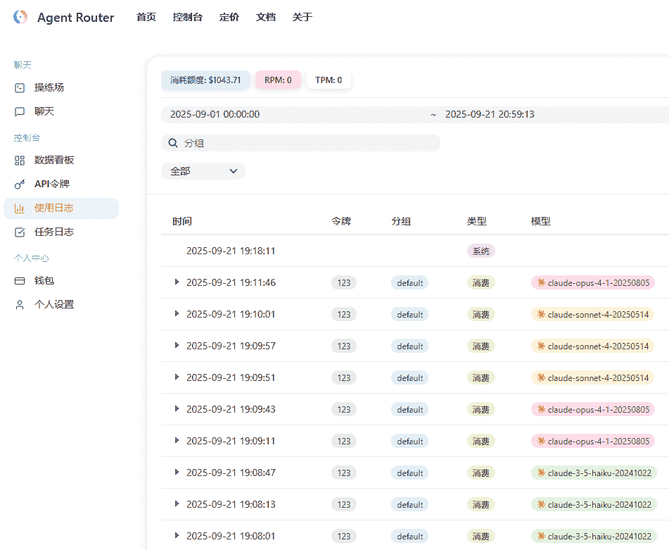

# 作为一个不懂代码的人，是怎么做出多产品的？邪修用法之IDE+多Cli纯自动！附带俩羊毛！

> 来源：[https://my.feishu.cn/docx/VXb8dMLkao9LeBx8RD3cuLQpn8e](https://my.feishu.cn/docx/VXb8dMLkao9LeBx8RD3cuLQpn8e)

最近各种Cli狂轰乱炸，之前老金就有说了各种邪修方案，主打一个性价比。

开始讲解之前，给大家说老金的用法，如下图所示。

作为一个不会代码，英语没过4级的人，老金已经在群内公开过很多项目了。

大家纷纷问我怎么做到的，今儿会在本篇内给大家介绍一下。

**文末将附带两个老金目前用的羊毛网**站，Claude的消耗基本都来自于这里。

光9月，老金从这俩网站上薅了2800多$！

先来看看老金日常的操作页面：

这里先给大家讲基础逻辑，其实AI在老金的概念中，目前一直都是个工具。

工具是用来干嘛的？提效的！是让你压缩你的单位时间产出的！

AI在此方面是老金这几十年来遇到的最强的，没有之一！

因为它能把你不会的做到！

因为它能教你最快，只要你会问！

**因为它还是极大的压缩你的制作时**间，像老金的产品，很多都是在睡觉时，它自动完成的。

因为老金我还拿AI做了个鞭策AI的工具，**这个本**篇就不讲了，过于复杂，简单理解就是全自动。

**下面我会讲它的最小MVP原理**实现，新手可以通过此方式快速入门！

随手放一些老金做的产品。

一个黑客帝国风个人主页，需魔法：https://laojin.vercel.app/

一个提示词优化器：

Nano Banana图文编辑网页：

此方法我不用多说，拿出去给人看都会觉得你很厉害。

讲讲它运行的原理，AI最强的是什么？

没错，就是底层的模型。

这里为什么老金我这么用？

作为一个普通大众，最关注的肯定是性价比，其次是在此范围内它们最强。

老金这个配置是经过了大量项目测试成本最低，效果最好的。

**主力版本，没有之一：**

**Gemini 2.**5 Pro：编写需求 - 免费 日1000次

**Claude Son**net 4：编写代码 - 薅羊毛，文末俩公益站

CodeX：审核以上俩模型的结果 & 修改BUG - 老金是实打实的PLUS用户2年了，每月20刀，不过老金也知晓其他渠道。

**国内平替：**

GLM 4.5 包月20元版。

其他 KIMI K2 0905/QWEN3 MAX等，更好用，但性价比差很多。

但也可以薅羊毛，硅基有很多模型可以免费使用。

[Claude Code & 硅基流动，老金突然使用自由了！](https://tffyvtlai4.feishu.cn/wiki/TDM1wU9LZib9lGkTfz4cnec2nmF)

**流程：**

1、可以先使用Codex中的GPT-5-HIGH模型（当下世界最强推理模型），或者直接在Chatgpt网页版上先聊你的想法，根据你的想法，初步建立框架。

2、把你觉得满意的框架内容发送给Gemini，同样你可以在Cli内，也可以在网页，都可以。

3、根据框架，把需求详情聊出来，返回Codex审核，若有问题则补充修改。

4、框架发给Claude，让它先做出代码的框架版本，返回Codex审核。

5、按照框架，把聊出的详情，一个个发给Claude制作，返回Codex审核。

这也是老金做的全自动版本的底层MVP逻辑。

如果你想用好此策略，需要2个基础能力：

1、提示词、提示词、还是提示词，这是老金一直强调的，你想用好AI的最基础且最强大的单元内容。

2、对于各个模型的认知，比如Gemini的细致，Claude的编程能力，GPT的框架能力&推理能力等等，你要知道你干什么需要什么模型最快最合适。

最后，肯定小伙伴们有疑问，那IDE是拿来干嘛的？

其实它就是个拼界面的。。。加上偶尔可以用Cursor进行一些替补操作。

最近老金也在准备一些公益教学，感兴趣的可以在文末加我。

**##**** ****羊毛部分介绍：**

**郑**重提醒：公益站需注重隐私，如果你运行的软件除了本文件夹没其他文件访问权限，且本文件夹没有重要信息时在用！

**这里已经很多小**伙伴会看岔了，包含我一开始也看错了，这是2个网站。

其中**Agent Router**是最近刚出的，能薅尽快薅，**只**能用Github、Linux Do账号申请。

然后**Any Router**是上线几个月了，老金最早推过，但是**网站挂了，最近好了，老金已经使****用**两周了，只能用Linux Do账号申请。

**第一个：**

https://agentrouter.org/register?aff=rLco

点链接注册能用200刀，也就是你和我分别多得100，你也可以分享出去。

每天登录没有白给的。

这个能用Opus和GPT5（没有新的CODEX模型，只有GPT5模型），还是很好的。

**第二个：**

https://anyrouter.top/register?aff=0FzF

有初始，好像是100刀，记不清了，链接注册你我分别获得50，你依然可以分享出去。

**每天登录有25刀额度**，自动领取的教程老金写过，注意同步时候图丢了，看置顶留言里的信息，那个有图文。

[老金·邪修法则：CC每天自动获取25$额度Claude*多账号，Anyrouter全自动签到](https://tffyvtlai4.feishu.cn/wiki/M7e1wiCoviEbE2kTNuLckcsHnUg)

这个只能用Sonnet。

**免责声明：**

本文仅出于学习和研究目的分享，不对使用者因采用本文方法而可能产生的任何后果承担责任。请注意:

1.  本文内容仅供学习和研究使用,不得用于任何商业目的或非法活动。

1.  使用者应当遵守Cursor和Claude的服务条款及相关法律法规。

1.  本文不鼓励也不支持任何形式的滥用、破解或规避付费服务的行为。请尊重知识产权和服务提供商的利益。

1.  如果您决定采用本文描述的方法,即表示您已完全理解并接受本免责声明的全部内容。

请合理使用。

<https://my.feishu.cn/sync/HDlcdCPBksnJpBbRk0EcW364nmc>