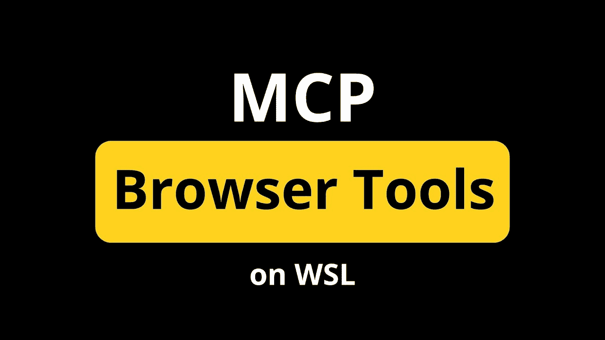
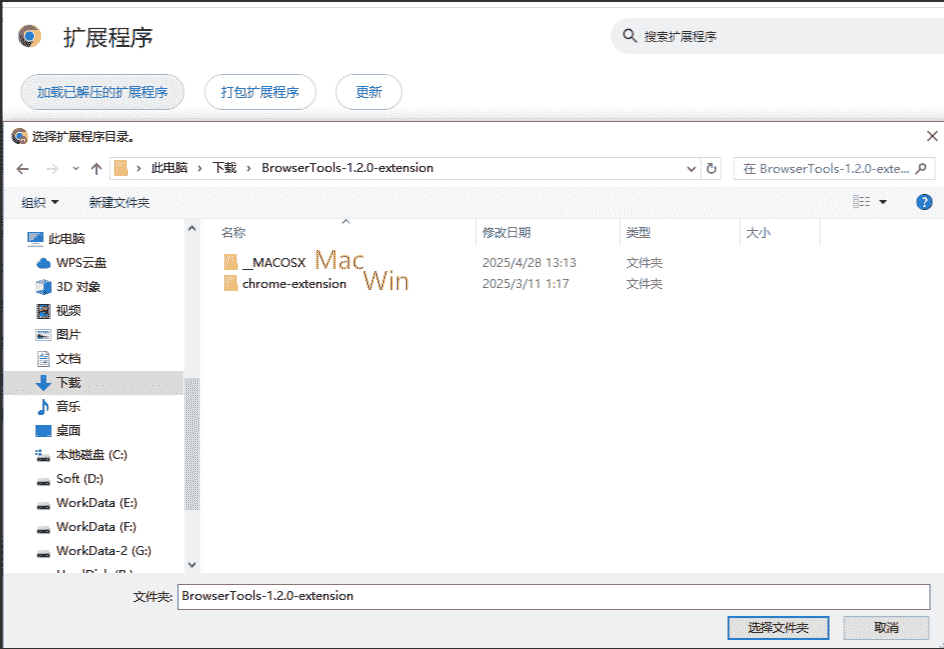
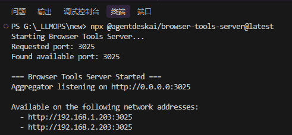
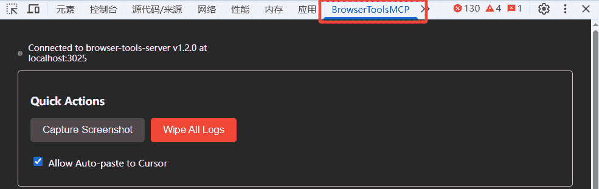
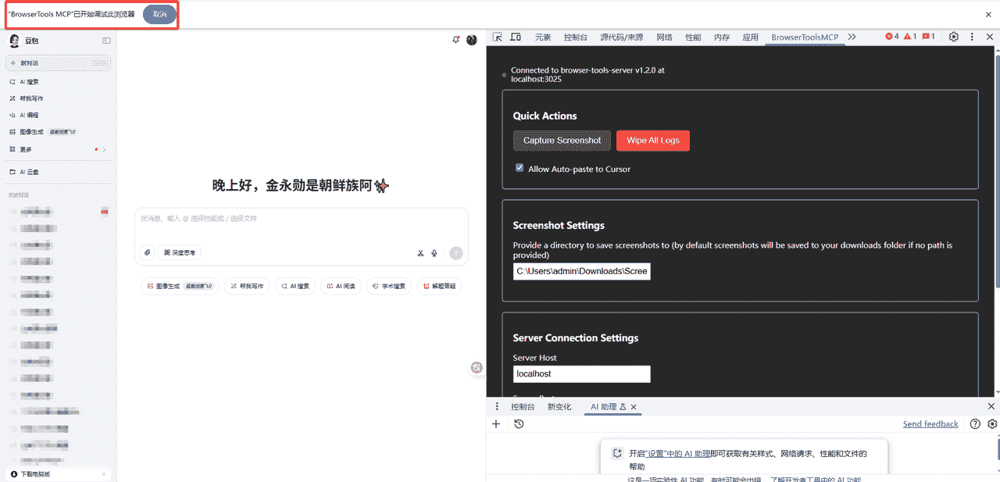
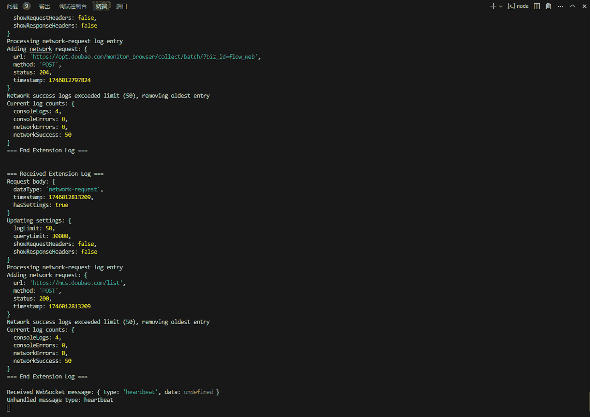
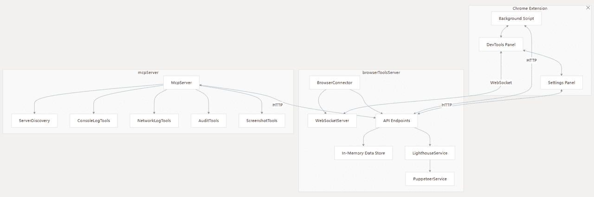
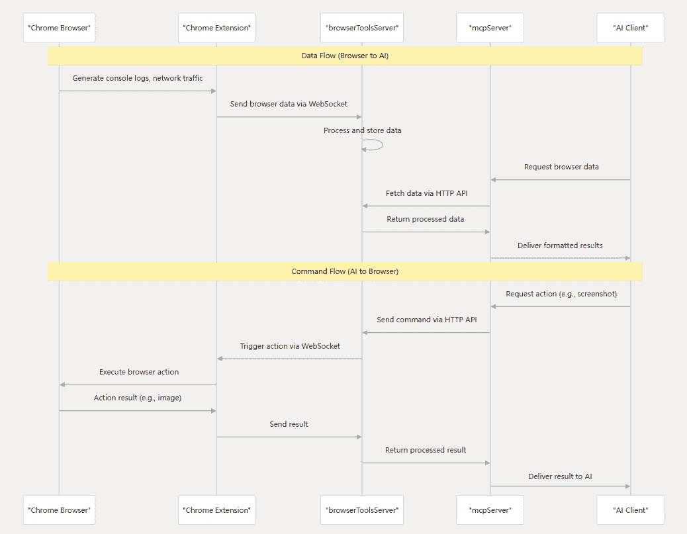
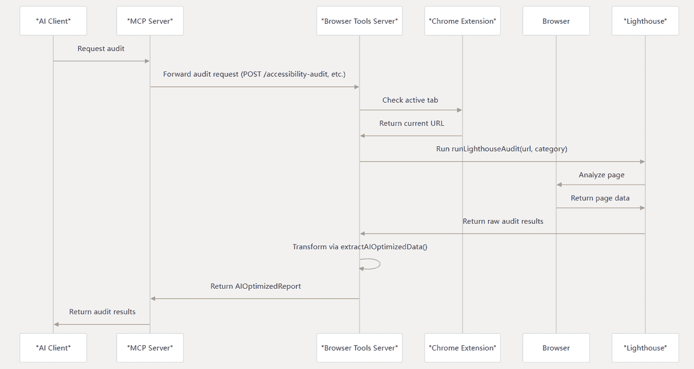

# 能动手操作浏览器的MCP！老金手把手教你使用BrowserTools！

> 来源：[https://my.feishu.cn/docx/FUFqduAlvoZCUTx50ircibmBnJc](https://my.feishu.cn/docx/FUFqduAlvoZCUTx50ircibmBnJc)

老铁们好，今儿老金给大家带来个MCP神器。

有没有觉得现在的 AI 助手有时候挺“笨”的？

这就好比你请了个超级聪明的助理，但他却是个“瞎子”、“聋子”，看不到也听不到办公室外面的世界，只能靠记忆里的旧信息干活。你让它帮你看看某个网页上的最新信息，它只会跟你说“抱歉，我访问不了外部网站”或者“我不知道”？

痛点就在这儿：AI 助手与实时、动态的互联网是脱节的！

今天老金就给你们介绍个神器，给你的 AI 助手装上“眼睛”和“手”，让它真正能看到、能操作你正在浏览的网页！

它就是——AgentDeskAI 的 `BrowserTools MCP` 系统！

操作这事儿就非常屌了，目前我看到还有个项目是 `BrowserUse`，他是个独立的端，还没看到 MCP。



## 小白入门篇：AI 上网冲浪，是种什么体验？

老金用大白话告诉你，这玩意儿装上后，你的 AI 助手（比如你可能在用的 `Cursor` 编辑器、或者未来支持的 AI 工具）能解锁哪些超能力，让你用起来更爽：

它能干嘛？

1. “看”网页内容：能读懂你当前打开的网页上写了啥。

2. “听诊”网页后台：能看到网页加载时程序员才关心的控制台日志、网络请求有没有报错。

3. “拍照”存档：随时帮你截取当前看到的网页画面。

4. 做“网站体检”：用专业工具 (`Lighthouse`) 分析网页健康状况，比如访问速度快不快、对残障人士友好不友好、搜起来容不容易等。

5. “分析诊断”：结合以上能力，帮你分析网页为啥出错、为啥卡顿。

为啥说它牛？

+ 告别“过时 AI”：AI 能获取网页上的最新信息，聊天、分析都更靠谱。

+ 解决问题“快准狠”：遇到网页问题，AI 能直接“看到现场”，帮你更快找到原因，不用你抓瞎。

+ 你的数据你做主，安全！：这套系统完全在你自己电脑上运行，你的浏览数据不会上传给任何公司，隐私有保障！

听起来还是很抽象？来看几个让你爽到的案例：

+ 案例一：购物决策好帮手

+ 痛点：想买东西，评论太多懒得翻，怕踩坑。

+ 怎么爽：直接问 AI：“总结下这页的差评和好评。” AI 用 `BrowserTools MCP` “看完”所有评论，几秒钟告诉你大家都在夸啥、骂啥。

+ 案例二：网页卡顿终结者

+ 痛点：好不容易打开个网站，卡得像幻灯片，不知道为啥。

+ 怎么爽：问 AI：“这网页咋回事，卡死了！” AI 调用“网站体检”功能，告诉你：“老铁，这网页卡，可能是因为图片太大没压缩，还有几个广告脚本拖后腿了。” 清清楚楚！

+ 案例三：报错信息翻译官

+ 痛点：访问网站遇到红字报错或者白屏，完全看不懂。

+ 怎么爽：让 AI “看看”控制台错误，或者截个图问它：“这啥情况啊？” AI 结合看到的错误信息，用人话帮你解释原因。

### 小白怎么快速上手？

看到这里，你可能想问：“这么牛的东西，我是不是得装一堆复杂的软件？”

好消息是：大概率你不需要！

这套 `BrowserTools MCP` 系统，主要是给开发者或者 AI 工具提供商（比如 `Cursor` 团队）用的。

他们会负责把这套系统集成到他们的 AI 产品里。

你需要做的，仅仅是确认你用的 AI 工具是否支持：看看你常用的 AI 编辑器（如 `Cursor`）、AI 助手（如 `Claude Desktop`）有没有宣布支持 `BrowserTools MCP` 或类似的功能。

如下操作，运行此 `MCP` 工具有三个组件：

1. 安装 Chrome 扩展程序：

   + 去官方 GitHub Releases 页面下载最新的 ZIP 包 (`v1.2.0 BrowserToolsMCP Chrome` 扩展程序)。
   + 解压缩。
   + 打开 Chrome，地址栏输入 `chrome://extensions/`。
   + 右上角打开“开发者模式”。
   + 点“加载已解压的扩展程序”，选中你刚才解压的文件夹。
   + 看到扩展图标出现在工具栏就对了。

   

2. 安装并运行浏览器工具服务器 (`Node Server`)：

   + 打开一个新的终端窗口。
   + 运行命令：`npx @agentdeskai/browser-tools-server@latest`
   + 看到提示服务器在端口 `3025` (默认) 运行起来，并且这个终端窗口要一直开着！

   

3. 安装并运行 MCP 服务器：

   + 再打开一个新的终端窗口（或者用 IDE 的终端）。
   + 运行命令：
   + 看到提示成功连接到 Browser Tools Server 就绪了！

   ```
   {
     &quot;mcpServers&quot;: {
       &quot;BroswerTools&quot;:{
         &quot;command&quot;:&quot;npx&quot;,
         &quot;args&quot;:[&quot;-y&quot;,&quot;@agentdeskai/browser-tools-mcp@latest&quot;]
       }
     }
   } 
   ```

4. 连接验证：

   + 打开 Chrome 开发者工具 (`F12` 或右键检查)。
   + 找到并切换到 “`BrowserToolsMCP`” 面板。
   + 面板里应该显示 “Connected to server”。
   + 同时看看两个服务器终端窗口，应该有连接成功的日志。
   + 这时候，你的 AI 客户端（比如 `Cursor`）应该就能识别并通过 MCP 调用这些浏览器工具了！

   

这样之后，等于 `Cursor` 就可以接管我们的浏览器了，然后你可以提问任何与网页相关的问题，它都可以自行操作。





然后你只需要在 `Cursor` 或其他支持 MCP 的应用里直接对网页提问就行：

```
帮我看看这个账号的所有你能看到的信息，并进行总结。

帮我看看这个网页上都说了什么，截个图，并总结一下。

帮我翻译下这个网页，并进行总结。

帮我看看它这个图片生成请求是怎么发的？

帮我看看页面刷新时候，`token` 会不会变？

这个网页加载好慢，帮我看看怎么回事？

帮我看看是不是有 BUG，我的余额怎么不会涨（最后这个开玩笑，不用试 = = ）
```

## 硬核进阶篇：技术宅深度解析

这部分内容老金基于官方文档编写，细节满满。

这套系统主要由三个在你本地运行的组件构成：



1. Chrome 扩展程序 (`Chrome Extension`)：深入卧底！

   + 你的“卧底”，安装在 Chrome 里，跟开发者工具 (`DevTools`) 集成。
   + 核心职责：捕获浏览器数据！
   + 内部构造 (`Manifest v3` 架构)：
     + `manifest.json`: 定义扩展的“身份证”和权限 (需要 `debugger`, `storage`, `tabs/tabCapture`, `<all_urls>` 等)。
     + `devtools.js`: 创建 "`BrowserToolsMCP`" 面板，监听控制台、网络、`DOM` 选择事件，调用 Chrome API 捕获数据，处理数据（截断、格式化），并通过 `WebSocket`/`HTTP` 与 Node 服务器通信。
     + 设置面板 UI (`panel.js`, `panel.html`): 提供配置界面（服务器连接、数据限制、截图路径、是否自动粘贴到 `Cursor` 等），设置保存在 `chrome.storage.local`。
     + 后台服务 (`background.js`): 独立运行，跟踪标签页 URL，处理截图请求，验证服务器身份，与 Node 服务器通信。

2. 浏览器工具服务器 (`Browser Tools Server` / `Node Server`)：中枢处理器！

   + 一个在你本地运行的 `Node.js` + `Express` 服务器，是“中转站”和“数据处理中心”。
   + 核心职责：接收、处理、存储浏览器数据，提供 API 供 MCP 服务器调用，执行浏览器自动化任务。
   + 内部构造：
     + `BrowserConnector` Class: 核心管理类，初始化和管理 `WebSocket` 及 `Express` HTTP 服务。
     + `WebSocketServer`: 通过 `/extension-ws` 路径与 Chrome 扩展进行实时双向通信（接收截图命令、发送导航事件等）。
     + `Express` Server (`app`): 提供 RESTful HTTP API 端点，供 MCP 服务器查询数据和发送命令（如 `GET /console-logs`, `POST /capture-screenshot`, `POST /accessibility-audit` 等）。
     + `In-Memory Data Store`: 用内存数组存储最近的控制台日志、网络请求、选定元素等数据（有数量和大小限制，可在设置面板配置）。
     + `PuppeteerService`: 核心的浏览器自动化引擎！
       + 能自动检测你系统里安装的浏览器 (`Chrome`, `Edge`, `Brave`, `Firefox` - 部分支持)。
       + 负责启动、管理和清理无头浏览器实例。
       + 提供跨平台兼容性（`Windows`, `macOS`, `Linux`, `WSL` 路径处理）。
       + 支持设备模拟（手机、平板、桌面）和网络条件模拟（慢速 3G、4G 等）。
       + 支持资源拦截（如屏蔽图片、字体以加速非性能审计）。
       + 有自动浏览器清理机制，防止内存泄漏。
     + `LighthouseService`: 基于 `Puppeteer` 服务，调用 Google `Lighthouse` 核心库来执行专业的网站审计。
     + 通信方式：通过 `WebSocket` 接收扩展的实时消息，通过 HTTP API (`/extension-log`) 接收扩展发送的日志数据；通过 HTTP API 响应 MCP 服务器的请求。
     + 健壮性：有端口占用自动回退机制（默认 `3025`），详细的错误处理和日志记录。

3. MCP 服务器 (`MCP Server`)：翻译官与指挥官！

   + “翻译官”和“指挥官”，实现了模型上下文协议 (`MCP`) 标准。
   + 核心职责：连接 AI 客户端 (`Cursor` 等) 和浏览器工具服务器，提供标准化的工具接口。
   + 内部构造：
     + `McpServer` Class: 实现 MCP 协议的核心，使用了官方的 `@modelcontextprotocol/sdk`。
     + `Server Discovery`: 自动查找本地运行的浏览器工具服务器。
     + 查找策略：先看环境变量 (`BROWSER_TOOLS_HOST/PORT`) -> 再看同目录下的 `.port` 文件 -> 再试常用主机 (`"127.0.0.1"`, `"localhost"`) 和端口 (默认 `3025`，备用 `3026-3035`)。
     + 身份验证：找到后会请求 `/.identity` 接口，验证返回的签名是不是 `mcp-browser-connector-24x7`，确保没找错人。
     + `Tool Registry`: 注册并暴露一系列标准化的工具给 AI 客户端调用。这些工具内部会调用 Node 服务器的 HTTP API。
     + `withServerConnection`: 一个保险机制，每次调用工具前都用它检查和 Node 服务器的连接。如果连接断了，会自动尝试重新发现并连接，保证稳定性。
     + 通信方式：使用 `StdioServerTransport` 通过标准输入输出流 (`stdio`) 与 AI 客户端进行 `JSON-RPC` 通信。

数据流和命令流：它是怎么跑起来的？



+ 数据流（浏览器 -> AI）：浏览器产生数据 -> Chrome 扩展捕获 -> `WebSocket`/`HTTP` 发给 Node 服务器 -> Node 服务器处理存储 -> AI 客户端通过 MCP 服务器请求 -> MCP 服务器调 Node API 获取 -> Node 服务器返回数据 -> MCP 服务器格式化后给 AI。
+ 命令流（AI -> 浏览器）：AI 客户端通过 MCP 服务器发指令 -> MCP 服务器调 Node API -> Node 服务器（可能通过 `Puppeteer` 或 `WebSocket`）发命令给扩展/浏览器 -> 扩展/浏览器执行操作 -> 结果返回 Node 服务器 -> Node 服务器给 MCP 服务器 -> MCP 服务器处理后给 AI。

看明白没？就是一个安全、高效的双向闭环，AI 能看也能动！

### 核心功能与 API 概览

这套工具能干的活儿可不少，通过 Node 服务器提供的 API 实现：

+ 日志管理 API:
  + `GET /console-logs`, `/console-errors`: 获取控制台日志/错误。
  + `GET /network-errors`, `/network-success`, `/all-xhr`: 获取网络请求日志。
  + `POST /wipelogs`: 清空所有内存中的日志。
  + `POST /extension-log`: (供扩展内部使用) 发送日志到服务器。
+ 元素选择 API:
  + `GET /selected-element`: 获取当前 DevTools 中选中的 DOM 元素信息。
  + `POST /selected-element`: (供扩展内部使用) 更新选中的元素信息。
+ 截图 API:
  + `POST /screenshot`: (供扩展内部使用) 保存已捕获的 base64 截图数据。
  + `POST /capture-screenshot`: 请求 Chrome 扩展捕获新截图并保存。
+ URL 管理 API:
  + `GET /current-url`: 获取当前监控的标签页 URL。
  + `POST /current-url`: (供扩展内部使用) 更新当前 URL。
+ 审计 API (`Lighthouse`):
  + `POST /accessibility-audit`, `/performance-audit`, `/seo-audit`, `/best-practices-audit`: 对当前页面运行相应的 Lighthouse 审计。
+ 服务器状态 API:
  + `GET /.port`: 获取 Node 服务器运行的端口。
  + `GET /.identity`: 获取服务器身份信息（名称、版本、签名）。

而且系统很智能，会帮你处理数据：

+ 自动截断超长日志/字符串 (`truncateStringsInData`)，防止 AI `Token` 爆了。
+ 自动删除 `Cookie`、凭证等敏感信息 (`Header Filtering`)。
+ 自动去重日志。
+ 把数据格式化成 AI 最喜欢的样子 (`AI-Optimized JSON Results`)。
+ 有可配置的限制 (`log count` and `size limits`，可在设置面板调整)。
+ 审计结果会根据问题严重性进行智能限制 (`Critical` 全显示, `Serious` 最多 15 条, `Moderate` 10 条, `Minor` 3 条)。

### 审计能力详解：网站“体检报告”生成器

它的审计功能是基于 `Lighthouse` 的，非常专业！能提供：

+ 无障碍审计：检查 `WCAG` 合规性（颜色对比度、替代文本、键盘导航等）。
+ 性能审计：分析 `Core Web Vitals`、页面加载速度、资源优化等。
+ SEO 审计：评估元数据、标题、链接结构、移动友好性等。
+ 最佳实践审计：检查安全性、用户体验、浏览器兼容性等。
+ `NextJS` 审计：专门针对 `Next.js` 应用的分析。



还有两种模式：

+ 审计模式 (`Audit Mode`): 一键跑完所有审计（检测到 `Next.js` 会加跑）。
+ 调试器模式 (`Debugger Mode`): 按特定顺序执行所有调试工具。

结果会以结构化的、为 AI 优化的 `JSON` 格式返回，包含元数据、分数、问题列表、优先级建议等，方便 AI 理解和分析。

MCP 服务器给 AI 客户端（比如 `Cursor`）提供了哪些可以直接调用的“武器”呢？官方文档列得很清楚：

+ 控制台工具 (`Console Tools`):
  + `getConsoleLogs`: 获取所有控制台日志。
  + `getConsoleErrors`: 只看错误日志。
  + `wipeLogs`: 清空内存里的日志（控制台+网络）。
+ 网络工具 (`Network Tools`):
  + `getNetworkLogs`: 获取所有网络请求（成功的）。
  + `getNetworkErrors`: 只看失败的网络请求。
+ 元素工具 (`Element Tools`):
  + `getSelectedElement`: 获取你在 DevTools 里选中的那个 DOM 元素的信息。
+ 截图工具 (`Screenshot Tools`):
  + `takeScreenshot`: 对当前浏览器标签页截个图。
+ 审计工具 (`Audit Tools`):


# BrowserTools MCP 工具指南

## 审计工具

+ `runAccessibilityAudit`: 跑无障碍审计。
+ `runPerformanceAudit`: 跑性能审计。
+ `runSEOAudit`: 跑 SEO 审计。
+ `runBestPracticesAudit`: 跑最佳实践审计。
+ `runNextJSAudit`: （这个比较特殊）返回一个详细的 `Next.js` SEO 分析指南，让 AI 照着做。

## 模式工具 (Mode Tools)

+ `runAuditMode`: 指导 AI 按顺序执行一系列审计（无障碍 -> 性能 -> 最佳实践 -> SEO -> `Next.js`(如果需要)）。
+ `runDebuggerMode`: 指导 AI 按结构化流程进行 Debug（思考可能原因 -> 缩小范围 -> 检查日志/网络/元素 -> 尝试修复 -> 验证）。

这些工具都遵循 `MCP` 的标准，返回格式化的 `JSON` 数据 (`{ content: [{ type: "text", text: "..." }], isError?: boolean }`)，方便 AI 理解和使用。

跟 `Cursor` 结合：编码效率原地起飞！

### 想象一下

+ 光速 Debug：你在 `Cursor` 里写代码，遇到报错。直接问 `Cursor` AI：“帮我看看浏览器控制台有啥错误？” AI 调用 `getConsoleErrors`，拿到错误日志，再结合代码分析，定位问题。或者你直接让它进入 `runDebuggerMode`，一步步帮你排查。
+ 秒懂新库/API：你在 `Cursor` 里用新函数。问 AI：“这个函数怎么用？” AI 可以先尝试理解代码，如果信息不足，它可能会提示你：“请打开这个函数的文档页面，然后选中关键部分，我再调用 `getSelectedElement` 来看看。” 或者更高级的，AI 直接控制浏览器访问文档页（如果未来支持这种操作）。
+ 前端调试利器：你在 `Cursor` 里写前端代码。直接说：“帮我跑个性能审计。” AI 调用 `runPerformanceAudit`，跑一遍 `Lighthouse`，把结果（比如 LCP 时间、阻塞资源）告诉你，并给出优化建议。想看某个按钮的样式？选中它，让 AI 调用 `getSelectedElement` 获取信息。
+ 实时信息获取：让 AI 调用 `takeScreenshot` 截个图看看页面效果，或者调用 `getNetworkLogs` 检查某个 API 请求是否成功。

### 遇到问题咋办？(官方排错提示)

+ `Node Server` 启动失败？检查 3025 端口是不是被占用了。
+ 扩展连不上 `Node Server`？彻底退出 `Chrome` 再重启试试，确保只打开一个 `DevTools` 面板。
+ `MCP Server` 找不到 `Node Server`？确认 `Node Server` 正常运行没报错。
+ AI 客户端里看不到工具？确认 `MCP Server` 正常连接。
+ 还是不行？检查防火墙是不是挡住了 3025 端口，或者去项目 `GitHub Issues` 页面看看。

### 配置选项

+ `Chrome` 扩展的设置面板里可以调：
+ 服务器地址 (`serverHost`, `serverPort`)
+ Token/截断限制 (`logLimit`, `queryLimit`, `stringSizeLimit`, `maxLogSize`)
+ 截图保存路径 (`screenshotPath`)
+ 是否显示请求/响应头 (`showRequestHeaders`, `showResponseHeaders`)
+ 是否允许自动粘贴到 `Cursor` (`allowAutoPaste`)
+ `Node Server` 可以通过环境变量 `PORT` 改端口，`LOG_LEVEL` 改日志级别。
+ `MCP Server` 会自动发现 `Node Server`，一般不用特殊配置。

## 老金怎么看？

`AgentDeskAI` 这个 `BrowserTools MCP` 系统，是真给 AI Agent 装上了“千里眼”和“顺风耳”，还能动手干活！

特别是跟 `Cursor` 这种 AI 编程工具结合，潜力巨大！

### 核心优势：

+ 打通 AI 与实时网络/浏览器：让 AI 不再局限于过时数据，能直接与浏览器交互。
+ 本地运行保隐私：数据安全放心。
+ 标准化接口 (`MCP`)：方便接入各种 AI 客户端（`Cursor`, `Claude Desktop` 等）。
+ 工具丰富且专业：监控、分析、截图、`Lighthouse` 审计、调试模式，覆盖开发调试全流程。
+ 提升开发效率：减少上下文切换，信息直达，AI 辅助调试和分析能力大大增强。
+ 可扩展性：官方提供了开发指南，懂行的同学还能自己扩展新工具！

当然，这套系统看起来也比较专业，学习起来可能需要点耐心。

但一旦搞定，对于需要 AI 深度参与浏览器交互、前端开发和调试的场景，绝对是大利器！

想让你的 AI 助手更强大？想让你的 `Cursor` 更智能？

那这个 `BrowserTools MCP`，值得你花时间研究一下！

跟紧老金！

我们一起探索这些能让 AI 更强大的工具和技术！

`<https://my.feishu.cn/sync/HDlcdCPBksnJpBbRk0EcW364nmc>`
