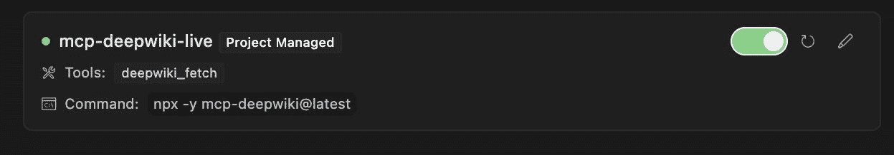

# DeepWiki MCP！AI 助你秒懂 GitHub 开源项目代码与文档！

> 来源：https://my.feishu.cn/docx/Uq2ddgIixoFYOxxfnGpcXJBHnod

家人们！平时看 GitHub 上的开源项目是不是特头大？

代码那么多，结构那么复杂，想快速搞懂它是干嘛的、怎么用的，简直大海捞针！

文档要么没有，要么写得云里雾里。问作者？人家哪有空理你。

痛点就在这儿：理解大型开源项目太耗时、太费劲，缺乏高效的代码理解和文档交互工具！

今天老金就来聊聊，DeepWiki 这个平台是怎么专门针对这个痛点，让你光速看懂 GitHub 项目，还能利用 MCP（模型上下文协议）这个“标准接口”，让 AI 变成真正懂项目的“内行”！

---

## 小白入门篇：AI 秒懂 GitHub 开源项目是种什么体验？

看不懂代码没关系！老金我也不懂代码，英语更是没过4级！（我学日语的。。）

老金用大白话告诉你这玩意能做啥！

让你快速了解开源项目，并能快速找到自己想要的功能，整合到自己的项目！

首先，认识下主角：DeepWiki - AI 驱动的开源项目理解神器

+ 它不是你印象里那种死板的 Wiki，而是个用 AI 驱动的、能跟你互动的代码知识平台。

+ 你可以把它想象成一个超级智能的在线文档库，里面收录了很多流行开源项目（比如 `Transformers`、`RAGFlow`、`Playwright`、`FastAPI` 等）的文档。

+ 它的牛逼之处在于，把这些静态文档变成了动态的、可以对话的知识库！你可以用自然语言跟文档聊天！它更像是一个动态的 AI 驱动研究和数据处理工具。

核心作用：让你能快速理解 GitHub 上的开源项目，它能准确地分析源码、理解项目架构和作用，还支持 AI 提问快速定位你想获取的信息。

你是不是遇到过这些痛点？

+ 看开源项目像逛迷宫：不知道从哪儿看起，核心代码找不到，架构图更是奢望。

+ 官方文档要么没有要么看不懂：信息零散，更新不及时，看得头秃。

+ 想问没人答：遇到问题卡住，只能自己硬啃或者去论坛大海捞针。

DeepWiki 就是来解决这些问题的！

**小白也能爽到的案例：**

+ 案例一：十分钟上手新框架（如 `FastAPI`）

+ **场景**：想用 `FastAPI` 这个 GitHub 项目，但完全没接触过。

+ **怎么爽**：打开 DeepWiki 上 `FastAPI` 的页面，直接问 AI：“`FastAPI` 的核心优势是啥？给我看下它的基本项目结构和处理请求的示例代码。” DeepWiki 的 AI 结合对源码和文档的分析，快速给你入门所需的核心信息和代码片段。

+ 案例二：复杂源码架构一眼看透（如 `Transformers`）

+ **场景**：想学习 `Transformers` 库的内部实现，但代码量巨大。

+ **怎么爽**：问 DeepWiki AI：“`Transformers` 库的 `pipeline` 功能主要涉及到哪些核心类和文件？它们之间的调用关系是怎样的？” AI 能帮你分析源码，梳理出关键路径。

+ 案例三：精准定位 API 用法（如 `Playwright`）

+ **场景**：在用 `Playwright` 时，想知道怎么设置代理。

+ **怎么爽**：直接问 DeepWiki AI：“`Playwright` 设置代理服务器的参数是哪个？在哪部分文档里有说明？” AI 快速帮你定位到具体用法和文档位置。

**小结**：DeepWiki 本身就是一个强大的 AI 开源项目理解工具，它通过 AI 精准分析源码和文档，让你能快速上手和深入理解复杂的 GitHub 开源项目，解决了看项目难、找信息慢的痛点。

## DeepWiki + MCP = 让你的 AI 助手变身“项目专家”！

DeepWiki 自身很牛了，但它的知识主要还是在 DeepWiki 平台内部。如果你想在你常用的其他 AI 工具（比如 `Cursor` 编辑器、`Claude` 桌面版）里，也能利用 DeepWiki 对 GitHub 项目的深刻理解，怎么办？

这时候，MCP（模型上下文协议）这个“神助攻”就登场了！

**新的痛点来了：**

+ AI 助手“不认识”DeepWiki：你在 `Cursor` 里写代码，想参考 DeepWiki 上对某个库的分析，但 `Cursor` 的 AI 默认是不知道 DeepWiki 里具体分析了啥的。

+ 知识无法打通：DeepWiki 对项目的理解，和你本地编辑器里的代码、其他工具里的知识是割裂的。

MCP + DeepWiki 就是来解决这个“知识打通”问题的！

+ MCP 是啥？ 它是 AI 应用的“USB-C”接口，一个开放标准，让不同的 AI 应用和数据/工具能方便地连接。

+ DeepWiki MCP 服务器：通过一个实现了 MCP 协议的服务器（GitHub 上有个 `regenrek/deepwiki-mcp` 项目在做这个事），把 DeepWiki 平台分析和理解 GitHub 项目的能力，以标准化的方式暴露出来。

+ 效果：任何支持 MCP 的 AI 客户端（比如未来的 `Cursor` 版本），理论上都可以通过这个服务器，调用一个叫 `deepwiki_fetch` 的工具，去获取 DeepWiki 对指定 GitHub 项目（或其文档）的分析结果和知识！

**小白也能爽到的案例（当你的 AI 工具支持 DeepWiki MCP 后）：**

+ 案例一：在 `Cursor` 里直接获取项目分析

+ **场景**：你在 `Cursor` 里看一个开源项目的代码，想快速了解这个文件的作用和上下文。

+ **怎么爽**：直接在 `Cursor` 的 AI 对话框里问：“用 DeepWiki 分析下这个文件的主要功能和依赖关系。” `Cursor` 的 AI 通过 MCP 调用 `deepwiki_fetch` 工具，获取 DeepWiki 对这个文件的分析结果，直接展示给你！

+ 案例二：AI 结合本地代码和 DeepWiki 分析进行 Debug

+ **场景**：你的项目用到了某个开源库，出了 Bug，你不确定是库的问题还是你用法不对。

+ **怎么爽**：在 `Cursor` 里选中你的代码，问 AI：“我这样用对不对？参考 DeepWiki 对这个库的分析和常见问题。” AI 不仅能理解你的代码，还能通过 MCP 去 DeepWiki 查询相关分析和文档，给你更全面的 Debug 建议！

**小结**：DeepWiki 加上 MCP，解决了 AI 助手无法利用 DeepWiki 对特定 GitHub 项目深刻理解的痛点，让 AI 能够跨平台、按需调取 DeepWiki 的分析结果和知识，变得更懂你的项目！

## 小白快速上手指南（重要！）

跟着老金玩 AI 的都知道老金肯定先介绍 `Cursor`，将其添加到 `.cursor/mcp.json` 文件。

```json
{
  "mcpServers": {
    "mcp-deepwiki": {
      "command": "npx",
      "args": ["-y", "mcp-deepwiki@latest"]
    }
  }
}
```



### MCP 工具集成

该软件包注册了一个名为 `deepwiki_fetch` 的工具，您可以将其与任何兼容 MCP 的客户端一起使用：

```json
{
  "action": "deepwiki_fetch",
  "params": {
    "url": "https://deepwiki.com/user/repo",
    "mode": "aggregate",
    "maxDepth": "1"
  }
}
```

#### 参数

+ `url`（必填）：DeepWiki 存储库的起始 URL

+ `mode`（可选）：输出模式，对于单个 Markdown 文档为 `aggregate`（默认），对于结构化页面数据为 `pages`

+ `maxDepth`（可选）：要抓取的页面的最大深度（默认值：`10`）

#### 响应格式

##### 成功响应（聚合模式）

```json
{
  "status": "ok",
  "data": "# Page Title\n\nPage content...\n\n---\n\n# Another Page\n\nMore content...",
  "totalPages": 5,
  "totalBytes": 25000,
  "elapsedMs": 1200
}
```

##### 成功响应（页面模式）

```json
{
  "status": "ok",
  "data": [
    {
      "path": "index",
      "markdown": "# Home Page\n\nWelcome to the repository."
    },
    {
      "path": "section/page1",
      "markdown": "# First Page\n\nThis is the first page content."
    }
  ],
  "totalPages": 2,
  "totalBytes": 12000,
  "elapsedMs": 800
}
```

##### 错误响应

```json
{
  "status": "error",
  "code": "DOMAIN_NOT_ALLOWED",
  "message": "Only deepwiki.com domains are allowed"
}
```

##### 部分成功响应

```json
{
  "status": "partial",
  "data": "# Page Title\n\nPage content...",
  "errors": [
    {
      "url": "https://deepwiki.com/user/repo/page2",
      "reason": "HTTP error: 404"
    }
  ],
  "totalPages": 1,
  "totalBytes": 5000,
  "elapsedMs": 950
}
```

#### 进度事件

使用该工具时，您将在抓取过程中收到进度事件：

```
Fetched https://deepwiki.com/user/repo: 12500 bytes in 450ms (status: 200)
Fetched https://deepwiki.com/user/repo/page1: 8750 bytes in 320ms (status: 200)
Fetched https://deepwiki.com/user/repo/page2: 6200 bytes in 280ms (status: 200)
```

### 本地开发 - 安装

#### 本地使用

```json
{
  "mcpServers": {
    "mcp-deepwiki": {
      "command": "node",
      "args": ["./bin/cli.mjs"]
    }
  }
}
```

#### 源码安装

```bash
# 克隆仓库
git clone https://github.com/regenrek/deepwiki-mcp.git
cd deepwiki-mcp

# 安装依赖（推荐使用 pnpm）
npm install # 或者 pnpm install

# 构建
npm run build # 或者 pnpm run build
```

#### 本地运行

```bash
pnpm run dev-stdio # 使用 stdio 与 AI 客户端通信
```

### 直接 API 调用

对于 HTTP 传输，您可以直接进行 API 调用：

```bash
curl -X POST http://localhost:3000/mcp \
  -H "Content-Type: application/json" \
  -d '{
        "id": "req-1",
        "action": "deepwiki_fetch",
        "params": {
          "url": "https://deepwiki.com/user/repo",
          "mode": "aggregate"
        }
      }'
```

### Docker 部署（官方标记为未测试）：

```bash
构建镜像
docker build -t mcp-deepwiki .
运行（stdio 模式）
docker run -it --rm mcp-deepwiki
运行（HTTP 模式，暴露 3000 端口）
docker run -d -p 3000:3000 mcp-deepwiki --http --port 3000
运行时传递环境变量
docker run -d -p 3000:3000 \
  -e DEEPWIKI_MAX_CONCURRENCY=10 \
  mcp-deepwiki --http --port 3000
```

## 配置

### 环境变量

创建一个 `.env` 文件来配置：

+ `DEEPWIKI_MAX_CONCURRENCY`：最大并发请求数（默认 `5`）

+ `DEEPWIKI_REQUEST_TIMEOUT`：请求超时时间（毫秒，默认 `30000`）

+ `DEEPWIKI_MAX_RETRIES`：失败重试次数（默认 `3`）

+ `DEEPWIKI_RETRY_DELAY`：重试基础延迟（毫秒，默认 `250`）

#### 常见问题排查

+ `权限问题 (EACCES)`：给二进制文件加执行权限 `chmod +x ./node_modules/.bin/mcp-deepwiki`。

+ `连接拒绝`：检查端口是否被占用（`lsof -i :3000`），防火墙是否阻挡。

+ `超时错误`：调大环境变量里的超时时间和并发数。

### 应用场景展望

报告中提到了 DeepWiki MCP 的几个重要应用方向：

1. `研究与知识发现`：自动化文献综述，收集实时数据，AI 生成报告。

1. `企业知识管理`：管理内部文档，集成 AI 到企业研究中。

1. `内容创建`：利用 LLM 和 DeepWiki 数据辅助写作。

1. `开发者工具集成`：在 IDE/编辑器中提供上下文相关的文档和代码示例。

### 使用示例（可替换成中文）

#### 自然语言查询

```
deepwiki fetch how can i use gpt-image-1 with "vercel ai" sdk
deepwiki fetch how can i create new blocks in shadcn?
deepwiki fetch i want to understand how `X` works
```

#### 获取完整文档（默认 aggregate 模式）

```
use deepwiki https://deepwiki.com/shadcn-ui/ui
```

#### 指定多页模式

```
use deepwiki multiple pages https://deepwiki.com/shadcn-ui/ui
```

#### 获取单页

```
use deepwiki fetch single page https://deepwiki.com/tailwindlabs/tailwindcss/2.2-theme-system
```

#### 使用短格式（库名或路径）

```
use deepwiki fetch tailwindlabs/tailwindcss
deepwiki fetch library #（可能需要 AI 进一步明确库名）
deepwiki fetch <name>/<repo>
```

#### 直接指定 URL

```
deepwiki fetch url <具体URL>
```

## 硬核进阶篇：技术宅深度解析

DeepWiki MCP 集成技术实现


# DeepWiki MCP 服务器

核心在于存在一个 DeepWiki MCP 服务器。这个服务器充当了 AI 模型和 DeepWiki 内容之间的桥梁。

## 服务器来源

服务器来源：GitHub 上存在一个名为 `regenrek/deepwiki-mcp` 的 DeepWiki MCP 服务器项目。

## 服务器核心功能与特性

### 通过 MCP 获取 DeepWiki URL

通过 MCP 获取 DeepWiki URL：接收 AI 客户端通过 MCP 协议发来的请求。

### 爬取 DeepWiki 页面

爬取 DeepWiki 页面：根据 URL 和 `maxDepth` 爬取相关页面。

### 处理 HTML 内容

- 🔒 域名安全：只处理 `deepwiki.com` 的 URL。
- 🧹 HTML 清理：去除头部、底部、导航、脚本、广告等。
- 📄 转为 Markdown：方便 AI 模型处理。
- 🔗 链接重写：调整 Markdown 内链接。

### 返回结果

- `aggregate` 模式：返回单个大 Markdown 文档。
- `pages` 模式：返回结构化页面列表（含 `path` 和 `markdown`）。

### 性能考虑

🚀 性能考虑：支持可调节的并发（`DEEPWIKI_MAX_CONCURRENCY`）和爬取深度（`maxDepth`）。

### NLP 能力

💡 NLP 能力：支持仅根据库名进行搜索（例如 `deepwiki fetch library`）。

## 核心 MCP 工具：`deepwiki_fetch`

这个 DeepWiki MCP 服务器向 AI 客户端注册了一个关键工具：`deepwiki_fetch`。

### 作用

作用：允许 AI 通过提供 URL 或查询来获取并处理 DeepWiki 上的内容。

### 调用参数

调用参数（通过 MCP 传递）：

- `url`（必需）：DeepWiki 的 URL（或由 AI 根据查询找到）。
- `mode`（可选）：`aggregate`（默认）或 `pages`。
- `maxDepth`（可选）：爬取深度（默认 10）。

### 响应格式

响应格式（服务器返回给 AI 客户端）：

#### 成功（聚合模式 `aggregate`）

```
{
  "status": "ok",
  "data": "# 页面标题1\n\n页面内容...\n\n---\n\n# 页面标题2\n\n更多内容...",
  "totalPages": 5,
  "totalBytes": 25000,
  "elapsedMs": 1200
}
```

#### 成功（页面模式 `pages`）

```
{
  "status": "ok",
  "data": [
    { "path": "index", "markdown": "# 首页\n\n欢迎..." },
    { "path": "section/page1", "markdown": "# 第一个页面\n\n内容..." }
  ],
  "totalPages": 2,
  "totalBytes": 12000,
  "elapsedMs": 800
}
```

#### 错误

```
{
  "status": "error",
  "code": "DOMAIN_NOT_ALLOWED", // 错误码
  "message": "Only deepwiki.com domains are allowed" // 错误信息
}
```

#### 部分成功

```
{
  "status": "partial",
  "data": "# 页面标题1\n\n页面内容...", // 成功部分的数据
  "errors": [ // 错误列表
    {
      "url": "https://deepwiki.com/user/repo/page2",
      "reason": "HTTP error: 404"
    }
  ],
  "totalPages": 1,
  "totalBytes": 5000,
  "elapsedMs": 950
}
```

#### 进度事件

在爬取过程中，服务器会发送进度事件，告知 AI 客户端当前的抓取状态，例如：

```
Fetched https://deepwiki.com/user/repo: 12500 bytes in 450ms (status: 200)
```

## MCP 的技术发展与未来

MCP 是一个由 Anthropic 发起并持续发展的开放标准，其规范托管在 GitHub 上，并且在不断改进。

- 生态系统：包含规范、多语言 SDK、文档、示例服务器等。
- 未来趋势：会有更多 MCP 服务器出现，连接各种数据源和工具，DeepWiki MCP 是其中一员。

总之，DeepWiki MCP 通过 GitHub 上的 `regenrek/deepwiki-mcp` 项目实现，提供 `deepwiki_fetch` 工具，将 DeepWiki 内容以标准化的 Markdown 格式提供给 AI 模型，极大增强了 AI 理解特定代码库和文档的能力。

## 老金怎么看？

让 AI 理解复杂的项目代码和技术文档，一直是行业里的难点和痛点。

DeepWiki 利用 MCP（或类似技术）来解决这个问题，方向绝对是正确的！它把“死”的文档和“难”的代码变成了 AI 可以理解和交互的“活”知识！

### 核心价值在于

- **直击痛点**：专门解决理解 GitHub 开源项目难的问题。
- **AI 赋能**：用 AI 分析源码、架构，提供交互式问答。
- **提升效率**：快速上手新项目，精准定位信息，减少无效时间。
- **标准化连接（MCP）**：让 DeepWiki 的代码理解和文档交互能力能被更多 AI 工具调用，打破信息孤岛。

当然，具体效果怎么样，按照老金我前两天推荐Deepwiki使用到现在开始，极其准确且强大。

不过还涉及到一个问题：**AI 模型对 `deepwiki_fetch` 返回结果的理解能力。**

但这个思路，绝对是未来 **AI 辅助开发**和**知识管理**的重要方向！

想让 AI 成为你真正的编程和学习伙伴？

那就多关注像 DeepWiki 这样，致力于让 AI 更懂专业知识、更懂你项目上下文的平台吧！

**跟紧老金！**

我们一起探索 AI 如何真正落地，提升我们的开发效率和体验！

<https://my.feishu.cn/sync/HDlcdCPBksnJpBbRk0EcW364nmc>
