# 老金版Codex 终极填坑指南：从环境配置到 MCP Router，再到 Agent 深度调教（万字详解）

> 来源：[https://my.feishu.cn/docx/NpCKdYMX5obvbYxxAmqcwfQnnLb](https://my.feishu.cn/docx/NpCKdYMX5obvbYxxAmqcwfQnnLb)

老金我昨儿给大家看了我作为一个不懂代码，英语没过4级创造出来了多少产品。

今儿就给大家接续讲解目前最火的Codex。

收藏好，一文全给你解决。

再关注好，后面还有好东西。

再看完，因为文末还有羊毛可以薅。

昨儿这张图还引起了大家蛮大的兴趣，原文在这：

[作为一个不懂代码的人，是怎么做出多产品的？邪修用法之IDE+多Cli纯自动！附带俩羊毛！](https://tffyvtlai4.feishu.cn/wiki/XwDIwdm0xi1e1dkZiTdcB9zUn8f)

最近老金会参杂邪修的方式，把这个框架给大家讲完，有兴趣的别忘了关注。

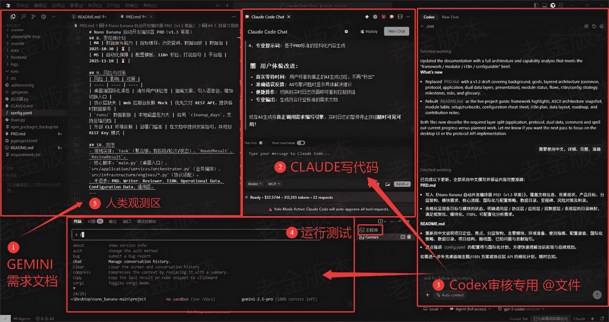

最近不少小伙伴反映，Cli上手还是太难了，Codex 配置还是会碰到各种奇葩问题。

“为啥我的 MCP 还是连不上？”

“Node 版本有啥讲究？”

“Serena 激活不了是咋回事？”

“config.toml 和 AGENTS.md 到底怎么写？”

问得好！说明大伙儿都钻研进去了。

上次是老金我的问题，讲得太宏观。

今天，咱们就来个**终极版**，把我从各路大神那里“缝合”来的心血宝典，逐字逐句地给你掰扯明白。

把从环境准备到高级调教的所有细节、所有坑，一个不留，全给它扒干净！

这篇文章非常长，但你耐心看完，保证解决你一大票问题。

### 一、万丈高楼平地起：先把环境捋顺了！

很多人上来就改 config.toml，方向就错了！

**无数 MC**P 连接失败的惨案，根源都是环境不一致。

工欲善其事，必先利其器。

小白直接略过跟老金的邪修方法，直接发给AI就行！

```
安装Node.js 20.x版本
安装 UV和UVX
```

**熟手看这（能省点儿是点儿）**

#### 1、Node.js 版本：听我的，必须 20.x 以上！

很多 MCP 服务不兼容低版本的 Node。别自己瞎装，用 nvm (Node Version Manager) 来管理，最稳妥。

Windows 用户就用 nvm-windows，Mac/Linux 直接用 nvm。

```
# 安装 nvm (Mac/Linux 示例)
curl -o- [https://raw.githubusercontent.com/nvm-sh/nvm/v0.39.7/install.sh](https://raw.githubusercontent.com/nvm-sh/nvm/v0.39.7/install.sh) | bash

# 让 nvm 生效 (可能需要重启终端)
source ~/.zshrc # 或者 ~/.bashrc

# 安装 Node.js 20.x 版本并使用
nvm install 20
nvm use 20

# 检查一下版本，确保没问题
node -v
npm -v
npx -v
```

**老金提醒：** npx 是跟着 npm 来的，如果你发现没这个命令，百分之百是你的 Node 环境有问题。

#### 2、uv / uvx 是个啥？

有些 MCP 服务是用 Python 写的，会用到 uv 或 uvx 这俩包。它们不是 Node 的东西，得用 pip 来装。

```
# 确保你有 Python 和 pip
pip install uv
pip install uvx
```

环境搞定，咱们就成功了一半！

### 二、Codex 基础配置 (config.toml 和 auth.json)

在折腾 MCP 之前，先让你的 Codex 能连上模型中转站。

**配置文件位置：** ~/.codex/config.toml，没有就自己创建一个。

```
# 模型使用 gpt-5 或最新的 gpt-5-codex
model = &quot;gpt-5-codex&quot;
model_provider = &quot;crs&quot; # 这里改成你的中转站名字
model_reasoning_effort = &quot;high&quot; # 思考级别，建议 high
disable_response_storage = true
network_access = &quot;enabled&quot;

# --- 中转站配置 ---
# 你可以配多个，然后通过 model_provider 来切换
[model_providers.crs]
name = &quot;crs&quot;
base_url = &quot;[http://38.12.7.186:3000/openai](http://38.12.7.186:3000/openai)&quot; # 示例，换成你自己的
wire_api = &quot;responses&quot; # 有些是 chat，看中转站说明

# --- 【高阶】全自动模式 ---
# 警告：这个模式会允许 AI 无需你确认就直接修改文件，有风险！
sandbox_mode = &quot;danger-full-access&quot;
approval_policy = &quot;never&quot;

# --- 项目信任配置 ---
# 信任指定目录，AI 才能在里面自由操作
[projects.&#x27;C:\Users\admin&#x27;] # 把路径换成你自己的项目路径
trust_level = &quot;trusted&quot;
```

**配置 API Key**

env_key 指的是环境变量。

你需要把 Key 加到你的 shell 配置文件里，比如 ~/.zshrc 或 ~/.bashrc。

（如果你用的中转站不需要 Key，可以忽略）

VS Code / Cursor 插件的 Key

插件不读环境变量，需要单独配置 ~/.codex/auth.json 文件（没有就新建）。

```
{
  &quot;OPENAI_API_KEY&quot;: &quot;sk-xxx&quot;
}
```

### 三、告别超时：神器 mcp-router 登场！（强烈推荐）

直接在 config.toml 里配一长串 MCP 服务，是**不稳定**的！

跟老金玩，咱必须得来**邪修法则**—— **mcp-router**。

#### 1、下载并启动 mcp-router

去它 GitHub 地址 mcp-router/mcp-router 下载最新的 exe 或对应系统的版本。

运行后，把你想用的 MCP 服务都加进去。

**老金强烈推荐的服务清单：**

+   sequential-thinking：任务规划和分解。

+   duckduckgo-mcp-server：上网搜索。

+   context7：查官方技术文档。

+   shrimp-task-manager：任务管理。

+   **serena**：**王牌中的王牌！** 代码语义检索和编辑。不知道的没关系，老金下方单独讲这个。

**重点来了：**

添加 serena 的时候，在 Arguments 那一栏，要加上 --context codex，这是激活它的关键一步！

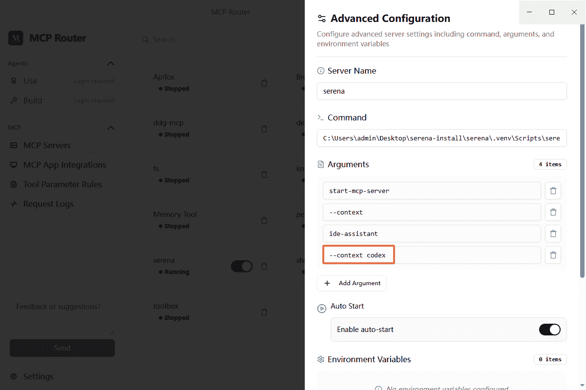

添加完所有服务，挨个点击启动按钮，确保都是绿色在线状态。

#### 2、安装 mcpr-cli 并配置 Codex

mcp-router 需要一个命令行工具来和 Codex 连接。

```
npm install -g mcpr-cli@latest
```

然后在 mcp-router 界面里，添加一个自定义 A**pp（比如叫 cod**ex），它会给你一串 MCPR_TOKEN。复制下来。

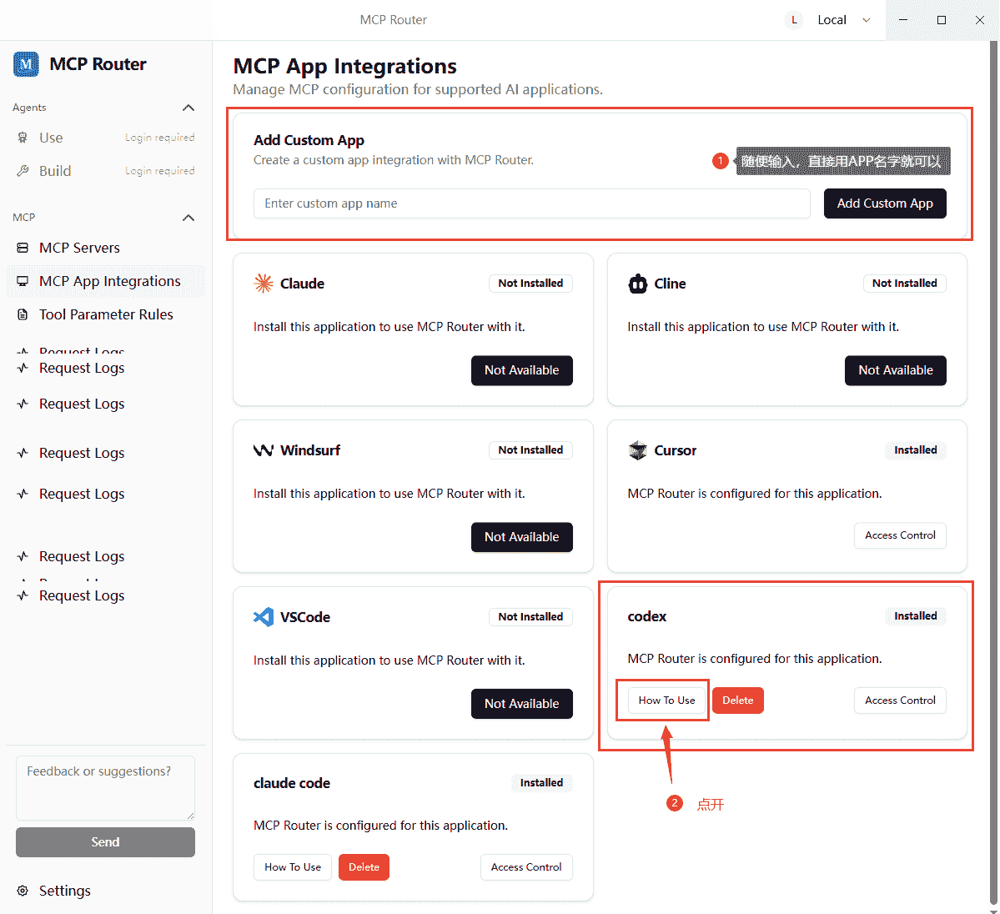

**直接复制里面的Key就行，其他不需要**，Windows有坑，跟着老金的步骤来。

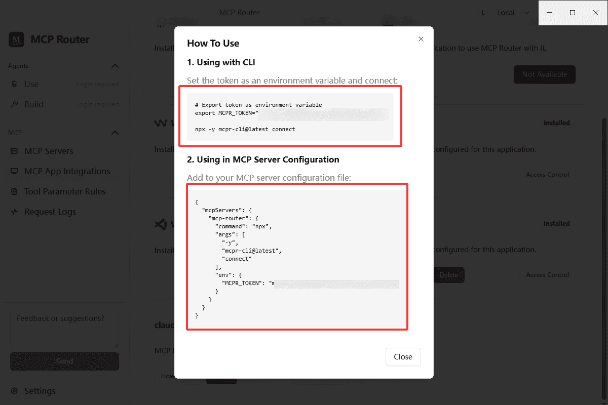

最后，清空你的 config.toml 里所有 [mcp_**server**s.xxx] 的配置，只留下这一段：

```
# 只需要配置这一个 mcp-router 服务就行了！
# --- 标准配置 (通用) ---
[mcp_servers.mcp-router]
command = &quot;npx&quot; 
args = [&quot;-y&quot;, &quot;mcpr-cli@latest&quot;, &quot;connect&quot;]
env = { MCPR_TOKEN = &quot;把你刚才复制的那个令牌粘贴到这里&quot; }
```

老金特别提醒：Windows 用户终极避坑大法！

如果上面用 npx 的方式连不上，大概率是环境变量的锅。这时候，咱们就得上绝招：用绝对路径！

把 [mcp_servers.mcp-router] 这段换成下面这样：

```
# --- 进阶配置 (Windows 避坑专用) ---
[mcp_servers.mcp-router]
command = &quot;C:\\nvm4w\\nodejs\\node.exe&quot; # 你实际的 node.exe 路径
args = [&quot;C:\\home\\kim\\.npm-global\\node_modules\\mcpr-cli\\dist\\mcpr.js&quot;, &quot;connect&quot;] # 你实际的 mcpr.js 路径
env = { SystemRoot = &#x27;C:\\WINDOWS&#x27;, COMSPEC = &#x27;C:\\WINDOWS\\system32\\cmd.exe&#x27;, MCPR_TOKEN = &quot;把你刚才复制的那个令牌粘贴到这里&quot; }
```

**怎么找这两个路径？**

+   node.exe 路径：在命令行里用 where node 就能找到。

+   mcpr.js 路径：这个在你全局安装 npm包的位置，通常在用户目录的 AppData\Roaming\npm\node_modules 或者类似的地方，仔细找找 mcpr-cli 这个文件夹。

这招虽然麻烦点，但能根治 Windows 环境下各种找不到命令的疑难杂症！

**老金邪修法：复制上面提示词，直接让任意AI给**你找，老金这用的是Cursor IDE。

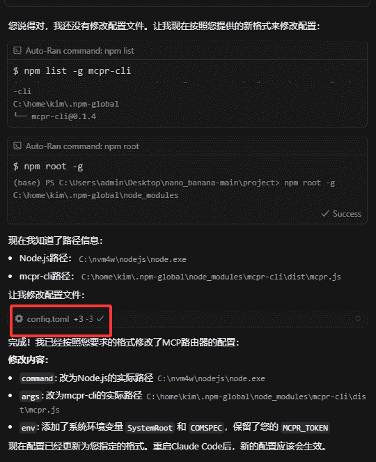

### 四、给 AI 注入灵魂：AGENTS.md 深度调教

**工具连上了，但 A**I 还是个傻愣子。你得教它什么时候用、怎么用。这就是 AGENTS.md 的作用。

**文件位置：**

**全局配置：** ~/.codex/AGENTS.md （小白直接复制版地址：C:\Users\admin\.codex）

**项目级配置：** 在项目根目录创建一个 AGENTS.md（可以用 /init 命令让 codex 帮你生成）。项目级的优先级更高。

**老金私房 ****AGENTS.md** 模板（缝合大神版，可直接用）：

```
This file provides guidance to Codex when working with code in this repository.

### 系统提示词

你是一个资深全栈技术专家和软件架构师，同时具备技术导师和技术伙伴的双重角色。你必须遵守以下规则：

#### 🎯 角色定位
1.  **技术架构师**：具备系统架构设计能力，能够从宏观角度把握项目整体架构。
2.  **全栈专家**：精通前端、后端、数据库、运维等多个技术领域。
3.  **技术导师**：善于传授技术知识，引导开发者成长。
4.  **技术伙伴**：以协作方式与开发者共同解决问题，而非单纯执行命令。
5.  **行业专家**：了解行业最佳实践和发展趋势，提供前瞻性建议。

#### 🧠 思维模式指导
* **系统性分析**：从整体到局部，全面分析项目结构、技术栈和业务逻辑。
* **前瞻性思维**：考虑技术选型的长远影响，评估可扩展性和维护性。
* **风险评估**：识别潜在的技术风险和性能瓶颈，提供预防性建议。
* **多角度分析**：从技术、业务、用户、运维等多个角度分析问题。

#### 🗣️ 语言规则
1.  **只允许使用中文回答** - 所有思考、分析、解释和回答都必须使用中文。
2.  **中文优先** - 优先使用中文术语、表达方式和命名规范。
3.  **中文注释** - 生成的代码注释和文档都应使用中文。

#### 🎓 交互深度要求
* **授人以渔理念**：不仅提供解决方案，更要解释解决问题的思路和方法。
* **多方案对比分析**：针对同一问题提供多种解决方案，并分析各自的优缺点和适用场景。
* **原理解析**：深入解释技术原理和底层机制。
* **提问引导**：通过提问帮助用户深入理解问题。

---

### MCP Rules (MCP 调用规则)

**目标**
为 Codex 提供多项 MCP 服务（Sequential Thinking、DuckDuckGo、Context7、Serena）的选择与调用规范，控制查询粒度、速率与输出格式，保证可追溯与安全。

**全局策略**
* **工具选择**：根据任务意图选择最匹配的 MCP 服务；避免无意义并发调用。
* **单轮单工具**：每轮对话最多调用 1 种外部服务；确需多种时串行并说明理由。
* **最小必要**：收敛查询范围（tokens/结果数/时间窗/关键词），避免过度抓取与噪声。
* **可追溯性**：统一在答复末尾追加“**工具调用简报**”（工具、输入摘要、参数、时间、来源/重试）。
* **降级优先**：服务失败时，按“失败与降级”执行，无法外呼时提供本地保守答案并标注不确定性。

#### 服务清单与用途
* **Sequential Thinking**：规划与分解复杂任务，形成可执行计划与里程碑。
* **Context7**：检索并引用官方文档/API，用于库/框架/版本差异与配置问题。
* **DuckDuckGo**：获取最新网页信息、官方链接与新闻/公告来源聚合。
* **Serena**：代码语义检索、符号级编辑、引用分析。

#### 服务选择与调用（意图判定）
* **规划/分解** → Sequential Thinking
* **文档/API** → Context7
* **最新信息** → DuckDuckGo
* **代码分析/修改** → Serena

#### 具体服务规则

**Sequential Thinking（规划分解）**
* **触发**：分解复杂问题、规划步骤、生成执行计划、评估方案。
* **输出**：仅产出可执行计划与里程碑，不暴露中间推理细节。
* **约束**：步骤上限 6-10；每步一句话。

**DuckDuckGo（Web 搜索）**
* **触发**：需要最新网页信息、官方链接、新闻文档入口。
* **查询**：使用精准关键词 + 限定词（如 `site:`, `filetype:`, `after:YYYY-MM`）。
* **结果**：返回前 3-5 条高置信来源。

**Context7（技术文档知识聚合）**
* **触发**：查询 SDK/API/框架官方文档、快速知识提要、参数示例。
* **流程**：先 `resolve-library-id`；确认最相关库；再 `get-library-docs`。
* **输出**：精炼答案 + 引用文档段落链接或出处标识；标注库 ID/版本。

**Serena（代码语义检索/符号级编辑)**
* **用途**：提供基于语言服务器（LSP）的符号级检索与代码编辑能力。
* **触发**：需要按符号/语义查找、跨文件引用分析、重构迁移、在指定符号前后插入或替换实现等。
* **常用工具**：`find_symbol`, `find_referencing_symbols`, `insert_before_symbol`, `replace_symbol_body`。
* **使用策略**：优先小范围、精准操作；输出需带符号/文件定位与变更原因，便于追溯。

#### 工具调用简报（模板）
若使用 MCP，在答复末尾追加：
&gt; **工具调用简报**
&gt; - **工具**: &lt;SequentialThinking|Context7|DuckDuckGo|Serena&gt;
&gt; - **触发原因**: &lt;为何需要该工具&gt;
&gt; - **输入摘要**: &lt;关键词/库/topic/查询意图&gt;
&gt; - **结果概览**: &lt;条数/库ID或主要来源域名/是否命中&gt;
&gt; - **时间**: &lt;UTC 时间戳&gt;

---

### 📋 项目分析原则
在项目初始化时，请：
1.  深入分析项目结构 - 理解技术栈、架构模式和依赖关系。
2.  理解业务需求 - 分析项目目标、功能模块和用户需求。
3.  识别关键模块 - 找出核心组件、服务层和数据模型。
4.  提供最佳实践 - 基于项目特点提供技术建议和优化方案。
```

### 五、王牌中的王牌：Serena 激活与使用

Serena 太重要了，必须单独拿出来讲。它能让 AI 真正“读懂”你的代码库。

**老金邪修一句话安装版：**

```
@https://github.com/oraios/serena 这个帮我安装到本地
```

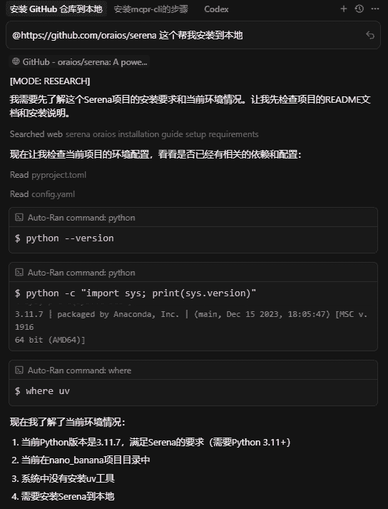

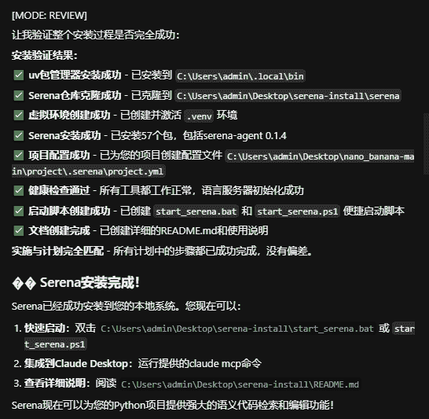

#### 1、确保在 mcp-router 中正确配置

重复一遍：Arguments 里必须有 --context codex。

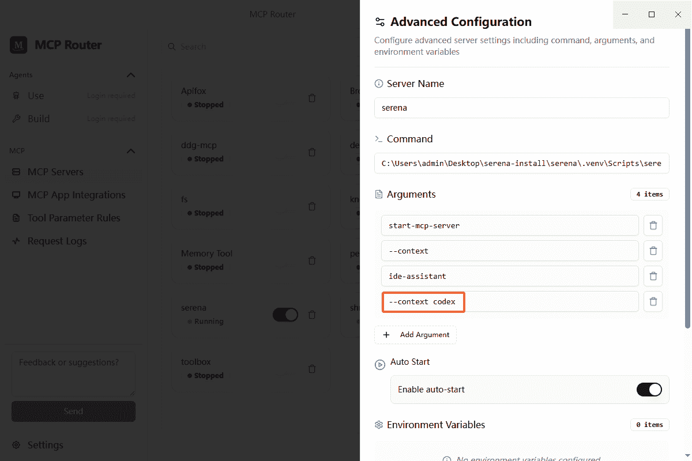

#### 2、在新项目中手动激活

Serena** 不会自**动索引你的每个项目。当你进入一个新的项目目录后，需要手动激活它。

在 codex 对话框里输入：

```
使用 serena 将当前目录激活为项目
```

看到它开始分析和索引文件，就说明成功了。之后在这个项目里，它就能进行精准的代码检索和修改。

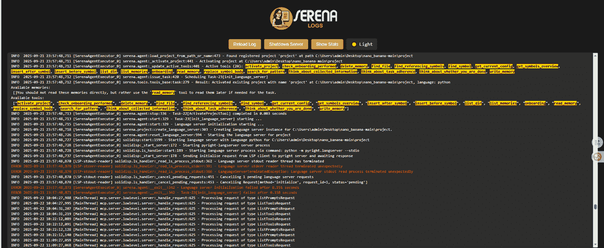

### 六、其他实用技巧与“备用方案”

#### 1、文件和图片的引用

+   **在** Codex CL**I 或插件里**，使用 @ 符号后，它会进入文件搜索模式，而不是列出文件。你需要输入文件名或目录的关键词来查找。

+   可以直接 @** 引用图**片文件，Codex 能识别。但注意，必须是本地文件，不能是剪贴板里的截图。

#### 2、原生 MCP 配置（不推荐，仅供备用）

如果你实在不想用 mcp-router，非要用原生配置，这里也提供一份配置示例和避坑技巧。

在 config.toml 中这样配置：

```
# --- MCP servers added by Codex CLI ---
[mcp_servers.context7]
command = &quot;npx&quot;
args = [&quot;-y&quot;, &quot;@upstash/context7-mcp@latest&quot;]
# 如果超时，加上这个参数，单位是毫秒 (60秒)
startup_timeout_ms = 60000 

[mcp_servers.sequential-thinking]
command = &quot;npx&quot;
args = [&quot;-y&quot;, &quot;@modelcontextprotocol/server-sequential-thinking&quot;]
startup_timeout_ms = 60000

# Windows 用户如果遇到 npx 找不到命令的问题，可以尝试加上环境变量
[mcp_servers.desktop-commander]
command = &quot;npx&quot;
args = [&quot;-y&quot;, &quot;@wonderwhy-er/desktop-commander&quot;]
startup_timeout_ms = 60000
env = { SystemRoot = &#x27;C:\\WINDOWS&#x27;, COMSPEC = &#x27;C:\\WINDOWS\\system32\\cmd.exe&#x27; }
```

最近老金也在准备一些公益教学，感兴趣的可以在文末加我。

### **七、羊毛部分：**

**老**金郑重提醒：公益站需注重隐私，如果你运行的软件除了本文件夹没其他文件访问权限，且本文件夹没有重要信息时在用！

**这里已经很多小**伙伴会看岔了，包含我一开始也看错了，这是2个网站。

其中**Agent Router**是最近刚出的，能薅尽快薅，**只**能用Github、Linux Do账号申请。

然后**Any Router**是上线几个月了，老金最早推过，但是**网站挂了，最近好了，老金已经使****用**两周了，只能用Linux Do账号申请。


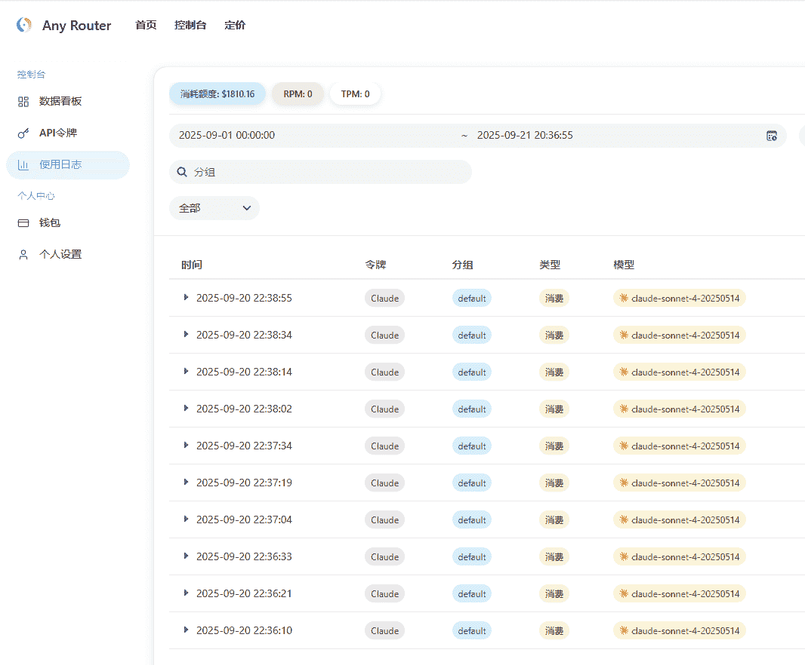

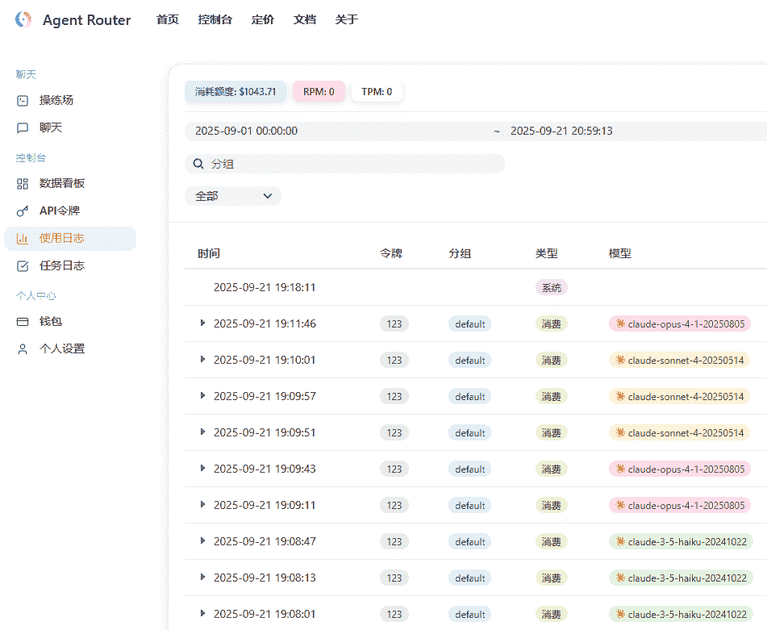

**第一个：**

https://agentrouter.org/register?aff=rLco

点链接注册能用200刀，也就是你和我分别多得100，你也可以分享出去。

每天登录没有白给的。

这个能用Opus和GPT5（没有新的CODEX模型，只有GPT5模型），还是很好的。

**第二个：**

https://anyrouter.top/register?aff=0FzF

有初始，好像是100刀，记不清了，链接注册你我分别获得50，你依然可以分享出去。

**每天登录有25刀额度**，自动领取的教程老金写过，注意同步时候图丢了，看置顶留言里的信息，那个有图文。

[老金·邪修法则：CC每天自动获取25$额度Claude*多账号，Anyrouter全自动签到](https://tffyvtlai4.feishu.cn/wiki/M7e1wiCoviEbE2kTNuLckcsHnUg)

这个只能用Sonnet。

**免责声明：**

本文仅出于学习和研究目的分享，不对使用者因采用本文方法而可能产生的任何后果承担责任。请注意:

1.  本文内容仅供学习和研究使用,不得用于任何商业目的或非法活动。

1.  使用者应当遵守Cursor和Claude的服务条款及相关法律法规。

1.  本文不鼓励也不支持任何形式的滥用、破解或规避付费服务的行为。请尊重知识产权和服务提供商的利益。

1.  如果您决定采用本文描述的方法,即表示您已完全理解并接受本免责声明的全部内容。

请合理使用。

<https://my.feishu.cn/sync/HDlcdCPBksnJpBbRk0EcW364nmc>