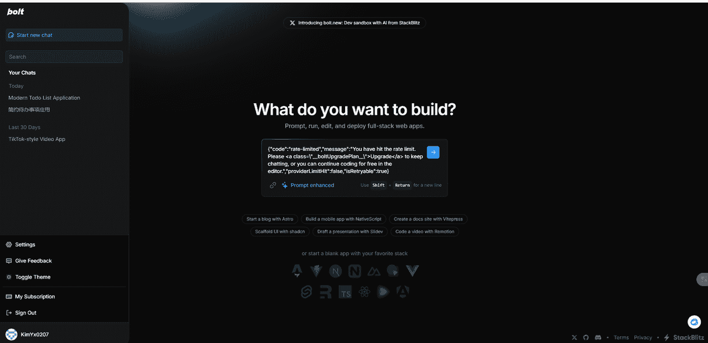
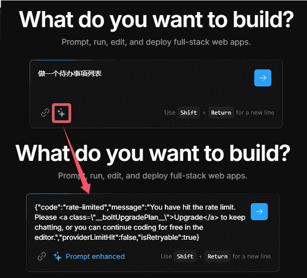
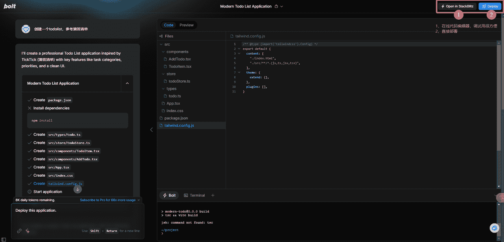
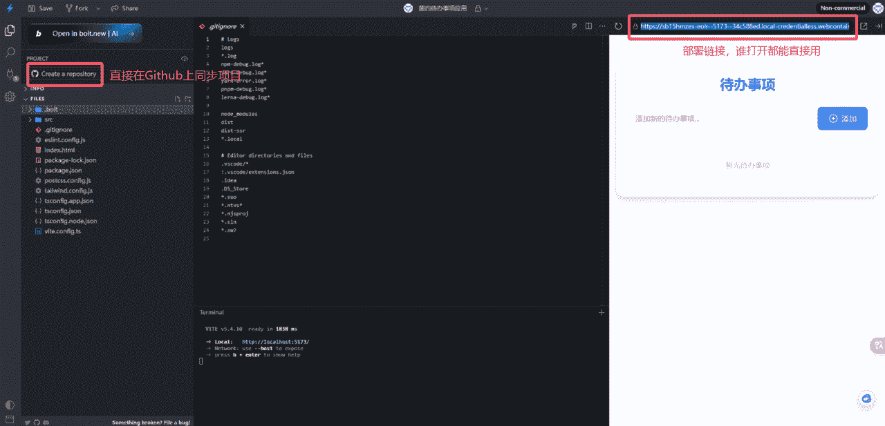
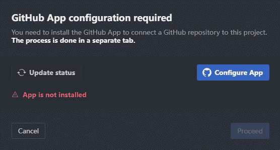
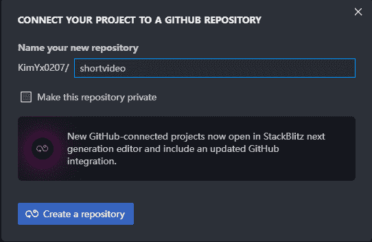
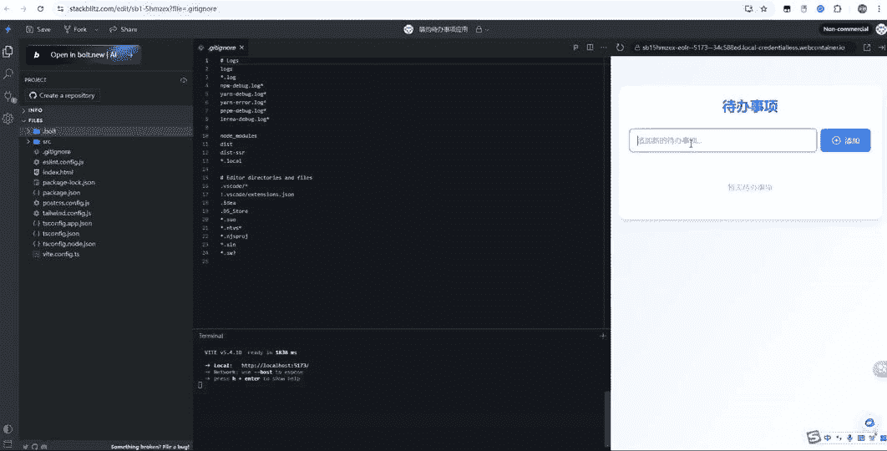
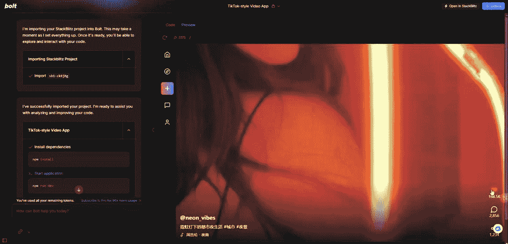

# Bolt.new：AI全栈Web开发工具，0代码基础5分钟从0到上线新网站

> 来源：[https://my.feishu.cn/docx/OfFDd3B7Bozt7Lx9H3EcnUTfnuf](https://my.feishu.cn/docx/OfFDd3B7Bozt7Lx9H3EcnUTfnuf)

###   **引   言   **

大家好，我是老金，一个对新科技充满热情的产品汪。虽然我不懂代码，但这并不妨碍我探索 AI 世界的奥秘。

最近，科技圈被一个名为 **Bolt.new** 的工具刷屏了。作为一个不懂编程的产品设计师，我对这种能让我“零代码”实现想法的神器简直爱不释手。今天，我就来和大家分享一下我使用 Bolt.new 的真实体验，以及它是如何改变我的工作方式的。

先说重点：目前免费！目前免费！目前免费！

**在 Bolt**.new 出现之前，大家对 Cursor 这款 AI 编程助手赞誉有加。但是，对于像我这样不懂代码的人来说，Cursor 的使用门槛还是有点高：

+   **需要下载安装软件**：对于电脑小白来说，下载和安装各种软件就是一种折磨。

+   **依赖 VS Code**：还要额外安装和配置 VS Code，步骤繁琐。

+   **模块缺失需手动安装**：遇到缺少的模块，还得自己搜索解决方案。

+   **手动部署代码**：代码写好了，还要研究如何部署上线，真是让人头大。

###  Bolt.new：为非程序员量身打造的 AI 工具

那么，Bolt.new 到底有多神奇呢？简单来说，它就是一款基于浏览器的 AI 全栈开发工具。你无需下载任何软件，打开浏览器就能开始创作。而且，它还能一键部署，让你的项目瞬间上线。

1.  **零安装，开箱即用**：只需访问 [Bolt.new 官网](https://bolt.new/)，登录后即可开始使用，无需任何安装。

1.  **对话式开发**：通过输入自然语言描述需求，Bolt.new 会自动生成代码。对于不懂编程的人来说，这简直就是福音。

1.  **一键部署**：完成项目后，点击“Deploy”按钮，即可将项目部署到线上，生成可访问的链接。

1.  **自动同步 GitHub**：支持使用 GitHub 账号登录，代码自动同步到你的仓库，方便管理和分享。

作为一名产品设计师，我经常需要向团队展示概念和想法。以前，我只能画原型图或者写文档，但现在有了 Bolt.new，我可以快速创建一个真实的 Demo。

直接打开官网进入首页如下，左侧有伸缩栏，鼠标划过去就出现了。

中间直接输入提示词，并利用强化提示词进行强化，还可以增加附件，如图片等等。

然后会进入代码页面，它就会噼里啪啦开始写了，速度非常快。

右上角2个按钮分别是进入s**tackb**litz在线代码编辑和快速部署。

stackblitz在线代码编辑预览界面

创建GitHub项目时，会弹出账号关联，直接选Configure App。

关联成功后，再次点击Create a reposotory（创建存储库），在弹出来的窗口中，直接修改仓库名字提交创建就同步到Github中了。

###    **老金的实测案例   **

案例一：创建一个简单的待办事项应用

我在 Bolt.new 的输入框中输入了以下需求：

> "创建一个简洁的待办事项应用，用户可以添加、查看和删除待办事项。界面风格简约，使用蓝白配色。"

几秒钟后，Bolt.new 自动生成了一个完整的应用，包括前端界面和后台逻辑。更让我惊喜的是，它还自动帮我部署到了线上，我只需将链接分享给团队成员，他们就能直接体验我的想法。

[待办事项.mp4](https://internal-api-drive-stream.feishu.cn/space/api/box/stream/download/all/Bajyb1jsKoE0kixMtxocO5b1neg)

**案例二：设计产品展示页面**

我想做一个短视频APP，因此输入了以下描述：

> "创建一个类似抖音的产品，可以浏览短视频。"

Bolt.new 立刻生成了一个精美的网页，所有元素都符合我的要求，我可以直接在浏览器中预览效果。

[短视频应用.mp4](https://internal-api-drive-stream.feishu.cn/space/api/box/stream/download/all/FSJSbP047oi8cJxYZMXc4E31nGf)

###    **功 能 详 解   **

+   **支持多种框架和库**：Bolt.new 内置了丰富的前端框架支持，如 React、Vue、Angular 等，你可以在提示词中指定使用哪种技术。

+   **AI 环境控制**：得益于强大的 AI 模型，Bolt.new 能够理解复杂的需求，并将其转化为代码，实现从前端到后端的全栈开发。

+   **实时预览**：在开发过程中，你可以随时预览项目效果，所见即所得。

###    **使 用 技 巧   **

1.  **明确需求**：在输入提示词时，尽可能详细地描述你的需求，包括功能、风格、技术栈等信息。

1.  **逐步细化**：如果初始生成的项目不完全符合预期，可以继续与 AI 交互，提出修改意见，逐步完善。

1.  **善用示例**：在提示词中加入参考示例或链接，帮助 AI 更好地理解你的想法。

###  为什么 Bolt.new 更适合非程序员？

+   **降低技术门槛**：无需掌握任何编程知识，只要会描述需求，就能生成应用。

+   **节省时间成本**：从想法到成品，只需几分钟时间，大大提升了工作效率。

+   **免费使用**：目前 Bolt.new 仍处于测试阶段，所有功能都可以免费体验，真的是业界良心。（每日限量Token）

###    **结 语   **

Bolt.new 的出现，意味着 AI 在软件开发领域的应用又迈进了一大步。对于像我这样的非技术人员，它为我们打开了新的大门，让创意得以快速实现。我相信，随着 AI 技术的不断发展，未来会有更多像 Bolt.new 这样的工具，助力我们实现更多可能性。

Bol**t.new相比于Curs**or，最大的优势是集成了先进的 AI 模型和 StackBlitz 的 WebContainers 技术，支持安装和运行 npm 工具和库、运行 Node.js 服务器、与第三方 API 交互、从聊天部署到生产环境等，并且可以打通预览、部署一系列链路（这是类似v0的优势）。

但是，目前的实现还**比较粗糙**，并没有Cursor在代码提示、文件相关度、项目indexing等等各方面的优化。

如果你和老金一样，对新科技充满好奇，又苦于缺乏技术能力，那么强烈推荐你试试 Bolt.new。

或许，下一个爆款应用，就出自你的手中！

<https://my.feishu.cn/sync/HDlcdCPBksnJpBbRk0EcW364nmc>