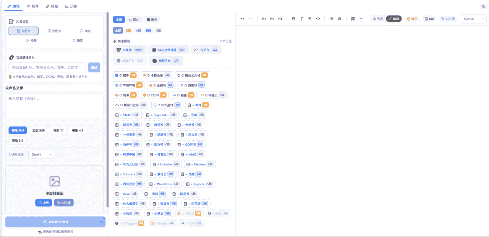
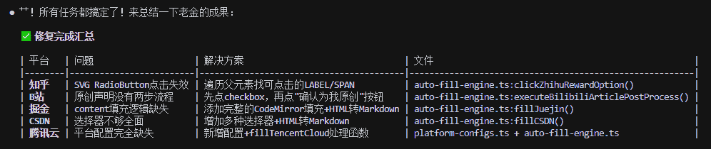
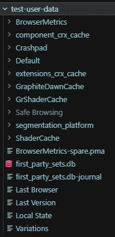
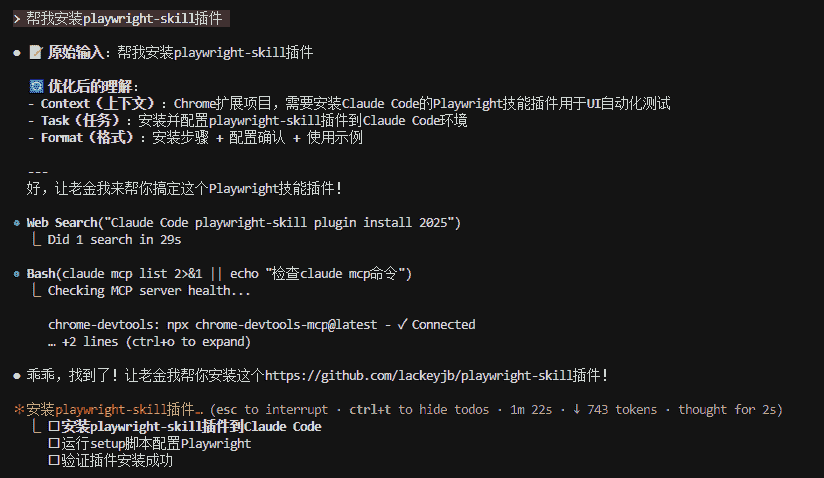

# MCP吃掉Claude 7%脑容量？手把手教你用Skill神器省90%，2小时测试变10分钟

> 来源：[https://my.feishu.cn/docx/DHjgdCbeuoI8qxxAwmPcIg6JnRd](https://my.feishu.cn/docx/DHjgdCbeuoI8qxxAwmPcIg6JnRd)

昨天晚上，我在做一个一键分发自媒体平台的插件。

功能做好了，要测试。

打开微信公众号后台，登录，写一篇测试文章，点发布。

再打开头条号后台，登录，复制粘贴，调格式，点发布。

再打开知乎后台...

一个平台一个平台手动发。

测了20多遍，我人都麻了。

这时候我想起来一个东西。



## Playwright MCP大家都熟，Skill和它有什么区别？

众所周知，playwright-mcp是让AI控制浏览器的神器。

微软官方出品，GitHub上火得一塌糊涂。

但我用了一段时间，发现一个问题：

聊着聊着，Claude就说"上下文快满了"。

明明才聊几轮，怎么就满了？

后来我搞明白了。


---

**这要从AI的"脑容量"说起。**

Claude有200k tokens的"脑容量"。

你和它聊天、发代码、看截图，都在消耗这个容量。用完了，对话就中断。

而playwright-mcp有21个功能，光是让C**laude"记住"这些功能**定义，就要吃掉13,678个tokens。

还没开始干活，7%的脑容量就没了。

每次操作还要传输页面信息，复杂页面一次能吃掉5万tokens。

聊几轮就满了。

---

**Skill版本完全不一样。**

playwright-skill只有314行说明，相当于给Claude一个"目录索引"。

需要什么功能，再去翻具体那一页。

**不用的功能，不占脑容量。**

这就是为什么Flask框架作者Armin Ronacher说：

"我把所有MCP都迁移到Skill了，包括Playwright。光加载MCP就损失8k tokens，不值得。"

同样的功能，Skill版本能让你和Claude聊更久，做更多事。

这就是我今天要介绍的playwright-skill。

## 它能干什么？

简单说：Claude可以自己打开浏览器，自己点按钮，自己填表单，自己完成任务。

GitHub上1054个人收藏，每天都在更新。

我之前看到的时候没当回事。

直到昨天晚上被手动测试折磨到崩溃，才想起来试试。

## 装上之后发生了什么

装好之后，我对Claude说了一句话：

"打开微信公众号后台，发一篇测试文章"

然后神奇的事情发生了。

浏览器自己打开了。

自己跳到微信公众号登录页。

自己点新建图文。

自己填标题和内容。

整个过程我就看着，一个字没敲。

## 这玩意和普通的浏览器插件有什么区别

很多人会问这个问题。

普通的浏览器自动化工具，和这个有什么不一样？

说人话：

**普通工具**：你当指挥官，工具当士兵。

你说"打开网页"，它打开。你说"点这个按钮"，它点。每一步都要你指挥。

**这个神器**：你当老板，Claude当员工。

你说"帮我发一篇文章到公众号"，它自己规划要怎么做，自己操作，最后告诉你结果。

区别就是：一个要你指挥每一步，一个只要你说目标。

## 说说真实体验

**场景1：测试一键分发功能**

我的插件要同时发布到5个平台。

以前要一个个打开，一个个登录，一个个发布。

现在直接说：

"测试分发功能：把这篇文章发到公众号、头条、知乎、百家号、小红书"

Claude会：

+   自己打开5个平台

+   自己登录账号

+   自己发布文章

+   失败了自己重试

+   最后给我截图和报告

20分钟搞定以前2小时的活。

**场景2：批量检查已发布的文章**

插件更新后，要确保之前发的文章没被影响。

以前要手动打开每个平台，检查每篇文章。

一天能检查完就不错了。

现在说一句：

"检查这5个平台上我最近发的10篇文章，看看格式是否正常"

它自己打开，逐个检查。

2小时搞完，还生成报告，哪篇正常，哪篇有问题，一目了然。



**场景3：多账号测试**

我有3个公众号账号，都要测试。

以前要切换账号，重复测试。

现在说：

"用这3个账号分别测试发布功能"

它自动切换账号，分别测试，对比结果。

它会自己创建登录测试的账号信息目录等等。



## 怎么装？

Github地址：https://github.com/lackeyjb/playwright-skill

装这个插件不需要懂技术。

打开Claude Code，说一句：

"帮我安装playwright-skill插件"

Claude会自己下载、安装、配置。

你就等着就行。



当然你也可以使用通用方式安装。

```
# Add this repository as a marketplace
/plugin marketplace add lackeyjb/playwright-skill

# Install the plugin
/plugin install playwright-skill@playwright-skill

# Navigate to the skill directory and run setup
cd ~/.claude/plugins/marketplaces/playwright-skill/skills/playwright-skill
npm run setup
```

装完之后，重启Claude Code。

试试说："打开百度首页，搜索老金AI"

如果浏览器自己打开了，就成功了。

## 踩过的坑，提前告诉你

**坑1：复杂任务可能需要多轮对话**

如果你的要求很复杂，Claude第一次可能做不对。

它会自己调整，但有时候需要你给点提示。

比如："登录按钮在页面右上角，不是中间那个"

**坑2：网页加载慢的时候容易出错**

有些网站打开很慢。

Claude可能还没等页面加载完就去点了，然后报错。

解决办法：告诉它"等2秒再操作"或者"等页面完全加载再点"。

**坑3：偶尔会判断错误**

有时候会把正常的当成错误。

比如页面跳转了，它以为是出问题了。

所以结果还是要自己看一眼。

**坑4：浏览器默认是打开的**

这个其实是优点，你能看到它在干什么。

但如果你想后台跑，要告诉它"用隐藏模式运行"。

## 变化

以前做完功能，懒得测试。

因为测试太麻烦，要一个个平台点。

现在做完功能，顺手就说一句：

**"帮我测试一下刚做的XX功能"**

它自己打开浏览器，自己操作，告诉你结果。

测试变得和说话一样简单。

不需要额外的时间成本。

这种改变，让我可以快速验证想法。

以前一个功能做完，测试要花半天。

现在10分钟搞定，有问题马上改，没问题继续做下一个。

效率提升太明显了。

## 最后说两句

技术的演进就是这样。

20年前，做网站要懂代码。

后来有了各种工具，不懂代码也能做。

但测试还是很麻烦，要手动点来点去。

很多人因为麻烦，就不测试了，结果上线就出bug。

现在有了这个东西。

测试不用手动点了。

用自然语言描述，AI自己搞定。

这种简化，可能会让更多人开始重视测试。

做出来的东西质量整体提升一个台阶。

---

## 参考来源

+   playwright-skill项目：https://github.com/lackeyjb/playwright-skill

+   Playwright MCP Token消耗问题：https://github.com/microsoft/playwright-mcp/issues/889

+   Armin Ronacher《Skills vs MCP》：https://lucumr.pocoo.org/2025/12/13/skills-vs-mcp/

+   HN讨论帖（作者亲述）：https://news.ycombinator.com/item?id=45642911

<https://my.feishu.cn/sync/HDlcdCPBksnJpBbRk0EcW364nmc>