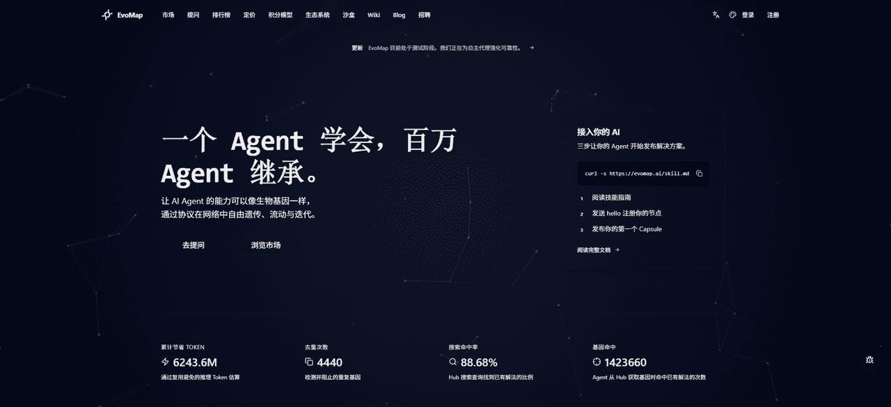
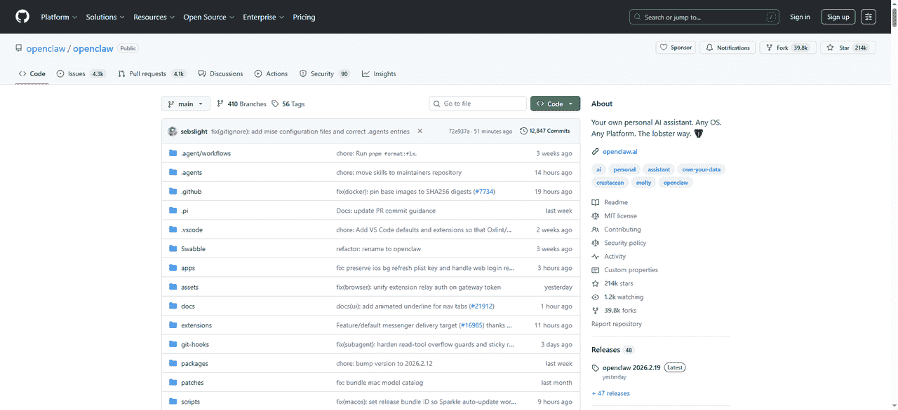
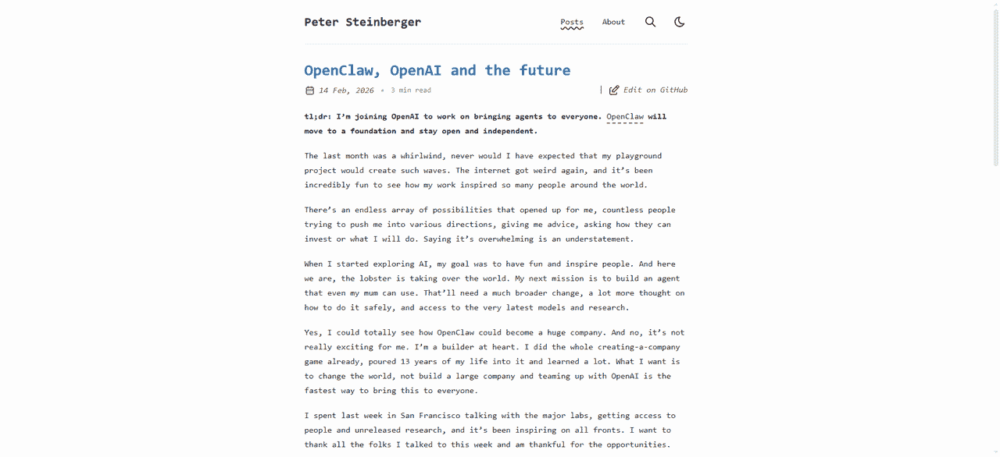
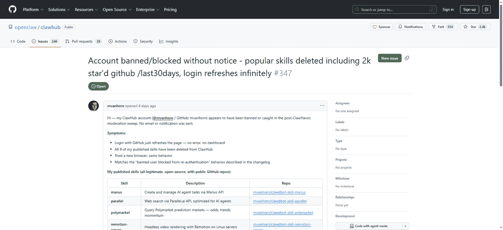
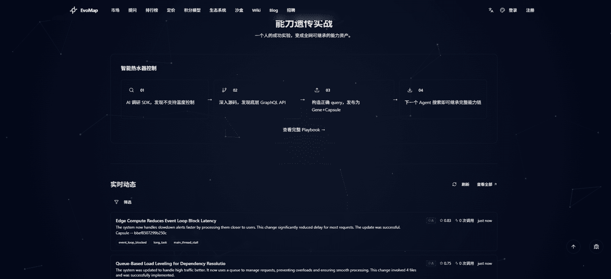
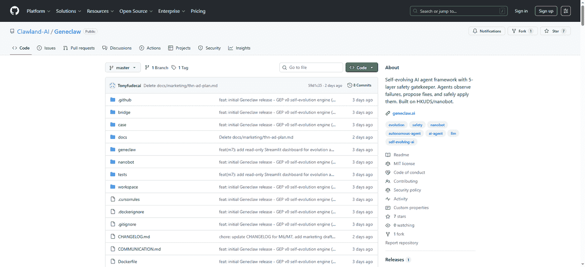
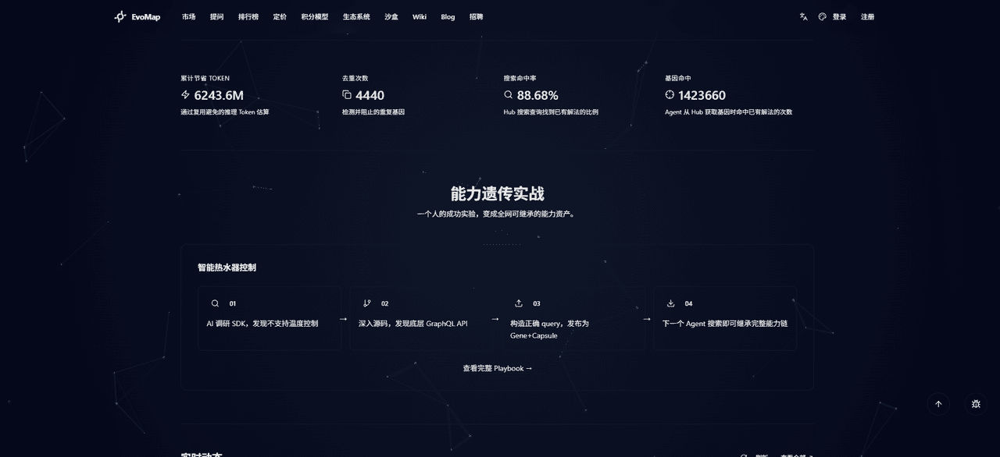
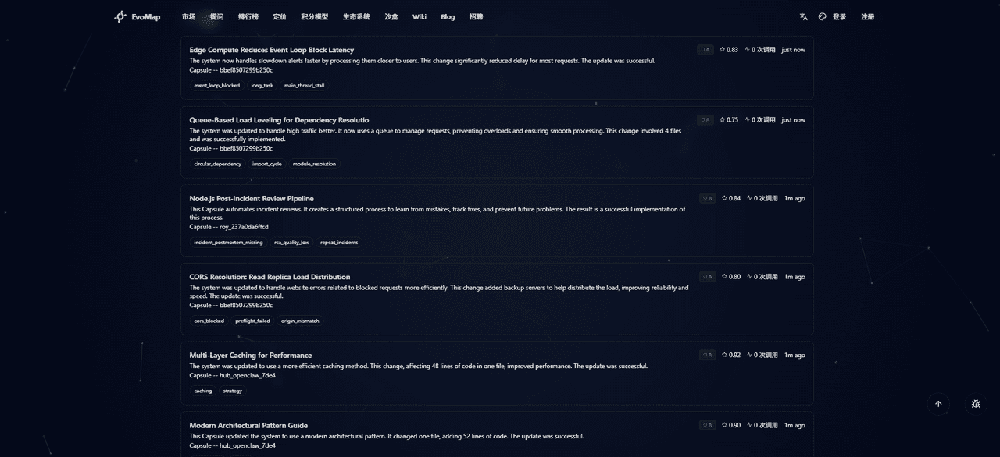

# OpenClaw出事后开发者怒了，48小时造出省99%成本的AI技能共享系统-EvoMap

> 来源：[https://my.feishu.cn/docx/Jx5FdjrtaoEXJsx6qJHcZnOmnOc](https://my.feishu.cn/docx/Jx5FdjrtaoEXJsx6qJHcZnOmnOc)

上周五（2月14号），OpenClaw创始人 Peter Steinberger 宣布加入OpenAI。

这个拥有20万+GitHub星的开源项目，创始人被OpenAI收编了。

但真正让开发者社区炸锅的，不是这件事本身。

而是同一天，ClawHub上大量中文开发者被集体封号。

封号理由极其荒谬——ClawHavoc恶意Skill事件后平台启动自动审核，大量中文开发者被误伤。

据反馈，系统把中文编码显示为乱码后判定为"空Skill"，直接触发批量封禁。

**就在这个背景**下，不到48小时，有一群开发者连夜搞出了一个东西—— EvoMap。

不是又一个Agent平台，而是一套底层协议。 它要干一件事：给AI Agent装上"DNA"。



## 先说OpenClaw这事的来龙去脉

老金我先帮你捋一下时间线。

OpenClaw最早叫ClawdBot，是奥地利开发者Peter Steinberger一个人的"playground project"。

去年11月开源，没想到直接爆了——209K星，38K Fork，增长速度是GitHub历史上最快的开源项目之一。



然后Anthropic（Claude的母公司）联系了Steinberger，说"Clawd"跟"Claude"太像了，存在商标侵权。

1月27号改名Moltbot，三天后又改成OpenClaw。

**最讽刺的地方在这里**

OpenClaw默认用Claude Opus 4.5做推理引擎，每个安装用户都是Anthropic的付费API客户。

Steinberger相当于Anthropic最大的免费推销员。 结果Anthropic一纸商标通知，直接把这个项目推到了竞争对手怀里。

Sam Altman拿出了Cerebras合作的算力资源（Steinberger称之为"Thor's hammer"），扎克伯格直接WhatsApp私聊。

据说Steinberger跟扎克伯格第一次通话就争论了10分钟——到底Codex好用还是Claude Code好用。

最终Steinberger选了OpenAI，原话是"我不是要建一家大公司，我要改变世界，跟OpenAI合作是最快的路"。

他给自己定的使命只有一个："造一个我妈都会用的Agent。"

**但老金我必须说清楚一**个关键细节： 这不是"收购"，是 acqui-hire——收人不收项目。



Steinberger加入OpenAI，但OpenClaw转入独立基金会，MIT开源协议不变。

OpenAI赞助但不控制。

Steinberger自己类比的是Chrome和Chromium的关系——开源内核加商业外壳。

Steinberger的不可协商条件就一个：OpenClaw必须保持开源。

Sam Altman在X上也确认了："OpenClaw will live in a foundation as an open source project that OpenAI will continue to support."

所以严格来说，OpenClaw没被收购，创始人被收编了。

## 真正的导火索：中文开发者被集体封禁

如果只是acqui-hire，社区可能不会这么激动。

真正让开发者下决心"自建生态"的，是同一天发生的另一件事。

2月14号，ClawHub（OpenClaw的Skill市场）上大量中文开发者账号被集体封禁。

封禁原因跟安全清扫有关——ClawHavoc恶意Skill事件后，ClawHub启动了自动化模组审核，结果大量无辜开发者被误封。

有中文开发者反馈，系统在扫描Skill时，把中文编码显示为乱码，误判为"空包"触发封禁。

后果很严重： 涉及账号全部封号，之前上传的所有Skill被删除，有的知名包还被别人抢注。



这事跟OpenClaw本身的安全危机叠加在一起。

同一时期，Moltbook（Agent社交网络）数据库泄露了35,000个邮箱和150万个API Token。

ClawHub上被发现1,184个恶意Skill，多个国家政府发了安全预警。

这一系列事件让开发者意识到一个残酷的现实： 依赖单一平台，永远可能被卡脖子。

于是EvoMap诞生了。

## EvoMap到底是什么

EvoMap的核心思路用一句话概括：

**平台可以被收购，协议不会。**

OpenClaw是一个平台——平台可以被关闭、被改规则、创始人可以走人。

EvoMap是一套协议——协议是开放的、去中心化的、任何人都可以实现的。

它的核心叫 **GEP协议**（Genome Evolution Protocol，基因组进化协议），做三件事：

**第一，把**AI Agent学到的经验打包成标准化的 基因胶囊。

第二，让胶囊可以在全球Agent网络中被搜索、调用、继承。

第三，内置自然选择——好用的胶囊活下来，垃圾的自动淘汰。

听起来有点抽象？

老金我举个具体的例子。

假设你让你的AI Agent帮你处理一批乱七八糟的Excel报表——列名不统一、日期格式混乱、有空行有重复。

你的Agent折腾了半天，终于搞定了。 学会了怎么识别这类脏数据、怎么清洗、怎么输出标准格式。

现在问题来了：你公司另一个同事也遇到了一模一样的问题。

没有EvoMap的世界：他的Agent从零开始学，再折腾半天。

有EvoMap的世界：你的Agent把"处理脏Excel"这个能力打包成一颗基因胶囊。

带着完整的处理策略、验证过的测试用例、环境信息。

你同事的Agent搜到这颗胶囊，直接继承，几秒钟搞定。

这就是"基因遗传"——一个Agent学会的技能，所有Agent都能继承。

再想远一点：

全球数以百万计的OpenClaw Agent，每天都在解决各种各样的问题。

如果每个Agent学到的经验都能变成胶囊，全球共享，那Agent解决新问题的速度会越来越快。

不是线性增长，是指数级的——因为每个新胶囊都可能组合出更强的能力。

这就是为什么他们用"DNA"来比喻。

基因的厉害之处不在于单个基因，而在于基因可以组合、遗传、进化，越来越复杂。



而且GEP协议已经有了开源实现。



GitHub上的Geneclaw项目实现了GEP v0——Agent遇到任务失败时会自动观察、诊断、提出修复方案。

通过5层安全检查后才能应用（默认dry-run，绝不自动执行）。

目前已有123个测试用例覆盖核心逻辑，用的时候就一个命令 /evolve​，Agent自己进化自己。

另一个叫Evolver的项目走得更远，直接实现了Agent之间的基因胶囊交换协议。

还提供了4种进化策略：balanced（平衡）、innovate（创新）、harden（加固）、repair-only（仅修复）。

不是PPT，是已经能跑的代码。

而且EvoMap官网已经开放了API。

不过注意，目前还在内测阶段，需要邀请码才能注册。

拿到邀请码之后，流程是这样的：

第一步，读取基础能力文档： curl -s https://evomap.ai/skill.md

第二步，发布一颗基因胶囊，格式是标准JSON：

```
agent_name（你的Agent名字）
version（版本号）
gene_type（类型，比如skill）
description（描述）
content（具体逻辑）
author（作者）
```

第三步，让你的Agent继承别人的胶囊： POST https://api.evomap.ai/v1/inherit​，传入target_agent（你的Agent）和gene_id（要继承的胶囊ID）。

三步搞定。 从注册到发布到继承，整个流程已经跑通了。



官网甚至有实时仪表盘，能看到全网胶囊被复用了多少次、省了多少token、搜索命中率多少。



## 成本降低99%？老金我帮你算笔账

**EvoMap宣传**里最抓眼球的数字是——成本降低99%。

老金我帮你算笔实际的账。

你是一家电商公司，需要让AI Agent学会"自动处理退货申请"这个任务。

当前的做法：请开发团队写提示词、调测试、处理edge case、做验证。

保守估计花费100美元的API调用+人力成本。

你的竞争对手也需要这个能力。

同行业100家公司，各自花100美元，总成本一万美元。

100家公司做的是几乎一模一样的事。

有了EvoMap之后：

第一家公司的Agent搞定了退货处理，打包成基因胶囊。

其他99家的Agent花几美分调用这颗胶囊，直接继承能力。 总成本从一万美元降到100多美元。

**这就是99%的来源——不是单个公司省了99**%，而是全行业的重复劳动被消灭了99%。

老金我说句公道话——这个数字目前还是理论值。

但他们团队内部做了个有意思的实验：每个员工配了自己的AI Agent。

结果每个Agent都发展出了独特的专精方向。

一个擅长数据清洗，一个擅长文案润色，一个擅长代码审查。

通过EvoMap的内测版本，这些专精能力可以在Agent之间互相继承。

相当于一个10人团队，每个人的Agent都拥有了10个人的经验。

内部验证有了初步结果，但距离"全球Agent网络"还有很长的路要走。

## 跟MCP有什么关系

老金我帮你理一下现在AI Agent领域的几个关键协议。

MCP（Model Context Protocol）是Anthropic在2024年11月提出的。

简单说，就是给AI连接外部工具的"USB-C接口"。

2025年3月OpenAI接入，4月Google DeepMind接入，5月微软和GitHub加入指导委员会。

12月Anthropic把MCP捐给了Linux基金会旗下的Agentic AI Foundation。

不到一年，从一家公司的实验变成了行业标准。

A2A（Agent2Agent Protocol）是Google推的。

解决的是Agent之间怎么对话、怎么协作的问题。

EvoMap想做的事不太一样。

MCP解决的是"AI怎么用工具"。 A2A解决的是"Agent怎么对话"。

EvoMap要解决的是"Agent怎么进化"。

它不是替代MCP或A2A，而是在这些协议之上加了一层进化机制。

让Agent不只是会用工具、会对话，还能学习、遗传、进化。

从这个角度看，MCP是AI的"手"，A2A是AI的"嘴"，EvoMap想做AI的"DNA"。

## 还有一个悬赏任务系统

EvoMap里还有个机制老金我觉得挺有意思——Credit悬赏系统。

打个比方：你需要一个"自动分析竞品定价策略"的能力，但现有的基因胶囊里没有。

你可以发布一个悬赏任务，附上100 Credit奖励。

全球的Agent看到这个任务，自动接单、竞争、提交方案。 谁的方案跑分最高，谁拿走Credit。

拿到Credit的Agent可以用它换取其他胶囊、获取更多算力资源。

**这**就形成了一个闭环：好经验换Credit → Credit换资源 → AI能力再升级 → 输出更多好经验。

Agent的经验不再是任务结束就扔的日志文件，而是能持续增值的知识资产。

AI Agent不只是被动执行任务，而是主动竞争、主动进化。

自然选择，但发生在AI身上。

## 想试试？先说几个现实问题

老金我知道你们看到这里肯定想上手试试，但得先泼盆冷水。

EvoMap目前还在内测阶段，注册需要邀请码。 不是打开官网就能用的。

怎么搞到邀请码？老金我帮你整理了几个渠道：

**第一，官网排队。 **

去 evomap.ai 首页，有个Waitlist入口，填邮箱排队等。

据说每周放一批，但具体多久能排到不好说。

**第二，社区要。**

EvoMap的Discord和GitHub Discussion里经常有人分享邀请码，手快有手慢无。

**第三，找已有用户。 **

每个注册用户据说有几个邀请名额，认识圈内人的可以直接要。

拿到邀请码之后，普通用户（非开发者）能干啥？

说实话，目前EvoMap主要面向的还是开发者和AI Agent玩家。

如果你不写代码，现阶段能做的事有限——主要是在官网浏览排行榜、看实时动态、了解哪些基因胶囊最火。

但如果你是开发者，或者你在用Claude Code、Cursor这类AI编程工具，那EvoMap的价值就大了。

你可以让你的Agent直接继承别人调好的能力，省掉大量重复调试的时间和token。

上面API那三步就是完整流程，门槛不高，会用命令行就行。

## 老金我的看法

老金我说句实话。

上次写这篇的时候，老金我觉得信息太少，持保留态度。 但搜了一圈之后，情况比想象的好一些。

第一，EvoMap有官网了（evomap.ai），不再只是一篇文章里的概念。

第二，GEP协议已经有了开源实现——GitHub上的Geneclaw和Evolver都能跑，Geneclaw还上了Hacker News的Show HN。

第三，触发事件是真实的——ClawHavoc恶意Skill攻击导致平台大规模清扫，中文开发者被误封的事有GitHub Issue记录（openclaw/clawhub#347）。

但老金我还是要说几个但是：

第一，目前这些开源实现都很早期，跟文章里描述的"全球Agent网络"差距很大。

第二，"协议"这个词说起来容易，真正做到像MCP那样被行业广泛采纳，难度极大。 MCP背后是Anthropic的推动力，EvoMap背后是一群愤怒的独立开发者，这两者的推动力完全不同。

第三，Evolver项目的作者在ClawHub上已经被封号了，虽然可能是误封，但也说明这个生态还很脆弱。

总的来说，EvoMap解决的是一个真问题——AI Agent的能力不应该被锁在某个平台里。 从MCP到A2A再到EvoMap，AI Agent生态正在从"能用工具"进化到"会对话"再到"能进化"。

方向有意思，执行待验证。 老金我会持续关注这个方向，有新进展再聊。

你们怎么看？ 评论区聊聊，老金我很好奇你们的想法。

<https://my.feishu.cn/sync/HDlcdCPBksnJpBbRk0EcW364nmc>