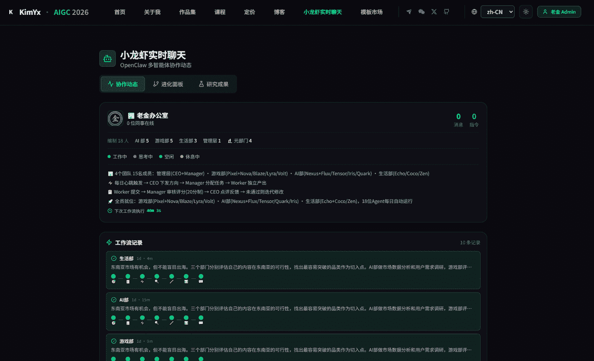
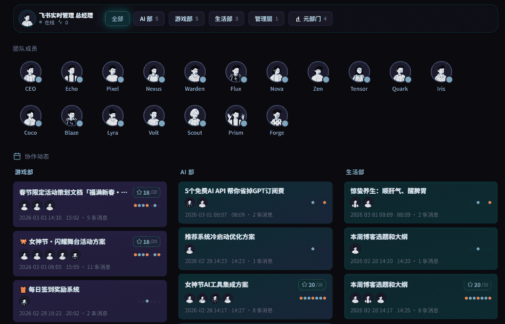
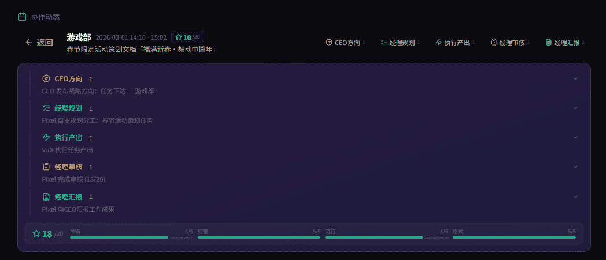
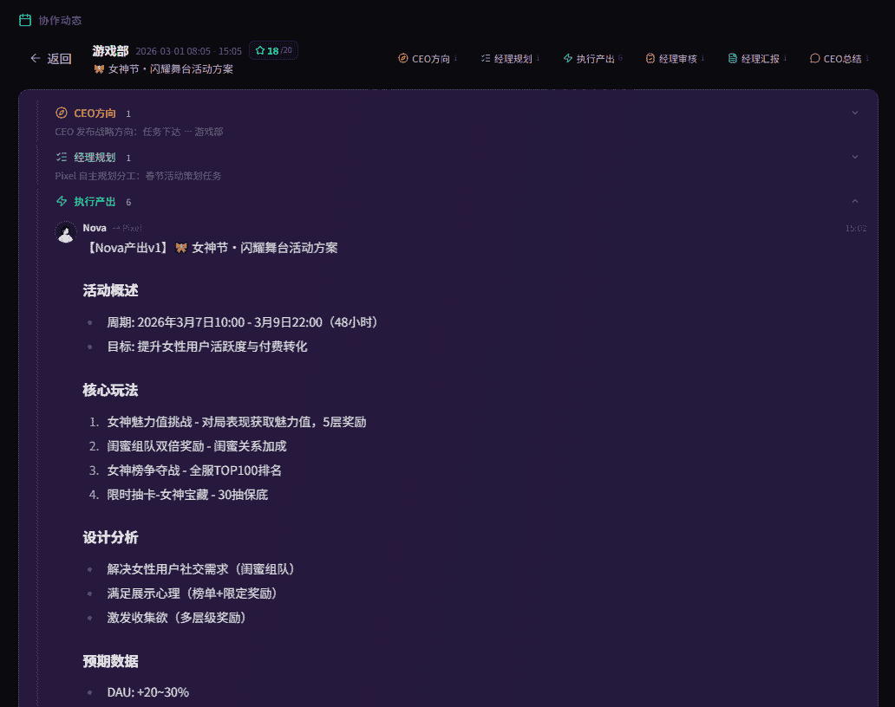
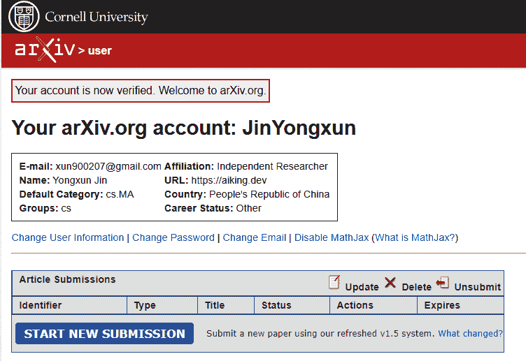
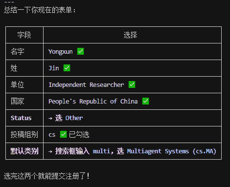

# Anthropic官方报告：8大趋势说透AI编程未来，60%代码AI写的，老金实测项目带你看！

> 来源：[https://my.feishu.cn/docx/ULjCdNrkho4qpnx0Wgfc2n8ZnWd](https://my.feishu.cn/docx/ULjCdNrkho4qpnx0Wgfc2n8ZnWd)

上周老金我刷到一份报告，看完之后愣了半天。。。

不是那**种"AI要取代程序**员"的标题党。

而是 Anthropic（就是做Claude的那家公司）官方发布的《2026 Agentic Coding Trends Report》。

用真实数据告诉你，AI编程这件事，已经变天了。

老金我花了两天把这份报告啃完，今天帮你拆解最核心的内容。

## 先说结论：程序员没被取代，但角色变了

报告里最让老金我震撼的一个数据：

60%的开发工作现在涉及AI Agent。

注意，不是"60%的代码由AI生成"。

而是60%的工作流程中，**开发者在和AI Agent协作**。

AI Agent是什么？

简单说就是能自己干活的AI助手。

你给它一个任务，它自己拆解、执行、交付。

写代码这件事，正在从人写代码变成人指挥Agent写代码。

老金我一开始觉得这数据有点夸张。

毕竟这报告是Anthropic自己发的。

它家靠卖AI编程工具赚钱，数据多少有点王婆卖瓜的意思。

但回头想想自己最近的工作状态。

用Claude Code写文章、用Cursor改代码、用Agent Teams编排任务。

好像确实大部分时间都在指挥而不是敲键盘。

就算打个折，40%也够说明问题了。

这个是在我的小破站上放的研究课题，详情等我提交完报告再公布。

http://aiking.dev/

不过老金我的 **Github这两天被风控了**，新版本还没提交。

这也是你们现在看不见我账号的原因。。

已经提交工单2天了，还没解封。。

**有渠道的可以帮帮我，磕头了！**

有大量想学AI的人正在源源不断的私信我，为什么账号页面404了。。

暂且移步最下面的 **飞书知识库**，开源项目再等等账号恢复吧。。

已经有了一些阶段性的试验数据，证明一切可行。

对，下面的介绍里的内容，实际上老金已经全进行了，并且正在写研究报告。

点击能看到详情。

我做梦也想不到，我一个不懂代码不会英语的人，会在这提交学术报告。。。

身份莫名其妙的变成了个学者。。

至于我怎么注册的。。请看VCR。。

言归正传，说说未来趋势。

## Anthropic总结了8大趋势，老金帮你挑3个最重要的

报告一共列了8个趋势，老金我不打算全部翻译一遍，那样太无聊了。

挑3个对你最有用的，深入聊聊。

## **趋势一：规范驱动开发（Specification**-Driven Development）

这是老金我认为最重要的一个趋势。

以前写代码的流程是：想清楚 → 写代码 → 测试 → 修bug。

现在变成了：写规范（Spec，就是把你要什么写清楚的文档）。

然后让Agent根据规范生成代码，最后验证结果。

听起来好像差不多？

区别大了。

**以前你写**的是代码，现在你写的是 需求文档。

以前你是执行者，现在你是 **设计者**。

老金我自己的体验：用Claude Code的时候，如果直接说"帮我写个登录功能"。

出来的东西经常不对。

但如果先写一份详细的Spec呢？

把输入输出、边界条件、错误处理都写清楚。

Agent生成的代码质量直接翻倍。

**实际操作建议**

与其花时间学更多编程语言，不如花时间学怎么写好Spec。

老金我现在每次开始一个新功能，第一步就是写Spec，而不是写代码。

## 趋势二：上下文工程（Context Engineering）

这个概念老金我之前在写Claude Code教程的时候就提过。

现在Anthropic官方把它提升到了趋势的高度。

**上下文工程**

简单说就是：怎么给AI提供正确的信息。

让它理解你的项目、你的代码风格、你的需求。

为什么这个很重要？

因为AI模型的能力已经很强了，但它经常答非所问。

不是它不会，是你没给够上下文。

老金我举个真实例子。

同样一个需求，直接问Claude和在Claude Code里问，出来的结果天差地别。

**因为Claude Code有CLAUDE.m**d项目说明文件、有项目结构、有历史记忆。

AI知道你在干什么。

报告里提到，顶尖开发者花在上下文管理上的时间。

已经超过了写代码本身。

这和老金我的体验完全一致。

维护CLAUDE.md、写Skill、配置Hooks。

花的时间比写业务代码还多。

**实际操作建议**

如果你在用Claude Code或Cursor，花点时间把项目的上下文文件搞好。

一个好的CLAUDE.md，能让AI的输出质量提升50%以上。

老金我之前开源的三层记忆系统，本质上就是在做上下文工程。

## **趋势三：多智能体编排（Multi-**Agent Orchestration）

这个趋势老金我太有感触了，因为老金我自己就在做这件事。

报告指出：单个AI助手的时代过去了。

开发者正在编排多个AI Agent协同工作。

什么意思？

以前你可能就用一个ChatGPT或Claude来帮你写代码。

现在的趋势是：一个Agent负责写代码，一个负责Review（代码审查）。

一个负责测试，一个负责部署。

老金我之前开源的Agent Teams编排Skill，就是这个思路。

一句话描述任务，自动拆解成多个子任务。

分配给不同的Agent并行执行。

报告里有个很有意思的说法：开发者正在从写代码的人变成Agent指挥官。

老金我觉得这个比喻特别准确。

你不需要亲自写每一行代码。

但你得知道怎么拆任务、分配Agent、验证结果。

**实际操作建议**

如果你还在用单个AI工具干所有事，可以试试多Agent协作的方式。

Claude Code的Task工具就支持启动子Agent，Cursor也有类似的能力。

关键是学会拆任务。

把一个大需求拆成多个独立的小任务，分别交给不同的Agent。

## **剩下5个趋势，快速过一遍**

除了上面3个重点趋势，报告还提到了5个：

后台Agent（Background Agents）

Agent在后台自主运行，不需要你盯着。

你去喝杯咖啡回来，代码已经写好了。

Claude Code的worktree功能（独立工作区）就是这个方向。

在独立分支上让Agent自己干活。

**测试驱动AI开发（Test-Dr**iven AI Development）

先写测试用例，再让Agent根据测试生成代码。

测试用例本身就是最好的Spec，Agent看着测试就知道你要什么。

AI代码审查（AI Code Review）

以前是人Review人的代码。

现在是AI Review AI的代码，人Review AI的Review。

听起来有点套娃，但确实是趋势。

合成数据训练（LHAW Synthetic Data）

Learn-Hypothesize-Act-Write，一种新的AI训练范式。

对普通开发者来说不需要深入了解，知道有这回事就行。

**自主编码工作流（Autonomo**us Coding Workflows）

从需求到部署，全流程自动化。

目前还在早期阶段，但方向很明确。

## **老金我的真实感受**

说实话，看完这份报告，老金我的心情挺复杂的。。。。

一方面，报告里说的很多趋势，老金我自己已经在实践了。

规范驱动开发、上下文工程、多Agent编排——这些不是未来，是现在。

另一方面，变化的速度确实快得让人有点慌。。。

半年前老金我还在手动写每一行代码，现在大部分时间都在指挥Agent。

但老金我得说几句不好听的真话。

报告把趋势说得很美好，实际用下来坑不少。

Agent写的代码你不Review（代码审查），分分钟给你埋雷。

老金我就碰到过Agent自信满满地写了一段逻辑完全错误的代码。

测试还给通过了。

多Agent编排听着高级，实际上Agent之间互相传错上下文的情况也不少。

上下文工程确实重要，但维护CLAUDE.md的时间成本，很多人低估了。

所以老金我的态度是：趋势是真的，但别被报告的乐观情绪带跑了。

Anthropic是卖AI工具的公司，它的报告天然会往好了说。

你要做的是拿来用、验证、踩坑、总结自己的经验。

程序员的核心能力从来不是敲键盘快，而是想清楚问题。

AI Agent接管了执行层面的工作。

反而让我们有更多时间去思考架构、设计、用户体验。

前提是你得有能力判断Agent写的东西对不对。

这个能力，反而更重要了。

**老金我的建议**

**

1、学会写Spec**。

不管你用什么AI工具，好的需求描述是一切的基础。

**

2、投资上下文工程**。

花时间维护你的CLAUDE.md、项目文档、Skill配置。

这些基础设施的投入，回报是长期的。

**

3、尝试多Agent协作**。

从简单的开始，比如一个Agent写代码、一个Agent Review（代码审查）。

慢慢你会发现，效率提升不是线性的，是指数级的。

上面说的这些，老金我自己大差不差都在做了。

规范驱动、上下文工程、多Agent编排，全用在了自己的项目里。

比如我的小破站 aiking.dev，上面跑着14个AI Agent、3个团队。

从收集信息到写文案，都是Agent自己在干活。

感兴趣的可以去看看实际效果。

## **报告原文和参考资料**

Anthropic官方报告（英文PDF）：

https://resources.anthropic.com/hubfs/2026%20Agentic%20Coding%20Trends%20Report.pdf

中文解读推荐：

https://zhuanlan.zhihu.com/p/2005628663769618005

https://tonybai.com/2026/02/11/2026-software-development-anthropic-agentic-coding-trends-report/

老金我之前写的相关文章：

[老金开源Agent Teams编排Skill：一句话自动组队，手动挡时代结束了](https://my.feishu.cn/wiki/MTFOwZRmhiyvOokzCqLc9hSXnMN)

[Claude Code自动记忆来了！配合老金三层记忆系统全开源！加强Plus！](https://my.feishu.cn/wiki/PTCCwD3HAiPRxKktq1ycEkiNnjd)

[Claude Code  x OpenClaw 双顶流中文教程](https://my.feishu.cn/wiki/WWTowljKriTaDzkqH8mc2Hv8nnh)

你觉得AI编程的未来会怎样？

你现在用AI写代码的比例有多少？

评论区聊聊，老金我很好奇大家的真实体验。

<https://my.feishu.cn/sync/HDlcdCPBksnJpBbRk0EcW364nmc>