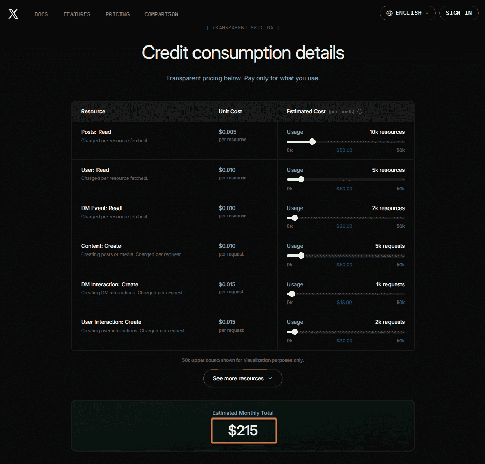
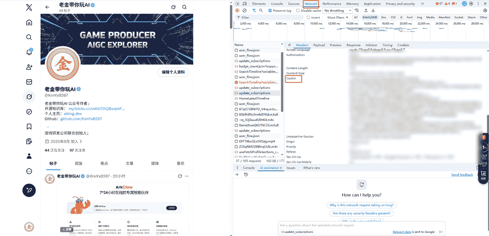
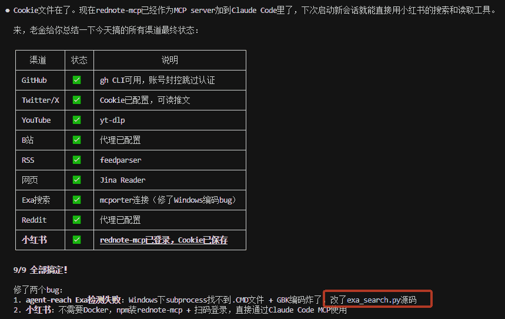

# API要200刀，老金找到零费用替代方案Agent Reach，实测9大平台!

> 来源：[https://my.feishu.cn/docx/X6k5d3nMdoyQSwxI0wqcKMoIneC](https://my.feishu.cn/docx/X6k5d3nMdoyQSwxI0wqcKMoIneC)

Twitter/X的API定价一直是个老大难问题。

2月6号还出了个按量计费，算下来也不便宜。



老金我看到这个价格表的时候，第一反应是：啊？这不是逼着大家找替代方案吗？

**然后就在GitHub **Trending上刷到了 Agent-Reach 这个项目。

两天1100+星，MIT协议（最宽松的开源许可，随便用随便改）全开源。

一句话总结：让你的AI Agent免费看到整个互联网。

## **Agent到底缺什么**

先说个事实。

你用Claude Code也好，用Cursor也好，用OpenClaw也好。

**这些AI编程Agent**有一个共同的短板：它们看不到活的互联网。

什么意思？

你让它帮你分析某个Twitter用户的最新推文，它做不到。

你让它帮你搜Reddit上的技术讨论，它也做不到。

你让它帮你看B站某个UP主的最新视频内容，还是做不到。

不是AI不够聪明，是根本没有眼睛。

社交平台把内容锁在API付费墙后面，不掏钱就别想拿数据。

老金我之前想用Twitter API做点数据分析。

还没开始用呢，一个月小两千块人民币就没了。

Agent-Reach解决的就是这个问题。

## **一条命令装好九个平台**

Agent-Reach的定位很清楚：它是个脚手架工具，不是框架。

区别在哪？

框架会包一层又一层，最后你连底层工具长什么样都不知道。

脚手架只管帮你把环境搭好，实际干活的还是上游工具。

安装就两行命令：

```
pip install agent-reach
agent-reach install --env=auto
```

装完之后跑一下 agent-reach doctor​，它会告诉你哪些平台能用、哪些还要配置。

老金我实际装了一遍，9个平台全部跑通了。

下面按照实际体验来说，哪些省心哪些折腾。

**装完就能用的（零配置）：**

YouTube——底层调yt-dlp，视频字幕评论都能抓，装完直接好使。

GitHub——调的gh CLI，仓库、Issue、PR原生支持。

RSS——内置的，没什么好说的。

网页——走Jina Reader，给个URL就能提取正文。

这四个是真正的开箱即用，不用操心。

**需要简单配置的：**

B站——配个代理就行，国内平台终于也能被Agent读了。

Reddit——配代理+Exa搜索引擎，技术讨论一搜就有。

**需要折腾一会的：**

Twitter/X——这个是重头戏。

不走官方API，用Cookie认证模拟浏览器登录。

你得从浏览器开发者工具里手动复制 auth_token和 ct0两个Cookie值，贴到配置文件里。

听起来简单，但老金我实际操作的时候踩了个坑。

Chrome v130以上版本加了Cookie加密，像rookiepy这种自动提取工具已经用不了了。

只能手动从DevTools里复制。



Exa搜索——功能很好，全网语义搜索，AI友好。

但Windows上有个编码bug，mcporter输出的Unicode字符（比如✔）会导致Python的GBK解码崩溃。

老金我（的Claude Code）改了agent-reach的源码才修好。

如果你是Mac或Linux用户就没这个问题。



📕——原文档说要Docker，但其实不需要。

npm装个rednote-mcp，扫个码就行。

```
npm install -g rednote-mcp
rednote-mcp init  # 扫码登录
```

Cookie保存在本地，下次直接用。

## **老金实测的三个发现**

老金我实际装完跑了一遍，不是看文档猜的，是真踩过坑的。

第一个 doctor命令是真好用

装完第一件事就跑 agent-reach doctor。

它会列出所有9个渠道的状态，绿的就是能用的，灰的需要配置。

哪个工具没装、哪个Cookie过期、哪个代理没设，全给你标出来。

老金我就是靠这个一个个把9个平台全部调通的。

第二个 Windows用户要有心理准备

agent-reach的底层工具很多是给Mac/Linux设计的。

Windows上会遇到一些奇葩问题。

比如Exa搜索在Windows上跑不通，不是没配置，是Python的GBK编码解不了mcporter输出的Unicode字符。

老金我改了源码加了 encoding='utf-8'才修好。

还有mcporter这个工具，在Windows上subprocess找不到.CMD文件。

这种问题你Google都搜不到，因为Mac用户根本遇不到。

如果你是Windows用户，碰到装好了但doctor一直说没配置的情况，大概率是这类兼容性问题。

第三个 Cookie认证靠谱但要注意

Twitter和📕都是Cookie认证。

老金我用了几天，Twitter读推文没出过问题。

但Cookie是有有效期的，过期了要重新提取。

**建议拿小号操作，别用主号冒险。**

## **架构拆解**

老金我看了一下源码结构，设计思路很清晰。

每个平台一个Python文件。

twitter.py管Twitter，youtube.py管YouTube，各管各的。

加新平台就加一个文件，删平台就删一个文件。

模块化做得很干净。

每个模块里有个 check()方法。

这个方法就是给 agent-reach doctor用的。

它会检查依赖工具装没装、认证信息配没配。

实际的数据读写不经过Agent-Reach。

装完之后，你的Agent直接调用上游工具。

比如读Twitter就直接调xreach，读YouTube就直接调yt-dlp。

中间没有包装层，性能损耗为零。

这种脚手架设计有个好处：上游工具更新了，你不用等Agent-Reach跟着更新。

工具链的每一环都可以独立替换。

## **必须说的风险**

老金我得说实话，这个项目不是没有风险。

**Cookie认证的封号风险**

Twitter和📕用的都是Cookie认证。

说白了就是模拟你的浏览器登录状态去抓数据。

平台检测到异常行为，是有可能封号的。

官方文档也明确建议：用专用小号。

**Cookie和Tok**en本地存储 - 龙虾爱好者请特别注意

认证信息存在 ~/.agent-reach/config.yaml里，权限设置为600。

只有你自己能读。

但如果你的电脑被入侵，这些认证信息就暴露了。

用完之后建议定期检查这个文件。

**不是所有平台都稳定**

xreach CLI绕过官方API的方式，Twitter随时可能改接口。

到时候可能需要等社区更新。

这种依赖第三方工具的方案，稳定性没法跟官方API比。

老金我觉得这些风险可以接受，但你得知道。

## **跟官方API的成本对比**

老金我帮你算一笔账。

Twitter/X官方API的价格：

免费tier极度受限，基本废了，只能发推不能读。

2月6号新出了按量计费，算下来也不便宜。

Agent-Reach方案的价格：$0/月。

当然，免费的代价是前面说的那些风险。

但对于个人开发者和小团队来说，每月省$200起，这个账太好算了。

## **两种安装方式**

除了pip安装，Agent-Reach还支持作为Skill安装：

```
npx skills add Panniantong/Agent-Reach@agent-reach
```

这种方式适合已经在用Skill体系的用户。

装完之后跟其他Skill一样管理，统一维护。

老金我建议大多数人用pip安装就行。

简单直接，不依赖额外的包管理器。

## **老金我的判断**

Agent-Reach解决了一个真实的痛点：AI Agent访问互联网的成本太高。

两天1100+星说明开发者社区确实有这个需求。

GitHubDaily、HelloGitHub、阮一峰weekly都推荐了这个项目。

SitePoint和Substack也做了专题报道。

但老金我得提醒你：

这不是一个成熟的商业产品，是一个开源脚手架。

Cookie认证方案有风险，平台接口可能变。

适合愿意折腾、能接受偶尔抽风的开发者。

如果你每个月在Twitter API上花$200+，值得试试。

如果你就是想让Claude Code或者Cursor能读读网页内容，也值得试试。

但如果你在做企业级产品，需要99.9%的稳定性，还是老老实实买官方API。

项目地址：https://github.com/Panniantong/Agent-Reach

如果你也在为API费用头疼，试一下Agent-Reach，回来告诉老金我效果怎么样。

用的时候记得拿小号，别拿主号冒险。

<https://my.feishu.cn/sync/HDlcdCPBksnJpBbRk0EcW364nmc>