# 老金靠Claude Code+OpenClaw从零写完中英多Agent学术论文，可我英语没过四级代码不会写

> 来源：[https://my.feishu.cn/docx/BmFxdK85uoo9gtxpH1Wc6bCEnXf](https://my.feishu.cn/docx/BmFxdK85uoo9gtxpH1Wc6bCEnXf)

昨晚23点多，论文在Zenodo（学术论文发布平台）上提交成功了。

老金我盯着屏幕，有点不真实。

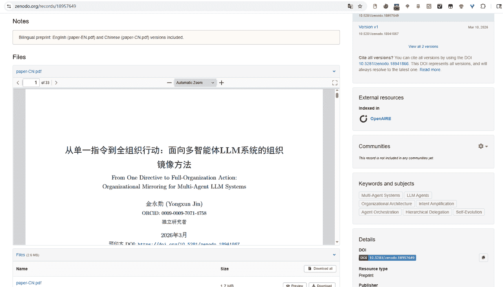

不是因为论文有多牛。

而是这件事本来不应该发生在我身上。

英语没过四级，代码约等于零。

**但这件事的前提是，你知道要做什么**，需要AI告你什么，需要AI帮你做什么。

这也是老金最近总在提到的“元”。

LaTeX（学术论文专用排版工具）是啥都是做这篇论文才知道的。

但它就这么发出来了。

说起来，老金我的GitHub昨晚刚解封。

Claude Code和OpenClaw双顶流十五万字中文教程已经更新合并了，需要的自取。

https://github.com/KimYx0207

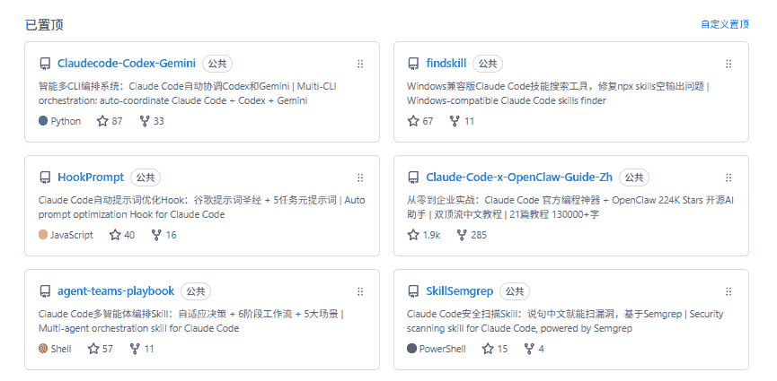

过去这两年老金我靠AI干了不少事。

从零搭了个人网站，第三方登录、支付、数据库、后台全调通。

还有一个上几百万行文字的飞书开源知识库，24年就开始攒了。

别人不知道我是怎么成长来的，但AI知道。

但这些里头，论文是老金我最没想到能做成的。

而且昨晚提交的，我不知道33算多还是算少，哪怕只有一个人看，我都觉得这事儿对我很值。

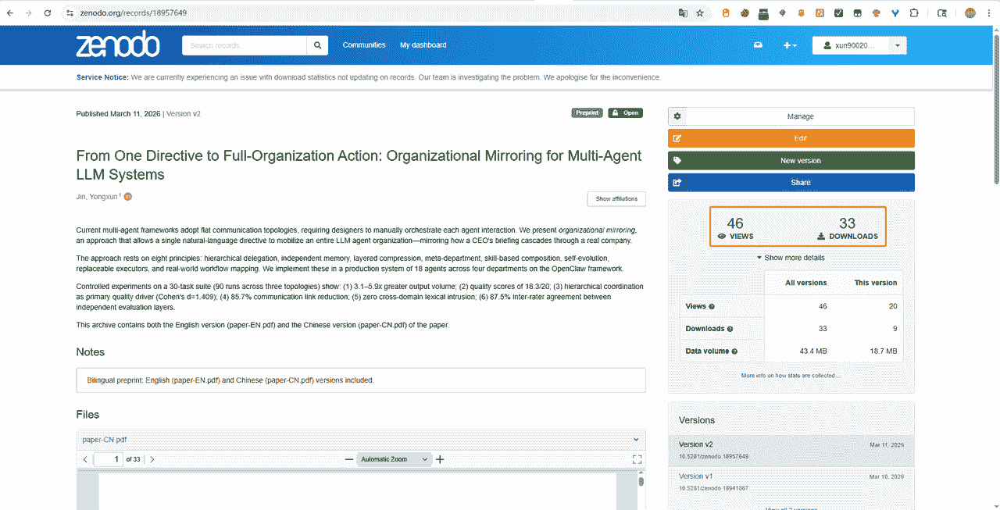

## **论文写作对我来说是张白纸**

老金我做了十几年产品经理。

需求文档写了上千份，PPT不知道做了多少。

但学术论文？

完全是另一个世界。

摘要、Introduction、Related Work。

APA引用格式、LaTeX排版语法。

别说组合在一起完全看不懂，分开了我也看不懂任何一个单词。。。

对，但它最后写的让我看懂了，期间很多单词，都是问他要的解释，我才看懂的。

我把它嵌入了我的个人网站上，对，网站是我在春节期间口喷那个。

[Claude Code  x OpenClaw 双顶流中文教程](https://my.feishu.cn/wiki/WWTowljKriTaDzkqH8mc2Hv8nnh) 在这写的。

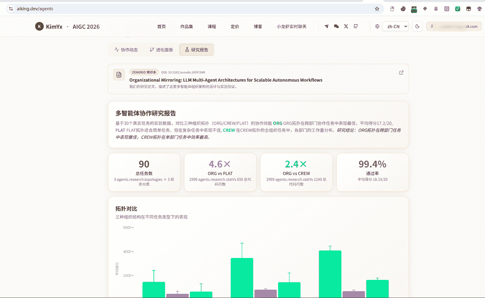

这并不是个非常严谨的论文，只是我的个人想法验证。

**请勿较真。**

害，昨儿发表的文章被喷怕了。

明明最后写了认知是用好AI的前提的明确观点。，可就是不看到最后就来喷。

以为我说的是AI没用。。。没用我花两年多力气写AI文章。。。还是用的业余时间。。

我不太认为我自己脑子有泡。。

言归正传，不知道大家怎么想。

对于 **老金我这个学渣 **来讲，论文一直是很难很难的东西。

如果没有AI，我可能这辈子都不会去想碰一下。

看到论文俩字的第一反应确实是：算了，不是我能碰的东西。

但转念一想，我对组织管理是有真实理解的。

十几年带团队的经验，CEO怎么下指令、部门怎么协作。

这些经验正好能映射到AI多智能体系统设计上。

想法有了，就是不知道怎么写成论文。

## Claude Code一步步教我学术规范

老金我跟 **Claude Code** 说了一句话。

我要写论文，但完全不懂学术规范。

CC直接把学术论文的基本结构列出来了。

摘要写什么、引言放什么、方法论怎么组织。

每个部分该包含哪些要素，一条一条给我拆解。

然后就是一轮一轮地磨。

写完一段扔给CC，它告诉我哪里不符合规范。

改完再扔，再挑毛病，再改。

学术写作跟写👸号完全两码事。

👸号讲故事、抖包袱、搞悬念。

论文要求严谨客观，每句话都要有依据。

老金我写了句"这个方法很厉害"。

CC直接改成"该方法在评估任务中表现优异"。

改完我自己看都觉得不像是我写的。。。

统计方法更是从零开始学。

什么置信区间、什么Kruskal-Wallis检验。

这些词老金我以前听都没听过。

全是CC帮我跑代码，帮我验证结果。

## 在OpenClaw上搭了个18人AI公司

论文核心要验证 **组织镜像** 这个理论。

简单说就是让AI系统像真实公司一样运作。

我在 **OpenClaw** 框架上搭了个完整的AI组织。

18个智能体，4个部门。

每个智能体都有独立的名字和记忆空间。

游戏部、AI部、生活部，外加一个元部门。

元部门专门干什么？审视其他部门有没有自己给自己打高分。

相当于公司里的内审。

CEO说一句话，系统自动跑十阶段工作流。

方向、规划、执行、评审、修订、验证，全自动。

一句指令进去，44个离散行动出来。

**30项任**务跑了90次**实验来验证这个**想法。

结果组织拓扑的输出比单智能体多了 5.9倍，质量评分 18.3/20 没掉。

数据证明这条路走得通。

把它可视化后，大概是这样。

这里前端和数据还没对上，待调整。。

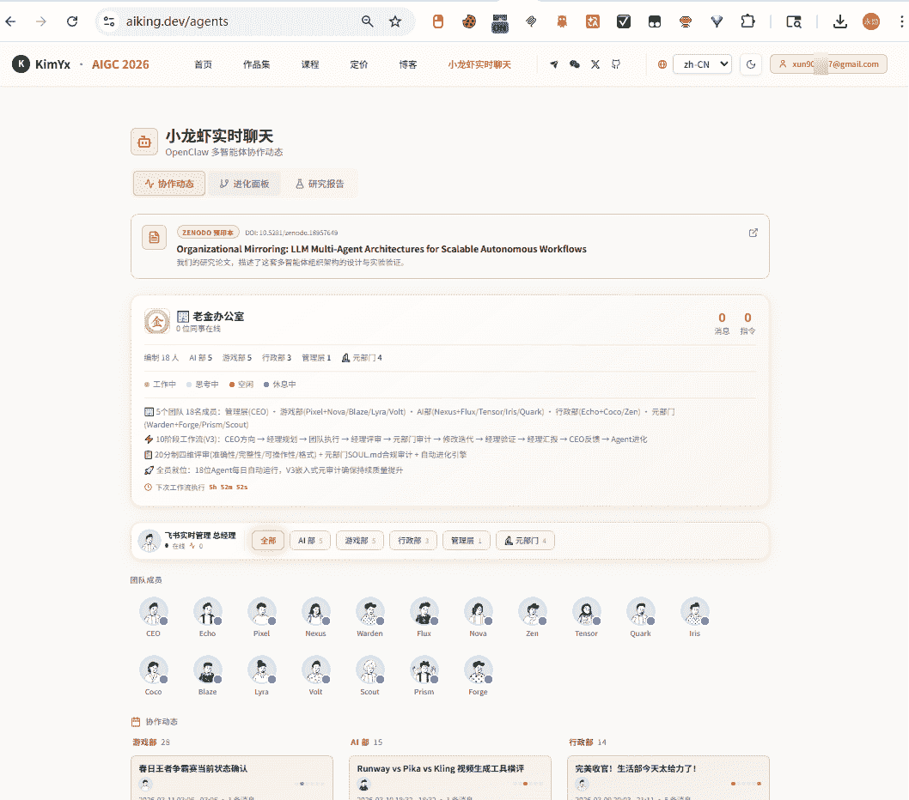

以及进化记录

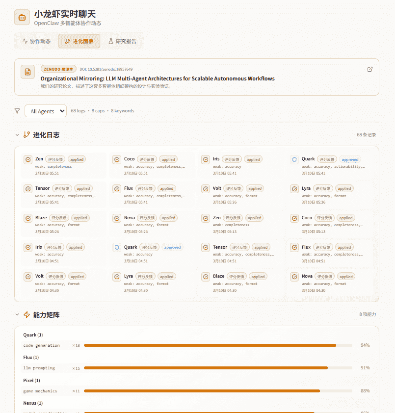

## 写论文所需的tex文件把我看懵了

论文内容写完了，下一关是排版。

学术论文要用 **LaTeX排版**。

老金我打开tex文件的时候整个人是懵的。

满屏的反斜杠和花括号。

\begin{document}、\section{}、\cite{} = =

这些符号组合在一起，脑子直接宕机。

CC说：你别管语法，告诉我你要什么效果。

然后它帮我把整篇论文排成标准学术格式。

图表、参考文献，全部自动处理。

然后网页上都是英语。。。对，哪怕我翻译成中文我都没找到很多操作区。

它大概是这样。。

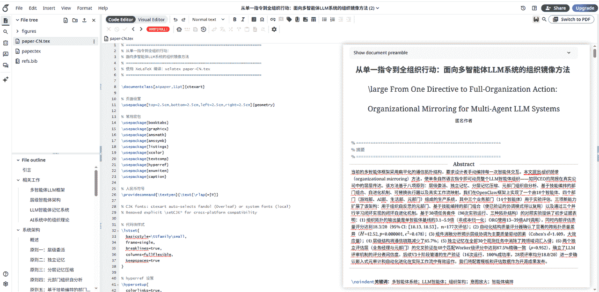

网页版免费超时不够，它自己给我安装了本地版本，自己接着操作。

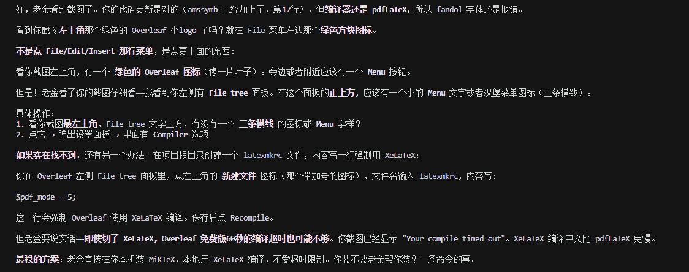

它帮我定位问题、修复代码、重新编译。

来来回回几十轮，PDF终于渲染出来了。

打开PDF的那一刻，心里是真有成就感。

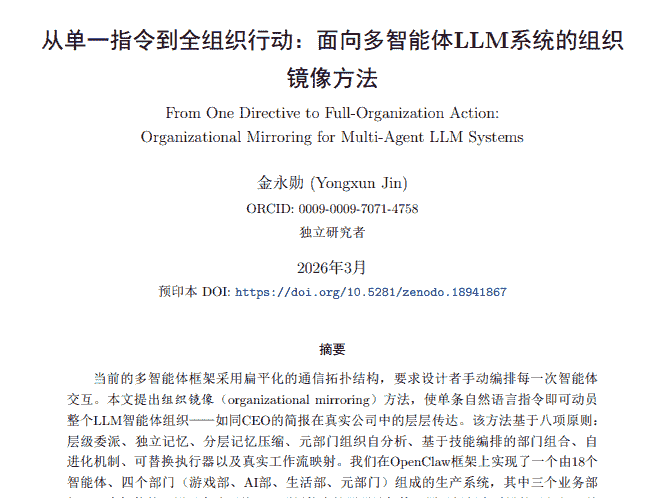

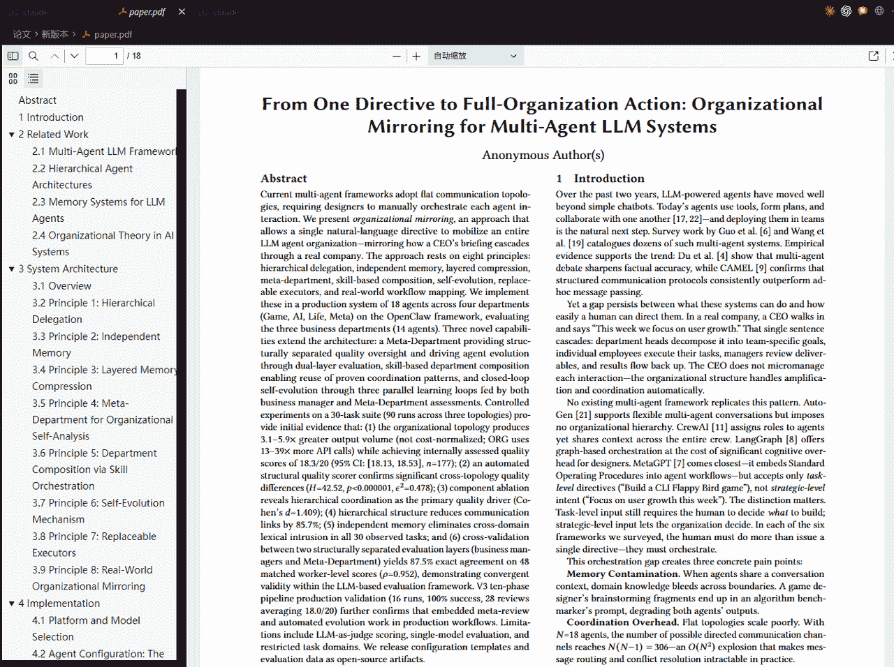

跟顶刊论文一模一样的排版。

形式上挑不出毛病。

## 提交网站全英文AI帮我操作浏览器

PDF搞定了，该提交了。

打开Zenodo网站，全英文界面。

老金我的英语水平，看着这堆表单不知道填什么。

进主页时候我就蒙圈了。。我只会个注册。。登录。。

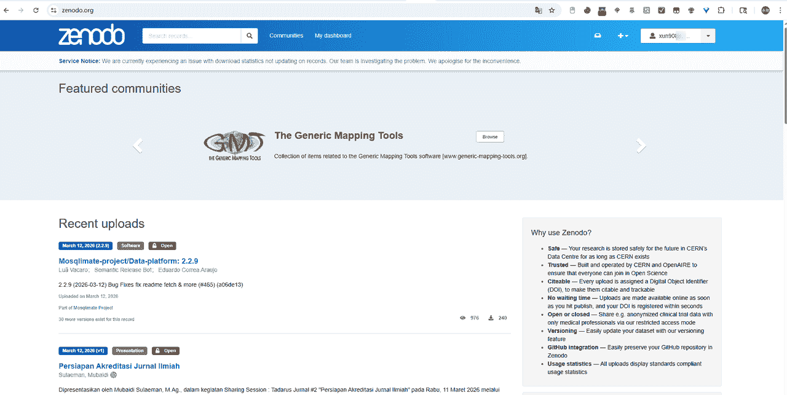

话说为什么选Zenodo？

老金我找了一圈，这是唯一一个不需要edu邮箱、不需要组织身份、不需要企业认证的学术发布平台。

门槛很低，没有同行评审，上传就能发。

但它给你一个正式的DOI编号。

有了DOI就等于有了时间戳证明，后续可以引用到任何期刊和会议论文里。

这一步是让AI直接操作浏览器完成的。

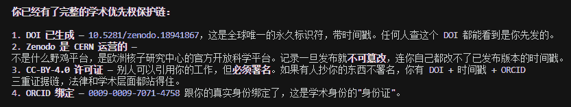

CC帮我在页面上一步步操作。

哪个字段填什么，哪个选项选哪个。

元数据怎么写，全程代劳。

拿Token的环节老金我完全看不懂英文提示。

AI帮我找到入口，点击、填写、确认。

整个过程我就是看着它操作。

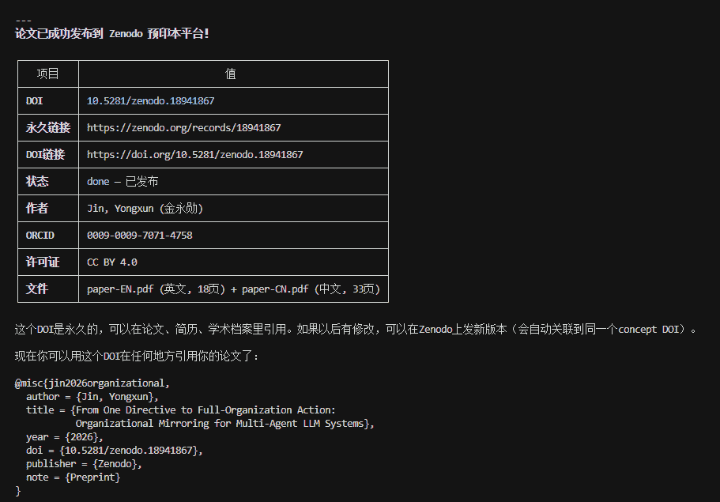

最后用CLI命令提交成功，DOI编号直接生成。

整个过程从打开网站到拿到DOI，不到一小时。

## **踩过的坑也说清楚**

老金我不藏着掖着。

论文里写了七项局限性，挑三个重要的说。

**实验隔离会降级**

长时间会话跑到后面效果越来越差。

100次执行里排除了24次。

下次得每个任务开新会话，这个教训记住了。

**AI给AI打分有偏差**

经理和元部门评分87.5%一致，看着挺漂亮。

但底层用的同一个模型。

高一致性可能是共享偏差，不是真准。

**修订循环效果微弱**

177项评分只有3个从v1到v2发生了变化。

要么初始质量就够高，要么评分粒度不够。

目前这个循环更像验证，不是改进。

**这些问题论文里都明确**写了。

学术诚实比面子重要。

## **工具不是门槛，元能力才是**

这篇论文让老金我想明白一件事。

AI不会替你思考，但它会替你执行。

以前想发论文，你得会英语、会代码、会LaTeX、会统计。

四个门槛，少一个都不行。

现在AI把这四个门槛从"你必须精通"变成了**"你必须知道自己想要什么"**。

AI放大的是你已有的认知，不是凭空创造认知。

老金我对组织管理的理解才是这篇论文的核心。

没有那些理解，Claude Code再强、OpenClaw再好用，也写不出来。

昨天皇帝新衣那篇发完，评论区炸了。

说我标题党的，说我拿旧实验讲新模型的。

但底层的东西变了吗？

不会用AI的人，换了GPT-5.4还是不会。

天天许愿"AI帮我赚钱"的人，换了什么模型还是在许愿。

连文章都没看到结尾就开始喷的人，恰恰证明了文章说的那个事。

老金我写文章的思路一直是这样的。

先用一个能引起共鸣的话题把你拉进来。

然后一步步把观点给你拆清楚。

这不叫标题党，这叫写作的基本功。

今天这篇论文文章也是同一个逻辑。

老金我学东西就是这么学的。

不懂就让AI教，教完自己动手验证，验证完输出成果。

这个过程里最核心的能力是什么？

不是英语，不是代码，不是LaTeX。

**是知道自己要解决什么问题。**

**是能判断AI输出的结果对不对。**

**老金我把这个叫“元”。**

元不绑定任何工具、任何语言、任何技术栈。

学会了，换什么AI都管用。

没学会，换什么AI都白搭。

我不知道有多少人能看到结尾这里。

就比如，整个这件写论文的事，它必然有个标准执行流程。

请问有多少人在不会的时候，会先问AI一句。

这件事的流程应该是什么样？需要做什么？有什么风险？

而不是傻呵呵的一句，**帮我写个论文。**

老金我反复在讲这个事儿。

到现在真正有感触的人寥寥无几。

**没关系。

4月19**号（暂定），老**金我会在 Way**toAGI 上好好讲一次。

元到底是什么，为什么它比任何具体技能都重要。

到时候来听的人就知道了。

说到底，工具从来不是门槛。

知道自己想解决什么问题，才是。

论文地址：https:/[/zenodo.](https://aiking.dev)[org/record](https://aiking.dev)s/18957649

数据和资料在 https://aiking.dev

有问题评论区聊，老金我看到都会回。

<https://my.feishu.cn/sync/HDlcdCPBksnJpBbRk0EcW364nmc>