# Claude Code & 硅基流动，老金突然使用自由了！

> 来源：[https://my.feishu.cn/docx/FBwXdfOFLoUaBxxdeWyclJUlnwf](https://my.feishu.cn/docx/FBwXdfOFLoUaBxxdeWyclJUlnwf)

前两天给大家讲了Cursor怎么和Codex Cli，Gemini Cli还有Github Cli的结合。

唯独Claude Code老金没有讲，因为实在是被他封怕了。

上一期的的安装教学可以看这里。

[老金的AI编程工作流：从使用者到指挥家（IDE+CLI版）](https://tffyvtlai4.feishu.cn/wiki/U9cPwVYUVirB6Ik2PKHcbeN3ngc)

然后老金突然想起来是不是硅基流动应该早就可以支持别的Anthropic协议的模型了？

果不其然，老金突然感觉模型自由了。

当然，从模型本身的实力来讲，都和Claude差远了，但是能使用CC的一些功能也是不错的。

老金标注的这仨是已知都还不错的国产模型，都可以使用CC，并且带有小🎁图标的，都是可以使用赠送余额的。

这里综合评判 GLM4.5>K2>DS 3.1，但是每分钟可运行的数量也是GLM4.5少，然后后面两个越来越大。

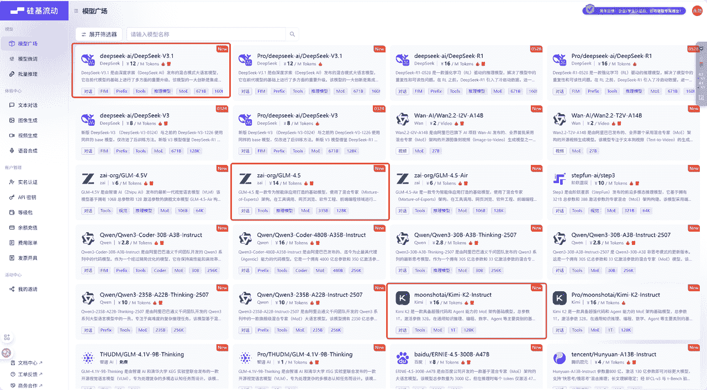

这里不得不再次推一次咯。点地址注册：

https://cloud.siliconflow.cn/i/wdyoipMi

然后你多邀请点儿人，你也就自由了。

不过老金在这再插个嘴，我个人觉得codex+gpt5high真的很无敌。

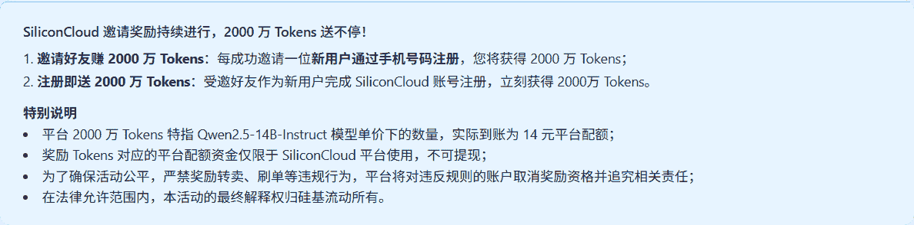

---

直接开讲，两种方式接入Claude Code。

## 方式一：一键安装及配置脚本

这个方法适用于只使用终端的小伙伴，是兼容Anthropic协议的方式，会省一些Token。

坏处是无法使用Powershell使用。

区别如下，Chatgpt老师给我上课了。

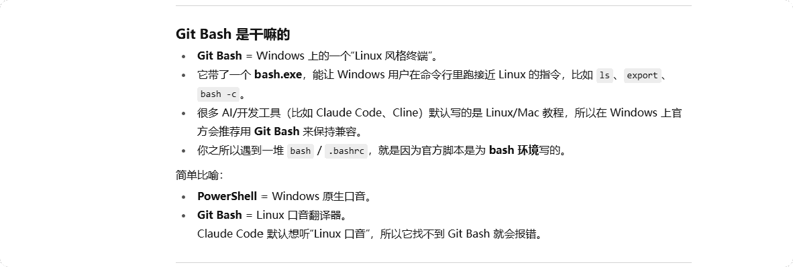

下面我们开始先讲解Git Bash的方法。

需要先安装Git，下载地址：

https://git-scm.com/downloads/win

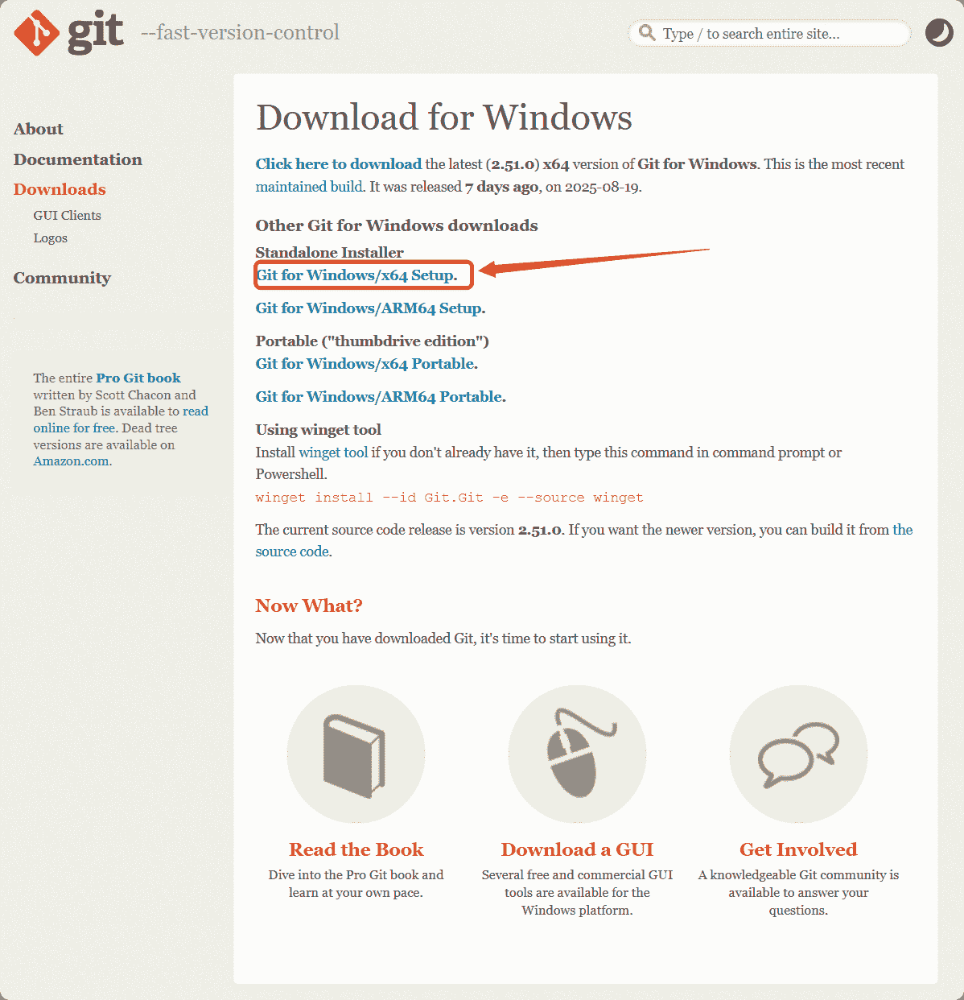

安装完成后，在任意文件夹中右键，选择 Open Git Bash here。

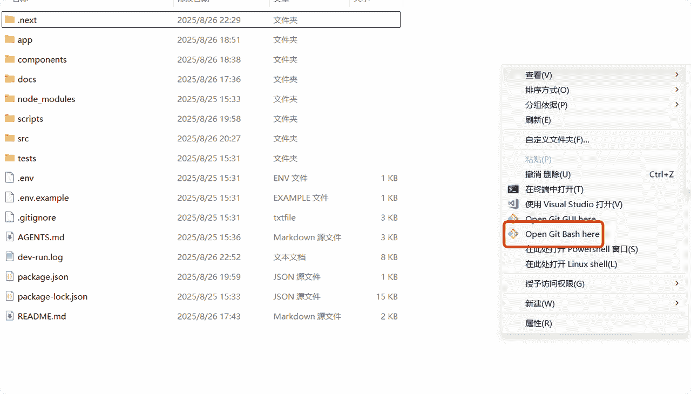

在Git bash中运行以下命令：

```
bash -c &quot;$(curl -fsSL https://static01.siliconflow.cn/cdn/assets/ccsf_v2_1.sh)&quot;
```

右键进行粘贴，它的快捷键有些不一样，老金还试了好久 = =

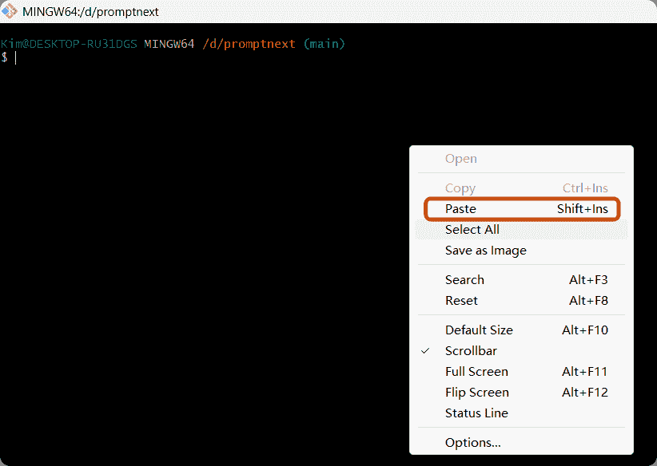

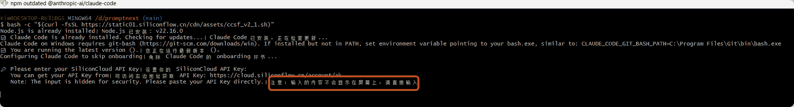

提示输入 API Key 时，粘贴你的 SiliconCloud API Key，注意它不会显示，复制进去后直接回车。

https://cloud.siliconflow.cn/me/account/ak 这里获取APIKey。

然后会弹出来让你选择模型的地方，老金我选了这个K2。

你也可以选择自定义，从硅基的模型广场复制粘贴想用的模型名称。

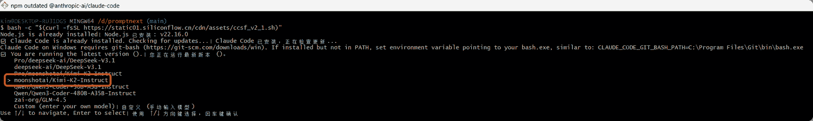

然后会弹出来这个界面，注意这行地址，复制它，放一边。

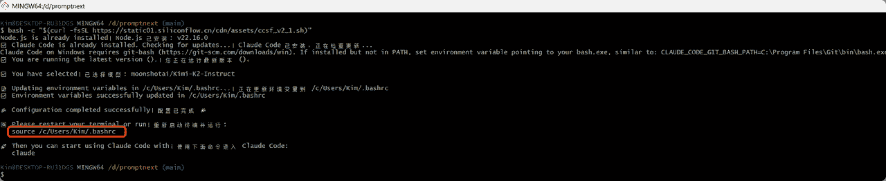

重启Git Bash，关闭上面的窗口，重新打开，并粘贴上面复制的这个地址。

再输入**Claude**启动。

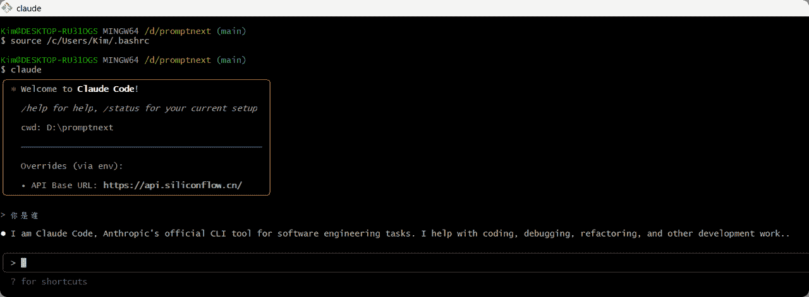

目前 Claude Code 并不支持添加多个自定义模型（Custom Model），可以再次执行上述步骤，选择并更新 ANTHROPIC_MODEL 环境变量的方式切换模型。

## 方式二：手动配置 Claude Code 环境变量

注意：此场景使用时将显著增加 token 消耗，好处就是它可以支持Powershell，像老金这种小白就只习惯用这个了。

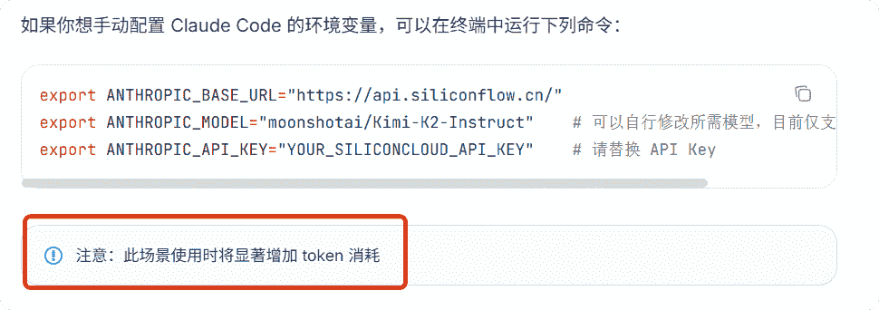

这里需要更改系统环境，老金也是跟着Chatgpt走了无数个坑，看来顶级AI也在很多情况下无计可施，瞎说。

右键点击 此电脑（就是Win桌面上那个我的电脑），选择属性，在弹出来的页面里找到 高级系统设置。

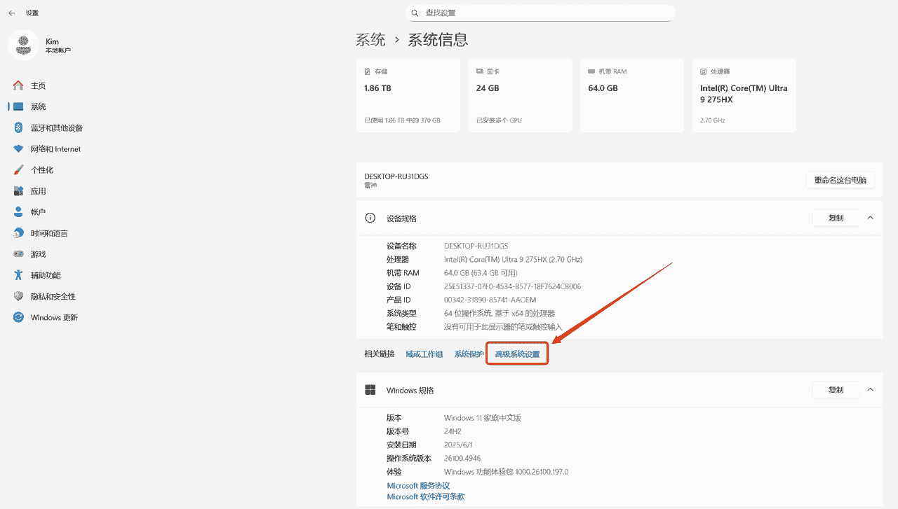

点开环境变量。

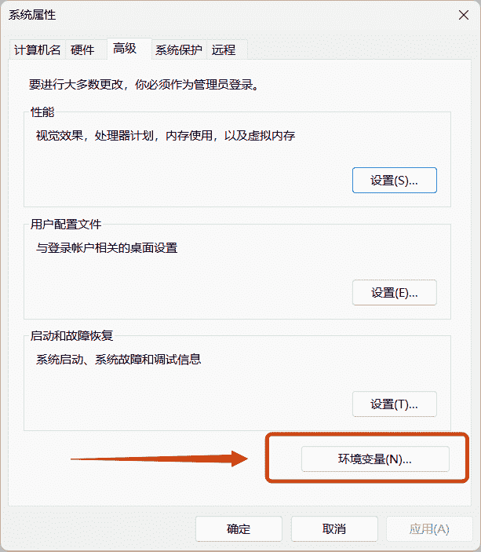

在系统环境中增加这三项，选择新建对应输入就行了。

```
ANTHROPIC_AUTH_TOKEN   你的API Key
ANTHROPIC_BASE_URL   https://api.siliconflow.cn/
ANTHROPIC_MODEL      moonshotai/Kimi-K2-Instruct
```

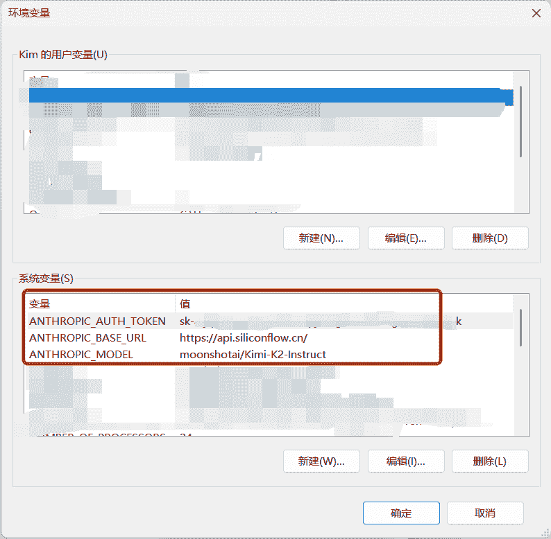

这个方法，可以在Win本身的Powershell中执行。

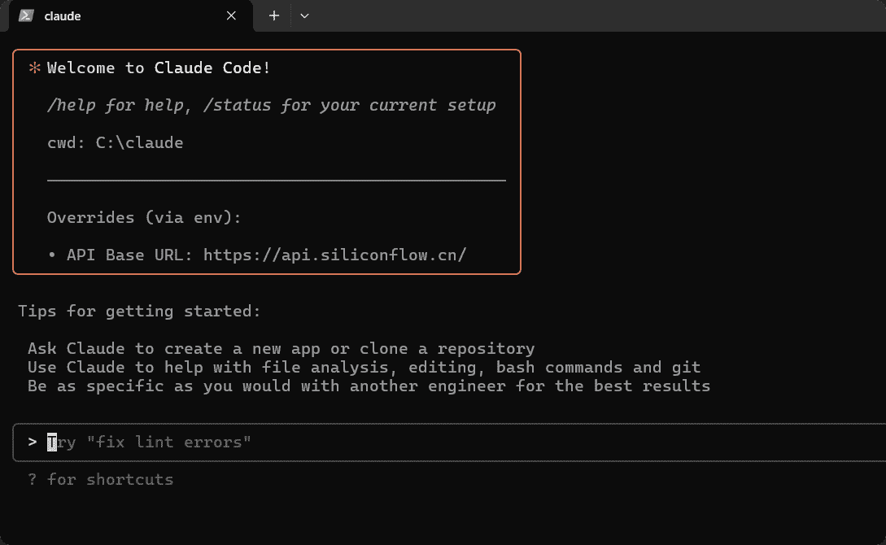

也可以在Cursor中使用了，首次在Cursor中使用时，它还会告你它有个Cursor版本。

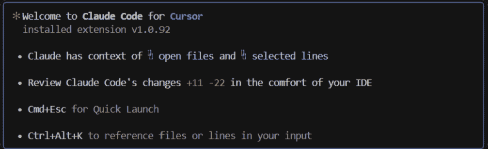

嗯，眼尖的小伙伴可以看见Codex和CC都可以一起使用了。

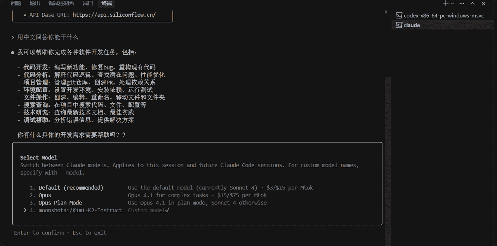

然后你会经历以下两种框。

这个 **黄色 **的：

**意思**：Claude Code 检测到你在 C:\claude 文件夹里运行，它问你是否信任这个目录。

**风险提示**：Claude Code 可能会读写或执行这个目录里的文件，如果目录里有恶意文件，你就有风险。

**选项**：

1.  Yes, proceed → 允许 Claude 在这个目录下操作。

1.  No, exit → 不允许，直接退出。

**正常场景**：只要是你自己项目文件夹（比如 D:\promptnext、C:\claude），选 Yes 就行。

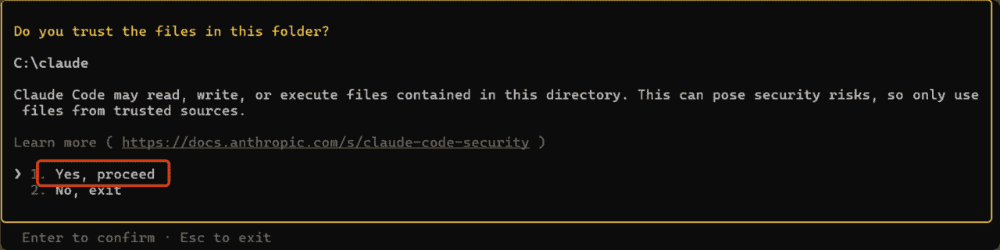

然后你输入这个启动 ** claude --dangerous**ly-s**kip**-permissions 会出现 红色 的：

**意思**：你是用 **--dang**erously-skip-permissions 或类似方式启动的 Claude Code，这叫 绕过权限模式。

**风险提示**：在这种模式下，Claude Code 不会再每次询问你“是否信任目录/执行命令”，它会直接执行，哪怕是危险命令（删除文件、联网下载等）。

**选项**：

1.  Yes, I accept → 表示你愿意承担风险，进入这种“无提示全放行”的模式。

1.  No, exit → 拒绝。

**正常场景**：除非你在安全的沙箱或虚拟机里做实验，否则一般不建议长期用这个模式。

但如果你和老金一样是个代码小白，那么就建议选上，少动手很多。

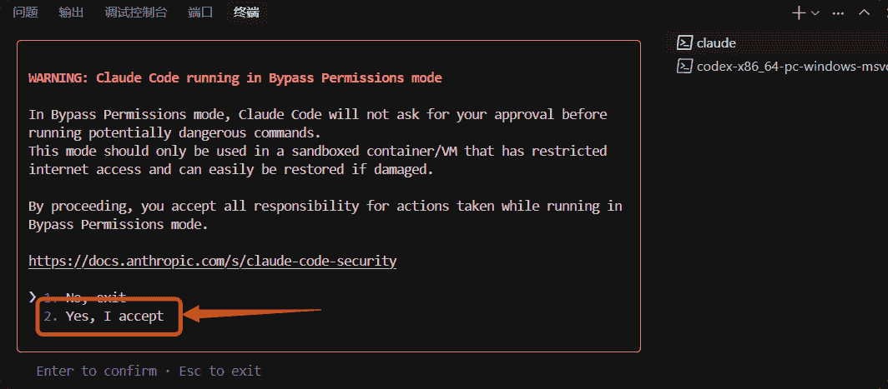

---

OK，两种使用CC的方式介绍完成，使用其他厂商API时，大差不差，都一个原理。

**然**后老金简单介绍下CC的功能，输入 / 你可以看到CC的功能 ：

## 功能说明

**环境与配置相关**

**/doctor** → 检查 Claude Code 的安装和配置，诊断问题。

**/config (theme)** → 打开配置面板，可以改主题。

**/model** → 切换使用的模型（比如换成 SiliconFlow 的 K2）。

/output-style /output-style:new → 设置输出样式，或者自定义新的样式。

/permissions (allowed-tools) → 管理 CC 能调用哪些外部工具/命令。

**/terminal-setup** → 配置终端键位，比如 Shift+Enter 换行。

**/vim** → 在编辑模式里切换 Vim / 普通键位。

---

**工作目录 & 文件**

**/add-dir** → 添加新的工作目录（让 CC 能操作那个目录下的文件）。

**/init** → 在当前目录初始化一个 CLAUDE.md 文件，作为项目文档/说明。

**/memory** → 编辑 Claude 的记忆文件（类似长期上下文）。

---

**IDE & 集成**

**/ide** → 管理 IDE 集成，比如和 VSCode/Cursor 结合。

/install-github-app → 给 GitHub 仓库安装 Claude 的 GitHub App，用于 CI/CD。

/migrate-installer → 从全局 npm 安装迁移到本地安装。

**/mcp** → 管理 MCP 服务器（Claude Code 插件/扩展机制）。

---

**协作 & 代码审查**

**/review** → 代码 Review。

**/pr-comments** → 拉取 GitHub PR 的评论，让 CC 帮你处理。

**/release-notes** → 自动生成 release notes。

/security-review → 做安全检查。

---

**会话与上下文**

**/clear (reset)** → 清空上下文。

**/compact** → 清空上下文但保留一个总结。

**/resume** → 恢复上次的会话。

**/context** → 以可视化网格显示当前上下文用量（类似 token 可视化）。

**/memory** → 编辑 Claude 的长期记忆。

---

**费用与账户**

**/cost** → 显示当前 session 消耗的 token / 金额。

**/upgrade** → 升级到 Max，提升速率限制和可用模型（Opus）。

**/login** → 登录 Anthropic 账号。

**/logout** → 登出。

---

**其他工具**

**/bash es** → 管理后台 bash 会话。

**/bug** → 给 Anthropic 提交 Bug。

**/export** → 导出当前对话到文件或剪贴板。

**/exit (quit)** → 退出 CC。

**/hooks** → 管理钩子事件。

/status /statusline → 查看当前状态。

---

**一句话总结**：这些命令就是 Claude Code 的「控制面板 + 项目管理指令」。

想让它读写代码 → /add-dir

想清空上下文 → /clear 或 /compact

想切换模型 → /model

想看自己花了多少钱 → /cost

想和 GitHub 打通 → /install-github-app、/pr-comments、/review

<https://my.feishu.cn/sync/HDlcdCPBksnJpBbRk0EcW364nmc>