# Claude 4.5与Claude code更新：一文给你讲清楚内容和配置！

> 来源：[https://my.feishu.cn/docx/KtczdRQj3okaVFxBGKPcrMmInFb](https://my.feishu.cn/docx/KtczdRQj3okaVFxBGKPcrMmInFb)

本文老金将拆清3件事——

1、Claude 4.5 到底更了谁，和 4.1 差哪，是不是全家升级；

2、Claude Code VS 扩展 2.0 更新了什么、界面怎么变；

3、重点 ：中转怎么配置？

---

**老金开门见山：  **

Claude 4.5 是 LLM 升级，主角是 Sonnet 4.5；

**不是全家桶齐换代。**

现在的全家桶分别是：

Sonnet 4.5、Opus 4.1、Sonnet 4、Haiku 3.x/3.5。

不同通道显示的 SKU 名可能略有差异，但不是全员 4.5。

**这代把长时自主****、**电脑操作、编码耐力拉高到能顶住 十几到数十小时 的连续工作。

媒体测试里给了 **30 小时连续自主构建应用 **这种耐力级别的例子。

定位很直接：更适合做复杂 Agent、做真实电脑操作、写工程化代码。

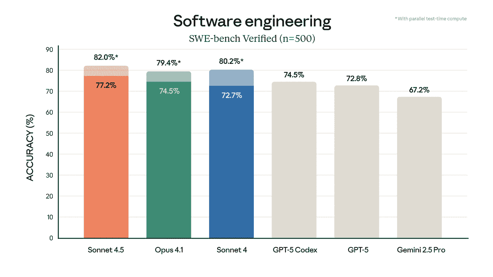

---

### 一、Claude 4.5 vs 4.1：盯能落地的三件事

1、耐力：7 小时 → 30 小时级

上一代（以 Opus 4/4.1 为代表）的连轴转大概在 7 小时级，这代 Sonnet 4.5 把连续自主时长拉到30 小时案例量级。

长链路编码、跨应用流程编排，实操意义非常大。

金融、法律、医学和 STEM 领域的专家发现，与包括 Opus 4.1 在内的旧模型相比，Sonnet 4.5 表现出了更出色的领域特定知识和推理能力。

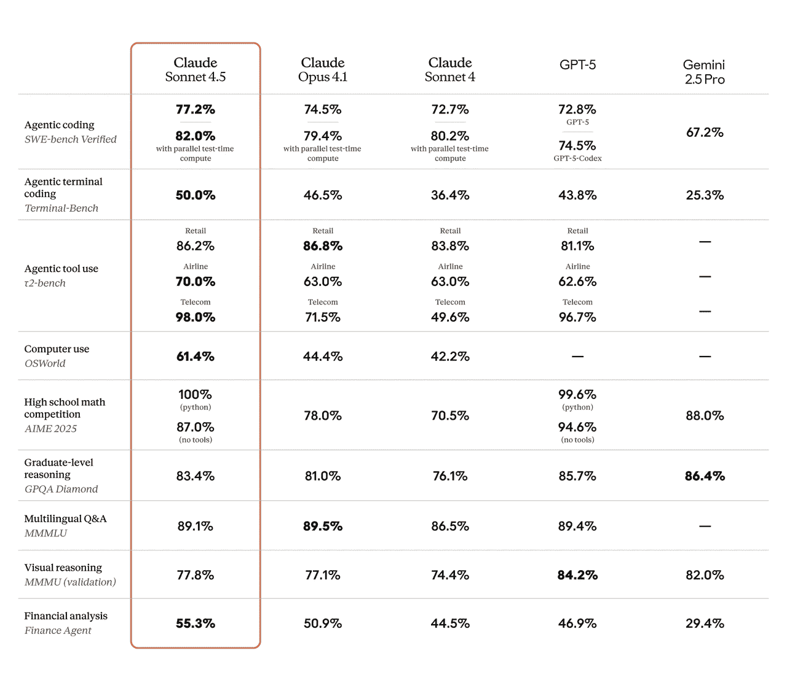

2、场景：电脑操作/Agent 优先

官方口径把 4.5 定成最强的电脑使用与编码模型，强调在真实应用里跑日程、表格、文件生成、代码执行等端内任务；

还给了 1M context（Beta） 的路线，用于超长链路。

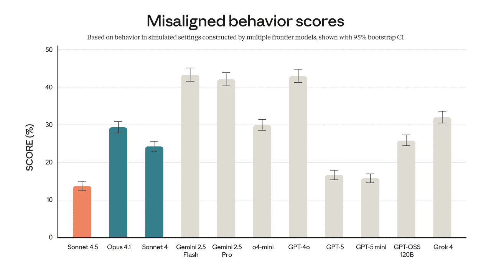

> 自动行为审计系统对整体失调行为的评分（分数越低越好）。

> 失调行为包括（但不限于）欺骗、谄媚、权力欲、鼓励妄想以及遵从有害的系统提示。

**3、节奏：不是全系 4.5**

这波是 Sonnet 升到 4.5，Opus 还在 4.1，Haiku 依然走低延迟定位。

**老金判断：**

4.5 的质变在可托付的时长与工作面，不是单点准确率。

你要跑一个任务簇，而不是一条指令。

**比**如你给了一大堆任务指令，加上 并行执行！

---

### 二、Claude Code Cli 和 VS扩展的更新

新版本中，**VS扩展 与 CLI完全解绑****。**

不论哪个都是多会话/历史，不同改动互不污染，回溯方便。

文件选择与 @ 引用更顺，跨文件推理、跨目录改动更稳。

VS扩展的新版本焕然一新，主界面如下：

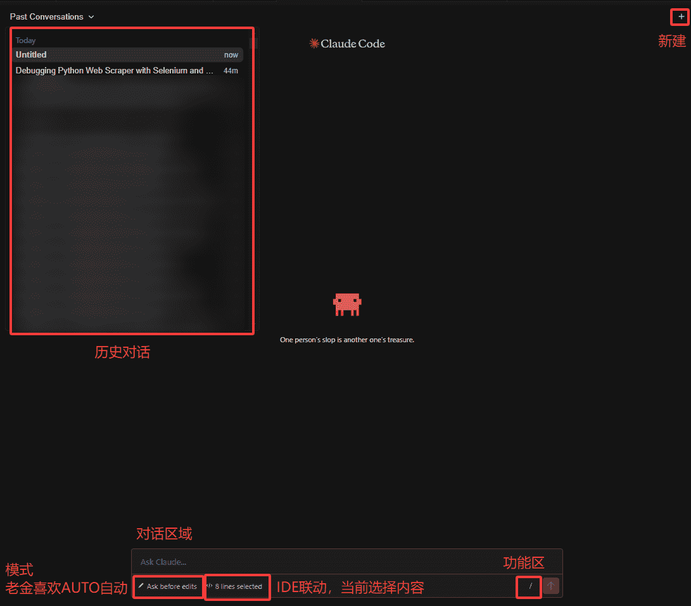

侧边栏原生 UI，能看**计划—步骤—执行—diff**的流水线。

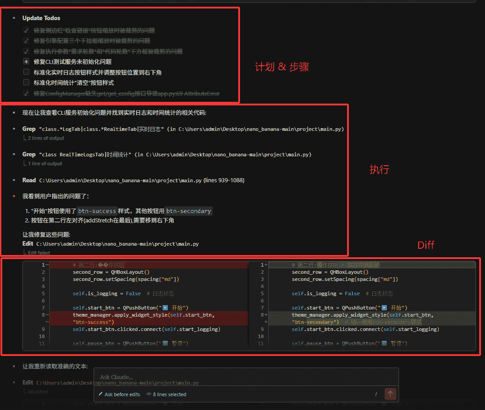

**Plan/Edit Auto**二段式，复杂改动先审计划再跑，减少AI 一把梭带来的心跳加速。

Plan 模式先出方案、你勾选后再执行，更贴近不爱敲纯命令行的同学。

Edit automatically只管文件编辑的自动应用。


注意：命令/工具调用仍会权限拦截，这是设计。

在 VS 里开自动编辑时，有可能修改 IDE 配置文件，这些文件某些场景下会被自动执行，所以官方明确建议不信任工作区走 Restricted Mode，命令仍保留弹框审批。

如果你还是想让它全自动，还是要使用 Cli版本。

输入**claude --dangerou****s**ly-skip-permissions。

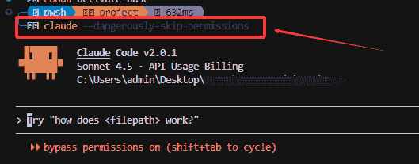

2、Checkpoints（可回滚）

**每次执行前自动**存一手，出问题就 /rewind 回到上一个安全点。

注意它只回滚 Claude 的编辑，不含你本地手改与 bash 命令，要和 Git 一起用。

3、Subagents / Hooks / 后台任务

子 Agent 分工、可编排的 Hooks（如改完即跑测/跑 lint）、后台任务不阻塞。

这套是把一个聪明人变成一个小队的关键部件。

---

可**根据提示词进**行全局搜索，快捷键 Ctrl+R 。

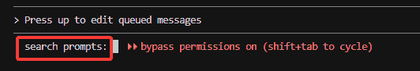

**/rewind** 指令，可以让 Claude Code 回到之前的某个检查点。

**注意：只能是CC改过的。**

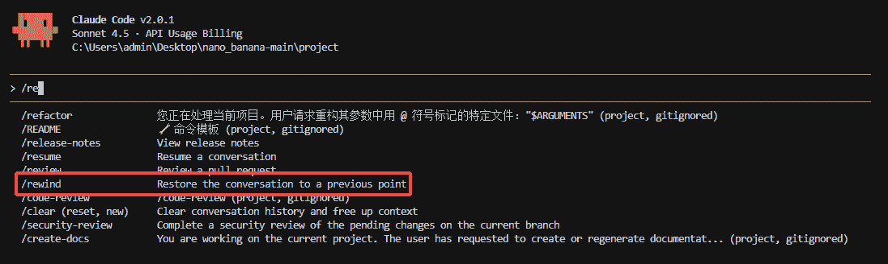

使用 **Tab** 切换对话级别的全局 **思考模式**

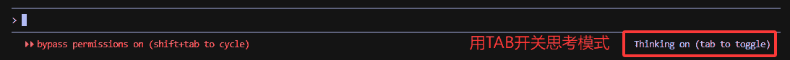

限量查询，**/usage**

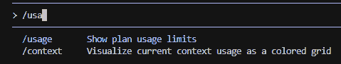

---

### 三、中转配置方法

更新后发现用不了了？

请在原基础上增加这个配置文件。

原基础：使用老金之前发的CC SWITCH一键配置，新版本已经支持Claude Code和Codex。

https://mp.weixin.qq.com/s/UQdqY08M4W9xx5W4S3dgOg

Claude code 根目录（如果没改过，直接在地址栏粘贴 %USERPROFILE%./claude 进入）

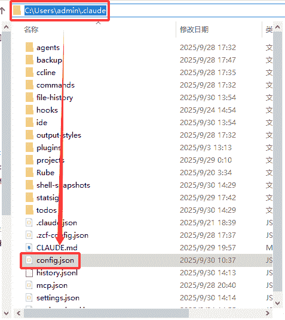

创建新的文件 **config.json**，粘贴以下内容：

```
{
    &quot;primaryApiKey&quot;: &quot;Kim&quot;
}
```

重启客户端即可。

---

### **四、和 OpenAI Codex 的扩展/**Agent 怎么对上？（工具链维度对比）

**形态**

Claude Code 2.0：本地优先 + IDE 原生 + 可回滚 + 可编排，配合 MCP/Agent SDK，把外部工具挂进来。

OpenAI Codex：本地 IDE 扩展 + CLI + 云沙盒 三位一体同一 Agent 可在本地与云端切换，大任务直接丢云端跑，账号直连 ChatGPT 生态。

**审批/权限**

Claude Code：编辑可自动应用，但命令仍走权限；

官方不在扩展 UI 暴露全局免审，强调 IDE 安全与受限模式。

**Codex：可**一键关闭所有审批，同时可选不同 sandbox 等级；社区也在讨论全免审在某些平台仍会残留提示的细节。这套更像审批档位可配置的安全观。

**运行环境**

Claude Code：主要跑你本机或你指定的 runner，贴现有 CI，适合本地-企业内网的现实场景。

Codex：云沙盒预载仓库，也能在本地；官方路线图强调无缝切换本地↔云端、状态不断。适合要排长任务、机器带不动的团队。

**界面与接入**

Claude Code：VS 内侧边栏 + 计划视图 + 内联 diff，入口简洁。

Codex：VS 扩展官方上线，不必手动折腾 API Key（走 ChatGPT 账号授权），GitHub 里还能 @codex 走审核/评论流。

**模型后端**

Claude Code 2.0 默认走 Sonnet 4.5，主打电脑操作与工程耐力。

Codex 这边公开资料指向 GPT-5 系列与专用 GPT-5-Codex 路线，用于更强的工程任务与并行处理。

**一句话结论**

**Claude Code 更像嵌进 IDE 的熟练工+保险丝，**Codex 更像可升舱到云端的工程班组。

两者都能干活，但协作半径与审批哲学不一样。

---

最后，还是这俩公益站，老金也只是为了薅薅羊毛 = =

近期波动大，如果连不上隔一段期间再试试，然后换着用，毕竟公益的。

然后我自己也充了个，用了一周多了，还不错。掉线少处理也及时，有兴趣的可以来问老金。

基本上每天的Codex和Claude是用不完的。


**郑**重提醒：公益站需注重隐私，如果你运行的软件除了本文件夹没其他文件访问权限，且本文件夹没有重要信息时在用！

**这里已经很多小**伙伴会看岔了，包含我一开始也看错了，这是2个网站。

其中**Agent Router**是最近刚出的，能薅尽快薅，**只**能用Github、Linux Do账号申请。

然后**Any Router**是上线几个月了，老金最早推过，但是**网站挂了，最近好了，老金已经使****用**两周了，只能用Linux Do账号申请。


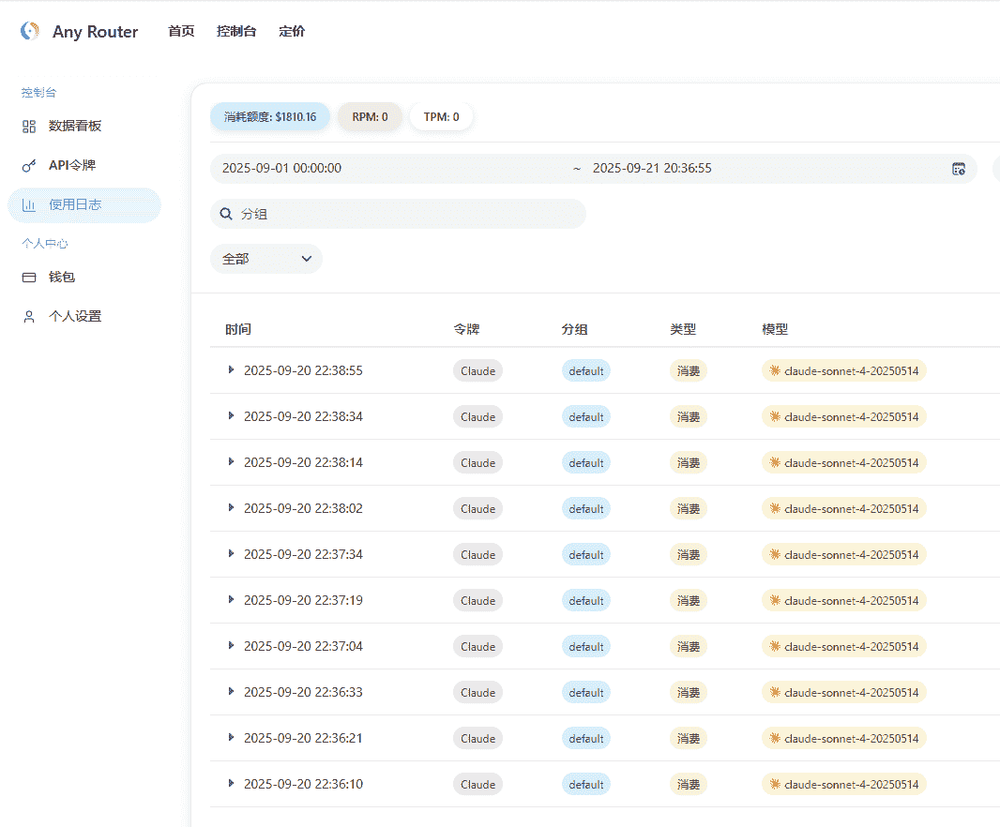

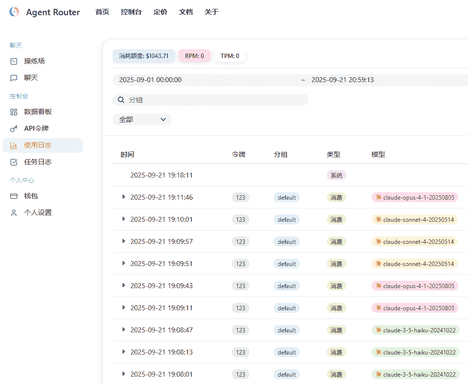

**第一个：**

https://agentrouter.org/register?aff=rLco

点链接注册能用200刀，也就是你和我分别多得100，你也可以分享出去。

每天登录没有白给的。

这个能用Opus和GPT5（没有新的CODEX模型，只有GPT5模型），还是很好的。

**第二个：**

https://anyrouter.top/register?aff=0FzF

有初始，好像是100刀，记不清了，链接注册你我分别获得50，你依然可以分享出去。

**每天登录有25刀额度**，自动领取的教程老金写过，注意同步时候图丢了，看置顶留言里的信息，那个有图文。

[老金·邪修法则：CC每天自动获取25$额度Claude*多账号，Anyrouter全自动签到](https://tffyvtlai4.feishu.cn/wiki/M7e1wiCoviEbE2kTNuLckcsHnUg)

这个只能用Sonnet。

**免责声明：**

本文仅出于学习和研究目的分享，不对使用者因采用本文方法而可能产生的任何后果承担责任。请注意:

1.  本文内容仅供学习和研究使用,不得用于任何商业目的或非法活动。

1.  使用者应当遵守Cursor和Claude的服务条款及相关法律法规。

1.  本文不鼓励也不支持任何形式的滥用、破解或规避付费服务的行为。请尊重知识产权和服务提供商的利益。

1.  如果您决定采用本文描述的方法,即表示您已完全理解并接受本免责声明的全部内容。

请合理使用。

<https://my.feishu.cn/sync/HDlcdCPBksnJpBbRk0EcW364nmc>