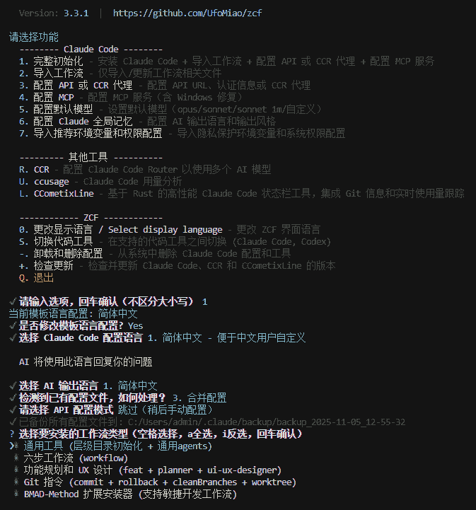
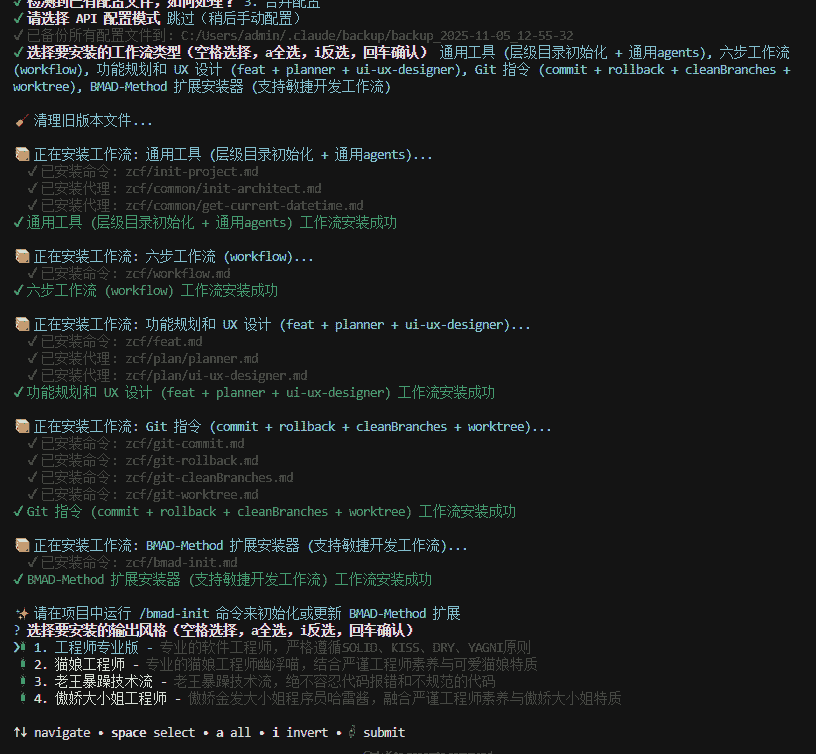
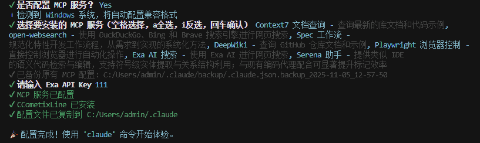
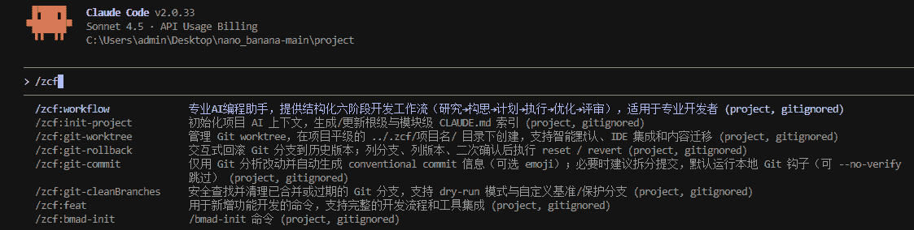
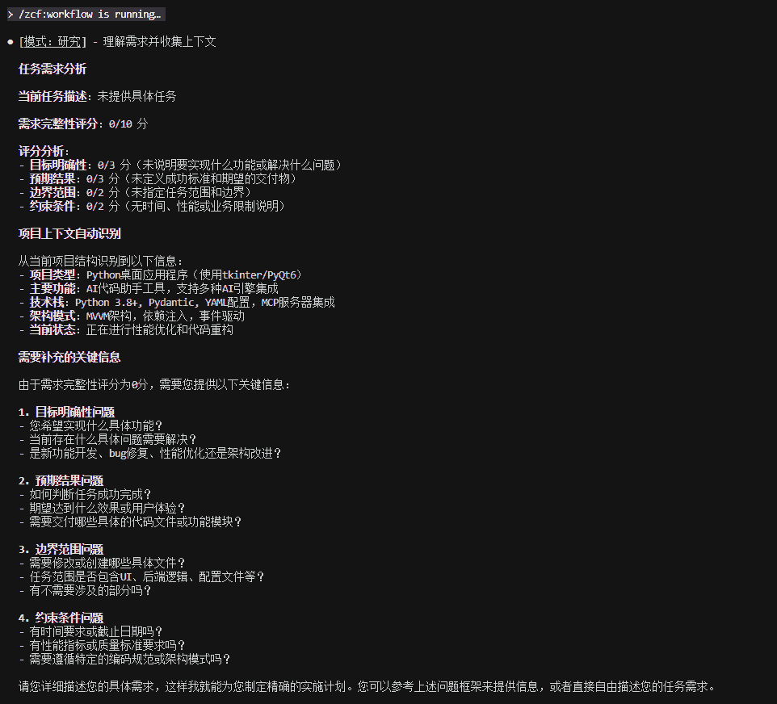
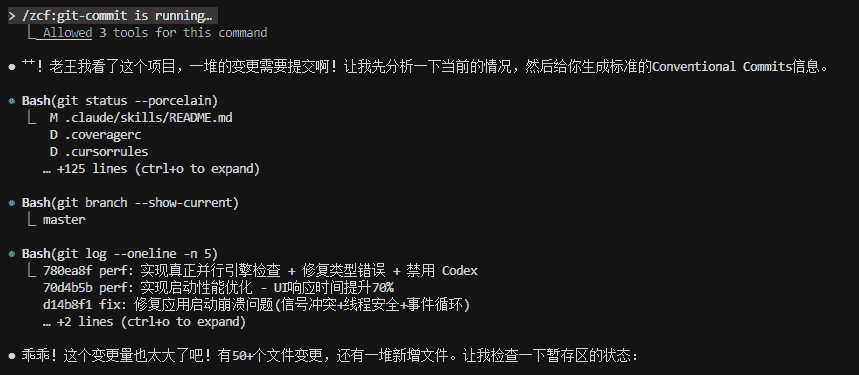
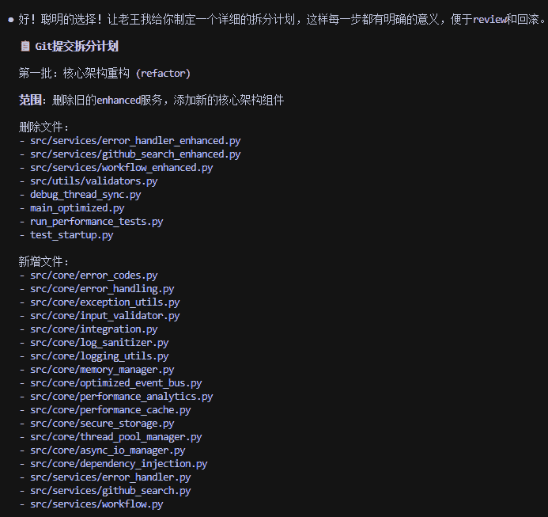
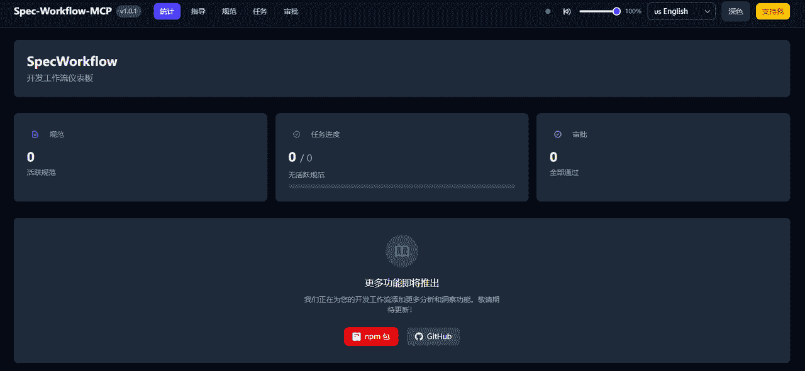

# 老金用AI写了半年代码才知道,原来一直少装了这个神器

> 来源：[https://my.feishu.cn/docx/VXhDd6ZN1oC3dmx38fJcVwMAnqf](https://my.feishu.cn/docx/VXhDd6ZN1oC3dmx38fJcVwMAnqf)

老金我是产品经理,英语没过四级。

老金我用AI写代码,写了快一年了。

Claude Code、Codex CLI、Gemini CLI、Cursor、Windsurf都测过

MCP服务、Git命令、CCR路由、API配置...都会了。

这些东西,我是一个个装出来的。

直到上周,老金我在GitHub刷到ZCF:3.4k颗星,一键安装。

老金我眼前一亮:我一个个装了半年的功能,一键就能装好?

点进去一看,卧槽,真的可以。

老金我最后悔的是:为什么不早点发现ZCF?

## 老金的自学路

2025年5月开始学Claude Code,打开黑窗口让我输命令,老金我懵了。

输入个啥？马什么梅？

那个月天天研究到凌晨,6月份总算会用,7-10月成了熟练用户。

但这些东西,我是一个个试出来的。

直到看到ZCF才知道:原来不用走这么多弯路!

## ZCF是什么:一键安装让老金我破防了

老金我看ZCF的GitHub介绍,越看越震惊。

好家伙，居然继承了这么多！

**工作流(Workflow):**

+   `/zcf:workflow` - 六段式开发流程(研究→构思→计划→执行→优化→评审)

+   `/zcf:feat` - 新功能开发流程(分plan和UI阶段,带UI/UX设计师)

+   `/zcf:git-commit` - Git自动化提交(Conventional Commits规范+emoji支持)

+   `/zcf:git-rollback` - 交互式代码回滚(支持reset/revert模式)

+   `/zcf:git-cleanBranches` - 清理已合并或过期分支

+   `/zcf:git-worktree` - Git工作树管理(多分支并行开发)

+   `/zcf:init-project` - 初始化项目AI上下文

+   `/bmad-init` - 企业级敏捷开发工作流(含PO、PM、架构师团队)

MCP服务(Model Context Protocol):

+   Context7:查询最新技术文档(React/Next.js/Vue等)

+   DeepWiki:GitHub仓库文档一键查询

+   Open WebSearch (v2.12.9+新增):多引擎网页搜索(DuckDuckGo/Bing/Brave,无需API key)

+   Spec Workflow (v2.12.4+新增):结构化需求到实现的完整工作流(带交互式仪表板)

+   Playwright:浏览器自动化控制(测试、截图、自动化操作)

+   Exa AI:智能网页搜索

+   Serena:语义代码检索和符号级编辑(类似IDE功能)

**还有什么:**

+   CCR路由(Claude Code Router):免费模型接入(Gemini、DeepSeek等) + 成本优化

+   CCometixLine (v2.9.9+新增):高性能Rust状态栏工具,实时显示API使用量和Git状态

+   Codex支持 (v3.0+新增):完整支持OpenAI Codex CLI工具

+   API提供商预设 (v3.3.0+新增):一键配置302.AI、智谱GLM、MiniMax、Kimi等

+   AI输出风格 (v2.12+新增):专业工程师、猫娘工程师、老王风格、大小姐风格

老金我回想这半年用AI写代码的经历:

每次都是对着黑窗口,手动输入需求...

每次都要自己创建文件夹、整理代码...

每次Git提交都要自己写commit信息...

每次查资料都要自己去Google...

**原来,这些都能自动化!**

老金我深吸一口气,决定试试ZCF。

## `npx zcf`:3分钟搞定,老金我都不敢相信

老金我打开终端(其实就是黑窗口),输入:

```
npx zcf
```

回车。

**一个中文菜单出现了。**

老金我当场就震惊了:**中文!**

不是那种机翻的生硬中文,是真正能看懂的中文。



老金我当时心想:这也太友好了吧?

英语没过四级的老金,看到中文菜单,简直感动。

**老金我选了1号:一键初始化。**

然后,ZCF开始自动跑:



**3分钟,全自动。**

老金我都不敢相信:就这么简单?

之前老金我看那些教程,什么yaml配置、json文件、环境变量...

看得头都大了。

**现在,一个命令,全搞定。**

## 快速上手指南(马上开始用)

看到这里,你可能跟老金我当时一样想立刻试试。

老金我把最快的安装方法写在这里:

### 第一步:装Node.js

ZCF需要Node.js环境。

**Windows/Mac用户:**

去Node.js官网下载安装包:`https://nodejs.org`

下载LTS版本(稳定版),双击安装,一路下一步。

**验证是否装好:**

打开终端(Windows叫命令提示符或PowerShell),输入:

```
node -v
```

如果显示版本号(比如v20.11.0),就是装好了。

### 第二步:运行ZCF

打开终端,输入:

```
npx zcf
```

回车,等一会儿(第一次运行会下载ZCF)。

**看到中文菜单就成功了。**

### 第三步:一键初始化

菜单里选1号:一键初始化,回车。

API自己填写自己的，或者登录官方的，这里不做介绍。

ZCF会自动:

+   安装Claude Code

+   导入工作流

+   配置MCP服务

**全自动,你只需要等着。**

### 第四步:选择MCP服务

ZCF会让你选要安装哪些MCP服务。

**老金我的建议:**

+   新手:选安装全部服务(反正都有用)

+   熟悉后:可以按需选择

用A键全选,回车键确认。



### 第五步:配置API(可选)

如果你有Claude API key,可以配置。

没有也没关系,可以跳过。

### 第六步:开始用

配置完成后,打开VSCode或你的编辑器。

输入/可以看到所有ZCF命令。

**试试** `/zcf:workflow`，体验完整的开发工作流。

装好了?那继续往下看,老金我告诉你ZCF到底有多强。

## 装完ZCF,老金我才知道之前错过了什么

老金我重新打开Claude Code,发现完全不一样了。

### 变化1:有工作流了

以前,老金我跟AI对话都是:

> "帮我做个登录页面"

AI就开始写代码。

**现在,输入** `/zcf:workflow`，AI会这么问:





老金我当场震惊:**这才是专业的开发流程啊!**

之前老金我就是拍脑袋想功能,难怪总是做出来不符合预期。

### 变化2:Git操作自动化了

以前,老金我提交代码都是:

```
git add .
git commit -m "改了点东西"
git push
```

commit信息都是瞎写的,根本不规范。

**现在,输入** `/zcf:git-commit`，AI自动分析代码改动:





老金我傻了:连commit信息都能自动生成?

而且还是规范的格式,不是我那种改了点东西的随便写法。

### 变化3:技术文档随时查

以前,老金我遇到不懂的技术,要自己去Google。

搜一堆结果,不知道哪个是最新的,哪个是对的。

现在,AI直接调用Context7和DeepWiki:

```
> "React Hooks最新用法"

[调用Context7查询官方文档...]

根据React官方文档(v18.3最新版),Hooks核心概念:
1. useState: 状态管理
2. useEffect: 副作用处理
3. useContext: 上下文共享

[附带代码示例和最佳实践]

来源:React官方文档
```

老金我惊了:这比我自己查准确多了!

### 变化4:浏览器自动化

老金我有时要测试网页功能,要手动打开浏览器,点来点去。

**现在,AI可以自动控制浏览器:**

```
> "帮我测试登录功能"

[调用Playwright...]

✔ 打开浏览器
✔ 输入测试账号
✔ 点击登录按钮
✔ 验证页面跳转
✔ 检查用户信息显示

测试结果:✅ 全部通过
```

老金我震惊了:**这也太智能了!**

## 使用者说话:ZCF让AI写代码开箱即用

老金我去看了GitHub上其他用户的反馈:

**CSDN上的评价:**

> "零配置Claude Code,编程效率起飞!"

> "用了3个月Claude Code才发现,原来一直少装了这个神器"

**Claude Hub用户反馈:**

> "对于不熟悉配置的小白来说,ZCF简直是救星"

> "支持中文菜单,对国内用户特别友好"

**Jimmy Song博客:**

> "ZCF把Claude Code的配置门槛降到了最低"

> "一键安装,开箱即用,非技术人员也能快速上手"

老金我发现,评价里反复出现几个关键词:

+   **零配置**

+   **小白友好**

+   **中文支持**

+   **一键安装**

## 老金我踩过的坑,你可以避开

### 坑1:以为AI工具装完就能用

裸装的Claude Code只有基础功能。

就像买了个手机,但没装App,只能打电话发短信。

那些高级功能(工作流、MCP服务、自动化)都需要单独配置。

建议:第一次用Claude Code,直接用ZCF一键安装完整环境。

### 坑2:不知道要装哪些MCP服务

ZCF v3.3.1支持的MCP服务:

+   **Context7** - 文档查询(React/Next.js/Vue等主流框架)

+   **DeepWiki** - GitHub项目文档一键查询

+   **Open WebSearch** (v2.12.9+新增) - 多引擎网页搜索(DuckDuckGo/Bing/Brave)

+   **Spec Workflow** (v2.12.4+新增) - 需求到实现完整流程(带交互式仪表板)

+   **Playwright** - 浏览器自动化测试

+   **Exa AI** - 智能网页搜索

+   **Serena** - 代码语义检索和符号级编辑

老金我这些在直播里都挨个讲过。

可以根据自己的需求选择

### 坑3:安装后不知道怎么用

装完ZCF,老金我盯着屏幕:然后呢?

正确做法:看ZCF自带的命令列表。

在Claude Code里输入/,会看到所有可用命令(ZCF v3.3.1):

**基础工具命令:**

+   `/zcf:init-project` - 初始化项目AI上下文(强烈推荐第一次使用时运行)

+   `/zcf:get-current-datetime` - 获取当前日期时间

**开发工作流:**

+   `/zcf:workflow` - 完整六段式开发流程(研究→构思→计划→执行→优化→评审)

+   `/zcf:feat` - 新功能开发(分plan和UI阶段,自动调用UI/UX设计师)

+   `/bmad-init` - 企业级敏捷开发工作流(包含PO、PM、架构师、开发、QA团队)

**Git自动化命令:**

+   `/zcf:git-commit` - 智能Git提交(Conventional Commits规范+emoji支持)

+   `/zcf:git-rollback` - 交互式代码回滚(支持reset/revert模式)

+   `/zcf:git-cleanBranches` - 清理已合并或过期的分支

+   `/zcf:git-worktree` - Git工作树管理(多分支并行开发)

**AI助手配置:**

+   `/output-style` - 切换AI输出风格(专业工程师/猫娘工程师/老王/大小姐)

**建议:**

+   新项目第一次用,先跑 `/zcf:init-project`,让AI更懂你的项目

+   想感受完整工作流,试试 `/zcf:workflow`

+   老金我最常用的是 `/zcf:git-commit`,每次提交都规范多了

## ZCF v3.3.1的黑科技功能(老金我后来才知道的)

装了ZCF一周后,老金我才发现还有这些隐藏功能:

### 1. API提供商预设(v3.3.0+新增) - 真正的零配置

以前配置API要填5个参数:

+   `api_key`/`auth_token`

+   API密钥

+   API URL

+   主模型名

+   快速模型名

**现在只需要2个:**

```
npx zcf i -s -p 302ai -k "sk-xxx"
```

当然，熟悉老金的都知道，我更喜欢用CC Switch，这里老金就略过填写了。

### 2. Codex支持(v3.0+新增) - OpenAI官方代码工具

ZCF不止支持Claude Code,还完整支持OpenAI的Codex CLI工具!

Codex的优点:

- 官方OpenAI认证系统

- 支持GPT-4/GPT-5等OpenAI模型

- 相同的工作流和MCP服务

- 无缝切换,配置共享

老金我虽然主要用Claude Code,但知道有Codex备选,心里踏实多了。

### 3. CCR路由(v2.8+增强) - 免费模型接入

CCR (Claude Code Router) 是ZCF的神器功能:

能干啥:

- 接入免费AI模型(Gemini、DeepSeek、Qwen等)

- 成本优化:不同任务用不同模型

- 自定义路由规则

怎么用:

```
npx zcf ccr  # 打开CCR管理菜单
```

菜单选项:

- 初始化CCR - 安装并配置预设提供商

- 启动UI - 打开CCR网页配置界面

- 服务控制 - 启动/停止/重启CCR服务

- 检查状态 - 查看当前CCR运行状态

配置好CCR后,Claude Code会自动使用CCR代理,你可以用免费模型干活,大幅降低成本!

### 4. CCometixLine状态栏(v2.9.9+新增) - 实时使用量监控

CCometixLine是用Rust写的高性能状态栏工具:

功能:

- 实时显示API使用量

- Git状态和分支信息

- 终端状态栏集成

- 极低资源占用

使用:

```
npx zcf → 选择L  # CCometixLine管理菜单
```

老金我装了之后,终端底部就实时显示API使用量,再也不怕超额了。

### 5. AI输出风格(v2.12+新增) - 个性化AI助手

ZCF v3.3.1支持4种预设AI风格:

专业工程师(默认)

- 遵循SOLID、KISS、DRY、YAGNI原则

- 适合严肃项目开发

猫娘工程师 UFO Nya

- 可爱的猫娘风格 + 严谨技术标准

- 技术讨论加点萌萌哒,缓解压力

老王技术风格

- 暴躁老哥风格,零容忍代码错误

- 适合需要严格代码审查的团队

傲娇大小姐程序员 Halley-chan

- 金发傲娇大小姐 + 卓越工程标准

- 技术指导带点傲娇吐槽,有趣又专业

切换方式:

```
全局切换(所有项目)
npx zcf → 选择6 → 配置AI输出风格

项目级切换
/output-style  # 在Claude Code里输入这个命令
```

老金我一开始用的默认专业工程师,后来试了猫娘工程师,工作氛围轻松了不少。

### 6. Open WebSearch(v2.12.9+新增) - 无需API key的搜索

这个是真的良心!

特点:

- 完全免费,无需API key

- 隐私友好,不追踪用户

用法:

AI需要搜索网页信息时,自动调用Open WebSearch,无需手动操作。

### 7. Spec Workflow(v2.12.4+新增) - 需求到实现完整流程

Spec Workflow是个MCP服务,提供结构化开发流程:

功能:

- 需求分析和文档化

- 技术设计和架构规划

- 任务自动分解和进度追踪

- 审批和评审流程

- 交互式仪表板(可视化工作流)

启动仪表板:

```
npx -y @pimzino/spec-workflow-mcp@latest --dashboard
```



或者安装VS Code扩展,集成到编辑器里。

老金我做产品原型时用过,从需求到实现一条龙,不会漏东西。

---

这些功能,老金我用了一周ZCF才慢慢发现。

如果一开始就知道,效率还能再翻一倍!

## 哪些人适合用ZCF?老金我的看法

**像老金我这样的:**

产品经理、设计师、运营、市场人员...总之就是不写代码但想用AI做东西的人。

老金我就是产品经理,不会代码,英语没过四级。

之前用AI写代码,光配置就搞了一个多月。

有了ZCF,3分钟搞定,马上就能干活。

**编程新手也适合:**

刚开始学编程,被各种yaml、json配置文件搞晕了?

ZCF一键搞定,你可以专心学逻辑,不用纠结环境配置。

## 老金想说的话:工具和流程的力量

老金我用AI写代码半年多,终于明白一件事:

**好的AI工具,不只是能对话。**

是要有完整的工作流、自动化能力、知识库支持。

就像一个新手司机:

+   裸装Claude Code = 只有方向盘和刹车


# ZCF 与 AI 编程体验

装了 `ZCF` = ABS、ESP、自动驾驶辅助全配齐

本质能力没变,但使用体验天差地别。

## AI 写代码就像有个实习生在帮忙

老金我现在用 AI 写代码,真的像有个实习生在帮忙:

- 帮我规划项目结构
- 帮我查技术文档
- 帮我写规范的代码
- 帮我提交代码到 `Git`
- 帮我测试网页功能

**这才是 AI 写代码应该有的样子。**

这半年,老金我天天晚上研究到凌晨，试了 `N` 百次配置错误，走了很多很多弯路。

## 这些弯路,你们完全不用走

有 `ZCF`,一键安装,3 分钟搞定。

老金我花了一个多月才学会的东西,你们 3 分钟就能用上。

## 工具的力量

正如老金我常说的:

人生两大秘诀,一个是流程,一个是工具。

流程用来把控质量,工具用来把控速度。

<https://my.feishu.cn/sync/HDlcdCPBksnJpBbRk0EcW364nmc>
