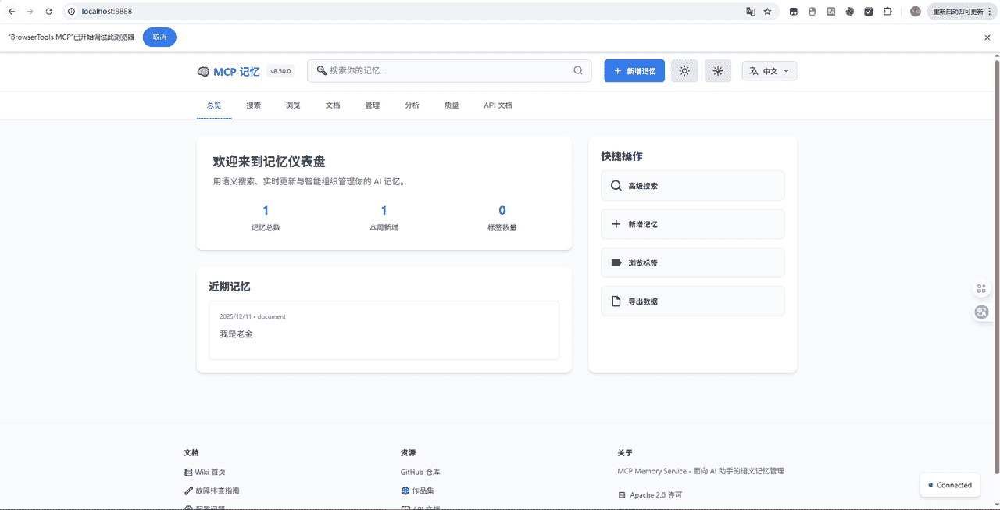
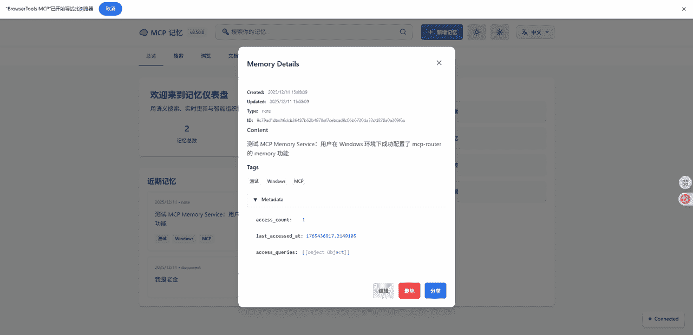
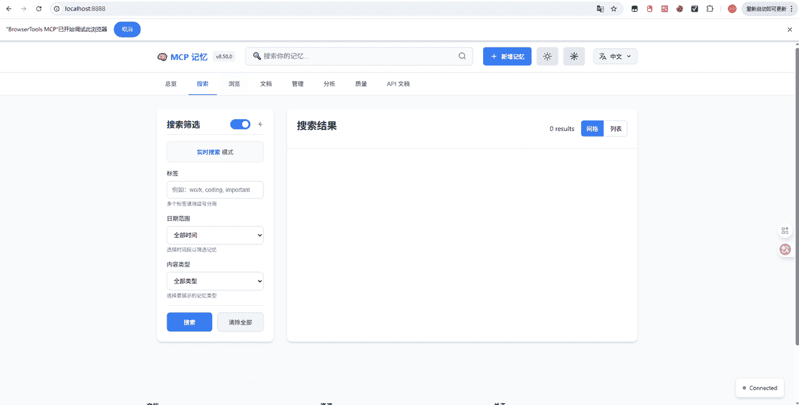
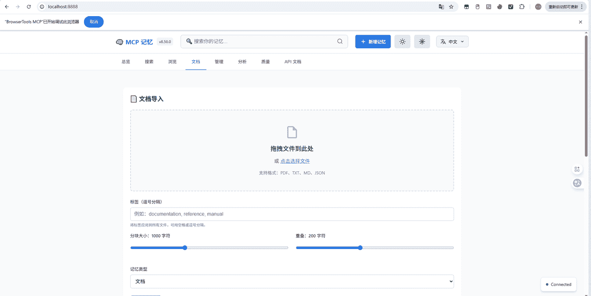
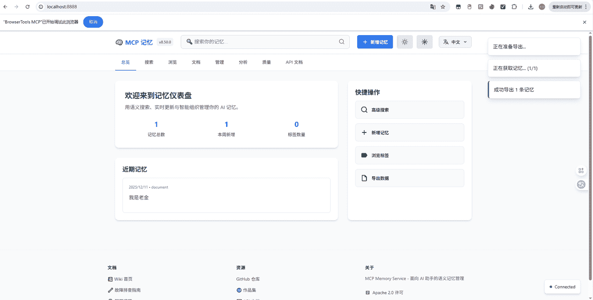
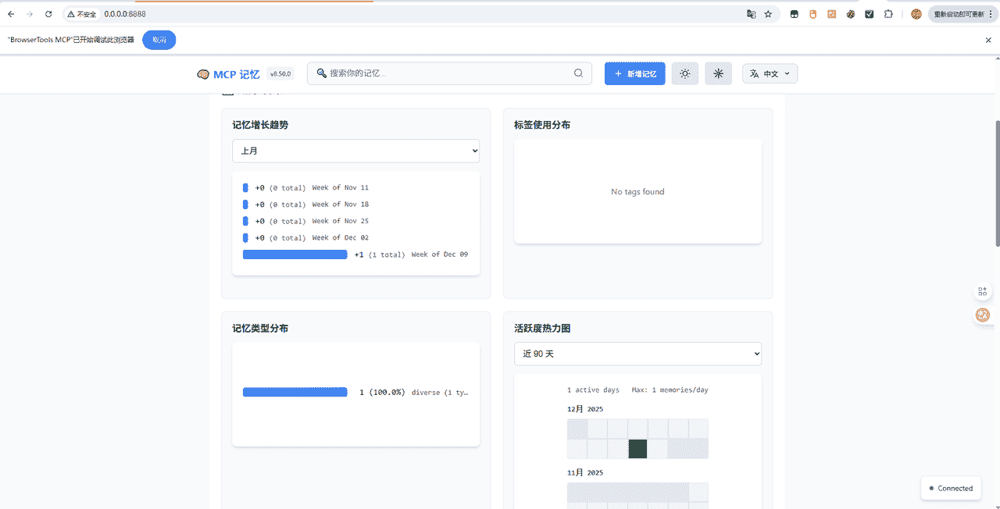
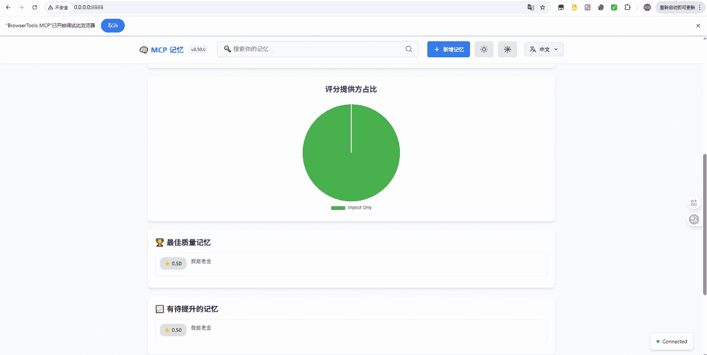
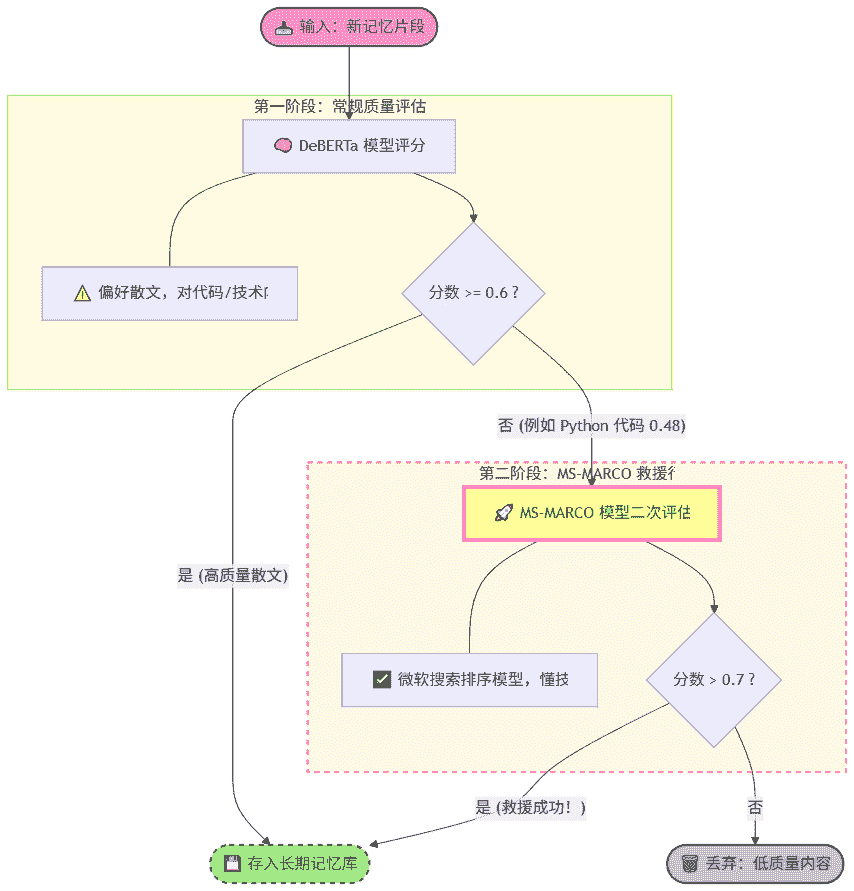
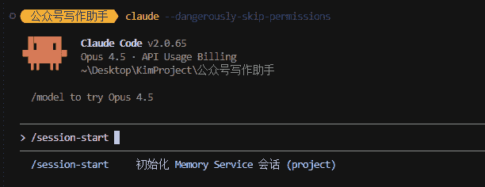
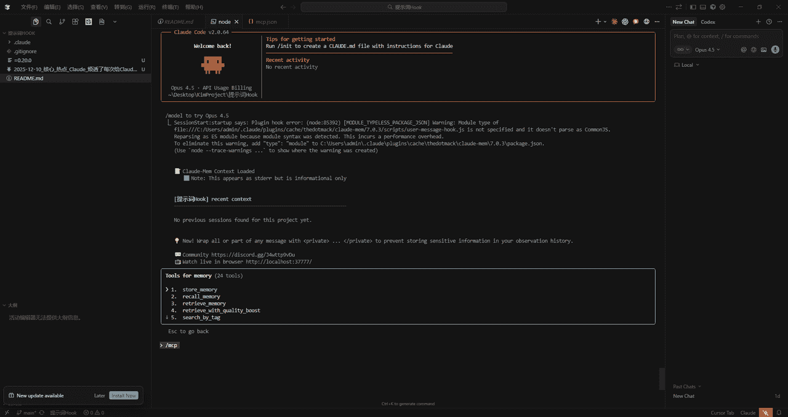

# 烦透了每次给Claude重复背景？手把手教你装这个神器，终极记忆神器

> 来源：[https://my.feishu.cn/docx/Te9Wdb0mhoOAfNxTCSOcOeeYnRf](https://my.feishu.cn/docx/Te9Wdb0mhoOAfNxTCSOcOeeYnRf)

## 上篇说的claude-mem，有人问我还有没有更强的

昨天那篇《Claude每次都失忆？两行命令装上这个神器》发出去后，评论区好几个人问我：

"老金，你说的`mcp-memory-service`到底怎么装？"

"`claude-mem`够用了，为啥还要装另一个？"

**"到底选哪个？"**

行，今天把这个坑填上。

友情提醒：本篇很长，略难，但功能极其强大！

## 先回顾一下：两个方案的区别

上篇讲的`claude-mem`，优点是简单——两行命令就能装。

但它有个局限：只能在Claude Code里用。

今天讲的`mcp-memory-service`，复杂一点，但能力强太多了：

+   支持`13+`个AI客户端（Claude Desktop、VS Code、Cursor...）

+   有混合存储（本地+云同步）

+   有`DeBERTa`智能分类（代码记忆不会被误删）

+   有团队协作（`OAuth`共享记忆）

**一句话总结**：`claude-mem`是"够用"，`mcp-memory-service`是"真香"。

直接先放老金觉得灰常牛X的几个功能，让你们能看下去！

非常舒服的Web页面操作，功能非常强大：

### 1、可手动输入和自动记忆和管理





### 2、搜索所有记忆



### 3、直接提交文档！



### 4、导出记忆！



### 5、最离谱的，它能分析质量，自己做迭代！





## 今天解决的核心问题

言归正传，还是那个老问题：**Claude不记得你是谁。**

每次开新对话，都得重新介绍一遍："我是做👸号的，技术栈是React+TypeScript，写作风格是这样，上次我们聊到哪了..."

**15分钟**，每次新对话建立上下文至少花15分钟。

一天开5次对话，就是1小时多。

`mcp-memory-service`，最新版`v8.50.0`（2025年12月9日发布）。

GitHub上901颗星，144个fork，106个版本迭代，20个贡献者。

玩了两天，这东西确实解决了我的痛点——上下文设置从15分钟压缩到30秒。

## 先说几个硬数据

这不是我瞎吹，是项目方在生产环境测出来的：

**上下文设置速度提升96.7%**

从15分钟压缩到30秒。

以前每次新对话要花15分钟重新建立上下文，现在30秒自动加载完。

**本地读取5ms**

比你打开一个网页都快。

用的是`SQLite-vec`做本地存储，零数据库锁，读写不冲突。

**令牌消耗减少65%**

通过`OAuth`协作，在Claude Code会话中令牌直降65%。

以前重复的背景信息要消耗大量令牌，现在自动复用。

**1700+条记忆在团队间使用**

这是实际部署的数据，不是实验室测试。

## 它到底干了什么

简单说，给Claude装了个"长期记忆"。

Claude本身是没有跨会话记忆的，每次对话都是全新开始。

`mcp-memory-service`的做法是：在本地建一个语义搜索数据库，把你的对话、偏好、项目上下文全存起来。

下次Claude需要的时候，自动把相关记忆调出来。

**什么是语义搜索？**

**不是**简单的关键词匹配，而是理解你说的话的含义。

比如你存了"项目用React 18 + TypeScript"，后来问"帮我写个组件"。

关键词匹配找不到（"组件"和"React"没有字面重叠），但语义搜索能找到（它理解这两个概念相关）。

这靠一个25MB的小模型（`all-MiniLM-L6-v2`）实现，首次启动会自动下载。

**国内用户注意**：可能需要手动处理下载问题，后面"坑5"会讲怎么解决。

### 三种存储模式

#### 混合模式（推荐）

快速本地SQLite + 后台Cloudflare同步。

5ms本地读取，多设备同步，零数据库锁。

这是`v8.9.0`之后的默认模式。

要用混合模式，需要配置Cloudflare凭证：

```
# 设置混合后端
export MCP_MEMORY_STORAGE_BACKEND=hybrid

# Cloudflare凭证（去Cloudflare控制台申请）
export CLOUDFLARE_API_TOKEN="你的token"
export CLOUDFLARE_ACCOUNT_ID="你的account-id"
export CLOUDFLARE_D1_DATABASE_ID="你的数据库id"
export CLOUDFLARE_VECTORIZE_INDEX="mcp-memory-index"

# SQLite优化参数（防止数据库锁）
export MCP_MEMORY_SQLITE_PRAGMAS="busy_timeout=15000,cache_size=20000"
```

不想配置Cloudflare？直接用SQLite-vec模式就行。

#### SQLite-vec模式

纯本地存储，轻量级`ONNX`嵌入。

适合单人离线使用，无需云依赖。

依赖小于100MB，装起来快。

#### Cloudflare模式

纯云存储，全球边缘分发。

适合团队协作，但性能依赖网络。

## 几个让我觉得骚的功能

### 自然记忆触发 v7.1.3

准确率85%以上。

你不用手动说"帮我存一下这个"，它会自动判断哪些信息值得记住。

比如你说"我的项目用React 18 + TypeScript"。

它自动就记下来了。

下次你问"帮我写个组件"，它知道用React 18的语法，不用你再提醒。

这功能在`v7.1.3`版本升级过，之前的准确率没这么高。

需要独立安装！在下面写了简单版！

详情请参考：https://github.com/doobidoo/mcp-memory-service/wiki/Memory-Hooks-Complete-Guide

### 梦境式记忆整合

名字有点中二，但功能挺实用。

它会定期整理你的记忆，做几件事：

**衰减评分**

用得少的记忆权重降低，常用的权重提高。

**关联发现**

把相关的记忆串起来，形成知识网络。

**压缩归档**

把重复的内容合并，减少存储空间。

类似于人睡觉时大脑整理白天的记忆，所以叫"梦境式"。

#### 怎么启用自动调度？

记忆整合需要启动HTTP服务器才能自动运行：

```
uv run memory server --http
```

这个老金下面Windows实战里会直接使用Http方式启动，直接看下面就行。

**调度频率**：

+   每日整合：清理重复、更新衰减分数

+   每周整合：发现关联、构建知识网络

+   每月整合：深度压缩、归档旧记忆

**性能参考**：2,495条记忆整合需要4-6分钟（hybrid后端）。

**手动触发整合**：

```
curl -X POST http://127.0.0.1:8888/api/consolidate

# 或者用MCP工具
# Claude里直接说"整合一下记忆"
```

### DeBERTa + MS-MARCO双模型救援（v8.50.0最新）

这是`v8.50.0`（12月9日发布）的重磅更新。

之前只用`DeBERTa`做质量评估，有个问题：它偏好散文，对代码和技术内容评分偏低。

比如你存一段Python代码，`DeBERTa`可能给0.48分（不合格），但这段代码其实很有价值。

解决方案：

**双模型串联**

`DeBERTa`先评分，分数低于0.6的不直接丢弃，而是交给`MS-MARCO`二次评估。

`MS-MARCO`是微软的搜索排序模型，对技术内容更友好。

如果`MS-MARCO`给分超过0.7，这条记忆就被"救"回来了。

**效果提升**

技术内容评分从0.48提升到0.70-0.80，提升45-65%。

简单说：**代码相关的记忆更不容易被误删了**。



### 文档摄取系统（v8.6.0）

这个功能很实用——可以直接上传文档让Claude记住。

**支持的格式**：PDF、TXT、MD、JSON

**怎么用**：

```
uv run memory server --http

open http://127.0.0.1:8888/
```

打开后可以直接 **拖拽上传文**，有实时进度条。

上传的文档会被自动分块、打标签、存入记忆库。

**命令行上传：**

```
curl -X POST http://127.0.0.1:8888/api/documents/upload \
  -F "file=@你的文档.pdf" \
  -F "tags=文档类型,项目名"
```

**使用场景**：

+   把项目的技术文档上传，Claude就能直接引用

+   把代码规范文档上传，生成的代码自动符合规范

+   把产品PRD上传，Claude能理解产品需求背景

### 基于关联的质量提升（v8.47.0）

连接数≥5的记忆，自动获得20%质量提升。

什么意思？

如果一条记忆跟其他5条以上记忆有关联（被引用、相似主题），系统就认为这是"知识中心"，自动提高它的质量评分。

**网络效应**：关联多的记忆更有价值，整合时不容易被删。

**可配置**：连接数阈值、提升因子都能通过环境变量调整。

### OAuth 2.1团队协作

如果你是团队用，可以通过`OAuth`共享记忆。

比如项目的技术规范、代码风格，团队成员都能同步。

**如果个人本地使用，把它关了就行，`MCP_OAUTH_ENABLED=false`。**

配置方法：

http://your-server:8000/mcp 换成你的服务器地址

```
# 启动OAuth服务器
export MCP_OAUTH_ENABLED=true
uv run memory server --http

# 团队成员连接
claude mcp add --transport http memory-service http://your-server:8000/mcp
```

自动`OAuth`发现、注册、认证，不用手动配来配去。

## 支持的客户端

不只是Claude Desktop，它支持一堆应用：

### Claude Desktop

原生MCP集成，最丝滑。

### Claude Code

HTTP传输 + 钩子，支持内存感知开发。

Windows用户注意：需要用`/session-start`手动初始化会话。

macOS和Linux是全自动的`SessionStart`钩子。



### VS Code、Cursor、Continue

通过IDE扩展接入。

### 13+个AI应用

兼容REST API的都能用。

### Web仪表盘

启动HTTP服务后，访问http://127.0.0.1:8888/有个交互式管理界面。

可以上传文档、搜索记忆、管理标签。

**启动方式**：

```
uv run memory server --http
```

或者设置环境变量：

```
export MCP_HTTP_ENABLED=true
uv run memory server
```

**官方Github地址：**https://github.com/doobidoo/mcp-memory-service

内容有很多，老金写这版是精华，想玩明白，还是去官方那挨个翻翻。

## 官方给的安装教程

### 最简单：PyPI安装

不想折腾的直接`pip`装：

```
pip install mcp-memory-service

# 或者用uv（更快）
uv pip install mcp-memory-service
```

装完直接用，不用克隆仓库。

### 推荐方法：轻量安装

```
git clone https://github.com/doobidoo/mcp-memory-service.git
cd mcp-memory-service

# 轻量安装（推荐）
# SQLite-vec + ONNX嵌入，依赖小于100MB
python install.py
```

如果你需要更高级的ML功能：

```
# 完整ML安装
# 添加PyTorch和sentence-transformers
python install.py --with-ml

# 混合后端安装
# SQLite-vec + Cloudflare同步
python install.py --storage-backend hybrid
```

### Docker安装（最快）

```
# MCP协议（Claude Desktop）
docker-compose up -d

# HTTP API + OAuth（团队协作）
docker-compose -f docker-compose.http.yml up -d
```

### Smithery一键安装

```
npx -y @smithery/cli install @doobidoo/mcp-memory-service --client claude
```

### Claude Desktop配置

在`~/.claude/claude_desktop_config.json`（macOS/Linux）或`%APPDATA%\Claude\claude_desktop_config.json`（Windows）添加：

```
{
  "mcpServers": {
    "memory": {
      "command": "python",
      "args": ["-m", "mcp_memory_service.server"]
    }
  }
}
```

## 老金Windows环境配置与验证

**前提**：已按照前面的方法完成基础安装（推荐用轻量安装）。

### 1. 创建启动脚本

在项目根目录创建 `start_server.ps1` 文件：


## 启动服务

```
$env:MCP_HTTP_PORT = "8888"
$env:MCP_OAUTH_ENABLED = "false"

Write-Host ""
Write-Host "========================================"
Write-Host "MCP Memory Service"
Write-Host "========================================"

# Auto cleanup: kill old process on port 8888
$port = 8888
$existingProcess = Get-NetTCPConnection -LocalPort $port -ErrorAction SilentlyContinue | Select-Object -ExpandProperty OwningProcess -Unique
if ($existingProcess) {
    Write-Host "[Cleanup] Port $port is occupied, killing old process..." -ForegroundColor Yellow
    foreach ($pid in $existingProcess) {
        try {
            Stop-Process -Id $pid -Force -ErrorAction SilentlyContinue
            Write-Host "[Cleanup] Killed process PID: $pid" -ForegroundColor Green
        } catch {
            Write-Host "[Warning] Cannot kill process PID: $pid" -ForegroundColor Red
        }
    }
    Start-Sleep -Seconds 1
}

Write-Host "URL: http://127.0.0.1:8888"
Write-Host "MCP Endpoint: http://127.0.0.1:8888/mcp"
Write-Host "========================================"
Write-Host ""

Set-Location $PSScriptRoot
python run_server.py

Write-Host ""
Write-Host "Server stopped."
Read-Host "Press Enter to exit"
```

创建`start_server.bat`文件：

双击运行或命令行执行。

```
@echo off
cd /d "%~dp0"
powershell -ExecutionPolicy Bypass -File "%~dp0start_server.ps1"
```

启动服务，窗口不能关！

```
双击 start_server.bat，看到以下输出表示成功：
========================================
MCP Memory Service
========================================
URL: http://127.0.0.1:8888
MCP Endpoint: http://127.0.0.1:8888/mcp
========================================

INFO:     Uvicorn running on http://0.0.0.0:8888
```

## 设定开机启动（可选）

创建`create_startup_shortcut.ps1`文件：

`C:\Users\admin\Desktop\KimProject\mcp-memory-service`，这个要换成自己的地址。

```
$WshShell = New-Object -ComObject WScript.Shell
$Shortcut = $WshShell.CreateShortcut("$env:APPDATA\Microsoft\Windows\Start Menu\Programs\Startup\MCP-Memory-Service.lnk")
$Shortcut.TargetPath = "C:\Users\admin\Desktop\KimProject\mcp-memory-service\start_server.bat"
$Shortcut.WorkingDirectory = "C:\Users\admin\Desktop\KimProject\mcp-memory-service"
$Shortcut.Save()
Write-Host "Startup shortcut created!"
```

## 2. MCP配置

配置文件位置：`C:\Users\admin\.claude\mcp.json`

添加以下配置：

```
{
  "mcpServers": {
    "mcp-memory-service": {
      "url": "http://127.0.0.1:8888/mcp",
      "transport": "http"
    }
  }
}
```

## 3. 验证测试

### 测试1：健康检查

```
curl http://127.0.0.1:8888/api/health
```

**成功响应**：

```
{
  "status": "healthy",
  "version": "8.50.0",
  "storage_backend": "sqlite_vec",
  "embedding_model": "all-MiniLM-L6-v2",
  "embedding_dim": 384
}
```

### 测试2：MCP初始化

```
curl -X POST http://127.0.0.1:8888/mcp -H "Content-Type: application/json" -d "{\"jsonrpc\":\"2.0\",\"id\":1,\"method\":\"initialize\",\"params\":{\"protocolVersion\":\"2024-11-05\",\"capabilities\":{},\"clientInfo\":{\"name\":\"test\",\"version\":\"1.0\"}}}"
```

**成功响应**：

```
{
  "jsonrpc": "2.0",
  "id": 1,
  "result": {
    "protocolVersion": "2024-11-05",
    "serverInfo": {
      "name": "mcp-memory-service",
      "version": "8.50.0"
    }
  }
}
```

### 测试3：工具列表

```
curl -X POST http://127.0.0.1:8888/mcp -H "Content-Type: application/json" -d "{\"jsonrpc\":\"2.0\",\"id\":2,\"method\":\"tools/list\",\"params\":{}}"
```

**可用工具**（40+个）：

+   `store_memory` - 存储记忆
+   `retrieve_memory` - 检索记忆
+   `retrieve_with_quality_boost` - 质量增强检索
+   `recall_memory` - 时间范围回忆
+   `search_by_tag` - 标签搜索
+   `delete_by_tag` - 标签删除
+   `ingest_document` - 文档摄取
+   `rate_memory` - 记忆评分

## 更高级的推荐方法

当然交给AI自己安装

## 安装后验证



## 自动记忆部分

### Claude Code

HTTP传输 + 钩子，支持内存感知开发。

Windows用户注意：需要用`/session-start`手动初始化会话。

macOS和Linux是全自动的`SessionStart`钩子。

需要独立安装！这是简单版！

详情请参考：https://github.com/doobidoo/mcp-memory-service/wiki/Memory-Hooks-Complete-Guide

### 查看当前状态

```
# Check if hooks are installed
ls ~/.claude/hooks/

# Check Natural Memory Triggers specifically
node ~/.claude/hooks/memory-mode-controller.js status
```

### 安装（30 秒）

```
# Clone repository (if not already done)
git clone https://github.com/doobidoo/mcp-memory-service.git
cd mcp-memory-service/claude-hooks

# Install with Natural Memory Triggers (recommended)
python install_hooks.py --natural-triggers
```

### 验证安装

```
# Test the system
node ~/.claude/hooks/test-natural-triggers.js

# Check CLI controller
node ~/.claude/hooks/memory-mode-controller.js status
```

### Claude Code settings.json 配置

安装程序会自动更新`~/.claude/settings.json`，添加：

```
  {
      "hooks": [
      {
        "pattern": "session-start",
        "command": "node ~/.claude/hooks/core/session-start.js"
      },
      {
        "pattern": "user-prompt-submit",
        "command": "node ~/.claude/hooks/core/mid-conversation.js"
      },
      {
        "pattern": "session-end",
        "command": "node ~/.claude/hooks/core/session-end.js"
      }
    ]
  }
```

### Hooks配置文件

位置：`~/.claude/hooks/config.json`

那个`apiKey`是你本地 Memory Service 的 API Key，来自`c:\Users\admin\.claude\hooks\config.json`。

这是一个本地服务的认证密钥，由你本地运行的 Memory Service（端口 8888）自己生成和管理的。它不是从外部服务获取的，而是：

1.  当你安装/配置这个 Memory Service 时自动生成

2.  或者你手动设置的一个任意字符串

这个 key 只在你本地机器上有效，用于 Claude Code hooks 与本地 Memory Service 之间的认证。

```
  {
    "memoryService": {
      "endpoint": "https://localhost:8888",
      "apiKey": "your-api-key"
    },
    "naturalTriggers": {
      "enabled": true,
      "triggerThreshold": 0.6,
      "cooldownPeriod": 30000,
      "maxMemoriesPerTrigger": 5
    }
  }
```

## 配置有几个坑

### 坑1：Python版本问题

`sqlite-vec`可能还没有Python 3.13的预编译wheel。

**解决方案**：用Python 3.12

```
brew install python@3.12
```

或者用Cloudflare后端绕过：

```
python install.py --storage-backend cloudflare
```

### 坑2：macOS SQLite扩展问题

macOS系统Python默认缺少SQLite扩展支持。

**解决方案**：用Homebrew Python

```
brew install python && rehash
```

或者用pyenv编译时启用扩展：

```
PYTHON_CONFIGURE_OPTS='--enable-loadable-sqlite-extensions' pyenv install 3.12.0
```

### 坑3：Windows会话初始化

Windows的Claude Code不支持自动`SessionStart`钩子。

**解决方案**：手动运行`/session-start`命令初始化会话

macOS和Linux用户不用管，全自动。

### 坑4：首次启动警告

首次运行会看到几个警告，别慌：

+   警告：无法从缓存加载：没有快照目录 - 正在检查缓存模型

+   警告：使用 `TRANSFORMERS_CACHE` 已弃用 - 信息性警告，不影响功能

+   模型下载进行中 - 自动下载25MB嵌入模型，需要1-2分钟

首次成功运行后这些警告就消失了。

### 坑5：国内网络无法下载模型（重要！）

首次启动需要从Hugging Face下载25MB的语义模型。

**国内网络大概率会报错**：

```
Model Download Error: Cannot connect to huggingface.co
```

**解决方案**：使用国内镜像手动下载

Windows用户（CMD或PowerShell）：

```
set HF_ENDPOINT=https://hf-mirror.com
python -c "from sentence_transformers import SentenceTransformer; SentenceTransformer('all-MiniLM-L6-v2')"
```

macOS/Linux用户：

```
export HF_ENDPOINT=https://hf-mirror.com
python -c "from sentence_transformers import SentenceTransformer; SentenceTransformer('all-MiniLM-L6-v2')"
```

看到类似`Model loaded successfully`的输出就成功了。

模型只需下载一次，后续启动会直接用缓存。

能🪜的用户可以跳过这步，首次启动会自动下载。

## 后续维护

### 日常使用

+   开机自启：将`start_server.bat`添加到Windows启动项


+   定期备份：备份 `C:\Users\admin\AppData\Local\mcp-memory\sqlite_vec.db`

**性能优化**：

+   如需多设备同步，配置Cloudflare混合后端

+   定期手动触发记忆整合：访问 `http://127.0.0.1:8888/api/consolidate`

---

# 装好了，怎么用？

下面是几个最常用的命令，掌握这些就够日常使用了。

## 基本用法

以下所有内容均可通过Web页面进行操作。

### 存储记忆

```
uv run memory store "项目用React 18 + TypeScript，代码风格遵循Airbnb规范"
```

### 搜索记忆

```
uv run memory recall "React代码风格"
```

### 按标签搜索

```
uv run memory search --tags python debugging
```

### 检查系统状态

```
uv run memory health
```

### 上传文档

```
curl -X POST http://127.0.0.1:8888/api/documents/upload \
  -F "file=@document.pdf" \
  -F "tags=documentation,reference"
```

### 搜索文档内容

```
curl -X POST http://127.0.0.1:8888/api/search \
  -H "Content-Type: application/json" \
  -d '{"query": "authentication flow", "limit": 10}'
```

## 对比了几个同类工具

市面上做Claude记忆的不只这一个：

OpenMemory MCP（Mem0出的）

本地优先，跨工具共享上下文。

Mem0刚融了$24M，公司靠谱。

但功能相对简单，没有记忆整合和DeBERTa分类器。

WhenMoon的claude-memory-mcp

轻量级，零云端依赖，单个SQLite文件。

适合不想折腾的人，但功能有限。

Knowledge Graph Memory Server

Anthropic官方出的，用知识图谱存记忆。

有官方背书，但只能做基础的实体和关系存储。

mcp-memory-service的差异化

+   混合后端：本地SQLite + Cloudflare云同步

+   自动触发：85%准确率的自然记忆触发

+   记忆整合：梦境式算法自动清理和关联

+   质量分类：DeBERTa消除假阳性

+   多客户端：13+应用支持

+   多语言：日韩德法西中文全支持（v8.44.0）

## 实际体验怎么样

用了两天，说几个真实感受：

### 开新对话不用重复背景了

以前每次都要说一遍项目技术栈。

现在它直接就知道，省了不少口舌。

### 代码风格一致性变好了

它记住了我喜欢的代码风格，生成的代码不用再手动调格式。

### 团队协作效率提升明显

通过OAuth共享记忆，新成员上手项目快多了。

不用每次都解释项目背景和规范。

### 偶尔会调出不相关的记忆

这个是缺点。

85%准确率嘛，还有15%会出岔子。

不过DeBERTa分类器加进来后，假阳性少了很多。

## 值不值得装

我的结论是：**看你用Claude的频率**。

### 如果你每天都用Claude干活

强烈建议装。

上下文设置从15分钟变30秒，令牌消耗降65%。

省下的时间和钱，一周就值回票价。

### 如果只是偶尔用用

可以先不折腾。

配置确实有几个坑，偶尔用的话收益不明显。

### 如果你是Claude Code重度用户

必装。

代码项目的上下文特别多，手动同步太痛苦了。

而且近期版本新增了DeBERTa + MS-MARCO救援机制，代码相关的记忆整合更准了。

## 最后说两句

昨天讲的claude-mem，两行命令就能用，适合只用Claude Code的人。

今天讲的mcp-memory-service，配置复杂一点，但功能强太多了。

### 怎么选？

+   只用Claude Code → 装claude-mem就够了

+   想跨多个AI工具用 → 装mcp-memory-service

+   有团队协作需求 → 必须mcp-memory-service

Claude的记忆问题，Anthropic官方也在做。

据说2025年会在更多地区推出官方Memory功能。

但在那之前，mcp-memory-service是我用过的最完整的第三方方案。

106个版本迭代，20个贡献者，社区挺活跃的。

有问题可以去GitHub提issue，作者doobidoo回复挺快。

项目地址在引用来源里，感兴趣的自己去看。

你用Claude的时候，最烦的是什么问题？评论区聊聊~

如果这篇对你有帮助，点个"在看"，我继续挖好用的AI工具。

## 引用来源（供验证）

+   GitHub仓库：mcp-memory-service项目主页 `https://github.com/doobidoo/mcp-memory-service`

+   Mintlify博客：Claude记忆与MCP工作原理解析 `https://www.mintlify.com/blog/how-claudes-memory-and-mcp-work`

+   Mem0官方：OpenMemory MCP介绍 `https://mem0.ai/blog/introducing-openmemory-mcp`

+   AIMultiple：Memory MCP工具评测与教程 `https://research.aimultiple.com/memory-mcp/`

+   Glama：MCP Memory Service详情页 `https://glama.ai/mcp/servers/@doobidoo/mcp-memory-service`

<https://my.feishu.cn/sync/HDlcdCPBksnJpBbRk0EcW364nmc>
