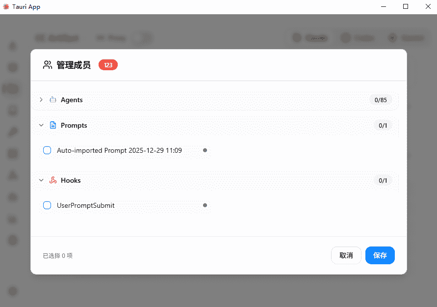
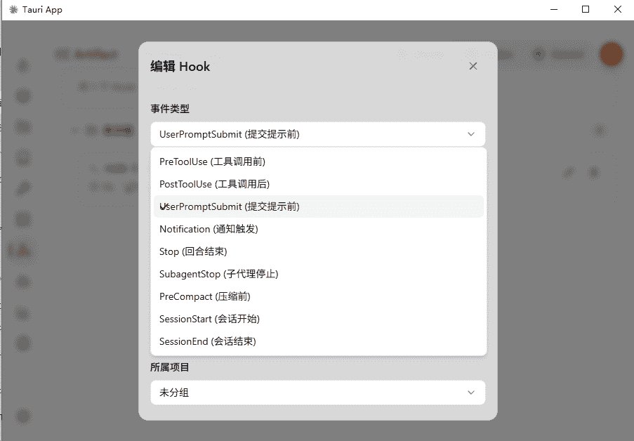
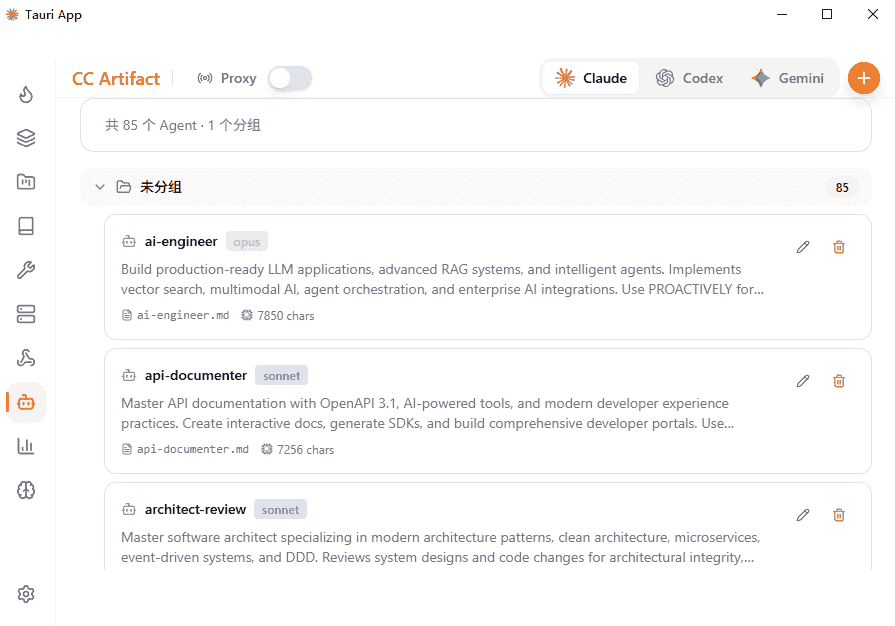

# 2026开年教程！Claude Code七大组件，老金一篇讲明明白白！90%的人只会用1个！

> 来源：[https://my.feishu.cn/docx/EwTOdDQK5o0uJex9aPrcpZ3Enob](https://my.feishu.cn/docx/EwTOdDQK5o0uJex9aPrcpZ3Enob)

上周有个读者私信我：

> "老金，我用Claude Code写了3个月代码，感觉和普通ChatGPT没啥区别啊？"

我问他：你用过Skills吗？用过MCP吗？配过Hooks吗？

他说：那是啥？

乖乖。

这就像买了辆特斯拉，只会踩油门刹车，自动驾驶从来没开过。

Claude Code其实是个"七件套"。

Skills、MCP、Commands、Hooks、Subagents、`CLAUDE.md`、Plugins。

老金也在整个新项目，还没做完，能一键使用这些了，并且是分组快速开关。

灵感来源自CC Switch，MCP Router，Code Switch，Antigravity Tools等优秀的项目。

还没做完，敬请期待 = =

嗯对，再次说，我不懂代码，英语极差。

我做出来的一些东西反而广受好评，意思就是想告诉大家，不要因为不会代码而望而却步。







老金我统计过：

+ 只用`CLAUDE.md`的人：效率提升1.5倍

+ 用上Skills+Commands的人：效率提升3倍

+ 七个组件都用好的人：效率提升**10倍以上**

今天一次性给你讲透。

保证小白也能听懂。

就比如上面这个软件的现状，是用了几个小时做的。现在花时间的是测试 = =

## 先用一个类比搞懂全局

把Claude Code想象成一家餐厅。

`CLAUDE.md` = 餐厅菜单

告诉厨师你喜欢什么口味。

有什么忌口。

`Commands` = 服务员

你点菜的入口。

喊一声`/红烧肉`。

服务员就去后厨传话。

`Skills` = 厨师的菜谱

详细写着红烧肉怎么做。

先焯水。

再炒糖色。

然后炖40分钟...

`MCP` = 外卖平台

餐厅自己做不了的菜。

比如寿司。

就从外面叫。

`Hooks` = 质检员

每道菜出锅前检查一下。

不合格打回去重做。

`Subagents` = 帮厨

一个厨师忙不过来。

叫几个帮厨同时做不同的菜。

`Plugins` = 预制菜包

别人调好的料包。

拆开就能用。

不用自己配料。

**记住这个类比。**

**下面的内容就好懂了。**

## 1、`CLAUDE.md`：项目记忆

这是最简单的组件。

新手先学这个。

**是什么？**

就是一个配置文件。

放在项目根目录。

Claude每次启动都会自动读取它。

**干嘛用？**

告诉Claude这个项目是干嘛的。

用什么技术栈。

有什么规范。

**怎么用？**

在项目根目录创建一个`CLAUDE.md`文件：

```markdown
# 我的项目

这是一个React项目，用TypeScript写的。

## 代码规范
- 组件用函数式写法
- 状态管理用Zustand
- 样式用Tailwind

## 注意事项
- 不要用class组件
- 提交前跑一遍eslint
```

就这么简单。

Claude看到这个文件。

就知道你的项目是啥情况了。

**老金实测**：加了`CLAUDE.md`之后，代码风格一致性提升了一大截。

不用每次都重复说"用TypeScript"。

也不用每次都说"用函数式组件"。

省心多了。

**快捷操作**：

1、`#`键快速添加指令（官方功能）

这是Claude Code的隐藏神器。

在对话中直接按`#`键，输入你想让Claude记住的规则。

Claude会自动把它写入对应的`CLAUDE.md`文件。

比如你想让Claude以后都用中文注释：

```
# 所有代码注释用中文
```

按回车，Claude就自动帮你写进`CLAUDE.md`了。

不用手动打开文件编辑。

**适用场景**：

发现Claude老是犯同一个错？

用`#`键加一条规则，以后就不会再犯了。

2、`/init`命令自动生成

新项目不知道怎么写`CLAUDE.md`？

运行`/init`命令。

Claude会分析你的项目结构、技术栈、依赖。

然后自动生成一份`CLAUDE.md`。

**老金实测**：`/init`生成的配置文件，80%的内容可以直接用。

剩下20%根据自己习惯微调就行。

**优势**：

简单易用，新手10分钟就能上手。

自动加载，不用手动告诉Claude去读。

多级配置灵活，全局+用户+项目三级覆盖。

支持父目录和子目录的`CLAUDE.md`按需加载。

**劣势**：

静态配置，运行时无法动态调整。

纯文本，没有条件判断能力。

项目大了之后，配置文件可能变得很长。

**多级配置**：

`CLAUDE.md`支持三个级别的配置，按优先级从低到高：

1、`~/.claude/CLAUDE.md`

适用于所有项目的通用规范。

比如你的代码风格偏好、常用技术栈。

2、`~/CLAUDE.md`

用户级别的个人偏好。

3、`./CLAUDE.md`（项目根目录）

项目特定的规范和上下文。

优先级最高，会覆盖全局配置。

**加载顺序**：Claude启动时会按顺序读取这三个文件，后面的覆盖前面的。

老金我的用法：

全局配置写通用规范（代码风格、注释习惯）。

项目配置写项目特定的东西（技术栈、业务逻辑）。

这样新项目只需要写项目配置就行。

## 2、`Commands`：快捷入口

**是什么？**

就是`/xxx`这种斜杠命令。

**干嘛用？**

快速触发某个功能。

不用每次都打一大段话。

**怎么用？**

在`.claude/commands/`目录下创建一个markdown文件：

```markdown
# 文件名：write-article.md

帮我写一篇公众号文章，主题是：$ARGUMENTS

要求：
1、用老金风格
2、字数2000-3000
3、保存到articles目录
```

然后在终端输入：

```
/write-article Claude Code教程
```

Claude就会按照你定义的模板执行。

**老金实测**：我现在写文章就一句话。

`/01-write [主题]`，剩下的全自动。

**优势**：

一句话触发复杂流程，效率拉满。

支持`$ARGUMENTS`传参，灵活度高。

团队共享命令，统一工作流。

**劣势**：

功能相对单一，只是入口不是逻辑。

没有条件判断，复杂场景得配合Skills。

命令多了容易忘，得维护文档。

## 3、`Skills`：工作流模板

这是七个组件里最核心的一个。

**是什么？**

一堆提示词模板。

打包成一个"技能"。

**干嘛用？**

把复杂的工作流程模板化。

比如"写👸号文章"这个流程：

搜索资料。

读取规范。

写作。

生成标题。

保存。

质检。

六个步骤。

打包成一个Skill。

以后一句话就能搞定。

**怎么用？**

在`.claude/skills/`目录下创建一个文件夹。

里面放一个`SKILL.md`：

```markdown
---
name: article-writer
description: 公众号文章写作助手
allowed-tools: WebSearch, Read, Write
---

# 文章写作流程

## 步骤1：搜索最新资料
用WebSearch搜索主题相关的最新信息

## 步骤2：读取写作规范
Read(".claude/skills/article-writer/style-guide.md")

## 步骤3：写作
基于搜索结果和规范，写一篇2500字的文章

## 步骤4：保存
Write到articles目录
```

**关键点**：`allowed-tools`这一行很重要。

写在这里的工具。

执行时不用你点确认。

直接自动批准。

**老金实测**：我的写作Skill有500多行。

包含了爆款公式。

包含了风格规范。

包含了质检标准。

每次写文章，Claude就按这个流程走。

质量稳定。

**`Skills`的智能特性**：

很多人不知道，Skills不是死板的配置文件。

它有四个智能特性：

1、自动发现

Claude启动时会自动扫描`.claude/skills/`目录。

你不用手动告诉它"我有哪些技能"。

放进去就能用。

2、上下文驱动加载

Claude不会一股脑把所有Skills都加载进来。

它会根据你当前的任务，动态选择相关的Skill。

比如你说"写文章"，它才会加载写作Skill。

你说"改代码"，它就不会加载写作Skill。

省token。

3、渐进式披露

Skill里的指令不是一次性全部注入。

Claude会按需展示能力。

避免信息过载。

4、动态加载

运行时按需激活。

不用的Skill不占资源。

**完整目录结构**：

一个规范的Skill长这样：

```
.claude/skills/
├── my-skill/
│   ├── SKILL.md          # 技能定义（必须有）
│   ├── instructions/     # 详细指令
│   ├── prompts/          # 提示词模板
│   ├── templates/        # 代码/文档模板
│   └── config/           # 配置文件
```

`SKILL.md`是入口文件。

Claude通过它知道这个Skill是干嘛的。

其他目录按需创建。

老金我的写作Skill就用了这个完整结构。

`instructions`里放写作流程。

`prompts`里放风格规范。

`templates`里放文章模板。

`config`里放质检配置。

**优势**：

自动发现，放进去就能用，不用手动注册。

上下文驱动加载，省token，不用的Skill不占资源。

模块化设计，一个Skill专注一件事，好维护。

可复用，写好一次，到处能用。

**劣势**：

学习曲线陡，目录结构、`SKILL.md`写法都要学。

调试困难，Skill没生效不知道是哪里出问题。

维护成本，Skill多了容易乱，得有文档记录。

依赖Claude理解，Skill写得不清楚，Claude可能理解错。

**老金建议**：

先从简单Skill开始，一个`SKILL.md`就够了。

复杂了再加`instructions`、`prompts`目录。

Skill描述写清楚，让Claude知道什么时候该用。

## 4、`MCP`：外部工具接口

**是什么？**

Model Context Protocol。

一个调用外部程序的协议。

简单说就是让Claude能用外部工具。

**干嘛用？**

Claude本身做不到的事。

比如截图、操作浏览器、查GitHub。

这些都得靠MCP。

**怎么用？**

在项目根目录创建`.mcp.json`：

```json
{
  "mcpServers": {
    "chrome-devtools": {
      "command": "npx",
      "args": ["@anthropic/mcp-chrome-devtools"]
    }
  }
}
```

配置好之后。

Claude就能调用这个MCP服务器了。

它提供的工具都能用。

比如截图：

```
mcp__chrome-devtools__take_screenshot()
```

**`Skills`和`MCP`的区别**：

`Skills`是"怎么做"。

定义工作流程。

`MCP`是"用什么做"。

提供工具能力。

打个比方：

`Skills`是菜谱。

告诉你红烧肉怎么做。

`MCP`是厨具。

给你锅碗瓢盆。

**老金实测**：我装了5个MCP服务器。

能截图。

能操作浏览器。

能查GitHub。

能读PDF。

Claude的能力直接翻倍。

**调试技巧**：

MCP配置出问题了怎么办？

用`--mcp-debug`标志启动Claude Code：

```
claude --mcp-debug
```

它会显示详细的MCP连接日志。

哪个服务器没连上，一目了然。

**优势**：

能力扩展无限，Claude本身做不到的事都能通过MCP实现。

标准化协议，一次配置到处能用，不用重复造轮子。

社区资源丰富，常用功能基本都有现成的MCP服务器。

热插拔，需要的时候启用，不需要的时候关掉。

**劣势**：

Token消耗暴增，每个MCP服务器启动时都要向Claude注册工具列表，装10个光工具描述就吃掉几千token。

响应变慢，MCP工具调用是同步的，装太多服务器Claude要等每个都响应。

内存问题，部分MCP服务器有内存泄漏，跑久了可能JavaScript堆溢出。

配置门槛，需要懂JSON配置和命令行，小白上手有难度。

**老金建议**：

常用的装3-5个就够了。

别贪多。

用不到的及时关掉。

## 5、`Hooks`：事件钩子

**是什么？**

在特定事件发生时自动触发的脚本。

就像监控摄像头。

有动静就响。

**干嘛用？**

两个主要用途：

1、拦截危险操作。

比如阻止删除重要文件。

2、自动处理。

比如每次保存文件后自动格式化。

**怎么用？**

在`.claude/settings.json`里配置：

```json
{
  "hooks": {
    "PreToolUse": [
      {
        "matcher": "Write",
        "hooks": ["python .claude/hooks/check_before_write.py"]
      }
    ]
  }
}
```

这个配置的意思是：

每次Claude要写文件之前。

先跑一下脚本。

脚本名叫`check_before_write.py`。

**九种`Hook`事件**：

**`PreToolUse`**：工具调用前触发。

用来拦截危险操作。

**`PostToolUse`**：工具调用后触发。

用来处理结果、记录日志。

**`SessionStart`**：会话开始时触发。

用来初始化环境、加载上下文。

**`SessionEnd`**：会话结束时触发。

用来清理资源、生成报告。

**`PreCompact`**：对话压缩前触发。

用来保存重要上下文，防止压缩丢失关键信息。

`UserPromptSubmit`：用户提交提示后触发。

用来增强提示、预处理输入。

`Notification`：通知事件触发。

用来自定义通知处理。

`Stop`：停止信号触发。

用来优雅终止、释放资源。

`SubagentStop`：子代理停止时触发。

用来清理子任务。

**老金实测**：我配了一个`PreToolUse` `Hook`。

专门检查Claude要写的代码有没有脏话。

别问为什么。

问就是踩过坑。

**优势**：

安全守护，危险操作自动拦截，防止Claude干傻事。

自动化处理，保存文件后自动格式化、自动跑测试。

灵活配置，9种事件类型覆盖全生命周期。

脚本自由，Python/Bash/Node随便写。

**劣势**：

调试困难，Hook脚本出错了不好排查。

性能开销，每次工具调用都要跑Hook，复杂脚本会拖慢速度。

维护成本，脚本多了容易乱，得有文档记录。

学习曲线，需要理解Claude Code的事件机制。

**老金建议**：

先从`PreToolUse`开始，拦截危险操作最实用。

脚本保持简单，复杂逻辑拆成多个小脚本。

加好日志，出问题能快速定位。

## 6、`Subagents`：分身术

**是什么？**

独立的Claude实例。

可以并行执行任务。

就像分身术一样。

**干嘛用？**

一个Claude忙不过来的时候。

叫几个"分身"同时干活。

**怎么用？**

用`Task`工具：

```
Task(subagent_type="Explore", prompt="搜索项目里所有的API端点")
```

这个命令会启动一个专门搜索代码的子代理。

让它去干活。

主Claude继续做别的。

**常用的子代理类型**：

**`Explore`**：快速搜索代码库。

**`Plan`**：设计实现方案。

**`debugger`**：调试错误。

**思考层级（官方定义）**：

让Claude深度思考时，用这些关键词：

+ `think` → 标准思考

+ `think hard` → 深度思考

+ `think harder` → 更深度思考

+ `ultrathink` → 极限思考

每个层级分配的思考预算递增。

复杂问题用`ultrathink`，简单问题用`think`就够了。

**后台运行模式**：

子代理还支持后台运行。

加个`run_in_background=true`参数：

```
Task(subagent_type="Explore", prompt="搜索所有API端点", run_in_background=true)
```

这样主Claude可以继续干别的。

子代理在后台默默干活。

干完了用`TaskOutput`取结果。

**典型场景**：

开发服务器持续运行。

测试套件执行。

构建过程。

这些耗时任务都适合后台跑。

**老金实测**：写复杂功能的时候。

我会让一个子代理去搜索相关代码。

另一个子代理去查文档。

主Claude负责整合。

效率提升很明显。

**优势**：

并行处理，多个任务同时跑，效率翻倍。


# Claude Code 七个组件详解与使用建议

## Subagents：独立子代理

独立上下文，每个子代理专注自己的任务，不互相干扰。

后台运行模式，主Claude可以继续干别的，不用干等。

专业分工，不同类型的子代理擅长不同任务。

### 劣势

Token爆炸，每个子代理都独立消耗token，开3个子代理就是3倍消耗。

协调复杂，多个子代理的结果需要整合，有时候会冲突。

调试困难，出问题了不知道是哪个子代理的锅。

启动开销，每个子代理启动都需要时间，简单任务反而更慢。

### 老金建议

简单任务别用子代理，杀鸡用牛刀。

复杂任务才值得开子代理，比如同时搜索+分析+写代码。

注意token消耗，别一口气开太多。

## Plugins：预制技能包

### 是什么？

别人做好的`Skills`集合。

打包成插件。

一个插件可以包含多种能力：

`Commands`、`Agents`、`Skills`、`Hooks`、`MCP`服务器。

### 干嘛用？

不用自己写`Skill`。

装上就能用。

### 怎么用？

用`/plugin`命令安装：

```
/plugin add anthropic-agent-skills
```

装完之后。

你就多了一堆现成的技能。

看看都有啥：

```
document-skills:pdf    # 处理PDF
document-skills:xlsx   # 处理Excel
document-skills:pptx   # 处理PPT
```

### 官方插件仓库有13个插件

老金我挑几个实用的说说：

### `code-review`

自动PR代码审查。

启动5个Sonnet并行审查你的代码。

一个看安全问题。

一个看性能问题。

一个看代码风格。

效率拉满。

### `commit-commands`

Git工作流自动化。

`/commit`一键提交。

`/commit-push-pr`一键提交+推送+创建PR。

懒人福音。

### `security-guidance`：安全提醒`Hook`

每次你调用工具前。

它会检查9种安全模式。

防止你写出有漏洞的代码。

### `hookify`

自定义`Hooks`创建工具。

不会写`Hook`？

用这个插件帮你生成。

### 老金实测

官方的`document-skills`插件真香。

处理PDF？一句话。

处理Excel？一句话。

处理PPT？还是一句话。

### ⚠️ 插件和 `Skills` 的区别

`Skills`是单一工作流模板。

`Plugins`是打包好的能力集合。

打个比方：

`Skills`是一道菜的菜谱。

`Plugins`是一整套预制菜包。

里面可能有好几道菜的料包。

### 优势

开箱即用，装上就能用，不用自己写`Skill`。

社区资源丰富，官方13个插件覆盖常见场景。

功能打包完整，一个插件可能包含多个`Skills`、`Commands`、`Hooks`。

### 劣势

依赖第三方维护，插件作者不更新你就卡住了。

定制性差，想改插件内部逻辑很麻烦。

版本兼容问题，Claude Code更新后插件可能失效。

黑盒操作，不知道插件内部具体做了什么。

### 老金建议

先用官方插件，稳定靠谱。社区插件谨慎选择，看看star数和更新频率。

## 七个组件怎么配合？

来，老金我画个流程图：

```
你输入 /write-article Claude教程
         ↓
    Commands（入口）
    识别到/write-article命令
         ↓
    Skills（工作流）
    加载article-writer技能
    注入500行写作指令
         ↓
    Hooks.PreToolUse（质检）
    检查即将调用的工具是否安全
         ↓
    MCP（外部工具）
    调用搜索、截图等外部能力
         ↓
    Subagents（并行）
    启动子代理同时搜索多个来源
         ↓
    CLAUDE.md（上下文）
    读取项目配置，了解写作规范
         ↓
    Plugins（预制能力）
    使用PDF处理等现成技能
         ↓
    Hooks.PostToolUse（后处理）
    检查输出结果，自动格式化
         ↓
    输出结果
```

### 七个组件各司其职

### 串起来就是一个完整的工作流

## 老金建议：学习顺序

刚开始用Claude Code，别贪多。

按这个顺序学：

### 第一步：`CLAUDE.md`

最简单。

写个项目说明就行。

花10分钟搞定。

### 第二步：`Commands`

定义几个常用命令。

花30分钟搞定。

### 第三步：`Skills`

把常用工作流模板化。

这个要花点时间。

但回报最大。

### 第四步：`MCP`

装几个常用的`MCP`服务器。

官方的`chrome-devtools`挺好用。

`github`那个也不错。

### 第五步：`Hooks`

配置一些安全检查。

防止Claude干傻事。

### 第六步：`Subagents`

学会用`Task`工具启动子代理。

复杂任务用得上。

### 第七步：`Plugins`

探索社区插件。

有现成的就别自己造轮子。

七个组件都用好，效率翻倍不是吹的。

## 小白常见问题FAQ

Q1：我是纯小白，应该从哪个组件开始学？

从`CLAUDE.md`开始。

在项目根目录创建一个文件，写几句话告诉Claude你的项目是干嘛的。

10分钟搞定，立刻见效。

Q2：`Skills`和`Commands`有什么区别？

`Commands`是入口（服务员），`Skills`是流程（菜谱）。

你喊`/写文章"，`Commands`接收命令，然后调用`Skills`里的写作流程。

简单任务用`Commands`就够了，复杂工作流才需要`Skills`。

### Q3：`MCP`装多少个合适？

3-5个就够了。

装太多会：

+   Token消耗暴增（每个`MCP`启动都要注册工具列表）

+   响应变慢（Claude要等每个`MCP`响应）

+   可能内存泄漏

老金推荐必装：`chrome-devtools`、`github`。

其他按需装。

Q4：`Hooks`会不会拖慢速度？

会，但可以接受。

每次工具调用都会触发`Hook`脚本。

脚本保持简单（<100行），影响可以忽略。

复杂逻辑拆成多个小脚本。

Q5：`Subagents`和普通对话有什么区别？

`Subagents`是独立的Claude实例。

有自己的上下文，不会污染主对话。

适合并行任务：一个搜代码，一个查文档，主Claude整合。

但注意：每个子代理都独立消耗Token！

Q6：`Plugins`和`Skills`到底怎么选？

+   有现成`Plugins` → 直接用，省时间

+   没有合适的 → 自己写`Skills`

+   `Plugins`是别人打包好的`Skills`集合

### Q7：这七个组件必须全部用吗？

不用。

按需使用：

+   个人项目：`CLAUDE.md` + `Commands` 就够了

+   团队协作：加上`Skills`统一工作流

+   复杂项目：全套上阵

## 老金总结

七个组件，说白了就是让Claude Code从"能用"变成"好用"。

老金我用了半年，最大的感受是：

不是组件越多越好，而是用对场景最重要。

个人项目？`CLAUDE.md` + `Commands`够了。

团队协作？加上`Skills`统一工作流。

复杂项目？全套上阵，效率翻10倍不是吹的。

你们现在用了几个组件？

有没有发现什么好用的搭配？

评论区聊聊，老金我也想学习学习。

一起交流！

---

谢谢你读我的文章。

如果觉得不错，随手点个赞、在看、转发三连吧🙂

如果想第一时间收到推送，也可以给我个星标⭐～谢谢你看我的文章。

开源知识库地址：https://tffyvtlai4.feishu.cn/wiki/OhQ8wqntFihcI1kWVDlcNdpznFf

<https://my.feishu.cn/sync/HDlcdCPBksnJpBbRk0EcW364nmc>
