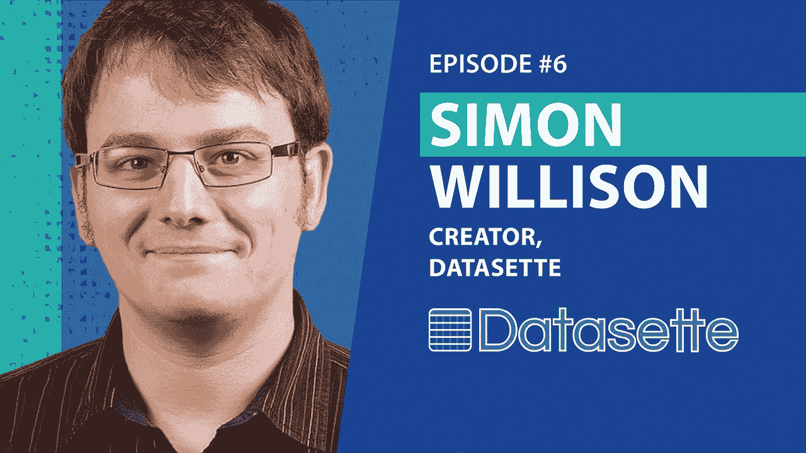

# Skills比MCP更重要？Python大佬这观点老金测了一周终于懂了

> 来源：[https://my.feishu.cn/docx/VIZFdZsmWoIsloxP8qXcHF6Rnbg](https://my.feishu.cn/docx/VIZFdZsmWoIsloxP8qXcHF6Rnbg)

上周在Hacker News刷到一篇文章，标题直接把老金我看愣了：

**"**Claude Skills are awesome, maybe a bigger deal than MCP"

给和老金我一样英语不好的翻译一下：

"Claude 的技能非常出色，或许比 MCP 更重要。"

作者是Simon Willison。

不认识？

Django联合创始人，Python界的大佬，Datasette作者。



说实话，老金我近三周对Skills的理念有大幅更新。

以前我知道Skills厉害，但理解不够深。

直到最近才真正搞明白它能大幅节省token这个点。

昨天在付费课上我也专门讲了这个：

很多同学MCP装了一堆，结果token都浪费在工具定义上了。

Skills按需加载这个设计太关键了。

## 先给小白科普一下

**什么是MCP？**

MCP就是Model Context Protocol（模型上下文协议）。

简单说，就是让AI能调用外部工具的一套标准。

比如你想让Claude能查数据库、能操作浏览器、能发邮件，就需要配置MCP服务器。

**什么是Skills？**

Skills就是技能包。

核心是一个SKILL.md文件（这是唯一必需的），告诉Claude怎么做某件事。

简单的Skill可以只是一个Markdown文件。

复杂的Skill可以是一个文件夹，包含脚本、文档、模板等。

比如你写一个"代码分析"的Skill：

1、简单版：一个SKILL.md，写清楚分析步骤

2、完整版：一个文件夹，里面有SKILL.md + scripts/分析脚本.py + templates/报告模板.md

**区别在哪？**

MCP：像给AI装了个外部APP，需要配置服务器、定义接口

Skills：像给AI写了个操作手册，最简单就是一个Markdown文件

重要补充：Skills和Plugins的区别

很多人搞混这两个概念，老金我给你讲清楚：

1、**Skills**：单一工作流模板（一道菜的菜谱）

+   本质是prompt-based的指令系统，不是代码

+   通过"prompt expansion"工作，不能直接调用MCP

+   但可以在指令中告诉Claude使用已配置的MCP工具

2、**Plugins**：打包好的能力集合（整套预制菜包）

+   **可以包含多个Skill**s + Commands + Hooks + MCP servers

+   如果你需要打包MCP，应该用Plugins而不是Skills

## 大佬的核心观点：4个理由

Simon Willison给出了4个理由，老金我一个个给你拆解。

### 理由1：Skills简单到离谱

MCP是什么？

一个完整的协议规范。

看看它包含什么：

1、hosts（主机）

2、clients（客户端）

3、servers（服务器）

4、resources（资源）

5、prompts（提示词）

6、tools（工具）

7、sampling（采样）

8、3种传输协议（stdio、HTTP、SSE）

老金我配一个MCP服务器，光看文档就要半小时。

**Skills呢？**

最简单的情况：一个SKILL.md文件。

没了？还真是。

官方文档说得很清楚：SKILL.md是唯一必需的文件。

当然，如果你想做复杂的Skill，可以加上：

1、instructions/ 放详细指令文档

2、prompts/ 放提示词模板

3、templates/ 放代码/文档模板

4、config/ 放配置文件

但核心就是那个SKILL.md，其他都是可选的。

**重要提醒**：SKILL.md需要包含YAML frontmatter：

```
---
name: my-skill-name
description: 描述这个Skill做什么、什么时候用
---
# 技能名称
[具体指令内容]
```

大佬原话：

"Skills feel a lot closer to the spirit of LLMs - throw in some text and let the model figure it out."

翻译：Skills更符合LLM的精神——扔点文字进去，让模型自己搞定。

老金我的理解：MCP是给程序员设计的，Skills是给人设计的。

### 理由2：CLI工具可以替代MCP

这个观点老金我一开始不太认同，但仔细想想确实有道理。

大佬说：

"Almost everything I might achieve with an MCP can be handled by a CLI tool instead."

翻译：几乎所有MCP能做的事，CLI工具也能做。

为什么？

因为LLM知道怎么调用 cli-tool --help。

模型自己能看懂帮助文档，不需要你在prompt里花几百个token描述怎么用。

Skills更进一步：连CLI都不需要了。

你只要写个Markdown文件描述任务怎么做，Claude自己就能搞定。

老金我测试了一下：

1、用MCP调用GitHub API：需要配服务器、写工具定义、花几千token

2、用Skill教Claude用gh命令：一个Markdown文件，200token

效果差不多，但Skill省了90%的配置时间。

### 理由3：Token效率差距巨大

这个是老金我最有感触的。

大佬提到一个恐怖的数据：

GitHub的官方MCP定义，光注册就要吃掉几万个token。

老金我之前写过一篇文章说MCP吃掉7%脑容量，现在看来还是保守了。

你想想，200K的上下文窗口，光一个GitHub MCP就吃掉几万。

再加几个常用服务器，prompt还能剩多少空间？

**Skills呢？**

只在需要的时候加载。

Claude不会一开始就把所有Skills塞进上下文。

它会看你的任务，判断需要哪个Skill，然后才加载。

老金我实测（仅供参考，不同配置结果可能不同）：

1、配置5个MCP服务器：prompt占用约15K token

2、安装10个Skills：prompt占用约2K token（只加载用到的）

省了85%！

### 理由4：分享起来太简单了

MCP服务器怎么分享？

1、写代码

2、发布到npm/pip

3、写README

4、让用户配置.mcp.json

5、调试连接问题

**Skills怎么分享？**

1、写个SKILL.md（或整个文件夹）

2、发出去

没了。

**补充说明：分享的几种方式**

1、**简单分享**：直接发文件夹给朋友，放到 .claude/skills/目录下

2、**Claude.ai**：打包成ZIP上传到Skills设置页面

3、**Claude Code**：通过Plugin marketplace分享

比如之前讲过的：

```
   /plugin marketplace add anthropics/skills
   /plugin install document-skills@anthropic-agent-skills
```

大佬说很多Skills就是单个文件，复杂点的也就一个文件夹。

老金我看了awesome-claude-skills仓库，4000多Star。

里面的Skills大部分就是一个SKILL.md或README.md。

复杂的也就是一个小文件夹，包含几个脚本。

这门槛也太低了。

## 老金我的实测对比

说了这么多理论，老金我实际测了一周。

### 测试场景1：让Claude帮我分析代码仓库

**MCP方案**

1、配置GitHub MCP服务器

2、配置filesystem MCP服务器

3、调试连接问题（花了20分钟）

4、Token消耗：约8000

**Skill方案**

1、写一个code-analysis.md，描述分析步骤

2、Claude用内置的Bash工具执行git命令

3、Token消耗：约1500

**结果**：Skill方案快3倍，省80%token。

### 测试场景2：自动化测试流程

**MCP方案**

1、需要写一个自定义MCP服务器

2、定义工具接口

3、处理各种边界情况

4、开发时间：2小时

**Skill方案**

1、写一个test-automation.md

2、描述测试步骤和命令

3、Claude自己调用pytest

4、开发时间：15分钟

**结果**：Skill方案开发效率提升8倍。

## 但老金我不完全同意

说了Skills这么多好处，但老金我觉得大佬的观点有点极端了。

MCP的优势Skills替代不了

1、**跨平台原生支持**

MCP是个标准协议，OpenAI、Google都原生支持。

Skills虽然Apache 2.0开源了（有open-skills项目可以让其他LLM运行），但原生体验还是Claude最好。

2、**复杂集成**

需要实时数据、数据库连接、API认证的场景，MCP更合适。

3、**开发者生态**

MCP有明确的开发者激励——你写一个服务器，所有LLM都能用。

Skills是用户端工具，激励结构不一样。

**老金我的结论**：两者是互补的，不是替代的。

1、**简单任务**：用Skills，省时省token

2、**复杂集成**：用MCP，标准化可复用

3、**最佳实践**：Skills + CLI工具 + 少量核心MCP

## 老金建议

卧槽，测试了一周，老金我确实对Skills刮目相看了。

以前老金我MCP装了不少，现在想想确实可以精简。

这也是老金我近三周理念更新最大的地方。

Skills按需加载，token消耗比MCP低太多了。

以前我知道Skills好用，但没意识到这个差距这么大。

昨天付费课上我也跟同学们说了：别一上来就想着配MCP，先问自己一个问题——这个任务用一个SKILL.md能不能搞定？

能搞定就别折腾协议，省下来的token能多聊好几轮。

**给你们的建议**

1、**先用Skills**

简单任务别上MCP，一个SKILL.md能解决的事别折腾协议。

2、**精简MCP**

别装太多服务器，3-5个核心的就够了。

每多一个就多吃几千token。

3、**CLI优先**

很多事情gh/git/npm命令就能做，Claude自己会调用--help。

4、看看awesome-claude-skills

github.com/travisvn/awesome-claude-skills

4000多Star，里面有很多现成的。

老金我现在的配置：

1、MCP：thinking、task、github、context7、bravesearch、exa等

2、Skills：dev-browser、👸号写作、数据分析、前端界面、api规范、claude/codex/gemini组套等

3、关键变化：浏览器控制从MCP换成了dev-browser Skill

4、Token占用：从之前的20K降到5K

效率提升了，脑容量也省出来了。

## 老金说

测完这一周，老金我突然想明白一件事。

很多人学AI工具，上来就想把所有MCP装全了、把配置调到最复杂。

就像刚买单反的人，恨不得把所有镜头、滤镜、三脚架都配齐。

但你猜怎么着？

真正出大片的人，往往就一机一镜。

Skills和MCP的关系，其实就是这个道理。

不是工具越多越牛，是你越清楚自己要什么，工具才越有用。

老金见过太多人做事儿是这样的。

买了一堆电动工具，最后发现一把螺丝刀就能解决问题。

工具不是越贵越好，是越顺手越好。

**你的时间才是最贵的资源。**

那些你花2小时配置、最后用了3次的MCP服务器，值吗？

一个15分钟写完的SKILL.md，天天都在用，哪个划算？

老金我现在的态度：

**能简单就别复杂，能省就别浪费。**

不是因为抠门，是因为老金我终于明白——

省下来的不只是token，是你的精力、你的注意力、你的创造力。

这些东西，比任何工具都珍贵。

所以别焦虑自己MCP装得不够多、Skills学得不够快。

找到适合你的节奏，一个一个来。

**慢慢来，比较快。**

有问题随时问老金，咱们一起研究！

## 参考来源

Simon Willison原文：simonwillison.net/2025/Oct/16/claude-skills/

Anthropic官方Skills发布公告：anthropic.com/news/skills

awesome-claude-skills仓库：github.com/travisvn/awesome-claude-skills

<https://my.feishu.cn/sync/HDlcdCPBksnJpBbRk0EcW364nmc>