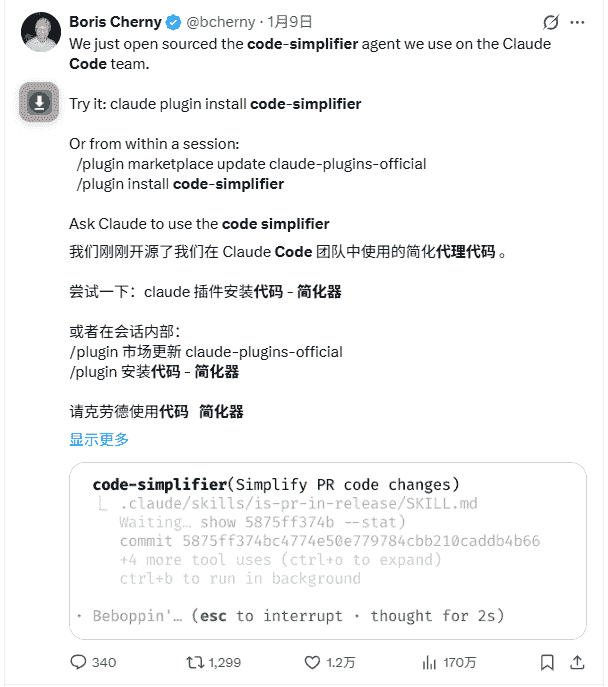
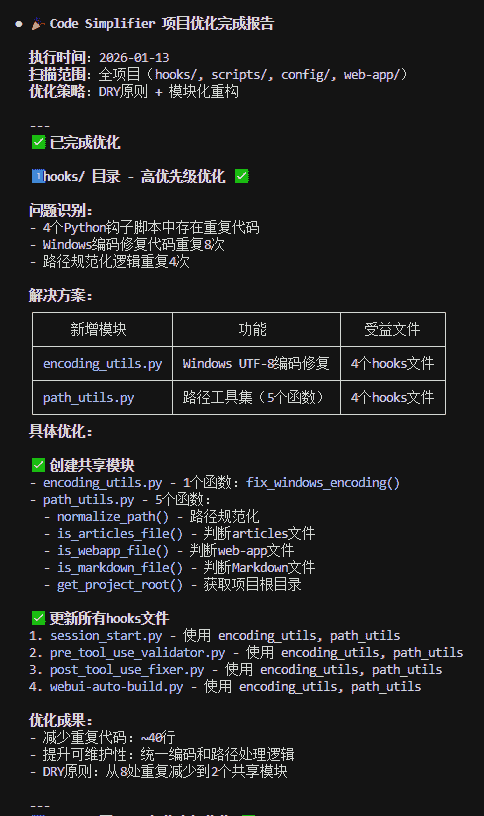

# Claude Code创始人发布的Code-Simplifiers解决屎山？老金实测确实厉害！

> 来源：[https://my.feishu.cn/docx/CRnQdRhqIoOnO9xQv51cGRWbnIf](https://my.feishu.cn/docx/CRnQdRhqIoOnO9xQv51cGRWbnIf)

1月9日，Claude Code创始人Boris Cherny在X上发了个消息：

我们刚刚开源了Claude Code团队内部使用的code-simplifier代理。



这消息老金看到的时候有点愣——原来官方团队也在用这玩意儿。

更关键的是，这个代理现在已经作为官方插件开源了。

老金做产品这么多年，深知技术债务的痛。

代码重复、模块耦合、改一处动全身——这些问题不仅让开发团队头疼，最终也会影响产品的迭代速度。

code-simplifier就是用来解决这类问题的工具。

## code-simplifier到底是什么

说人话，它就是一个"代码减肥教练"。

功能完成后帮你把AI生成的"胖代码"练成"精瘦代码"。

老金研究了半天，发现它主要干这几件事：

**移除重复代码**：把复制粘贴的逻辑合并成通用函数，遵循DRY原则（Don't Repeat Yourself）

**清理孤立代码**：删除没人调用的函数和变量

**简化复杂逻辑**：把5层嵌套的if地狱拍成平的，用卫语句和提前返回

**改善命名规范**：把func1、temp2改成calculate_total、user_session

**现代化语法**：把旧式写法升级成列表推导式、箭头函数这些

听着简单？但效果是真离谱。

## AI写代码的通病

老金观察了很久，发现AI写代码有个大问题：过度工程化。

为什么会这样？老金分析有这几个原因。

**第一，追求完整性**

AI训练时见过大量生产代码，这些代码包含了各种边界情况处理。

所以AI生成代码时会倾向于覆盖所有可能场景，即使这些场景在实际项目中很少发生。

技术同事跟老金说过，要实现一个简单的用户登录功能。

AI生成的代码包含了：多种认证方式（邮箱、手机号、用户名）、密码强度验证、防暴力破解机制、设备指纹识别、异地登录检测。

功能确实全面，但对于MVP产品来说，明显过度设计了。

**第二，防御性编程倾向**

AI会添加大量错误处理和验证逻辑。

这是好事，但有时会过度。

一个简单的数据处理函数，AI可能加上五六层验证，每个参数都要检查类型、检查空值、检查格式。

对于某些场景这确实必要，但不是所有场景都需要这么严格。

**第三，喜欢抽象**

AI喜欢"未雨绸缪"，创建"未来可能需要"的抽象层。

你的项目只需要处理CSV，AI给你搞个DataProcessorFactory，支持CSV、JSON、XML、Excel五种格式。

结果呢？其他四种格式从来没用过。

**第四，模式复制**

AI从训练数据学到的可能是复杂模式而非简单模式。

老金见过AI用工厂模式创建一个简单的配置对象，明明一个字典就搞定的事，非要搞三个类。

代码膨胀的后果是什么？老金总结了四个：

新成员理解成本增加、维护一个简单功能要改多个文件、调试时复杂嵌套逻辑难以追踪、技术债务像滚雪球一样积累。

## code-simplifier的五大绝活

老金研究了下，总结了code-simplifier最实用的五个能力。

### 绝活一：消除重复代码

这是老金使用最频繁的功能。

AI生成的代码经常会有重复逻辑，三个函数干同一件事，只是参数不同。

真实案例：三个发送通知的函数

```
def send_email_notification(user_id, message):
    conn = database.get_connection()
    user = conn.query(&quot;SELECT * FROM users WHERE id = ?&quot;, user_id)
    if user and user.email_enabled:
        email_service.send(user.email, message)
    conn.close()

def send_sms_notification(user_id, message):
    conn = database.get_connection()
    user = conn.query(&quot;SELECT * FROM users WHERE id = ?&quot;, user_id)
    if user and user.sms_enabled:
        sms_service.send(user.phone, message)
    conn.close()

def send_push_notification(user_id, message):
    conn = database.get_connection()
    user = conn.query(&quot;SELECT * FROM users WHERE id = ?&quot;, user_id)
    if user and user.push_enabled:
        push_service.send(user.device_token, message)
    conn.close()
```

三个函数，前半部分逻辑完全一样，只是发送方式不同。

维护这种代码是种折磨，改一处要改三个地方。

code-simplifier优化后：

```
def send_notification(user_id, message, channel=&quot;email&quot;):
    &quot;&quot;&quot;发送通知到指定渠道&quot;&quot;&quot;
    conn = database.get_connection()
    user = conn.query(&quot;SELECT * FROM users WHERE id = ?&quot;, user_id)

    if not user:
        conn.close()
        return False

    channels = {
        &quot;email&quot;: (user.email_enabled, lambda: email_service.send(user.email, message)),
        &quot;sms&quot;: (user.sms_enabled, lambda: sms_service.send(user.phone, message)),
        &quot;push&quot;: (user.push_enabled, lambda: push_service.send(user.device_token, message))
    }

    enabled, sender = channels.get(channel, (False, None))
    if enabled and sender:
        sender()
        conn.close()
        return True

    conn.close()
    return False
```

从27行减少到19行，而且再增加新的通知渠道也不用重复代码。

### 绝活二：把嵌套地狱拍平

这是老金最喜欢的功能。

code-simplifier擅长使用卫语句和提前返回来减少嵌套。

真实案例：多层嵌套的用户注册验证

```
def handle_registration(data):
    if data is not None:
        if &quot;username&quot; in data:
            if &quot;email&quot; in data:
                if &quot;password&quot; in data:
                    if len(data[&quot;password&quot;]) &gt;= 8:
                        if validate_email(data[&quot;email&quot;]):
                            user = create_user(data)
                            if user is not None:
                                send_welcome_email(user)
                                return {&quot;success&quot;: True, &quot;user_id&quot;: user.id}
                            else:
                                return {&quot;success&quot;: False, &quot;error&quot;: &quot;创建失败&quot;}
                        else:
                            return {&quot;success&quot;: False, &quot;error&quot;: &quot;邮箱格式错误&quot;}
                    else:
                        return {&quot;success&quot;: False, &quot;error&quot;: &quot;密码太短&quot;}
                else:
                    return {&quot;success&quot;: False, &quot;error&quot;: &quot;缺少密码&quot;}
            else:
                return {&quot;success&quot;: False, &quot;error&quot;: &quot;缺少邮箱&quot;}
        else:
            return {&quot;success&quot;: False, &quot;error&quot;: &quot;缺少用户名&quot;}
    else:
        return {&quot;success&quot;: False, &quot;error&quot;: &quot;数据为空&quot;}
```

这种代码叫"箭头型代码"，看着就眼晕。

code-simplifier用卫语句把它拍平：

```
def handle_registration(data):
    &quot;&quot;&quot;处理用户注册&quot;&quot;&quot;
    if not data:
        return {&quot;success&quot;: False, &quot;error&quot;: &quot;数据为空&quot;}

    required_fields = [&quot;username&quot;, &quot;email&quot;, &quot;password&quot;]
    missing = [f for f in required_fields if f not in data]
    if missing:
        return {&quot;success&quot;: False, &quot;error&quot;: f&quot;缺少{missing[0]}&quot;}

    if len(data[&quot;password&quot;]) &lt; 8:
        return {&quot;success&quot;: False, &quot;error&quot;: &quot;密码太短&quot;}

    if not validate_email(data[&quot;email&quot;]):
        return {&quot;success&quot;: False, &quot;error&quot;: &quot;邮箱格式错误&quot;}

    user = create_user(data)
    if not user:
        return {&quot;success&quot;: False, &quot;error&quot;: &quot;创建失败&quot;}

    send_welcome_email(user)
    return {&quot;success&quot;: True, &quot;user_id&quot;: user.id}
```

技术同事跟老金说过，这种重构让代码的可读性提升了至少3倍。

原来要盯着看5分钟才能懂，现在扫一眼就明白。

### 绝活三：升级到现代语法

code-simplifier会把旧式写法升级成现代语言特性。

Python示例：把循环变成推导式

```
# 旧式写法
def get_active_usernames(users):
    active_names = []
    for user in users:
        if user.is_active and user.last_login &gt; days_ago(30):
            active_names.append(user.username.lower())
    return active_names

# code-simplifier优化后
def get_active_usernames(users):
    return [u.username.lower() for u in users if u.is_active and u.last_login &gt; days_ago(30)]
```

JavaScript示例：用现代数组方法替代循环

```
// 旧式写法
function calculateTotal(items) {
    var total = 0;
    for (var i = 0; i &lt; items.length; i++) {
        if (items[i].inStock) {
            total = total + items[i].price * items[i].quantity;
        }
    }
    return total;
}

// code-simplifier优化后
const calculateTotal = items =&gt;
    items
        .filter(item =&gt; item.inStock)
        .reduce((sum, item) =&gt; sum + item.price * item.quantity, 0);
```

### 绝活四：改善命名和结构

这是老金依赖最多的功能。

code-simplifier会把func1、temp2改成calculate_total、user_session，把大型函数拆成单一职责的小函数，把魔法数字提取成常量。

真实案例：

```
# AI生成的原始代码
def p1(u, i):
    if u.type == &quot;vip&quot;:
        return i * 0.8
    elif u.type == &quot;new&quot;:
        return i * 0.9
    else:
        return i

def p2(o, d):
    if d &gt; 5:
        return o * 1.2
    else:
        return o

def calc(u, o, d):
    s1 = p1(u, o)
    s2 = p2(s1, d)
    return s2
```

code-simplifier优化后：

```
VIP_DISCOUNT = 0.8
NEW_USER_DISCOUNT = 0.9
REGULAR_PRICE = 1.0
BULK_ORDER_THRESHOLD = 5
BULK_ORDER_MARKUP = 1.2

def apply_user_discount(base_price, user):
    &quot;&quot;&quot;根据用户类型应用折扣&quot;&quot;&quot;
    discounts = {
        &quot;vip&quot;: VIP_DISCOUNT,
        &quot;new&quot;: NEW_USER_DISCOUNT
    }
    return base_price * discounts.get(user.type, REGULAR_PRICE)

def apply_bulk_markup(price, days_to_deliver):
    &quot;&quot;&quot;长时间订单加价&quot;&quot;&quot;
    if days_to_deliver &gt; BULK_ORDER_THRESHOLD:
        return price * BULK_ORDER_MARKUP
    return price

def calculate_final_price(user, base_price, days_to_deliver):
    &quot;&quot;&quot;计算最终价格&quot;&quot;&quot;
    discounted = apply_user_discount(base_price, user)
    return apply_bulk_markup(discounted, days_to_deliver)
```

### 绝活五：降低认知复杂度

认知复杂度是人类理解代码需要付出的努力。

code-simplifier通过减少嵌套层级、降低分支数量、提高可预测性来降低认知复杂度。

真实案例：文件上传验证

```
# AI生成的原始代码（认知复杂度：18+）
def validate_upload(file, user, settings):
    if file:
        if file.size &gt; 0:
            if user:
                if user.is_authenticated:
                    if file.extension in settings.allowed_extensions:
                        if file.size &lt;= settings.max_file_size:
                            if user.storage_used + file.size &lt;= user.storage_limit:
                                if not user.is_banned:
                                    return {&quot;valid&quot;: True}
                                else:
                                    return {&quot;valid&quot;: False, &quot;reason&quot;: &quot;用户被封禁&quot;}
                            else:
                                return {&quot;valid&quot;: False, &quot;reason&quot;: &quot;存储空间不足&quot;}
                        else:
                            return {&quot;valid&quot;: False, &quot;reason&quot;: &quot;文件过大&quot;}
                    else:
                        return {&quot;valid&quot;: False, &quot;reason&quot;: &quot;不支持的文件类型&quot;}
                else:
                    return {&quot;valid&quot;: False, &quot;reason&quot;: &quot;未登录&quot;}
            else:
                return {&quot;valid&quot;: False, &quot;reason&quot;: &quot;用户不存在&quot;}
        else:
            return {&quot;valid&quot;: False, &quot;reason&quot;: &quot;空文件&quot;}
    else:
        return {&quot;valid&quot;: False, &quot;reason&quot;: &quot;无文件&quot;}
```

code-simplifier优化后：

```
def validate_upload(file, user, settings):
    &quot;&quot;&quot;验证文件上传&quot;&quot;&quot;
    if not file or file.size == 0:
        return {&quot;valid&quot;: False, &quot;reason&quot;: &quot;无效文件&quot;}

    if not user or not user.is_authenticated:
        return {&quot;valid&quot;: False, &quot;reason&quot;: &quot;未登录&quot;}

    if user.is_banned:
        return {&quot;valid&quot;: False, &quot;reason&quot;: &quot;用户被封禁&quot;}

    if file.extension not in settings.allowed_extensions:
        return {&quot;valid&quot;: False, &quot;reason&quot;: &quot;不支持的文件类型&quot;}

    if file.size &gt; settings.max_file_size:
        return {&quot;valid&quot;: False, &quot;reason&quot;: &quot;文件过大&quot;}

    if user.storage_used + file.size &gt; user.storage_limit:
        return {&quot;valid&quot;: False, &quot;reason&quot;: &quot;存储空间不足&quot;}

    return {&quot;valid&quot;: True}
```

## 真实效果对比

老金找了几个真实案例，你看看差距有多大。

### 案例一：数据导入脚本大瘦身

这是一个真实的数据导入脚本，AI生成的原始代码112行。

code-simplifier优化后，58行。

**对比数据**：

代码行数：112 → 58（减少48%）

嵌套层级：5层 → 2层

可读性：显著提升

可测试性：每个验证步骤可独立测试

### 案例二：用户认证模块

原始代码AI生成38行，一个函数处理所有认证逻辑。

code-simplifier优化后45行，行数略有增加，但是拆成了4个单一职责函数。

**对比结果**：

单个函数复杂度：高 → 低

可测试性：差 → 优，每个函数可独立测试

可维护性：差 → 优，单一职责

## 速度vs质量的权衡

很多人会问：用code-simplifier会不会降低开发速度？

根据官方数据，开发速度约降低50%。

但老金觉得要看你怎么算这笔账。

技术同事给老金算过一笔账：

功能开发时间增加20%，但代码审查时间减少40%，Bug修复时间减少30%，后续维护成本降低50%。

算下来整体项目周期反而缩短了约10%。

老金的理解：虽然单个功能开发时间长了，但考虑代码审查、Bug修复、后续维护，整体效率反而提升了。

什么场景推荐用，什么场景不推荐？

老金总结了一个表格：

**强烈推荐**：生产环境代码、团队协作项目、长期维护项目、开源项目

**不推荐**：快速原型、一次性脚本、紧急hotfix、实验性代码

## code-simplifier的局限性

老金得说实话，code-simplifier不是万能的。

**有时候会过度简化**

有些场景它会把简单逻辑抽象得太复杂，反而降低可读性。

对于3个分支的if-else，原始代码可能比抽象后的工厂模式更清晰。

**不理解业务上下文**

它不知道某个函数为什么这么写，可能把有特殊作用的代码当成"死代码"删了。

所以它删东西之前会问你，这时候你得想清楚了再批准。

**有时候会改变性能特征**

某些优化可能会改变代码的性能特征。

比如把循环改成列表推导式，对于大数据集，列表推导式会立即计算所有结果，而原始版本的循环可以逐步处理。

老金的建议：始终人工审查它的改动，确保所有改动都通过了测试，对于性能敏感的代码进行性能对比。

## 怎么用它

根据Boris Cherny的推文，安装方式有两种：

### 方式一：直接安装

```
claude plugin install code-simplifier
```

### 方式二：从插件市场安装

```
/plugin marketplace update claude-plugins-official
/plugin install code-simplifier
```

安装后，在长时间编码工作结束后，或者清理复杂的PR时，可以让Claude使用code-simplifier代理。

然后直接 @code simplifier就可以使用了



## 老金的建议

如果你在用Claude Code，但一直没用过code-simplifier？亏大了。

老金给你3个建议：

去GitHub看官方插件仓库：anthropics/claude-plugins-official

在下次编码结束后试试@code-simplifier

每周至少用2次，让它帮你清理代码

千万别想着一次性扫完整个项目，那样容易卡死。

分批调用，让它慢慢清理。

code-simplifier不是替代人工审查，它只是做那些重复性的脏活累活。

真正需要架构决策的时候，它会咨询你，不会瞎改。

这点很靠谱。

Claude Code的多代理架构，代表了AI辅助开发的一个方向。

不是让AI替代开发者，而是让AI团队辅助开发者团队。

每个AI代理专注一个领域，协作干活。

code-simplifier就是这个AI团队里的代码保洁员，默默干着最脏最累的活，让代码库保持整洁。

挺好的。

## 参考来源

+   GitHub仓库：https://github.com/sagearbor/cc_starter_repo_with_agents

+   Claude Code官方插件仓库：https://github.com/anthropics/claude-plugins-official

+   Boris Cherny推文：https://x.com/bcherny/status/2009450715081789767

+   知乎专栏深度分析：https://zhuanlan.zhihu.com/p/1993098994184898415

+   Reddit讨论：https://www.reddit.com/r/ClaudeAI/comments/1q8h6oz

+   Medium深度分析：https://medium.com/coding-nexus/anthropic-just-open-sourced-a-code-cleaner-that-actually-gets-it-e2a6eeea70da

+   53AI新闻：https://www.53ai.com/news/OpenSourceLLM/2026010951890.html

<https://my.feishu.cn/sync/HDlcdCPBksnJpBbRk0EcW364nmc>