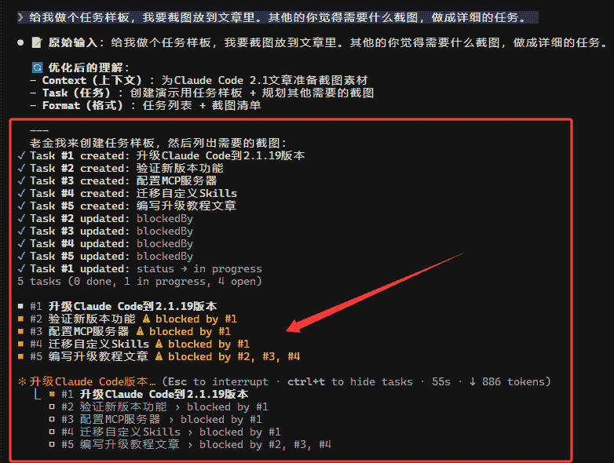
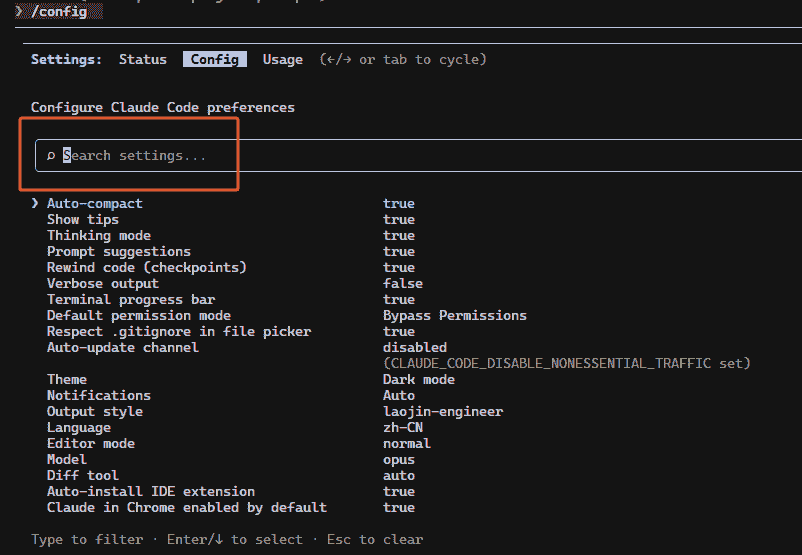
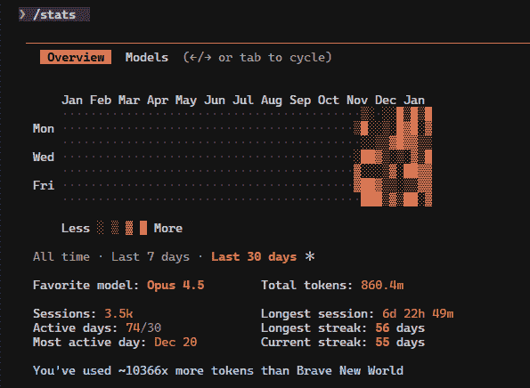
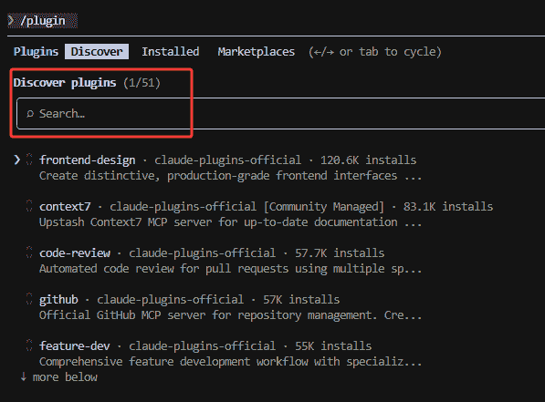

# Claude Code这周这波更新有点猛，一次性给你讲清楚

> 来源：[https://my.feishu.cn/docx/FEBodeeKeoEV2Axpc7RcE18Wnjf](https://my.feishu.cn/docx/FEBodeeKeoEV2Axpc7RcE18Wnjf)

1月23日，Claude Code发布2.1.19版本。

[Claude Code 2.1.2超详细更新说明，小白也能10分钟上手](https://my.feishu.cn/wiki/Pjdywmp3OiDDiEkY98ecV9zmnnf)次更新不是小打小闹，距离老金上次讲2.1更新，

也就是从2.1.12到2.1.19，短短7天时间，Claude Code迭代了8个版本。

更关键的是，2.1.15版本里藏着一行提醒：npm安装方式已不推荐使用，建议迁移到原生安装。

老金我第一时间去扒了GitHub的完整更新日志，越看越觉得这波更新有点东西。

说实话，看到npm要被淘汰的时候，老金我愣了一下，毕竟用了这么久了。

## npm要被淘汰了

从2.1.15版本开始，官方发出了deprecation通知。

原因是npm生态有恶意包风险，而且npm依赖Node.js容易出现依赖冲突和权限问题，官方决定专注原生安装。

原生安装其实很简单。

Mac和Linux用户用一行curl命令就能搞定，Mac用户也可以直接用brew install claude-code，Windows PowerShell用户用irm命令，WinGet用户也可以用winget install Anthropic.ClaudeCode。

文章下方有代码块一键复制。

这对不同用户意味着不同的事情。

新用户建议直接用原生安装，别折腾npm了。

老用户如果用npm装的，老金亲测已经不能升级到2.19了。

如果你一直遇到npm报错，那就立刻迁移到原生安装。

## 效率提升这几个功能值得说

bash历史补全这个功能老金我挺喜欢的。

在bash模式下，输入部分命令后按Tab，会自动从你的历史命令里补全，不用重复输入相同的命令。

玩了两天，真的省事不少。

自定义快捷键也很实用。

输入/keybindings就能设置自己的快捷键，常用功能一键调用，不用记长长的命令。

外部编辑器支持（Ctrl+G）适合写长文本和复杂提示词的时候用。

在plan模式下，Shift+Tab可以快速选择"自动接受编辑"选项。

参数访问也更简洁了。

以前要写$ARGUMENTS.0、$ARGUMENTS.1，现在直接用$0、$1就可以了。

这个非常好用！请各位小伙伴记住！

## 任务管理系统升级了

以前任务之间没有依赖关系，Claude Code不知道哪个先做哪个后做。

现在支持任务依赖追踪，任务A必须在任务B之前完成，能自动识别阻塞关系，还能可视化任务状态。

截个图，老金我觉得非常爽用，替代了一部分之前我推的MCP。



如果你不喜欢新系统，设置环境变量 CLAUDE_CODE_ENABLE_TASKS=false可以切回老版本。

加载自定义Skill以前每次都要点确认，现在如果是简单的技能（没有特殊权限），直接加载不用审批。

插件管理方面，可以把插件锁定到特定的Git commit，这对团队协作很重要，确保所有人用的是同一版本的插件。

## 搜索过滤功能更方便了

/config命令现在支持搜索过滤，能快速找到想要的配置项。



/stats命令按r键可以循环切换最近7天、最近30天、全部时间。



插件列表也支持搜索，按名称或描述过滤。

/plugins把插件和MCP统一在同一个标签页，按作用域分组。



## 性能和稳定性修复很关键

2.1.15版本用React Compiler优化了UI渲染，界面响应更快。

内存泄漏问题修了好几次。

2.1.2版本修复了tree-sitter内存泄漏，2.1.14版本修复了stream资源内存泄漏，2.1.16版本修复了重载会话的内存崩溃。

老电脑用户的崩溃问题也在2.1.17和2.1.19版本修复了，这是非AVX处理器的问题。

用MCP服务器的用户应该遇到过卡死问题，2.1.15版本修复了MCP stdio服务器超时问题。

上下文窗口阻塞限制计算错误的问题也修了，从65%提升到98%。

## 安全漏洞修复得注意

有几个安全漏洞修复值得提一下。

2.1.2版本修复了bash命令处理的命令注入漏洞，也修复了MCP工具名暴露在分析事件中的问题。

2.1.6版本修复了shell行续行可能导致的权限绕过问题。

2.1.7版本修复了通配符权限规则可能匹配复合命令的问题。

## VSCode和IDE相关更新

LSP工具支持是在2.0.74版本添加的，支持跳转到定义、查找引用、悬停文档这些代码智能功能。

2.1.16版本添加了VSCode原生插件管理支持，可以直接在VSCode里管理插件。

2.1.19版本让所有用户都能使用会话fork和rewind功能。

/usage命令可以显示当前plan使用情况。（老金我用中转，这个就没用）

/terminal-setup现在支持Kitty、Alacritty、Zed、Warp这些终端。

## 其他实用更新

从Web会话创建的commits和PRs会带上会话URL。

拖拽图片到终端时会带上来源路径信息。

支持OSC 8的终端（如iTerm）里，文件路径可以点击跳转。

[Image #N]链接可以直接在默认查看器打开图片。

Windows用户现在可以用WinGet安装Claude Code了。

可以在 /config里切换stable或latest发布通道。

在子目录工作时，会自动发现嵌套的 .claude/skills目录。

## 升级步骤

第一步备份配置：

```
cp -r ~/.claude ~/.claude.backup
```

第二步如果你用npm装的，先卸载：

```
npm uninstall -g @anthropic-ai/claude-code
```

第三步安装原生版本：

```
# Mac用户
brew install claude-code

# Linux用户
curl -fsSL https://claude.ai/install.sh | bash

# Windows PowerShell用户
irm https://claude.ai/install.ps1 | iex
```

第四步验证，用 claude --version命令，看到版本号就成功了。

## 总结

**老金我总结了，就4点变化：**

安装方式变了，直接原生安装。

界面更流畅了，React Compiler优化加上各种性能修复，体验确实更好。

Bug修了不少，内存泄漏、崩溃、卡死问题都解决了。

新功能也多了，历史补全、快捷键、搜索过滤这些用起来更顺手。

**老金我给个直白建议。**

如果你用npm装的一直报错，或者电脑比较老经常崩溃，或者用MCP服务器遇到过卡死，或者你需要那些新功能，那就立刻升级。

如果你用npm装的运行正常，没时间折腾，感觉够用了，那就暂时不升。

新用户直接装最新版，用原生安装方式就行。

不到3个月迭代了90多个版本，老金我用了一周原生安装，确实比npm稳多了。

有问题随时问老金我，咱们一起研究。

<https://my.feishu.cn/sync/HDlcdCPBksnJpBbRk0EcW364nmc>