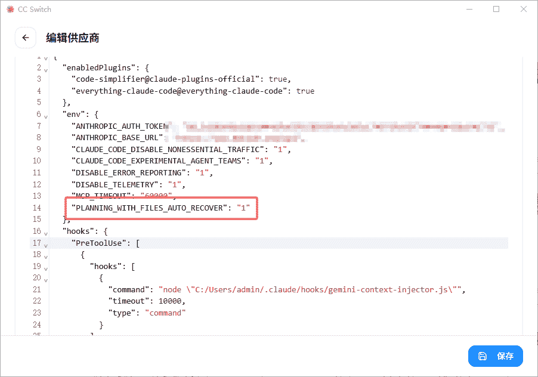

# Claude Code神器：Manus同款文件规划法，价值20亿美元的工作流秘密

> 来源：[https://my.feishu.cn/docx/DgetdnrwGo4GDkxDXzacfGwQnyP](https://my.feishu.cn/docx/DgetdnrwGo4GDkxDXzacfGwQnyP)

你有没有遇到过这种情况：给AI下个任务，聊了50轮后，它就开始"脑抽"了。

接口规范？忘了。

变量命名风格？混了。

你半小时前定的规则？直接抛到九霄云外。

你得一直提醒它，像保姆一样伺候它，效率低，还累。

但如果我告诉你，现在有个方法能让AI拥有"持久记忆"。

你只需要在项目里放三个Markdown文件，AI就会自动记录所有发现、避免重复踩坑、恢复断开的会话。

效率提升30%，重复错误减少80%。

这不是科幻，是Meta花20亿美元收购的Manus核心技术，被GitHub社区完全复刻了。

项目地址：https://github.com/OthmanAdi/planning-with-files

之前我在说[CC本次更新最强的不是OPUS4.6，而是Agent Swarm(蜂群）](https://my.feishu.cn/wiki/CAsLwb5BBiVztakm0h9cGnucnRc)的时候，也有强烈推荐这个是必备的安装之一。

老金我花了一整天研究这个项目，把这套工作流拆解成可复制的模板，今天全部分享给你，直接复制就能用。

**这篇文章老金我会告诉你：**

1、Meta 20亿收购的Manus核心技术到底值在哪，哪些是真功夫哪些是吹牛

2、三文件模式怎么用，什么时候用最稳、最省、最快

3、具体使用模板，完整示例+配置文件，拿来即用

## 什么是planning-with-files？

planning-with-files是Claude Code的一个插件，复刻了Manus的"Context Engineering"（上下文工程）模式。

老金我用最简单的比喻给你讲清楚。

传统AI助手就像一个失忆的实习生。

你说一句他干一件事，干完就忘。

下次遇到同样的问题，他还得重新查文档、重新踩坑。

效率低，而且你得一直盯着。

planning-with-files就像给这个实习生配了个笔记本。

你让他把所有发现、所有错误、所有进度都记在本子上。

下次遇到同样问题，他翻开本子一看："哦，这个问题之前遇到过，这样解决就行。"

关键是不用你一直盯着，他自己会记录、自己会查阅、自己会复盘。

之前老金我写过各种记忆系统，本质上都是解决这个问题。

但planning-with-files的实现最简单，三个Markdown文件就搞定。

## 核心原理：三文件模式

planning-with-files的核心就是一个"3-File Pattern"——在项目根目录放三个Markdown文件。

老金我用大白话给你讲清楚。

1、task_plan.md（任务计划）

这是你的"任务清单"，AI必须先看这个再干活。

里面写三样东西：第一步干什么？

现在走到哪一步了？

最终目标是什么？

每次AI想写代码，先让它读一遍这个。

就像Team Leader站在你身后问："你现在到底在瞎折腾什么？"

2、findings.md（发现记录）

这是AI的"笔记本"，记录所有研究发现。

你在调试时发现Node 18有个bug。

或者发现某个库的API变了。

这些信息，通常聊几句就被刷过去了。

planning-with-files强迫AI把这些记在这个文件里。

下次再遇到类似问题，AI不会傻乎乎地去查文档，而是直接调取这里的记录。

3、progress.md（进度日志）

这是项目的"流水账"，记录所有尝试和结果。

刚才跑测试挂了？

挂在哪一行？

上一次尝试改了哪个函数？

全都记下来。

这主要是为了防止AI陷入死循环——有时候AI会反复尝试同一个错误的修复方案。

有了这个文件，你就能直接甩给它："这招刚才试过了，不好使，换一个。"

## 为什么是这三个文件？

核心思想很简单：**C**ontext Window = RAM（易失，有限），Filesystem = Disk（持久，无限）。

所有重要信息都写入磁盘，而不是塞在上下文里。

这样AI就能跨会话保持记忆，积累经验。

启用方法很简单，一行命令搞定：

```
claude plugins install OthmanAdi/planning-with-files
```

装好后，AI会自动创建这三个文件，并在每次操作前后读写它们。

## 必备配置（开始前必看）

在开始使用之前，老金我强烈建议先了解一下配置选项。

**这**个插件支持14个IDE平台，包括Claude Code、Cursor、Windsurf、Zed、VS Code等。

基本上你能想到的主流IDE，全都有对应方案。

**环境变量配置**（可选）：

如果需要自定义配置，可以在settings.json中添加：

```
{
  &quot;env&quot;: {
    &quot;PLANNING_WITH_FILES_AUTO_RECOVER&quot;: &quot;1&quot;
  }
}
```

这个配置启用后会话恢复功能，上下文重置后自动恢复进度。

老金我实测觉得这个功能特别实用。

想象一下场景：你下午让Claude Code帮你写代码，写到一半去吃饭了。

回来的时候，上下文可能已经重置了。

传统方式：重新说一遍需求，从零开始。

用planning-with-files：AI直接读取progress.md，看到上次写到哪儿了，继续干。

就像你有个能记住所有对话的超级助理。

## 使用模板：三分钟上手

老金我给你一个完整的上手模板，直接复制就能用。

**第一步：创建项目文件**

在你项目根目录创建这三个文件：

task_plan.md

```
# Task Plan

## Current Status
- Status: in_progress
- Phase: 1/3

## Next Steps
1. [ ] 分析项目需求
2. [ ] 设计技术方案
3. [ ] 实现核心功能
4. [ ] 测试验证

## Final Goal
[你的最终目标，如：完成用户认证模块开发]

## Notes
- [注意事项，如：需要兼容旧版本API]
```

findings.md

```
# Findings

## Key Discoveries
- [发现1，如：库X在Node 18有兼容问题]
- [发现2，如：API v2.0的认证方式变了]

## Errors Encountered
| Error | Attempt | Resolution |
|-------|---------|------------|
| [错误描述] | [尝试次数] | [解决方案] |

## Decisions Made
- [决策1，如：选择使用库A而不是库B]
- Reason: [原因]
```

progress.md

```
# Progress Log

## Session 1 - [日期]
- 尝试方案A：失败
- 原因：[失败原因]
- 切换到方案B：进行中

## Session 2 - [日期]
- 完成功能X
- 发现问题Y，已记录到findings.md
- 下一步：[下一步计划]
```

**第二步：开始干活**

就这么简单。

下次你让Claude Code干活的时候，它会自动：

1.  先读task_plan.md确认目标

1.  边干边更新findings.md记录发现

1.  完成后同步progress.md

## 六大铁律（千万别违）

项目作者总结了六大原则，老金我提炼一下：

**铁律1：先计划，后动手**

绝不在没有task_plan.md的情况下启动任何复杂任务。

就像出门前先看地图，别瞎走。

**铁律2：边干边记**

每完成两次搜索/浏览操作，立即写入findings.md。

防止重要信息被上下文冲刷掉。

**铁律3：决策前回顾**

做关键决策前，先读task_plan.md，把目标重新拉入注意力窗口。

**铁律4：阶段完成必更新**

每个任务阶段完成后，必须同步task_plan.md：

+   状态从in_progress改成complete

+   记录所有遇到的错误

+   注明新增或修改的文件

**铁律5：错误入库**

将所有错误写进findings.md，构建AI的经验库。

**铁律6：绝不重蹈覆辙**

一旦操作失败，按这个流程走：

第1次：诊断并修复

第2次：更换方法（绝不执行相同的失败操作）

第3次：全局反思，质疑原有假设

3次均失败：向用户求助

## 进阶技巧：会话恢复

这是老金我觉得最实用的功能。

想象一下场景：你下午让Claude Code帮你写代码，写到一半去吃饭了。

回来的时候，上下文可能已经重置了。

传统方式：重新说一遍需求，从零开始。

用planning-with-files：AI直接读取progress.md，看到上次写到哪儿了，继续干。

**启用方法很简单**：

在settings.json中添加环境变量：

```
{
  &quot;env&quot;: {
    &quot;PLANNING_WITH_FILES_AUTO_RECOVER&quot;: &quot;1&quot;
  }
}
```



### 零门槛入门任务（5分钟体验）

**第一步**：安装插件**（建议项目级）**

```
claude plugins install OthmanAdi/planning-with-files
```

**第二步**：创建三个文件

按照上面的模板，在项目根目录创建task_plan.md、findings.md、progress.md。

**第三步**：跑一个最简单的任务

打开Claude Code，输入这句话：

```
帮我创建一个简单的React待办事项应用，使用planning-with-files模式记录进度
```

等30秒，看AI自动创建计划、记录发现、更新进度。

跑完这个任务，你就会明白什么叫"AI拥有持久记忆"。

---

## 总结：这不是技巧，是工作方式的升级

如果你只记住这篇的一句话，就记住这句：

**planning-with-files的本质，不是"更聪明**的AI"，而是"会积累经验的数字助理"。

你会发现，真正的变化不是"AI聪明了一点"。

而是你开始从"每次都重新教AI"变成"AI越用越聪明，记得所有坑和经验"。

这就是老金我这周最大的感受：

**会用planning-with-files的人，AI会**越用越聪明；不会用的人，每次都从零开始。

现在就开始，今晚跑一个入门任务，明天你就会感受到工作方式的升级。

<https://my.feishu.cn/sync/HDlcdCPBksnJpBbRk0EcW364nmc>