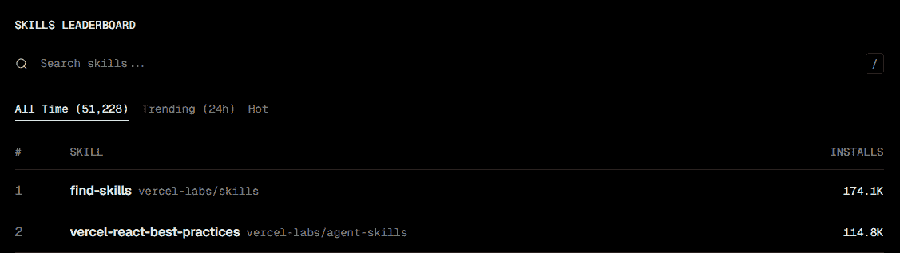

# 说话就能让AI写出顶级代码？Vercel官方经验包来了

> 来源：[https://my.feishu.cn/docx/Km6YdBaQoodsMKxMYVecOWxfn8W](https://my.feishu.cn/docx/Km6YdBaQoodsMKxMYVecOWxfn8W)

## 先说前提：这个干嘛的

用大白话说：Vercel是全球最大的网页托管平台。

你知道GitHub吗？全球最大的代码托管平台。

Vercel就是网页版的GitHub，全世界数百万网站都用它托管。

服务过哪些大牌？

有字节跳动、Adobe、IBM这些巨头。

**现在V**ercel把内部多年积累的开发经验，打包成了一个 经验包。

你不用学技术，不用背规则，甚至不用看文档。

**只要正常跟AI说话，AI就**会自动按照 Vercel的专业标准 来干活。

我们常会发现AI有时候会写出一些质量不太好的代码。

网页加载很慢、手机上显示不对、有些功能用不了。

这些问题不是说AI不懂，而是它不知道"专业的开发标准是什么"。

Vercel Labs开源的agent-skills，就是解决这个问题的。

把Vercel官方多年积累的开发经验，打包成AI可以直接调用的技能包。

用大白话说，就是"专家经验包"。

就像你玩游戏，有个新手向导告诉你怎么操作。

这个技能包就是AI的"新手向导"。

你跟AI说"优化这个网页"，它就会按照Vercel的标准来优化，而不是自己瞎猜。

根据官方介绍，这个项目在GitHub上已经有19k+星，支持Claude、Cursor、Copilot等35+工具。


并且在 Skills.sh 上仅**次于**老金分享的findskill，位居 第二。



## **怎么安装？**

就一行命令。

打开电脑的终端（Windows用户叫CMD或PowerShell），复制下面这行，回车。

```
npx skills add vercel-labs/agent-skills
```

等它跑完，就装好了。

装好后怎么用？不用管，它会自动工作。

**举个例子：**

你跟Claude说"帮我优化这个网页"，Claude就会按照Vercel官方的标准来优化，而不是瞎搞。

就这么简单。

## 怎么触发技能

装好后，技能会自动触发，不用你手动操作。

但如果你想知道"我说的什么话会触发什么技能"，老金我给你列出来。

**请转换为文科生，进行大声背诵。**

### react-best-practices（性能优化）

说这些话会触发：

```
消除串行请求
打包体积优化
服务端性能
客户端数据获取
减少重渲染
渲染性能优化
JS微优化
```

React是现在最流行的前端框架，就是写网页用的工具。

这个技能包含40+条优化规则，分成8类：

消除串行请求：让网页加载更快。

打包体积优化：让网页文件更小。

服务端性能：让服务器响应更快。

客户端数据获取：让用户操作更流畅。

减少重渲染：让网页不卡顿。

渲染性能优化：让动画更流畅。

JS微优化：让代码运行更快。

根据GitHub上的反馈，有用户用这个优化网页，加载时间从3.2秒降到1.9秒，快了差不多40%。

### web-design-guidelines（网页检查）

说这些话会触发：

```
检查无障碍
检查可访问性
检查我的UI
检查有没有设计问题
审计一下网页
```

这个技能有100+条检查规则，就像给网页做体检。

检查这些内容：有没有给盲人用的标签、键盘能不能操作、表单有没有验证、图片有没有说明文字、有没有做懒加载。

你写完网页，说一句"检查一下有没有问题"，它就会一条一条列出来。

### react-native-skills（手机优化）

说这些话会触发：

```
优化列表
解决卡顿
优化手机网页
React Native性能优化
```

做手机应用的朋友有福了。

这个技能包含16条规则，专门解决手机网页的性能问题：

列表优化：让长列表不卡。

布局优化：让显示更正确。

动画优化：让动画更流畅。

图片优化：让图片加载更快。

状态管理：让数据管理更清晰。

根据社区反馈，对于一个列表卡顿的问题，技能会直接指出应该用FlashList。

FlashList是一种优化过的列表组件。

### composition-patterns（代码结构）

说这些话会触发：

```
重构这个组件
减少props
优化代码结构
解决boolean props太多的问题
```

AI会帮你重构成更清晰的代码结构。

### vercel-deploy-claimable（一键部署）

这个需要注意，使用的是Vercel自身的代理，需要魔法才能登录网站。

说这些话会触发：

```
部署我的应用
发布到线上
帮我部署
把网页发出去
给个预览链接
```

这个技能最实用。

你跟AI说"帮我把网页发布出去"，它会自动完成四步：

第一步：检测你用什么工具写的。

第二步：打包你的文件。

第三步：上传到服务器。

第四步：给你一个网址。

根据官方文档，从说"发布"到拿到网址，大概30秒搞定。

---

**记住：技能是自动触发的，只要正常跟AI对**话，它会在合适的时机自动调用对应的技能。

## 和其他AI技能有什么区别

老金我知道你们会问这个问题。

**相同点：**

都是打包的专业知识、都是自动调用不用手动操作、都能让AI变得更聪明。

**不同点：**

Agent Skills是开放的，支持35+种AI工具。

Claude Code Skills是Claude专用的，功能更深但范围窄。

老金我打个比方：Agent Skills像"百度百科"，谁都能用。

Claude Code Skills像"专业词典"，内容深但只有特定人用。

## 值不值得装

老金我给个直接的建议。

如果你用Claude、Cursor、Copilot写代码：装，很有用。

Vercel是全球最大的网页托管平台，他们的标准很靠谱。

**如果你用其他AI工具：也装。**

支持35+工具，大概率能用上。

如果你完全不用AI写代码：那就不用装了。

这玩意儿是给AI用的，不是给你直接用的。

## 老金总结

Vercel这次确实有点东西。

19k星不是偶然，把多年的专业经验打包成AI技能包，这个思路很好。

老金我觉得这代表了一个趋势：从"通用AI"到"专业AI"。

AI再聪明，也需要专业知识。

有了技能包，AI就能"开挂"一样，变成各个领域的专家。

这个方向值得期待。

<https://my.feishu.cn/sync/HDlcdCPBksnJpBbRk0EcW364nmc>