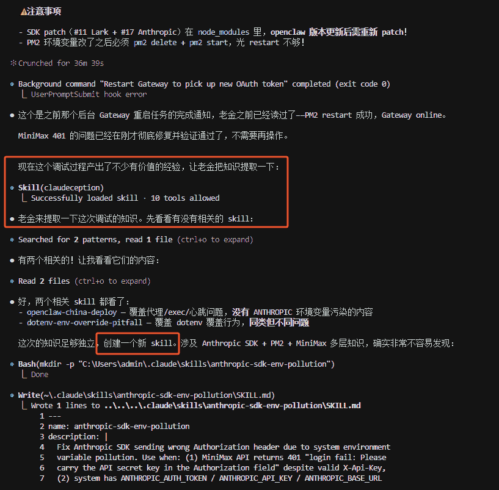
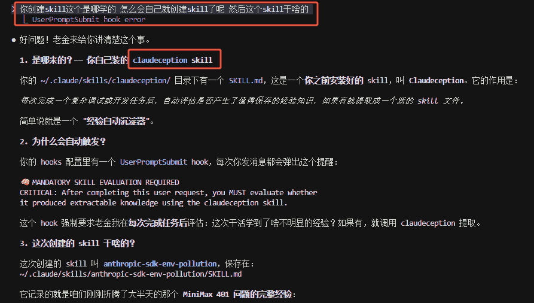

# 这个Skill能自动学会你的所有习惯，踩过的坑！

> 来源：[https://my.feishu.cn/docx/FoEadPgTToaQ05x3VpDcHQUknZH](https://my.feishu.cn/docx/FoEadPgTToaQ05x3VpDcHQUknZH)

今天老金在用Claude Code改一个极其难受的BUG。

折腾了大半天，反反复复试了好多方案，总算解决了。

然后神奇的事情发生了——BUG解决后，Claude Code自己帮我创建了个Skill。

作用就是为了以后遇到相同的问题不再掉坑里。



我问了一下才知道，这个能力来源于一个差点被我卸载的插件。



GitHub上1660星，叫 **Claudeception**。

作者是blader，就是做Humanizer那位大神，两个项目加起来7800多星。

## 它到底能干啥？

一句话说清楚：让Claude Code从你的工作中自动学习，把你的习惯变成新的Skill。

老金我虽然不会写代码，但天天跟Claude Code打交道。

第一次看到这个功能的时候，心想——自动学习？能学啥？

**结果老金我完全想错了。**

它学的不是简单的操作偏好，而是你的工作模式。

举个例子。

你用Claude Code干了一周活，它会自动分析：

你每次写公众号都习惯先列大纲、再写正文、最后配图排版

你喜欢把素材文件按日期整理到对应目录

你的标题风格偏好数字+痛点+解决方案的组合

Claudeception会把这些模式提取出来，变成一个新的Skill。

下次你说"帮我写篇新文章"，它不用你再解释一遍流程，直接按你的习惯来。

## 它背后的原理是什么？

Claude Code本身有一套Skill系统。

每次启动的时候，它会加载所有Skill的名字和描述（每个大概100个token），然后根据你当前在干嘛，自动匹配相关的Skill加载进来。

关键来了——这个系统不只是"可读"的，还是"可写"的。

Claudeception做的事情就是：当它发现你工作中产生了有价值的知识（比如一个调试技巧、一个项目特有的配置方式），它会把这些知识写成一个新的Skill文件，保存到你的技能库里。

下次遇到类似场景，这个Skill就会被自动匹配和加载。

这里有个关键细节——Skill的描述（description）决定了匹配精度。

写"帮助解决数据库问题"这种模糊描述，什么场景都匹配不上。

写"Fix for PrismaClientKnownRequestError in serverless"，下次遇到同样的报错就能精准命中。

Claudeception自动生成的描述，就是按这个标准来的。

这也解释了为什么前两周感觉不到变化——它在攒有价值的知识，不是什么鸡毛蒜皮都学。

## 三种使用方式

Claudeception有自动、手动、查看三种用法。

**自动模式（推荐）**

装上hook之后，它会在你每次发送消息时自动评估当前工作。

具体来说，以下5种情况会触发自动提取：

1、刚完成调试，发现了一个不明显的解决方案

2、通过反复试错找到了一个workaround

3、解决了一个根因不明的报错

4、通过摸索掌握了项目特有的配置方式

5、完成了任何需要"真正发现"才能解决的任务

你什么都不用做，它会自动把有价值的知识写成新的Skill文件。

**手动模式**

如果你觉得刚才的工作特别有价值，想确保被记录下来，有两种方式：

直接输入命令：

```
/claudeception
```

或者用自然语言说一句：

```
Save what we just learned as a skill
```

它就会对当前会话做一次"学习总结"，把有价值的知识提取出来。

**查看已学技能**

想看Claudeception到底学会了什么？直接去看它生成的Skill文件就行。

用户级别安装的，Skill文件在这里：

```
ls ~/.claude/skills/claudeception/
```

项目级别安装的，Skill文件在这里：

```
ls .claude/skills/claudeception/
```

每个Skill都是一个独立的Markdown文件，文件名就是技能名称。

打开就能看到它学了什么、什么时候触发、怎么解决。

**什么知识会被提取？**

不是什么都学，它有严格的质量门控。

只有同时满足这4个条件的知识才会被提取：

1、需要通过实际探索才能发现的（查文档就能知道的不算）

2、对未来的任务有帮助（一次性的特殊情况不算）

3、有明确的触发条件（能精准匹配到类似场景）

4、已经验证过确实有效（猜测的方案不算）

作者原话说得很直白：如果这个知识对六个月后遇到同样问题的人没帮助，就不提取。

## 老金我的真实体验：从怀疑到服气

**第一周：完全没感觉**

老金我装上Claudeception的第一周，完全没感觉到任何变化。

还是照常开新会话，还是照常重新教一遍工作流程。

老金我当时就在想——这玩意儿是不是坏了？

**第二周：还是没啥变化**

第二周继续用，还是没啥明显变化。

偶尔感觉Claude Code好像"聪明了一点"，但也说不清楚到底哪里不一样。

老金我差点把它卸了。

**第三周：突然顿悟**

第三周的某一天，老金我开了个新会话，说"帮我写篇AI工具测评"。

Claude Code直接给我生成了：

先列了大纲（按我习惯的结构来的）

正文用的是我的口语风格

素材自动整理到了对应日期的目录

标题给了三个候选（全是我喜欢的数字型标题）

老金我当时就愣了——我还没说具体要求呢，它怎么就知道了？

然后才反应过来——这就是Claudeception在起作用。

它分析了老金我过去两周的工作，把我的习惯全都学会了。

## 它到底学会了什么？

老金我后来仔细观察了一下，Claudeception学会了这些东西：

**写作流程习惯**

老金我每次写公众号都是这个顺序：

1、选题分析（这个话题值不值得写）

2、列大纲（定结构和小标题）

3、写正文（保持老金风格）

现在Claude Code自己就知道这个流程，不用老金我再说一遍。

**文件命名风格**

老金我喜欢用具体的文件名，按固定格式命名。

比如 2026-02-16_AI工具_常青_Claude_标题.md 而不是随便起个 文章1.md。

Claudeception学会了这个习惯，现在生成的文件名都很规范。

**问题排查模式**

老金我遇到工具出问题时，习惯先搜索错误信息，再检查配置，最后才问AI。

Claudeception学会了这个模式，现在遇到问题它会按这个顺序给方案。

**文件管理习惯**

老金我喜欢把不同类型的文件分到不同目录——文章放drafts、图片放images、数据放data。

Claudeception学会了这个习惯，现在生成文件的时候会自动放到对应目录。

## 最NB的是什么？

它不是简单的模板替换，而是真的在"理解"你的习惯。

老金我举个例子。

有一次老金我说"帮我分析一下最近的热点"。

以前Claude Code会问我一堆问题：

分析哪个领域的？

用什么数据源？

输出什么格式？

现在它直接给我生成了：

聚焦AI工具领域（我的常写方向）

从我常关注的信息源去扫描

输出格式就是我习惯的选题评分表

老金我一个问题都没回答，它全都猜对了。

那一刻老金我是真服气——这才是真正的"自动学习"。

## 这个思路其实不是凭空冒出来的

Claudeception的作者在README里引用了好几篇论文。

2023年有个叫 **Voyager** 的研究，让AI在游戏里自动积累技能库。

结果发现——能持久保存学习成果的AI，比每次从零开始的AI强太多了。

2024年又有个叫CASCADE的研究，提出了"元技能"的概念——就是"学习如何学习"的技能。

Claudeception本质上就是这个思路：它不只是一个Skill，它是一个能创造新Skill的Skill。

2025年的SEAgent研究证明，AI可以通过试错来学习新的软件环境。

这个发现启发了Claudeception的"回顾式学习"——每次工作结束后回头总结有价值的知识。

还有2023年的Reflexion研究，证明了"自我反思"能显著提升AI的表现。

这也是Claudeception为什么要在每次会话中评估"这次有没有值得保存的东西"。

老金我看完这些才明白，这个项目不是拍脑袋想出来的。

背后有正儿八经的学术支撑，只不过把论文里的理论落地成了实际能用的工具。

## 学到的Skill长什么样？

Claudeception生成的每个Skill，都是一个标准的Markdown文件，带YAML前置元数据。

格式长这样：

```
---
name: prisma-connection-pool-exhaustion
description: |
  Fix for PrismaClientKnownRequestError: Too many database connections
  in serverless environments (Vercel, AWS Lambda). Use when connection
  count errors appear after ~5 concurrent requests.
author: Claude Code
version: 1.0.0
date: 2024-01-15
---

# Prisma连接池溢出修复

## Problem
Serverless环境下数据库连接数爆了

## Context / Trigger Conditions
并发请求超过5个时出现PrismaClientKnownRequestError

## Solution
1、配置连接池上限
2、添加重试逻辑
3、使用连接代理（如PgBouncer）

## Verification
压测确认连接数稳定在配置上限内
```

最关键的是 description 那段——这决定了未来什么场景能匹配到这个Skill。

作者特别强调：写"Helps with database problems"没用，写"Fix for PrismaClientKnownRequestError in serverless"才能精准匹配。

README里列了3个示例Skill，可以参考：

nextjs-server-side-error-debugging：浏览器控制台看不到的服务端报错

prisma-connection-pool-exhaustion：Serverless环境"连接数太多"的问题

typescript-circular-dependency：检测和修复循环依赖

## 适合哪些人用？

这个Skill适合重度用户，偶尔用一下的人体感不明显。

**Claude Code重度用户**：每天用超过2小时的，这个Skill必装。用得越久效果越好，因为它积累的模式越多。

**有固定工作流程的人**：如果你有自己的工作流程和文件管理习惯，它能帮你省掉大量重复沟通的时间。

**带团队的负责人**：可以让团队成员都装上。它会学习团队的协作规范，保持工作风格一致。

**不适合偶尔用一下的人**：体感不明显。因为它需要时间积累你的工作模式。

## 怎么安装？

GitHub地址：https://github.com/blader/Claudeception

安装分两步：克隆仓库 + 配置Hook。

每一步都有 **用户级别** 和 **项目级别** 两种选择。

**第一步：克隆仓库**

**用户级别（推荐）**

装一次，所有项目都能用：

```
git clone https://github.com/blader/Claudeception.git ~/.claude/skills/claudeception
```

**项目级别**

只对当前项目生效，适合团队协作（可以提交到Git）：

```
git clone https://github.com/blader/Claudeception.git .claude/skills/claudeception
```

**第二步：配置激活Hook**

Skill本身可以通过语义匹配自动激活，但配了Hook能确保每次会话都评估是否有可提取的知识。

激活率更高，强烈推荐配上。

**用户级别Hook（推荐）**

1、创建hooks目录并复制脚本：

```
mkdir -p ~/.claude/hooks
cp ~/.claude/skills/claudeception/scripts/claudeception-activator.sh ~/.claude/hooks/
chmod +x ~/.claude/hooks/claudeception-activator.sh
```

2、在 ~/.claude/settings.json 里加上hook配置：

```
{
  &quot;hooks&quot;: {
    &quot;UserPromptSubmit&quot;: [
      {
        &quot;hooks&quot;: [
          {
            &quot;type&quot;: &quot;command&quot;,
            &quot;command&quot;: &quot;~/.claude/hooks/claudeception-activator.sh&quot;
          }
        ]
      }
    ]
  }
}
```

**项目级别Hook**

1、在项目目录下创建hooks目录并复制脚本：

```
mkdir -p .claude/hooks
cp .claude/skills/claudeception/scripts/claudeception-activator.sh .claude/hooks/
chmod +x .claude/hooks/claudeception-activator.sh
```

2、在项目目录的 .claude/settings.json 里加上hook配置：

```

  &quot;hooks&quot;: {
    &quot;UserPromptSubmit&quot;: [
      {
        &quot;hooks&quot;: [
          {
            &quot;type&quot;: &quot;command&quot;,
            &quot;command&quot;: &quot;.claude/hooks/claudeception-activator.sh&quot;
          }
        ]
      }
    ]
  }
}
```

如果你已经有 settings.json 文件，把 hooks 配置合并进去就行，不要覆盖原有内容。

**安装注意事项**

**关于耐心**

这个Skill是"慢热型"，装上不会立马有效果。

至少用2周才能感觉到明显变化，用得越久效果越好。

**关于Windows**

自带的激活脚本是给Mac和Linux写的，Windows上可能跑不通。

需要转换成Node.js版本，详见下方踩坑章节。

**关于验证**

装完之后可以测试一下hook是否正常工作：

```
cat ~/.claude/hooks/claudeception-activator.sh
```

能看到脚本内容就说明文件到位了。

## 老金我踩过的坑

**坑1：装上就想看效果**

老金我第一次装上的时候，迫不及待地想看效果。

结果发现——完全没变化。

后来才明白，这个Skill需要时间学习。

至少用2周才能感觉到明显变化。

解决方案：

耐心等待，正常使用Claude Code就行

不用做任何特殊设置，它会自动在后台学习

**坑2：以为它只能学简单偏好**

老金我一开始以为Claudeception只能学一些简单偏好，比如文件放哪个目录。

后来才发现，它学的是完整的工作模式。

包括文件管理、问题排查、写作流程、工具选择等等。

解决方案：

不要低估它的学习能力

它能学的东西远比你想象的多

**坑3：频繁切换工作内容**

有一次老金我在做两个不同的项目，一个写公众号，一个做数据整理。

结果Claudeception学混了，生成的内容风格不稳定。

解决方案：

如果你同时做多个项目，建议为每个项目创建独立的工作区

这样Claudeception可以为每个项目学习不同的模式

坑4：Windows上脚本不兼容

老金我在Windows上装的时候，发现它自带的脚本是给Mac和Linux写的。

直接运行会报错，一个字都不输出。

解决方案：

把原来的脚本转换成Node.js版本，逻辑完全一样，就是换了个运行方式

然后配置文件里把运行命令改一下就行了

装完之后记得测一下能不能正常运行

在终端输入一行命令就能验证——看到正常输出就说明没问题

## 老金我的使用建议

**给它足够的学习时间**

不要装上就期待立马有效果。至少用2-3周，让它充分学习你的习惯。

**保持工作流程的一致性**

如果你的工作流程经常变，Claudeception可能学不到稳定的模式。尽量保持一致。

**定期检查它学到了什么**

可以偶尔去看看它生成了哪些Skill文件：

```
ls ~/.claude/skills/claudeception/
```

打开任意一个 .md 文件就能看到它学了什么知识、什么场景触发。

如果发现它学错了，直接删掉那个文件或者手动修改就行。

**结合其他Skill使用**

Claudeception可以和其他Skill一起用。比如配合Humanizer去AI味，让生成的内容更自然。

## 总结

Claudeception是老金我用过的最"慢热"的Skill。

装上的第一周，完全没感觉。

用到第三周，才发现——这玩意儿是真的"懂我"了。

核心价值：

自动学习你的工作模式

省掉重复沟通的时间

用得越久效果越好

适合人群：

Claude Code重度用户（每天2小时以上）

有固定工作流程的人

带团队的负责人

GitHub地址：https://github.com/blader/Claudeception

这个Skill需要2-3周才能看到明显效果，别装上就卸了。

你们用过这个Skill吗？有什么发现评论区聊聊，老金我很好奇它都学会了你们什么习惯。

<https://my.feishu.cn/sync/HDlcdCPBksnJpBbRk0EcW364nmc>