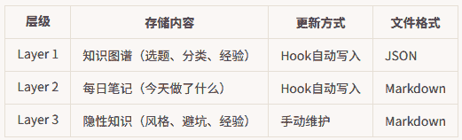
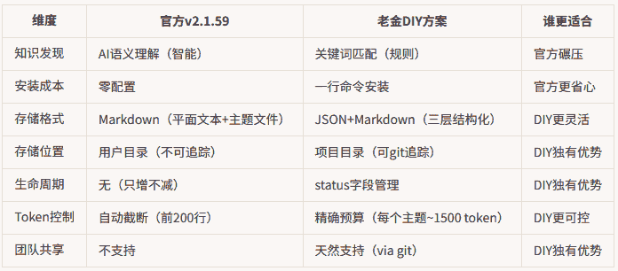
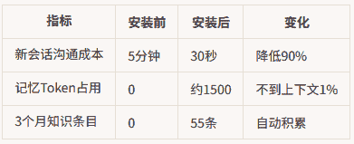
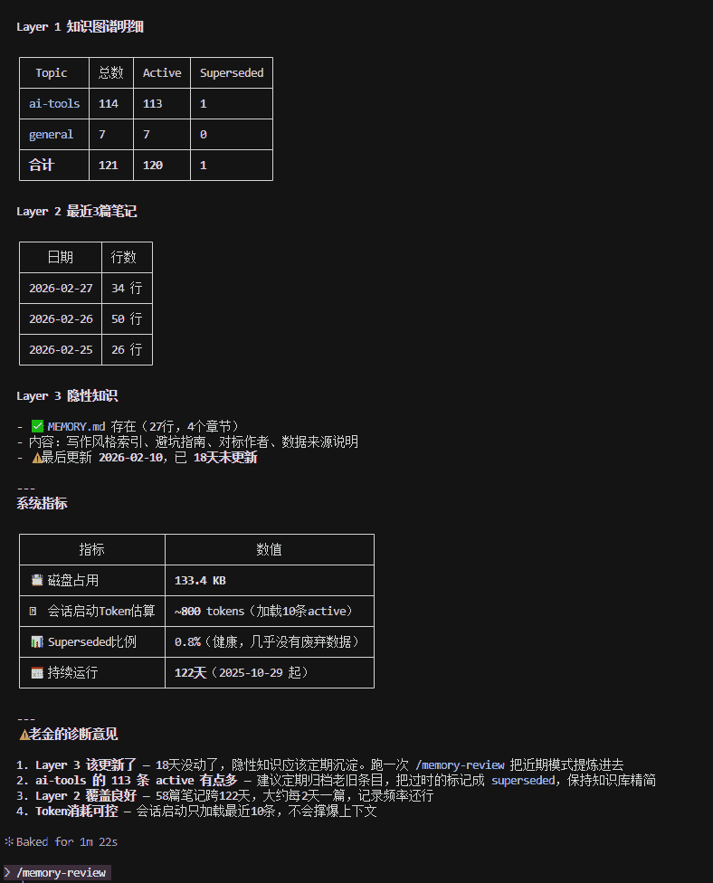
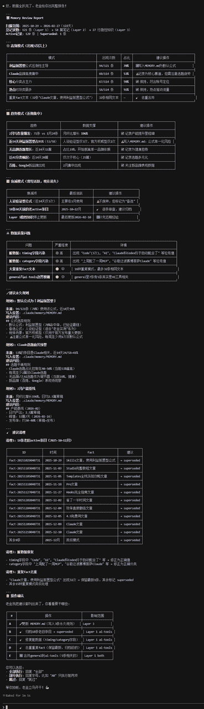

# Claude Code自动记忆来了！配合老金三层记忆系统全开源！加强Plus！

> 来源：[https://my.feishu.cn/docx/OSz4ds58ooH03lxswqCctOd4nbd](https://my.feishu.cn/docx/OSz4ds58ooH03lxswqCctOd4nbd)

昨天晚上，老金我照例打开 **Claude Code** 准备写代码。

随便聊了几句项目架构，Claude突然冒出一句：

> "Based on our previous discussions, this project uses pnpm and TypeScript strict mode."

老金我愣了一下。

上次提到pnpm是三天前的事了，这中间重启了好几次。

打开 ~/.claude/projects/ 一看，多了个 memory/MEMORY.md 文件。

里面记着老金我之前跟它讨论过的项目配置和编码习惯。

这不就是老金我3个月前自己搭的那套三层记忆系统的思路吗？

点开更新日志一看，**v2.1.59** 昨天刚上线了自动记忆功能。

老金我第一时间试了，发现官方方案跟老金我的DIY方案，"提取→存储→加载"的核心流程几乎一模一样。

但仔细一看，两套系统各有各的不可替代性。

今天这篇文章，老金我把官方方案实测、DIY方案原理、代码实现、一行安装全给你讲透。

看完你就知道该用哪套、怎么用、怎么组合效果最好。

## 以前为什么这么痛苦

用过Claude Code的都知道，跨会话记忆一直是老大难问题。

关掉终端再打开，对它来说就是一张白纸。

**Anthropic**之前给的解决方案是 CLAUDE.md——在项目根目录放一个Markdown文件，启动时自动读取。

相当于给Claude Code写了一张"说明书"。

但问题是，这玩意儿得你自己维护。

每次发现Claude Code又忘了什么，你就得手动加一行。

用了两周你会发现，CLAUDE.md越写越长，过时的规则也懒得清理。

老金我的CLAUDE.md一度写到200多行。

维护成本比写代码还高，这就很离谱了。

## v2.1.59更新了什么

2月26号，Claude Code发布了v2.1.59版本。

更新日志里最重要的一条：

> "Claude automatically saves useful context to auto-memory. Manage with /memory"

翻译一下：Claude现在会自动把有用的上下文保存到记忆系统里，用 /memory 命令管理。

**核心变化就一句话**

以前是"你写CLAUDE.md，Claude读"。

现在是"Claude自己写MEMORY.md，自己读"。

CLAUDE.md是你给Claude的指令，权威性最高，你说什么它听什么。

MEMORY.md是Claude自己的笔记本，它觉得什么重要就记什么。

两者并存，互不冲突。

## 官方自动记忆怎么工作

**记忆存在哪里**

文件存在你的用户目录下，不在项目目录里：

```
~/.claude/projects/&lt;项目名&gt;/memory/
├── MEMORY.md          # 主记忆文件（自动加载前200行）
├── debugging.md       # 调试相关的记忆
├── api-conventions.md # API约定
└── ...                # 其他主题文件
```

<项目名> 是从git仓库根目录推算的。

同一个仓库下的所有子目录，共享同一份记忆。

**什么时候触发记录**

不需要你做任何事情，完全自动。

Claude自己判断什么时候该记——具体的触发机制是黑盒，官方没有公开阈值。

但从实际使用来看，Claude记忆非常保守。

有用户反馈用了几周，MEMORY.md也才12行。

短对话（比如"帮我改个拼写错误"）几乎不产生记忆。

深度对话（比如讨论架构设计、反复纠正同一个习惯）才会触发记录。

**怎么加载记忆**

下次开新会话时，Claude Code自动读取MEMORY.md的前200行。

超过200行的内容不会自动加载，Claude会收到一个警告。

主题文件（比如debugging.md）不会启动时加载。

Claude觉得需要的时候，会自己去读取对应的文件。

**怎么管理**

输入 /memory​，可以查看和编辑MEMORY.md，也能开关自动记忆功能。

在输入框里输入 # 加一条指令（比如 # 永远用TypeScript严格模式​），能快速保存到CLAUDE.md里。

注意：#快捷键写入的是**CLAUDE.md**（你的指令文件），不是MEMORY.md（Claude的笔记）。

一个是"你说的"，一个是"它记的"，别搞混。

如果不想用自动记忆，在 .claude/settings.json 里加 "autoMemoryEnabled": false 就行。

## 社区反应：有惊喜也有坑

这个功能上线不到24小时，GitHub上已经有不少讨论了。

**惊喜的部分**

确实解决了跨会话记忆的痛点。

不用再手动维护CLAUDE.md了，Claude自己学、自己记。

对于长期在固定项目上开发的用户，体验提升很明显。

**翻车的部分**

GitHub Issue #29178报告了一个问题：Token消耗明显增加。

有用户在Max x5套餐下，18分钟的轻度对话就消耗了8%的配额。

原因是自动记忆会把内容注入到每条消息的系统提示词里，叠加Skill元数据，Token开销不小。

Issue #23544指出另一个问题：记忆是"影子状态"。

记忆文件存在 ~/.claude/projects/ 下，不在你的项目目录里。

不能被git追踪，不能在PR里review，不能跨设备同步。

Issue #24044发现了一个Bug：MEMORY.md被加载了两次。

自动记忆加载器和CLAUDE.md加载器各加载了一遍，Token消耗直接翻倍。

## 官方只解决了一半问题

说到这里，老金**我得说句**实话。

官方自动记忆在知识发现上是碾压级别的——Claude用AI语义理解来判断什么值得记，这个能力任何规则匹配都拍马赶不上。

但**知识管理**呢？

记下来之后怎么办？过时了怎么清理？Token怎么控制？怎么跨设备同步？怎么团队共享？

这些问题，官方一个都没解决。

这就是老金我3个月前搭三层记忆系统的初衷——不是为了替代官方方案，而是补上"管理"这半截。

## 老金的方案：三层自动记忆架构

折腾了3个月，老金我设计出一套三层记忆系统。

每一层解决不同的问题，组合起来就能让Claude Code真正"懂你"。



**核心思路****

Laye**r 1和Layer 2是自动的——通过 Hooks（钩子脚本）在你工作时自动提取和保存知识。

Layer 3是手动的——存放那些AI提取不了的隐性经验。

三层加起来每个主题大概占1500 token，对200K的上下文窗口来说不到1%，几乎可以忽略。

## Layer 1：用Hook自动积累知识图谱

这是整套系统最核心的部分。

**Hooks是什么**

Hooks是Claude Code 2.1引入的功能——在特定时机自动执行脚本。

比如会话开始时、工具调用后、上下文压缩前，都可以挂一段代码自动运行。

不需要你手动触发，完全在后台静默执行。

老金我用了三个关键Hook来实现自动记忆。

第一个：SessionStart Hook

每次打开Claude Code，这个Hook自动运行，把之前积累的知识注入到当前会话。

核心逻辑很简单：

```
def load_layer1_knowledge_graph():
    topics_dir = MEMORY_DIR / &quot;areas&quot; / &quot;topics&quot;
    for topic_folder in topics_dir.iterdir():
        items_file = topic_folder / &quot;items.json&quot;
        items = json.load(open(items_file))
        # 只加载每个主题最近10条active记录，按时间排序
        active_items = [i for i in items
                        if i.get(&quot;status&quot;) == &quot;active&quot;]
        active_items.sort(key=lambda x: x.get(&quot;timestamp&quot;, &quot;&quot;))
        recent = active_items[-10:]
```

它干的事就一件：读取 items.json 里的知识条目，按时间排序后取每个主题最近10条状态为active的记录，注入到会话上下文。

多了浪费token，少了不够用，10条是老金我试出来的平衡点。

第二个：PostToolUse Hook

这个Hook在Claude Code每次使用工具后自动触发，分析对话内容，提取有价值的信息保存下来。

比如老金我写完一篇公众号文章后，它会自动提取一条记录：

```
{
  &quot;id&quot;: &quot;fact-20260227150448&quot;,
  &quot;fact&quot;: &quot;Claude Code文章，使用利益前置型公式&quot;,
  &quot;category&quot;: &quot;核心&quot;,
  &quot;timing&quot;: &quot;常青&quot;,
  &quot;formula&quot;: &quot;利益前置型&quot;,
  &quot;timestamp&quot;: &quot;2026-02-27&quot;,
  &quot;status&quot;: &quot;active&quot;
}
```

这条记录自动保存到 items.json。

下次开新会话时，SessionStart Hook自动加载它。

整个过程完全自动，你不需要做任何事情。

第三个：PreCompact Hook

这个Hook在Claude Code压缩上下文窗口之前自动触发。

为什么需要它？Claude Code的上下文窗口大概200K token，用着用着就快满了，系统会自动压缩——也就是丢掉一部分对话内容。

如果不做任何处理，压缩时可能把你当前正在做的事情、修改的文件列表这些关键信息给压没了。

PreCompact Hook干的就是：在压缩发生之前，把当前会话状态（正在做什么任务、改了哪些文件、临时笔记）保存到磁盘。

这样即使上下文被压缩了，下次SessionStart Hook还是能把这些状态找回来。

**知识图谱的目录结构**

```
.claude/memory/areas/topics/
├── ai-tools/
│   └── items.json    # 35条记录
├── writing/
│   └── items.json    # 12条记录
└── debugging/
    └── items.json    # 8条记录
```

老金我用了3个月，自动积累了55条知识记录。

每条记录都有status字段，active表示还有用，superseded表示已被新知识替代。

这样知识库会自动迭代，不会越积越臃肿。

## Layer 2：每日笔记自动记录

Layer 2比Layer 1更简单。

每天自动生成一个Markdown笔记文件，记录今天做了什么。

每次写完文章或完成一个任务，Hook会自动追加一条记录：

```
# 2026-02-27

## 15:04 - 写作
主题：Claude Code
公式：利益前置型
分类：核心
时效：常青
```

SessionStart Hook会自动加载最近3天的笔记。

这样Claude Code下次启动时就知道：昨天你写了一篇关于DeepSeek的文章，用的是利益前置型公式。

对于连续工作特别有用。

比如老金我上午写了一半的文章，下午接着写，Claude Code知道上午的进度，不用从头解释。

## Layer 3：手动维护隐性知识

这一层最简单，就是一个 MEMORY.md 文件。

里面放那些AI自动提取不了的东西。

**风格偏好**

"标题最优22-28字"、"禁止用FOMO词"、"品牌词首次出现要加粗"。

**避坑经验**

"Windows路径分隔符要用正斜杠"、"代码块前后必须有空行"。

**对标参考**

"技术深度好的号可以借鉴架构，但保持差异化"。

这些东西没法自动生成，需要你根据经验手动写进去。

但一旦写好，每次会话启动都会自动加载。

老金我的MEMORY.md只有20多行，大概200 token。

精炼但管用。

## 官方+DIY：7维度对比

现在你对两套方案都有了解了，老金我做个全面对比。



核心架构一模一样——都是"提取→存储→加载"。但实现路径完全不同，各有各的不可替代性。老金我挑几个关键差异展开说。

**知识发现：官方碾压，没悬念**

官方的提取能力是AI语义理解——Claude自己读对话、自己判断什么值得记、自己归纳总结。

老金我的提取是什么？关键词匹配。if "claude" in text.lower() 这种级别。

这个差距不是一个量级的。

但"发现知识"只是记忆系统的前半段。

后半段——"管理知识"，才是老金我的主场。

知识生命周期：有管理 vs 只进不出

老金我的items.json每条记录都有一个status字段。

当一条知识过时了，把status改成 superseded​，SessionStart Hook就不再加载它。

知识库会自动新陈代谢，永远保持精简。

官方的MEMORY.md没有这个机制。

Claude往里写，越写越长，超过200行就自动截断不加载。

等于说你最早存的记忆可能是最重要的，但200行以后的新记忆反而被忽略了。

**Git追踪：能 vs 不能**

老金我的记忆文件全部存在项目目录 .claude/memory/ 下。

可以git追踪，可以在PR里review，可以跨设备同步。

团队协作的时候，知识库是共享的。

官方的MEMORY.md存在 ~/.claude/projects/ 下，属于用户个人目录。

不能git追踪，不能跨设备同步。

换台电脑开发，记忆就没了。

Token精确控制：1500 vs 不可控

老金我的方案每个主题加载最近10条active记录。单主题场景下大概1500 token，占200K上下文窗口不到1%。多主题会按比例增加，但通过环境变量 MEMORY_MAX_ITEMS 可以精确控制。

官方的方案加载MEMORY.md前200行，具体多少token完全取决于你的MEMORY.md写了什么。

再加上Skill元数据注入，Issue #29178反馈的Token消耗暴增就是这个原因。

## 社区还有哪些方案

除了官方和老金我的，社区也有两个值得关注的项目。

**Claude-Mem**

安装后完全无感运行。

它的思路是让AI自己决定记什么、怎么压缩、什么时候注入。

核心优势是智能压缩——10:1到100:1的压缩比，Token消耗从早期版本的25K降到现在的1.5K。

相当于请了一个智能档案员，帮你自动整理所有工作记录。

[Claude Code开始失忆了？两大记忆神器帮你选](https://my.feishu.cn/wiki/WgB1wov8JiGzM4kotS4c6NTmnee)

Mcp-memory-service - 老金我用的是这个

复杂一点，但能力强太多了：

支持**13+个AI客户端**（Claude Desktop、VS Code、Cursor...）

有**混合存储**（本地+云同步）

有**DeBERTa智能分类**（代码记忆不会被误删）

有**团队协作**（OAuth共享记忆）

**一句话总结**：claude-mem是"够用"，mcp-memory-service是"真香"。

[烦透了每次给Claude重复背景？手把手教你装这个神器，终极记忆神器](https://my.feishu.cn/wiki/Wq36w7vpliaAo9kz8K3cjPjcn4d)

**Claudeception**

**GitHu**b上超过1800星的项目，做"自动技能提取"。

当Claude Code在工作中发现了一个非显而易见的解决方案——比如某个报错的特殊修复方式——它会自动把这个知识保存为一个新的 Skill（技能文件）。

下次遇到类似问题，Skill系统自动加载对应的解决方案。

[这个Skill能自动学会你的所有习惯，踩过的坑！](https://my.feishu.cn/wiki/ZYEpws2VKiDUSdkqNYCcGjX5npb)

四者的区别很简单。

Claude-Mem偏向"记住你做了什么"，是经验记忆。

Claude-mem是"够用"，Mcp-memory-service是"真香"。

Claudeception偏向"记住怎么解决问题"，是技能记忆。

老金我的三层系统介于三者之间——既记录做了什么（Layer 1和2），也存储怎么做好（Layer 3）。

## 一行命令装好

老金我已经把这套三层记忆系统做成了开源工具，一行命令就能装好。

**GitHub地址**：https://github.com/KimYx0207/claude-memory-3layer

```
# macOS / Linux
curl -fsSL https://raw.githubusercontent.com/KimYx0207/claude-memory-3layer/main/install.sh | bash

# Windows PowerShell
irm https://raw.githubusercontent.com/KimYx0207/claude-memory-3layer/main/install.ps1 | iex
```

一行命令搞定：自动创建目录结构、复制Hook脚本、注册settings.json、生成MEMORY.md模板。

零依赖，纯Python标准库，装完就能用。

装好后还附送两个命令：/memory-review​（定期回顾记忆，提炼规则）和 /memory-status​（查看记忆系统状态）。

**安装后的目录结构**

```
你的项目/
└── .claude/
    ├── hooks/
    │   ├── memory_loader.py      # SessionStart：加载三层记忆
    │   ├── memory_extractor.py   # PostToolUse：提取知识
    │   ├── session_state.py      # 会话状态管理
    │   └── pre_compact.py        # PreCompact：压缩前保存
    ├── memory/
    │   ├── MEMORY.md             # Layer 3：隐性知识
    │   ├── memory/               # Layer 2：每日笔记
    │   └── areas/topics/         # Layer 1：知识图谱
    └── settings.json             # Hook注册配置
```

## 两套系统怎么一起用

前面说了"两套结合才是最优解"，但具体怎么结合？

老金我用大白话讲一遍，保证你听完就懂。

核心原理：它们住在不同的地方，互不干扰

官方的MEMORY.md存在你的用户目录 ~/.claude/projects/ 下，由Claude Code内置加载器自动读取。

老金我的items.json存在项目目录 .claude/memory/ 下，由SessionStart Hook自动读取。

两套系统各走各的路，完全不冲突。

你可以把它想象成一个人有两本笔记本。

官方那本是"随手记"——Claude觉得什么重要就往里写，你不用管。

老金我这本是"整理簿"——结构化存储，能过期、能追踪、能团队共享。

**实际运行流程长这样**

```
你打开Claude Code
    ↓
① 内置加载器自动读取 MEMORY.md（官方记忆）
② SessionStart Hook自动读取 items.json（DIY记忆）
    ↓
两份记忆同时注入上下文，Claude都能看到
    ↓
你开始干活
    ↓
③ Claude自动往 MEMORY.md 写新发现（官方机制）
④ PostToolUse Hook自动往 items.json 写结构化记录（DIY机制）
    ↓
下次开新会话，①②再来一遍
```

整个过程零配置，装好就自动运行。

你不需要做任何"联合"的操作——它们天然就是联合的。

**各管各的，谁也替不了谁**

举个例子。老金我跟Claude讨论了半天架构设计，Claude可能会在MEMORY.md里记一条："这个项目偏好函数式编程风格"。

这种语义级别的洞察，老金我的关键词匹配提取不了。

但老金我写完一篇公众号文章后，PostToolUse Hook会自动提取一条结构化记录：标题、分类、公式、时效性，存到items.json里。

这种结构化的知识管理，官方的MEMORY.md做不到。

所以不是"选哪个"的问题。

官方负责发现你自己都没意识到的偏好，DIY负责把工作成果结构化存档。

一个管"悟"，一个管"记"，缺一不可。

## 真实效果：3个月数据

装上这套系统之前，老金我每次开新会话至少要花5分钟重新介绍项目。

"我的项目是公众号写作助手"、"文章保存在articles/drafts目录"、"用老金风格写"。

每次都是这一套，烦得很。

**第一周：没什么感觉**

知识图谱还没积累起来，items.json里只有几条记录。

体验跟以前差不多。

**第二周：开始有变化了**

知识条目超过20条后，Claude Code开始"懂"一些东西了。

比如老金我说"写公众号"，它已经知道要用什么风格、文章保存在哪里。

**第三周之后：真的回不去了**

现在老金我开新会话，直接说"帮我分析最近的标题数据"。

Claude Code知道数据在哪、用什么格式、输出到哪个目录。

完全不需要解释。

**具体数据**



/memory-status​（查看记忆系统状态）执行效果参考：



/memory-review​（定期回顾记忆，提炼规则）效果参考：



## 老金的避坑指南

第一个：先小范围试用官方自动记忆

这个功能刚上线，还不够稳定。

建议先在一两个项目上开启，观察几天的Token消耗变化。

如果发现消耗异常增加，先关掉等后续版本修复。

**第二个：定期审核记忆内容**

不管是官方的MEMORY.md还是老金我的items.json，都需要定期扫一遍。

Claude记的不一定全对，也不一定都是你需要的。

老金我建议每周花5分钟看一遍，删掉过时的或不准确的记录。

第三个：不要放弃CLAUDE.md

别因为有了自动记忆就不维护CLAUDE.md了。

CLAUDE.md是你的"规矩"，权威性最高。

MEMORY.md只是Claude的"参考笔记"。

核心规则一定要写在CLAUDE.md里，这是底线。

第四个：给DIY系统足够的学习时间

不要装上就期待立马有效果。

至少用2-3周，让知识图谱积累到20条以上，效果才明显。

**第五个：保持工作流程的一致性**

如果你的项目结构和工作习惯经常变，记忆系统会比较混乱。

尽量保持固定的目录结构和命名规范。

## 总结

Claude Code v2.1.59的自动记忆，本质上就是让Claude自己维护一份跨会话的"学习笔记"。

方向是对的，跨会话记忆确实是Claude Code最大的痛点，官方终于动手解决了。

但"发现知识"只是记忆系统的一半。

另一半——知识过期管理、Git追踪、团队共享、Token精确控制——官方还没覆盖到。

老金我3个月前搭的三层记忆系统，刚好补上了这些缺口。

最终答案不是二选一，而是两套结合。

```
官方Auto Memory（AI智能发现知识）
       ↓ 自动记录到 MEMORY.md
你的日常使用（零配置，不用管）
       ↓
三层记忆系统（结构化管理知识）
       ↓ 一行命令安装
items.json（可过期、可追踪、可共享）
```

官方负责"发现"，DIY负责"管理"。一个都不能少。

开源地址：https://github.com/KimYx0207/claude-memory-3layer

有啥问题评论区聊，老金我看到都会回。

---

## 参考资料

Claude Code官方记忆文档：https://code.claude.com/docs/en/memory

v2.1.59更新日志：https://github.com/anthropics/claude-code/releases/tag/v2.1.59

GitHub Issue #29178（Token消耗问题）：https://github.com/anthropics/claude-code/issues/29178

GitHub Issue #23544（关闭自动记忆请求）：https://github.com/anthropics/claude-code/issues/23544

GitHub Issue #24044（MEMORY.md重复加载）：https://github.com/anthropics/claude-code/issues/24044

Anthropic官方Hooks文档：https://code.claude.com/docs/en/hooks

<https://my.feishu.cn/sync/HDlcdCPBksnJpBbRk0EcW364nmc>