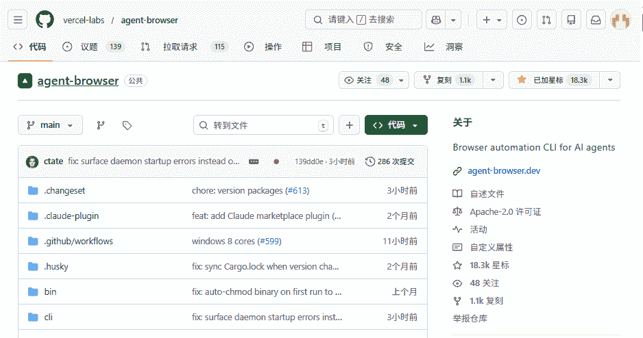
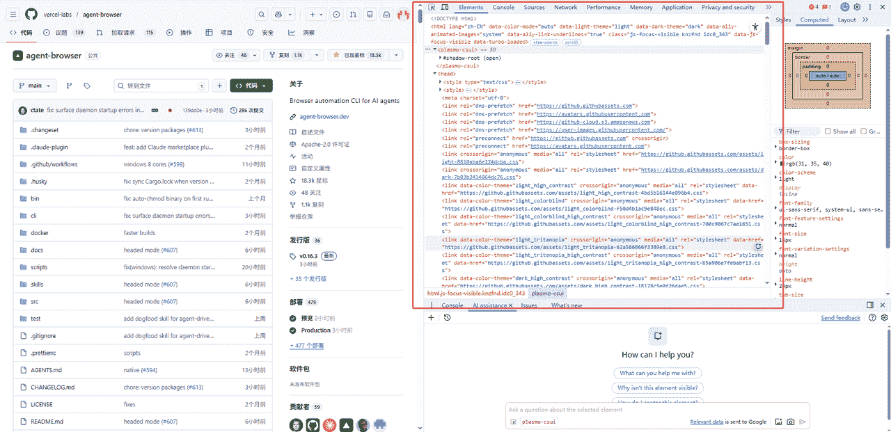

# Vercel推Agent Browser：让AI自己控制浏览器，比Playwright省93%上下文

> 来源：[https://my.feishu.cn/docx/GOsIdIRDioLsIvxsOMocanKJnkf](https://my.feishu.cn/docx/GOsIdIRDioLsIvxsOMocanKJnkf)

周末**刷GitHub的时候，老金**我看到Vercel Labs推了个新工具。

叫 Agent Browser，16.8k星，两个月不到就冲到这个数字。

点进去一看，这玩意儿是专门给AI Agent用的浏览器自动化工具。



说实话，老金我一开始没太当回事。

Playwright、Puppeteer不是早就能自动化浏览器了吗？

又是重新造轮子吧？

但实际测了一圈之后，老金我承认想错了。

这次Vercel是真的解决了一个大痛点。

## 传统工具的问题：AI看不懂CSS选择器

先说说为什么需要Agent Browser。

传统的浏览器自动化工具，比如Playwright，是给程序员用的。

你得写CSS选择器、XPath这些东西。

告诉程序"点击class为submit-button的元素"。

这对程序员来说还行。

但对AI Agent来说就是灾难。

**最大的坑是什么？**

AI Agent每次操作浏览器，都得把整个HTML DOM树（就是网页的结构代码）发给大模型。

一个普通网页的HTML，轻松几万行。

全部塞进上下文，Token消耗直接爆炸。



老金我之前用Playwright MCP（让AI调用工具的协议）让Claude控制浏览器。

结果一个简单的登录操作，上下文就用掉了2万Token。

而且AI还经常选错元素。

因为CSS选择器太脆弱了——网页改个class名称，整个脚本就废了。

当时老金我就在想，有没有什么工具能让AI不用看HTML就能操作网页？

## Agent Browser的核心创新：用引用代替选择器

Vercel的解决方案很巧妙。

不让AI去猜CSS选择器，而是给每个可交互元素分配一个稳定的引用编号。

**工作流程分三步**

第一步，AI执行 snapshot命令。

获取页面的accessibility tree（无障碍树，就是网页里所有能点、能填、能选的元素清单）。

这个树自动过滤掉装饰性的div，只留可交互的部分。

第二步，Agent Browser给每个元素分配一个ref编号。

比如 @e1、@e2、@e3。

AI看到的不是几万行HTML，而是一个简洁的列表：

```
button &quot;登录&quot; [ref=e1]
input &quot;用户名&quot; [ref=e2]
input &quot;密码&quot; [ref=e3]
```

第三步，AI直接用ref编号操作。

click @e1点击登录，fill @e2 "admin"填用户名。

不需要猜选择器，不需要解析DOM结构，指哪打哪。

**这个设计有多厉害？**

根据官方数据，Agent Browser比Playwright MCP减少了93%的上下文消耗。

原来2万Token的操作，现在只要1400 Token。

而且ref编号是基于无障碍树生成的。

网页改版只要结构不变，ref就不会失效。

老金我看到这个数据的时候是真的心动了。

Token贵啊，省93%是什么概念。

## **架构设计：三层套娃**

Agent Browser的架构挺有意思，是个三层设计。

**第一层：Rust CLI**

Rust（一种高性能系统编程语言）写的命令解析器。

启动速度快，资源占用低。

命令行敲 agent-browser open example.com​，毫秒级响应。

**第二层：Node.js守护进程**

后台跑一个常驻进程，负责管理浏览器实例。

这个进程会一直保持运行，避免每次命令都要重启浏览器。

**第三层：Playwright**

底层还是用Playwright控制Chromium。

但封装了一层AI友好的接口。

为什么要搞三层？

Rust保证CLI性能，Node.js保证生态兼容性。

而且如果Rust二进制文件不可用，会自动降级到纯Node.js模式。

兼容性拉满。

## **怎么用自然语言控制？**

看到这里你可能会问：这不还是命令行工具吗？

这是老金我一开始最困惑的地方。

后来才搞明白——你根本不需要自己敲命令。

Agent Browser的设计理念是让AI来当翻译。

你用自然语言告诉AI想干什么，AI自动生成命令。

**举个例子**

你跟Claude说："帮我登录GitHub并创建Issue"。 <---- 你说的是这句话

Claude理解你的意图后，自动生成一串命令：

```
agent-browser open https://github.com/login
agent-browser snapshot -i
agent-browser fill @e1 &quot;username&quot;
agent-browser fill @e2 &quot;password&quot;
agent-browser click @e3
```

你全程只需要说话，AI帮你干活。

这就是"AI-First"设计的核心。

## **实际安装：两行命令搞定**

老金我实际装了一下，确实简单。

```
npm install -g agent-browser
agent-browser install
```

第一行全局安装CLI工具。

第二行下载Chromium浏览器内核。

老金我这边261个包，18秒装完，版本v0.16.1。

**基础操作就这几个**

```
agent-browser open https://example.com
agent-browser snapshot -i
agent-browser click @e1
agent-browser fill @e2 &quot;用户名&quot;
agent-browser screenshot demo.png
```

打开网页、拍快照、点击、填写、截图。

五个命令覆盖80%的场景。

**配合Claude Code使用**

如果你在用Claude Code、Cursor这些AI编程工具。

可以直接让AI调用agent-browser命令。

AI会自动分析snapshot结果，选择正确的ref编号完成操作。

老金我测试了一个场景：让Claude自动登录GitHub并创建Issue。

用Playwright MCP的话，需要写一堆提示词解释DOM结构。

用Agent Browser，直接说"登录GitHub，创建Issue"，Claude自己就搞定了。

省心程度，差距太大了。

## 对比Playwright：什么时候该用哪个？

Agent Browser不是要替代Playwright。

而是针对AI Agent场景做了优化。

**Agent Browser适合**

AI Agent自动化任务（爬虫、测试、数据采集）

需要频繁交互的场景（表单填写、多步操作）

上下文预算有限的情况（Token贵，省着用）

**Playwright适合**

传统自动化测试（人工编写脚本）

需要精细控制的场景（复杂等待逻辑、性能监控）

已有大量Playwright脚本的项目（迁移成本高）

**一句话总结**

Agent Browser是AI-First设计，优先考虑AI的理解能力。

Playwright是Developer-First设计，优先考虑程序员的控制力。

## **老金我的使用建议**

**适合这些人**

正在用AI Agent做自动化任务的开发者

想让AI控制浏览器但被Token成本劝退的人

需要快速原型验证的产品经理（让AI写脚本，自己不用写代码）

**注意这些坑**

Agent Browser还在快速迭代（当前v0.16.1），API可能会变。

复杂页面的无障碍树可能不完整，需要手动调整。

如果网页本身的无障碍支持做得差，ref可能识别不准。

**老金我的实际体验**

现在老金我做数据采集任务，优先用Agent Browser。

配合Claude Code，基本上说一句话就能完成整个自动化流程。

省下来的时间，老金我能多写两篇文章，美滋滋。

不过说实话，目前也有不爽的地方。

每次 snapshot后ref编号会重新生成。

如果中间页面跳转了，之前的ref就全废了，得重新拍快照。

这个设计虽然合理，但操作多步流程的时候确实有点烦。

总的来说，瑕不掩瑜。

93%的上下文节省，这个数字太香了。

有兴趣的可以去GitHub上看看，star数还在蹭蹭涨。

你们用过Agent Browser吗？评论区聊聊，老金我很好奇大家都拿它做什么。

<https://my.feishu.cn/sync/HDlcdCPBksnJpBbRk0EcW364nmc>