# 龙虾装了几百Skill搜不到还冲突？Claude Code官方新版 Skill Creator一键优化！

> 来源：[https://my.feishu.cn/docx/QFFYdU6ZdoSPBXx14f3c8Mzknpc](https://my.feishu.cn/docx/QFFYdU6ZdoSPBXx14f3c8Mzknpc)

OpenClaw这只小龙虾火了，在各个大厂推广自家小龙虾产品之后，简直火出天际。

ClawHub上万个Skill随便装，看着好就往下灌。

老金我看群里聊天，用了一段时间的人，Skill数量轻松大几百，卷的直接上千。

Claude Code这边也一样。

Anthropic（就是做Claude的那家公司）官方Skill仓库在涨。

社区造的Skill也在爆发，装Skill的门槛已经低到一句话的事了。

但老金我想问你一个问题。

这几百上千个Skill里面，你测过哪个是真有用的吗？

没测过。你也不知道怎么测。

装了一个代码审查Skill，Review出来的结果跟不装比到底差多少？

装了一个写作辅助Skill，写出来的东西跟裸写比到底强在哪？

没有对比数据，全凭 我觉得好像好了一点。

这不是工程，这是玄学。

还有一个更头疼的问题——**触发词打架**。

10个Skill的时候偶尔碰到。

100个的时候天天碰到。

800个的时候，每条指令都在碰。

你说"帮我看看这段代码"。

代码审查Skill跳出来，调试Skill也跳出来，安全审查Skill也想插一脚。

到底谁接？看运气。

"帮我优化一下"。

重构Skill、性能Skill、代码审查Skill三个抢。

你说的优化到底是哪种优化？

AI猜不准，你也没法指定。

Skill装得越多，这两个问题越严重。

这不是偶发情况，是必然。

这周发现Skill Creator更新了。

跑了一轮，这两个问题都解决了。

先说新老版本差在哪，再说具体怎么用。

## 新老版本对比：从手工作坊到质量工程

先列清楚。

旧版Skill Creator能干什么？

你描述需求，它帮你生成SKILL.md。

就这样。

没了。

生成完之后好不好用？它不管。

触发词准不准？它不管。

Skill有没有起到实际作用？它也不管。

相当于给了你一把刀，至于切菜还是切手，自求多福。

**新版加了什么？**

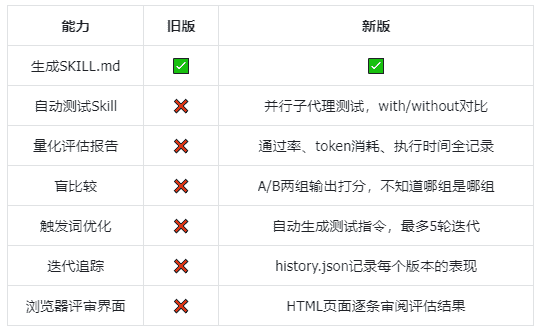

一句话总结：旧版帮你造Skill，新版帮你造+测+改Skill。

Skill越多，这个测+改的能力就越值钱。

10个Skill的时候你还能手动调，800个的时候你调得过来吗？

## Skill能自测了，这是最大的变化

这个功能让老金我跑完之后直接拍大腿。

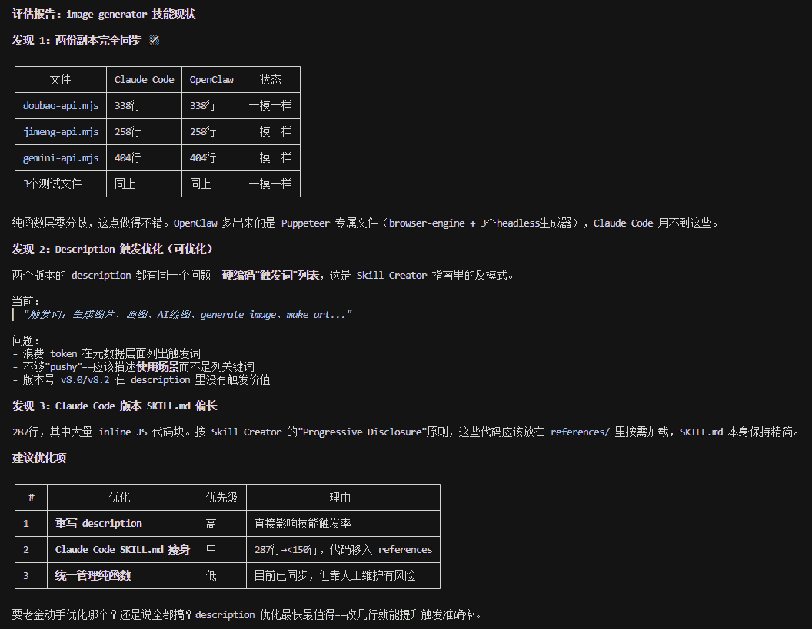

以前怎么测Skill？

打开Claude Code，输入一个测试指令，看看输出像不像回事。

测了觉得还行，换个指令再试。

一轮下来花半小时，结论是感觉还可以。。。

但问题来了。

第一次跑得好，你以为是Skill的功劳。

第二次换个场景就拉了。

**后来才发现，第一次之所以好，**是 前面的对话给了太多上下文提示。

Skill本身没起多大作用。

**你甚至不知道自己被骗了。**

新版Skill Creator的评估机制是这样的。

首先它读你的SKILL.md，理解核心功能。

然后自动设计测试场景。

不是一个，是多个，覆盖各种使用情况。

每个场景都配了量化验收标准。

不是看起来不错，是硬指标。

然后关键的来了。

它启动多个独立子代理（就是独立运行的AI分身），每个在干净环境里跑。

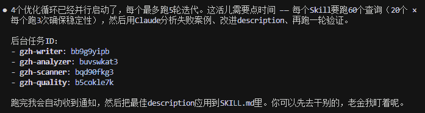

装了Skill跑一遍，不装Skill跑一遍。

两组数据放一起看。

干净环境意味着白纸一张，没有历史对话的污染。

结果是Skill的功劳，就是功劳；不是，就是不是。

跑完直接出量化报告。

老金我跑完一轮，发现了一个之前完全没注意的问题。

在特定场景下，Skill里有个环节偶尔会被跳过。

这种bug靠人工测根本找不到。

评估系统帮我揪出来了。

改完再跑一遍，通过率从85%直接飙到97%！！

你装了几百个Skill？

一个一个跑一遍，心里就有数了。

哪些是真有用，哪些是心理安慰，数据说了算。

## 触发词不打架了

回到第二个问题。

Skill多了，触发词必然打架。

想象一下你装了三个相关Skill：

```
代码审查、安全审查、调试修复。

&quot;帮我看看这段代码&quot;触发谁？
三个都觉得是自己的活。
```

再比如写作类的几个Skill：

```
内容生成、文案润色、翻译改写。

&quot;帮我改一下这段话&quot;——谁接？
都能接，但结果完全不一样。
```

以前怎么调？

凭感觉改 **description** （Skill的功能描述文字）里的措辞。

改完手动测几条，觉得好像对了，上线。

过两天又碰到一个边界情况翻车了。

再改，再测，再翻车。。。

循环往复。

Skill越多，这个循环越痛苦。

10个的时候还能忍，几百个的时候直接摆烂。

新版的触发优化流程完全不一样。

第一步，自动生成20条测试指令。

一半是应该触发你这个Skill的，一半是不应该触发的。

重点是那些模棱两可的边界情况。

比如"帮我分析一下这段代码的问题"——到底该不该触发？

第二步，弹出一个HTML页面让你逐条确认。

觉得它判断错了直接改。

这一步保证了评测数据的质量——你说了算，不是AI猜。

第三步，数据集按60/40拆成训练集和测试集。

用训练集跑优化，用测试集验证效果。

最多5轮迭代，每轮自动微调description措辞。

为什么要拆训练集和测试集？

防止过拟合（在已知数据上表现好，遇到新数据就翻车）。

用全部数据优化，结果可能只在这20条上好看。

拆开验证才能保证效果是真的泛化了，不是背答案。

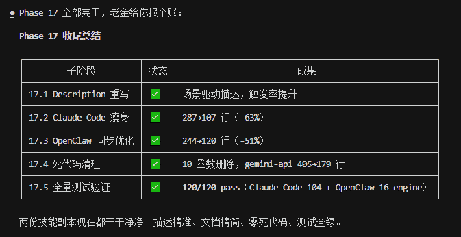

跑了一次（Skill Creator评估报告数据）。

优化前边界场景触发准确率70%。

优化后92%。

跑完直接把最优版本覆盖回你的SKILL.md。

全程不碰一行代码。

Skill越多的人，这个功能越救命。

## Claude Code怎么用

分两步：更新Skill Creator，然后跑评估。

第一步：安装/更新Skill Creator

打开Claude Code，说一句：

```
从 https://github.com/anthropics/skills/tree/main/skills/skill-creator 拉取最新版skill-creator，覆盖本地 .claude/skills/skill-creator/ 目录，完成后确认版本信息。
```

它自己去GitHub拉最新代码，30秒搞定。

一个细节：

最新版跑触发词优化时不再需要单独配ANTHROPIC_API_KEY了。

以前你得去Anthropic官网申请API Key才能用这个功能。

现在直接用Claude Code自带的就行。

**第二步：跑Skill评估**

安装完之后，对着Claude Code说：

```
用Skill Creator评估一下我的xxx Skill
```

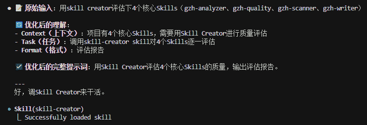

它会自动读你的SKILL.md，设计测试场景。

启动子代理跑装了Skill和没装Skill的对比测试。

跑完给你量化报告+盲比较打分。

这是他的判断标准。

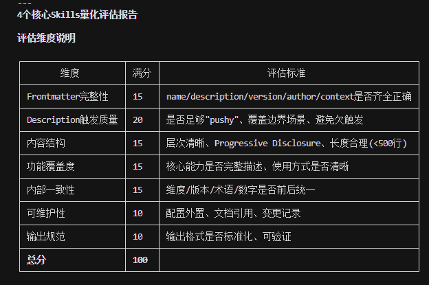

结果如下，我找了个一直没咋关注的数据分析技能：

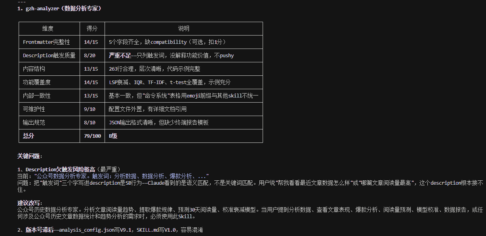

不看不知道，一看吓一跳，居然问题还不少：

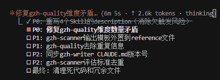

完成后的修复报告：

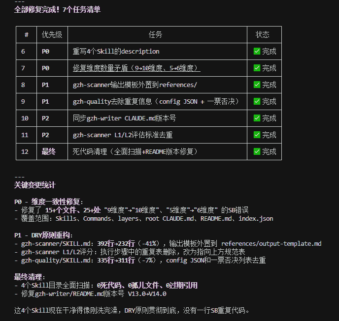

然后如果你想优化触发词，说：

```
用Skill Creator优化xxx Skill的触发词
```

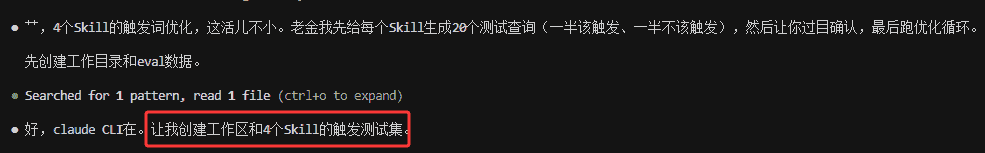

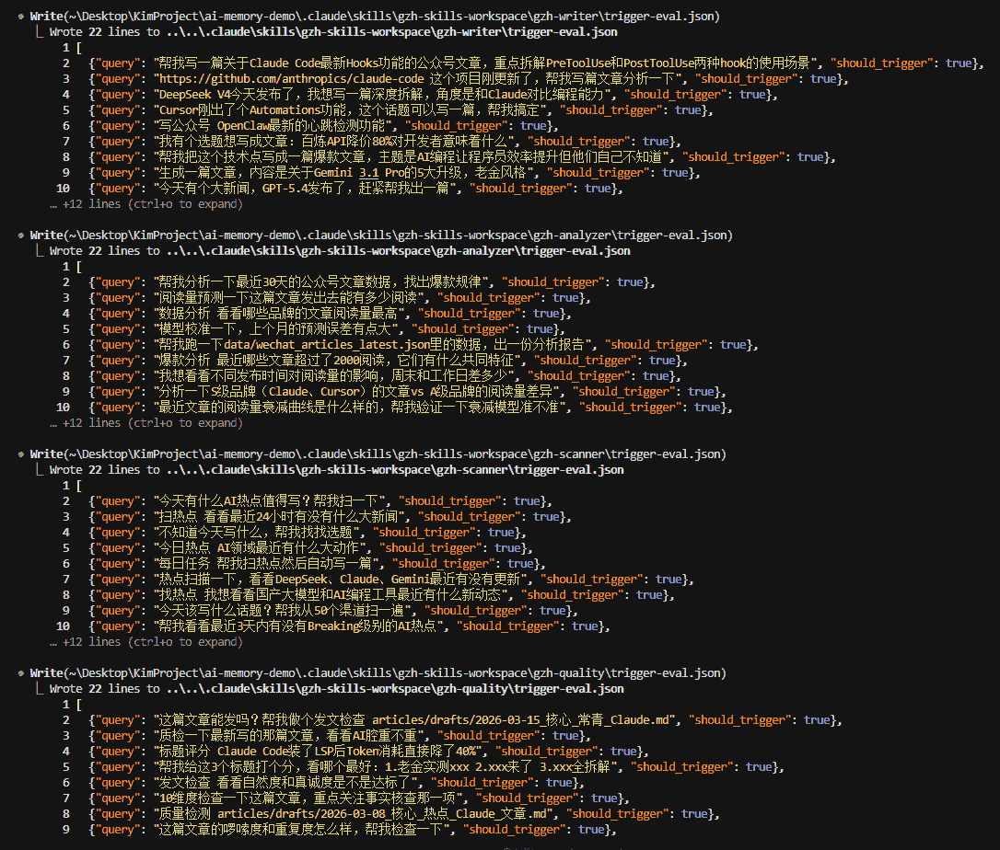

它会生成测试指令，弹出HTML页面让你确认。

然后自动跑60/40训练测试集迭代。

跑完把最优版本直接覆盖回SKILL.md。

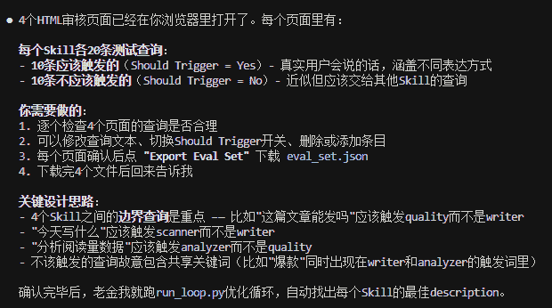

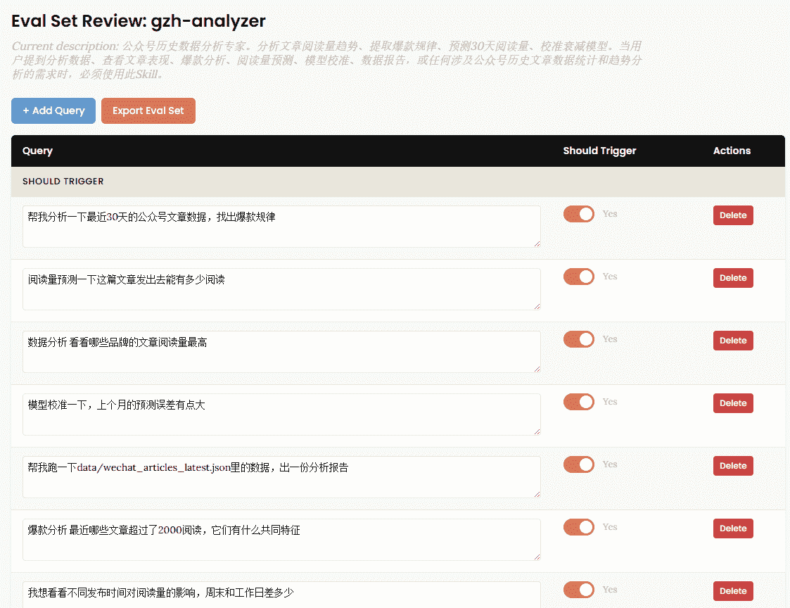

全程不碰一行代码。

等着完成就行了，啥也不用管。

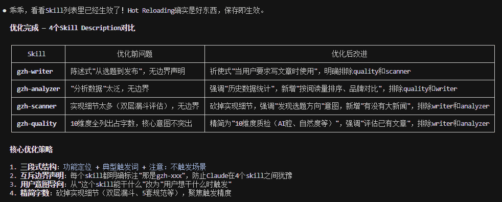

## OpenClaw用户怎么办

先说清楚一个事实。

**OpenClaw的C**l**awHub上有skill-te**st和skill-evaluator。

名字看着像，但跟Skill Creator不是一回事。

skill-test能在沙盒里隔离跑一遍你的Skill，确认它能不能正常工作。

skill-evaluator能从25个维度检查你的Skill格式有没有问题。

但它们都做不到最关键的一件事：装了Skill和没装Skill两组对比跑。

Skill Creator测的是疗效——这个Skill到底让输出变好了多少。

OpenClaw那边测的是出厂检验——格式对不对、能不能跑。

一个回答有没有用，一个回答能不能用。

完全不是一个层级的问题。

触发词自动优化？OpenClaw目前没有 = =

所以老金我的建议是：直接从Claude Code学。

好消息是两边的SKILL.md格式通用。

同样的YAML frontmatter（元数据头部），同样的Markdown正文。

Claude Code这边优化好的SKILL.md，直接复制到OpenClaw就能用。

**具体路径：**

第一步，装Claude Code和Skill Creator。

前面写了怎么装，30秒的事。

第二步，把你想测的OpenClaw Skill的SKILL.md复制到Claude Code。

放在 .claude/skills/ 目录下就行。

格式兼容，直接能认。

第三步，用Skill Creator跑评估和触发优化。

第四步，把优化好的SKILL.md复制回OpenClaw那边。

注意一个细节。

**OpenClaw的Skill是会话**启动时加载的，改了之后得重启会话才生效。

这点跟Claude Code的热重载不一样。

一份Skill两边跑，评估优化在Claude Code做，日常使用哪边顺手用哪边。

## 说几个限制

Skill Creator不是万能的，有几个边界要说清楚。

评估依赖测试场景的设计质量。

场景设计得太简单，好Skill和差Skill的差距就测不出来。

触发优化有上限。

如果两个Skill的功能本身就高度重叠，再怎么调description也分不开。

这种情况该合并就合并，别硬分。

另外，评估跑一次要消耗不少token。

几百个Skill逐个跑一遍，成本不低。

建议先挑最常用的20个跑，不用一口气全上。

## 老金的建议

如果你Skill不多，十几二十个

先跑一遍评估。

看看通过率多少、跟不装Skill比差距多大。

数据不好看就让Skill Creator帮你迭代改进。

**如果你Skill几百上千个**

优先跑触发优化。

Skill多了触发冲突是最致命的问题。

自动优化+train/test拆分，比手动调靠谱太多。

**如果你主要用OpenClaw**

Skill Creator目前是Claude Code独有的。

但SKILL.md格式通用，可以在Claude Code里跑完优化再同步回去。

多一步操作，但效果差距是质变级别的。

两组数据放在这（均来自Skill Creator评估报告）：

触发准确率从70%到92%，通过率从85%到97%。

Skill这个生态在爆发。

OpenClaw的ClawHub，Claude Code的官方仓库，社区第三方。

Skill越来越多，但好不好用、该不该用，以前没有工具能告诉你。

现在有了。

以前写代码靠手感，后来有了单元测试，没人再敢裸奔上线。

现在造Skill也一样。

Skill Creator这次更新，本质上就是给Skill开发加了一套单元测试。

装Skill的人多的是。

但测过Skill到底有没有用的人，不多。

<https://my.feishu.cn/sync/HDlcdCPBksnJpBbRk0EcW364nmc>