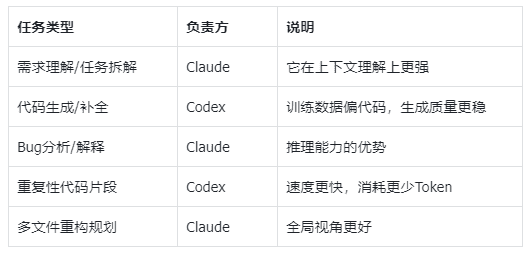
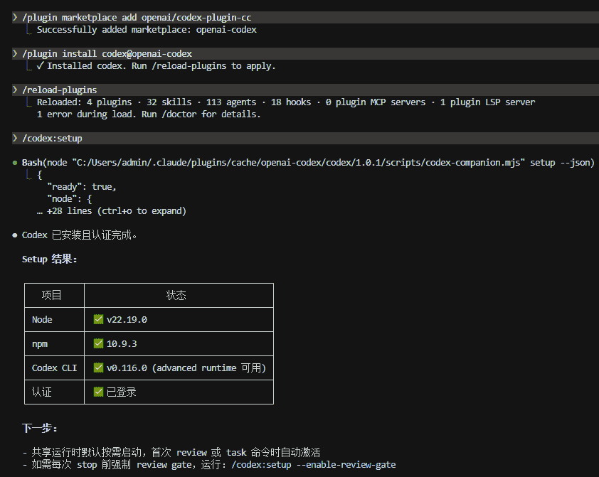
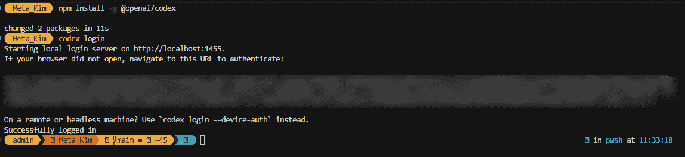
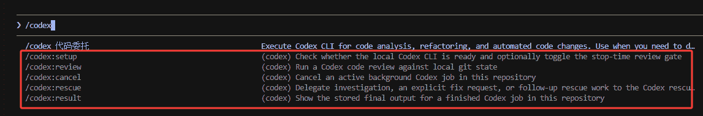
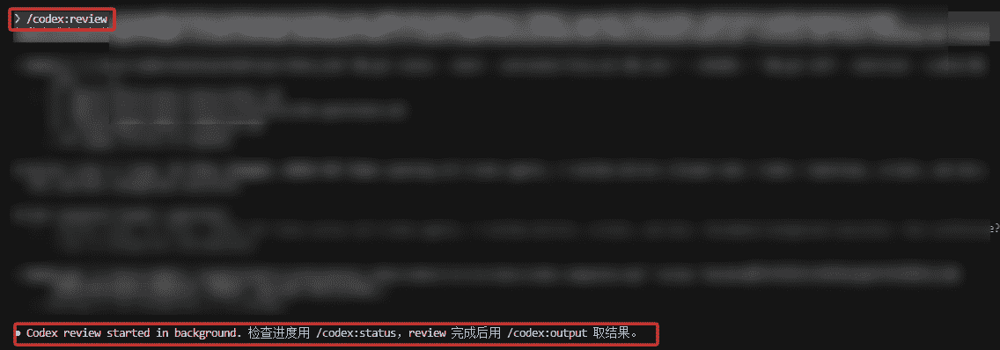

# OpenAI官方插件进Claude Code，老金装了后工作流省了这4步

> 来源：[https://my.feishu.cn/docx/FQYkdPbf8oYOEGxXe3OcNxhznXG](https://my.feishu.cn/docx/FQYkdPbf8oYOEGxXe3OcNxhznXG)

都说OpenAI和Anthropic是死对头，没想到有一天老金我要写"竞对官方直接联动"这种标题 = =

**上周OpenAI悄悄发布了一个**东西，叫 codex-plugin-cc（OpenAI Codex的Claude Code官方插件），专门给在用Claude Code的人装的。

这玩意儿让你在Claude Code工作流里，直接调用Codex干活。

老金我拿到之后装了测了一圈，今天把结论给你们说清楚。

## 这两家为什么会联动？

先说背景，这事本身就值得聊几句。

OpenAI的 **Codex**（就是GPT背后的代码理解模型）和Anthropic的Claude Code，一直是正面竞争关系。

但最近这个局面在悄悄变化。

老金我的判断是：两件事推动了这个合作。

第一，OpenAI的Codex API已经足够稳定，可以作为独立服务嵌入第三方工具。

第二，Claude Code的插件生态（Skill体系）已经成熟，能接入外部能力。

说白了就是：大家都意识到，用户不会只用一家的产品。

不如把自己的强项开放出来，让用户在熟悉的工作流里直接调用。

这是商业决策，不是打感情牌。

## codex-plugin-cc 能干什么

先说清楚这个插件是什么，避免你们像老金我一开始那样想歪了。

它不是"用Codex代替Claude"。

这两个模型在Claude Code里是协作关系——Claude负责理解你的需求、规划任务，Codex负责具体的代码生成和补全。

具体能力分工是这样的：



用老金我的大白话翻译：Claude是项目经理，Codex是专注写代码的程序员。

你不用管谁在干，插件自动分配。

## 怎么装、怎么配置

这部分老金我把踩到的坑也一并写进来了，别跳过。

**第一步：确认前置条件**

你需要有OpenAI API Key（codex-plugin-cc通过API调用Codex）。

或者你有Plus及以上的账号也可以，反正就是付费20刀以上的。

**第二步：安装插件**

```
/plugin marketplace add openai/codex-plugin-cc
/plugin install codex@openai-codex
/reload-plugins
/codex:setup
```

装完之后Claude Code会自动重新加载，不用重启。



如果你和我一样，原本机器里就有Codex Cli。

直接跨过第三步。

**第三步：配置API Key**

插件装好后会提示你输入OpenAI API Key。

也可以手动加到环境变量：

```
export OPENAI_API_KEY=&quot;sk-你的key&quot;
```

或者直接auth登录。先安装 Codex Cli。

```
npm install -g @openai/codex
```

然后网页登录。

```
codex login
```



**第四步：验证是否生效**

输入 /codex ，你会发现多了5个斜杠指令。



最上面那个原本是我自己做的，现在可以光荣下岗了。

#### **/codex:review**

审核未提交的改动，或者对比分支。

```
/codex:review 
/codex:review --base main 
/codex:review --background
```

建议使用后台跑，就是 /codex:review --background。

/codex:status 可以，/codex:result 取结果。



然后还有个**隐藏功能**。

```
/codex:setup --enable-review-gate 
/codex:setup --disable-review-gate
```

当开启后，它会审查本次对话更改内容，若发现问题，则会打断，先处理完问题再继续。

然后老金我发现，自己写的几个自定义Skill，有两个和codex-plugin-cc争同一批触发词。

解决方法是在冲突的Skill里加 priority: low，让插件优先接管代码相关任务。

## 装上之后，工作流变了什么

这才是你们真正关心的。

**变化1：代码生成速度快了**

纯Claude模式下，生成一个200行的工具函数大概需要8-12秒。

加了Codex分流之后，同样的任务平均在5-7秒完成。

（数据来自老金我自己的计时，不是官方数据，你们的环境可能不同）

**变化2：重复性代码质量更稳**

这个是老金我没想到的。

以前让Claude写测试用例，偶尔会出现"测了但没真测"的情况。

看起来有用，实际上assert（断言判断，测试的核心逻辑）写错了。

Codex在这种标准化测试代码上明显更稳，老金我连续生成了30个单元测试，没有一个是废的。

**变化3：省掉了手动切工具这一步**

以前老金我的流程是：在Claude Code里规划 → 复制到Cursor里生成代码 → 再粘回来。

现在一个窗口全搞定，不用来回切换了。

听起来小事，但一天切几十次的话，省下来的时间真不少。

**变化4：Token消耗降了**

代码生成这部分转给了Codex的API，消耗的是OpenAI那边的额度，不算Claude的Token。

对于重度Claude Code用户来说，这意味着同样预算能干更多活。

## 边界在哪，什么时候不该用

老金我不太喜欢只说好的，所以这部分要认真说。

有几种情况，这个插件不适合用，甚至会帮倒忙：

**1. 上下文高度相关的代码任务**

比如你在重构一个有很深业务逻辑的模块，需要模型理解你整个项目的架构设计。

这种任务交给Codex分流之后，它不了解你的项目背景。

生成的代码可能技术上没错，但风格和你项目格格不入。

这种情况建议关闭插件，全用Claude。

2. 需要精确控制模型行为的场景

如果你在用Claude Code跑复杂的Agent任务，需要精确控制每一步的输出，插件的自动分流会引入不确定性。

插件判断"这段应该给Codex"的逻辑目前还不够透明。

老金我在几次Agent任务里遇到过分流出错的情况。

**3. 预算有限的时候**

两个API都在消耗。

如果你OpenAI账户里只有5美元，别指望靠Codex省Claude的钱——省下的Claude Token会被OpenAI这边的Codex消耗平衡掉。

真正的省钱效果取决于你的使用场景，代码生成占比越高，省得越多。

## 老金我的建议

如果你主要用Claude Code写代码（代码任务超过70%）

建议装，尤其是做重复性开发工作的（写测试、写CRUD（增删改查接口）、写工具函数）。

Codex在这块确实比Claude稳，而且速度也快一些。

如果你主要用Claude Code做规划和分析（代码任务不到30%）

暂时可以不装。

你的主要收益是代码生成提速，但你用的少，性价比不高。

如果你是Claude Code重度用户，每天用超过3小时

强烈建议装。

Token分流带来的成本节省，时间越长越明显。

老金我自己这一周下来，Claude Token消耗降了大概20%（数据来自Claude Code使用报告）。

说到底，这个插件的出现说明了一件事：AI工具之间的边界正在变模糊。

以前是各家守着自己的生态，现在反而开始互相嵌入。

对用户来说这是好事，但也意味着你得多花点时间搞清楚，每个工具在你工作流里到底扮演什么角色。

会搭配工具的人，以后会比不会搭配的人多出一倍的效率。

装还是不装，自己判断。

有问题评论区聊，老金我这几天都在。

<https://my.feishu.cn/sync/HDlcdCPBksnJpBbRk0EcW364nmc>