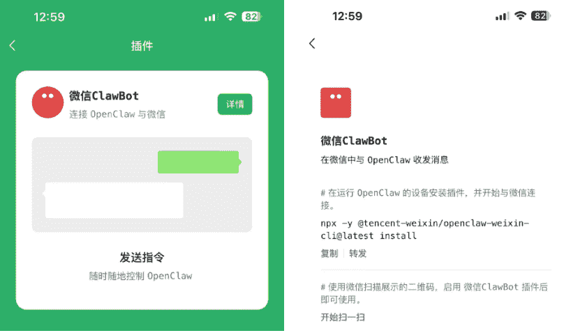
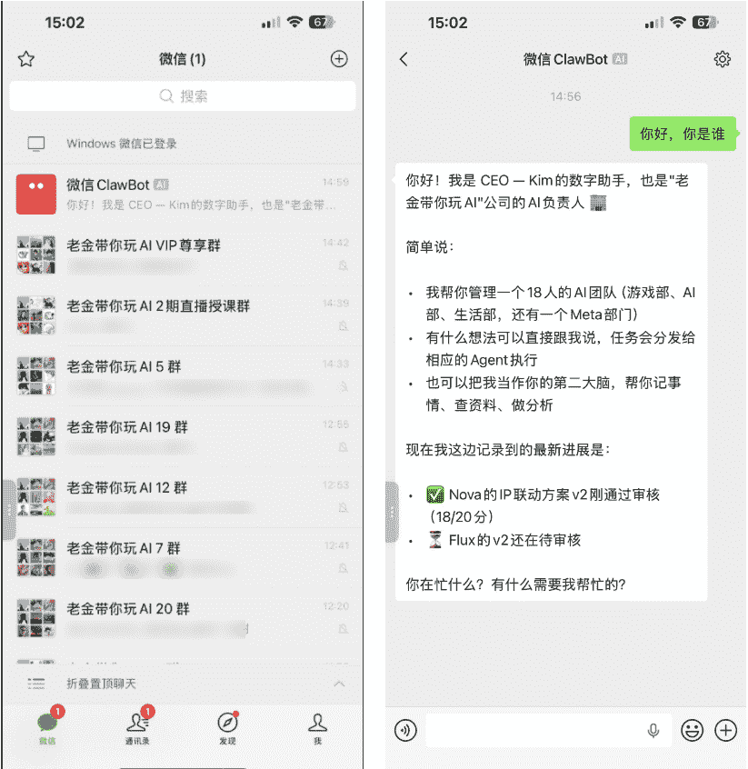
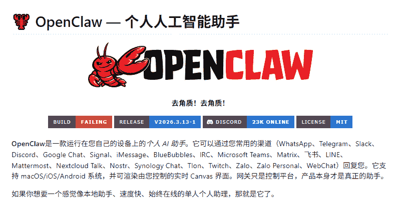
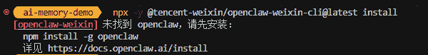
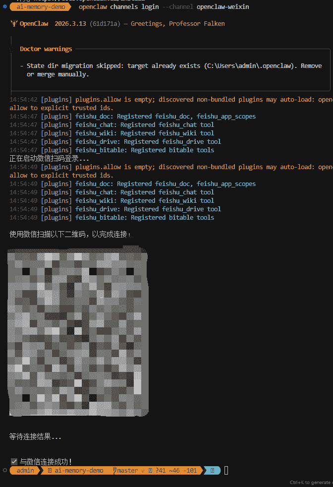
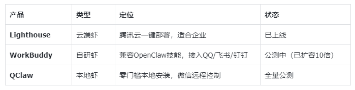
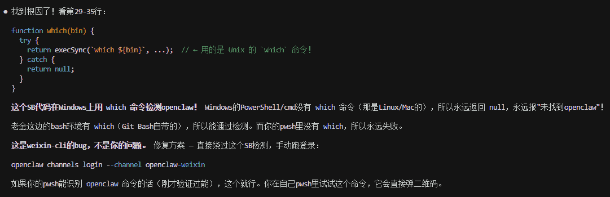

# 微信ClawBot插件支持个人微信，14亿人的AI入口打开了！附带Win踩坑解决方案！

> 来源：[https://my.feishu.cn/docx/ERRLdvuVGoyBWBxVqPGcbVx9nqh](https://my.feishu.cn/docx/ERRLdvuVGoyBWBxVqPGcbVx9nqh)

今天刷IT之家，看到一条消息直接坐起来了。

微信插件页面，悄悄上了一个新东西。

名字叫 **ClawBot**。

功能只有一句话：连接OpenClaw与微信。



这意味着什么？

意味着那只GitHub上32万星的"小龙虾"，终于有了微信官方认证的入口。

不是第三方魔改，不是企业微信绕路，是微信自己做的插件。

老金我第一时间装了，给你们说说到底怎么回事。



## 先说ClawBot是什么

**OpenClaw** 你们应该不陌生了。

全球最火的开源AI助手，GitHub 32万星，能帮你操作电脑、跑脚本、读写文件、控制浏览器。



之前最大的问题是什么？

得坐在电脑前才能用。

出门在外想让AI帮你整理个文件？

对不起，打开电脑、连VPN、敲命令。

这跟没有AI有什么区别。

所以大家一直在想办法把OpenClaw接到手机上。

之前的方案要么走企业微信（配置复杂），要么用第三方协议直连个人微信（有封号风险）。

现在微信官方自己做了个插件，问题一下子解决了。

不需要公网服务器，不需要企业微信，不需要折腾API Key。

目前的限制：

首先，你需要本地安装Openclaw。

至于怎么安装openclaw。

你可以在我的开源知识库里找我的公开直播，1小时的直播里我一共就和Claude code说了4句话。。其他时间都在科普一些大家提问的问题，以及等待它自己下载，以及自动安装。

所以我还是强烈建议你先学会Claude Code，直接把openclaw的github地址甩进去它自己安装就好了。

其次，必须要IOS版本微信，更新至8.0.70版本。

插件入口在 微信->我->设置->插件。

微信更新后插件不显示，需要重启微信。

## 安装只要一行命令（但windows有坑）

老金我实测了一下，整个过程不到5分钟。

但中间踩了个大坑，先说正确姿势。

**Mac用户**：官方的一行命令就行，基本不会踩坑。

```
npx -y @tencent-weixin/openclaw-weixin-cli@latest install
```

装完自动弹二维码，扫码搞定。

**Windows用户**：别用npx，坑太多了。

为什么不用npx？两个原因：

1.  npx会报EPERM权限错误（Windows文件锁机制拒绝临时目录操作）

1.  npx内部用Linux的 which 命令检测openclaw，Windows压根没有 which，永远报"未找到openclaw"——这是weixin-cli的bug



老金我实测的正确姿势：

第一步：用openclaw自带命令装插件

```
openclaw plugins install &quot;@tencent-weixin/openclaw-weixin&quot;
```

**第二步：修复配置**

```
openclaw doctor --fix
```

它会自动处理配置格式迁移、清理孤儿文件。

跑完看到 Doctor complete. 就是正常的。

**第三步：微信扫码登录**

```
openclaw channels login --channel openclaw-weixin
```

终端里会弹出一个二维码。

拿起手机，打开微信扫一扫。

二维码有效期不长，弹出来赶紧扫，过期了它会自动刷新（最多3次）。



扫码之后，微信里就多了一个"服务通知"入口。

通过这个入口，你就能和电脑上的OpenClaw对话了。

**第四步：重启gateway**

```
openclaw gateway restart
```

让插件正式生效。不重启的话插件加载不进来。

**关于安全警告**

安装过程中会弹一个黄色警告，说插件有"环境变量+网络发送"行为。

别慌，这是微信插件的正常操作——它得读配置、发消息到微信服务器。

想消除警告，在 openclaw.json 里加白名单：

```
{
  &quot;plugins&quot;: {
    &quot;allow&quot;: [&quot;@tencent-weixin/openclaw-weixin&quot;]
  }
}
```

**第五步：开始用**

在微信里发一句"帮我查一下桌面上那个Excel的数据汇总"。

电脑上的OpenClaw就开始干活了。

干完了把结果发回你的微信。

## 张军亲自回应了

腾讯公关总监张军今天专门发了条动态。

原话是这样的：

**"微信当年所努力的，就是成为一个连接人、连接设**备、连接服务的工具。这个理念依然有效。"

翻译成人话就是：微信从第一天起就想做万能入口，现在AI来了，这条路终于走通了。

张军还透露了一个信息。

腾讯内部有个"龙虾特工队"，已经第一时间完成了适配。

目前腾讯的"三只虾"产品矩阵已经全部就位：



再加上今天的 **ClawBot插件**，等于腾讯把OpenClaw的入口铺到了你能想到的每一个角落。

## ClawBot和QClaw有什么区别？

你可能会问：之前不是有QClaw了吗？ClawBot又是什么？

老金我帮你理清楚。

**QClaw** 是腾讯电脑管家团队做的独立客户端。

你得单独下载安装，它会在你电脑上装一只OpenClaw。

然后通过微信小程序远程控制。

**ClawBot** 是微信官方的插件。

它不装新的OpenClaw，而是连接你已有的OpenClaw。

如果你电脑上已经跑着一只龙虾，ClawBot直接就能用。

**简单说：**

QClaw适合从零开始的小白，它帮你全包了。

ClawBot适合已经在用OpenClaw的老手，一行命令接入微信。

两个产品不冲突。

你甚至可以同时装。

## 额外注意事项

安装过程上面已经写得很清楚了，这里补充几个容易忽略的点。

微信更新后插件不显示，需要重启微信。

这个坑特别隐蔽。

你更新完微信，打开插件页面，发现ClawBot根本不在列表里。

别急，退出微信重新打开一次。

第一次加载插件列表的时候不会刷新新插件，重启之后就有了。

**目前只支持文字**

和QClaw一样，ClawBot现在只支持文字消息。

你没法直接发图片让它分析，也不能发文件让它处理。

据IT之家报道，语音和图片支持在排期中，但没给具体时间。

weixin-cli源码里的bug（技术向）

好奇为什么npx在Windows上死活不行的，老金翻了源码。

@tencent-weixin/openclaw-weixin-cli 的检测逻辑长这样：

```
function which(bin) {
  return execSync(`which ${bin}`, ...).trim();
}
```

它用Linux/Mac的 which 命令检测openclaw是否安装。

Windows的PowerShell没有 which，所以永远返回null，永远报"未找到openclaw"。

**我依旧是那个不懂代码的老金**，是Claude code告我的。



这是个平台兼容性bug，和你的环境无关。上面教的安装方法已经绕过了这个问题。

## 安全性怎么样？

这是很多人关心的问题。

ClawBot走的是微信官方插件通道。

不是第三方协议，不存在封号风险。

你的数据处理全在本地电脑完成。

微信只负责传递你的指令文本，不会把你的文件上传到任何地方。

不过老金我还是要提醒：

ClawBot目前处于逐步放量阶段。

不是所有人都能看到这个插件。

如果你的微信插件页面还没出现ClawBot，等几天就好。

另外，OpenClaw生态的安全问题一直存在。

之前Cisco安全团队发现ClawHub上12%-20%的Skills有恶意行为。

所以装第三方Skill之前，一定要看清楚来源。

## 老金我的判断

回看这个月发生的事：

3月9日，QClaw内测，OpenClaw塞进微信小程序。

3月18日，QClaw全量公测，WorkBuddy同步上线。

3月19日，企业微信更新OpenClaw插件到最新版。

3月22日，微信官方ClawBot插件上线。

两周之内，腾讯完成了四步棋。

这不是试水，这是All in。

14亿微信用户，每个人都能用微信控制一只AI助手。

这个画面腾讯想了很久，现在终于落地了。

## 老金我的建议

**如果你已经在用OpenClaw**

现在就装ClawBot插件，一行命令的事。

你的Skills、配置、记忆全部保留，只是多了一个微信入口。

**如果你是纯小白**

直接装QClaw，去 qclaw.qq.com 下载。

20秒安装，微信扫码绑定，从零到能用不超过3分钟。

**如果你是企业用户**

走企业微信方案，支持群聊、文件直传、白名单控制。

去企业微信后台开启OpenClaw接入，官方文档已经更新。

不管选哪条路，终点都是一样的。

用微信发条消息，电脑上的AI就开始干活。

这才是AI助手该有的样子。

<https://my.feishu.cn/sync/HDlcdCPBksnJpBbRk0EcW364nmc>