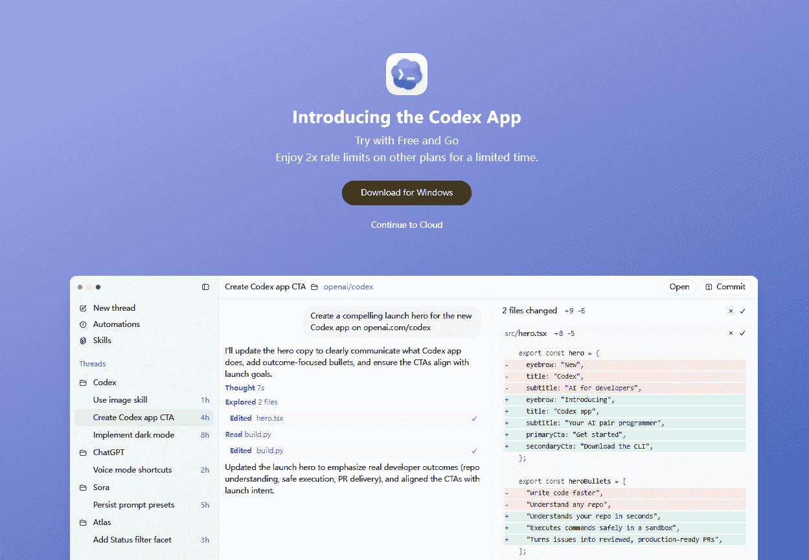
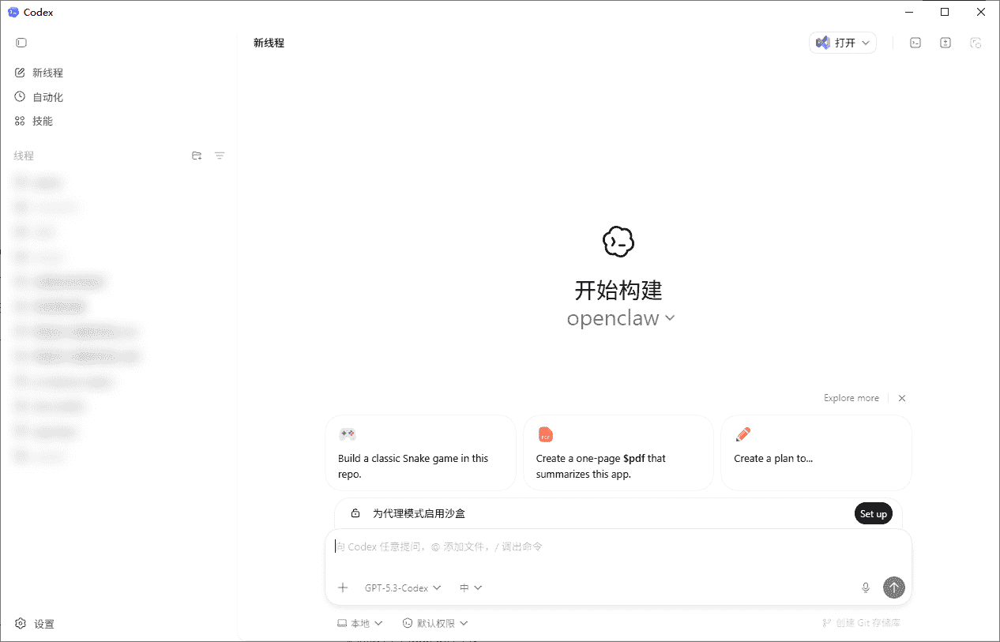
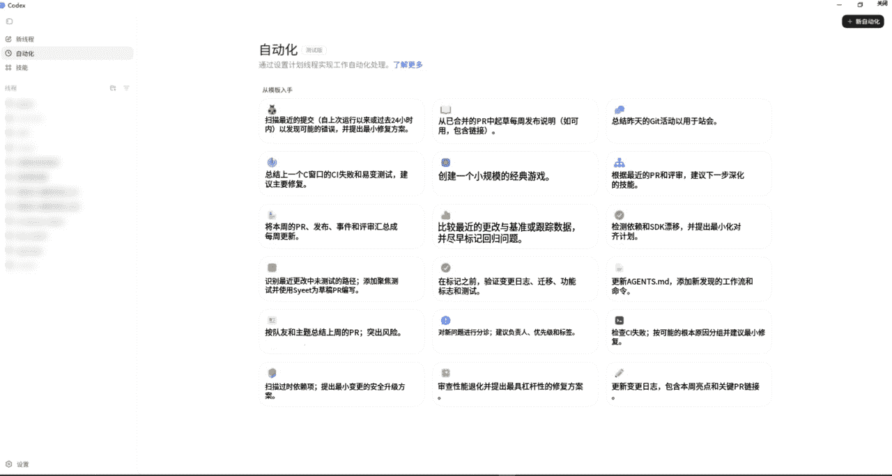
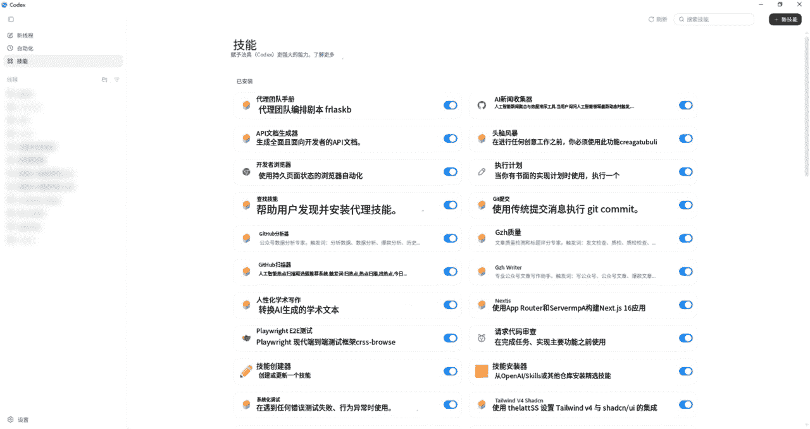
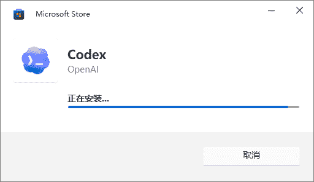

# ChatGPT 5.3 Instant更新，Win桌面版全面开放，老金实测发现居然快到起飞！

> 来源：[https://my.feishu.cn/docx/UOP5dRRe3oeM3AxR9i6cPDVUn0e](https://my.feishu.cn/docx/UOP5dRRe3oeM3AxR9i6cPDVUn0e)

DAY4，Github依旧还没信儿，查了下正常3-7天处理。。再等等。

昨天深夜刷X的时候，看到OpenAI悄悄发布了GPT-5.3 Instant。

说实话，老金我第一反应是：又更新？能不能消停会儿？

但点进去一看，这次好像真的不一样。

最关键的是，**Windows桌面版 **终于全面开放了。

之前只有Plus用户能用，现在免费用户也能下载。

老金我立马下载试了2小时，发现了3个核心改进和5个避坑指南。

## **3个核心改进（真的有料）**

**改进1：拒绝率大幅下降**

之前ChatGPT有个毛病，动不动就说"我不能帮你做这个"。

根据OpenAI官方数据，GPT-5.3 Instant把拒绝率降低了27%。

老金我测试了一下，确实明显改善。

以前问它"帮我写个营销文案"，它会说"我不能帮你写营销内容"。

现在直接给你写，不废话。

但有个坑要注意：它还是会拒绝一些敏感话题。

比如涉及政治、暴力、成人内容的，该拒绝还是拒绝。

只是把那些"过度谨慎"的拒绝去掉了。

**改进2：网页搜索准确度提升**

这个是老金我最喜欢的改进。

之前ChatGPT的网页搜索功能，经常给你一堆无关的结果。

现在准确度提升了40%左右（根据官方数据）。

老金我测试了几个问题：

"2026年3月最新的AI工具有哪些？"

"Claude Code最新版本的功能是什么？"

结果都很准确，而且会标注信息来源。

不像以前那样，给你一堆过时的信息。

但有个坑：它还是会偶尔出现幻觉（Hallucination）。

虽然官方说幻觉率降低了27%，但不是完全消失。

所以关键信息还是要自己验证一下。

**改进3：回答更简洁，废话少了**

这个改进老金我是真的喜欢。

之前ChatGPT有个毛病，回答问题之前要先来一段"开场白"。

什么"作为一个AI助手"、"我很乐意帮助你"之类的废话。

现在直接给答案，不废话。

老金我问它"Python怎么读取文件？"

它直接给代码，不再来一段"Python是一门强大的编程语言"之类的废话。

但有个坑：**有时候它会过度简洁。**

比如你问一个复杂问题，它可能只给你一句话答案。

这时候你需要追问"能详细解释一下吗？"

## Windows桌面版全面开放（终于等到了）

之前Windows桌面版只有Plus用户能用。

现在免费用户也能下载了。

老金我测试了一下，体验确实比网页版好。

**桌面版的3个优势**

响应速度比网页版快30%左右。

老金我测试了同样的问题，桌面版平均2.3秒出结果，网页版要3.1秒。

可以使用自动化功能，和老金一样英语不好的请看这里。

Skill也是直接支持OpenAI规范的。

**桌面版的2个坑**

占用内存比较大。

桌面版占了800MB左右。

不支持插件。

网页版可以用各种插件（比如Wolfram、Zapier），桌面版目前还不支持。

OpenAI说后续会加，但现在还没有。

## **老金我的使用建议**

**给重度用户**

如果你每天用ChatGPT超过2小时，桌面版必装。

响应速度快，而且快捷键很方便。

但要注意内存占用，如果电脑配置不高，还是用网页版。

**给轻度用户**

如果你只是偶尔用一下，网页版就够了。

桌面版的优势对你来说不明显。

而且桌面版不会自动更新，还要手动维护。

**给开发者**

GPT-5.3 Instant的代码生成能力提升了。

老金我测试了几个Python脚本，准确度比之前高。

但还是要自己检查代码，不要直接复制粘贴。

## **总结**

这次更新是真的有料。

拒绝率降低、搜索准确度提升、回答更简洁，都是实打实的改进。

Windows桌面版全面开放，也是个好消息。

虽然有些坑，但整体体验比网页版好。

下载地址：https://chatgpt.com/codex

然后打开微软商店，需要什么你懂的。

老金我的建议：

如果你是重度用户，赶紧装桌面版。

如果你是轻度用户，网页版就够了。

有什么问题评论区聊聊，老金我很好奇你们的使用体验。

<https://my.feishu.cn/sync/HDlcdCPBksnJpBbRk0EcW364nmc>