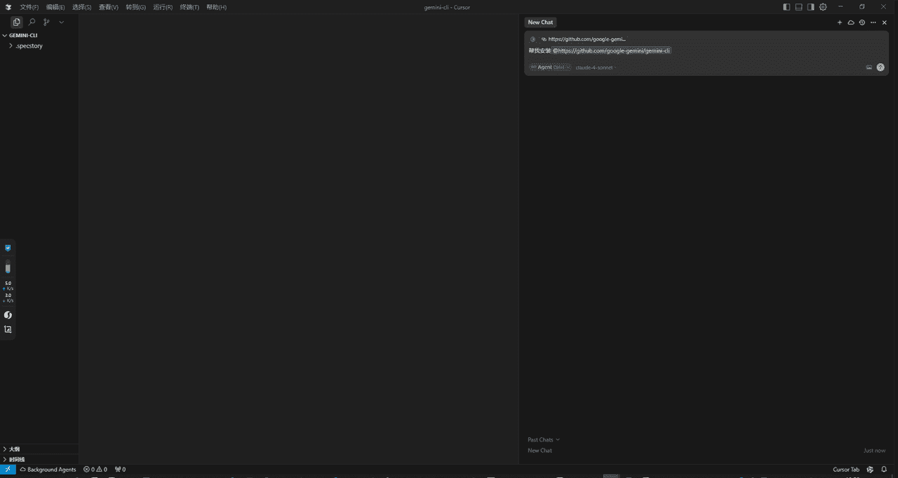
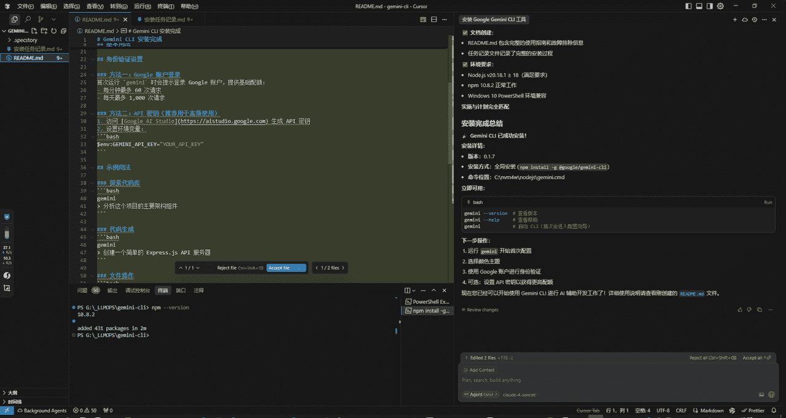
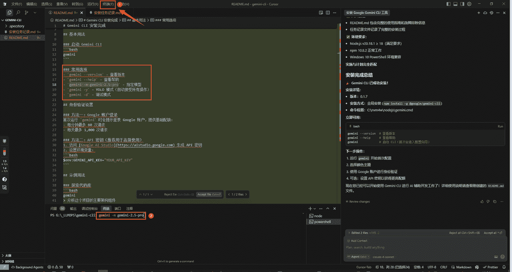
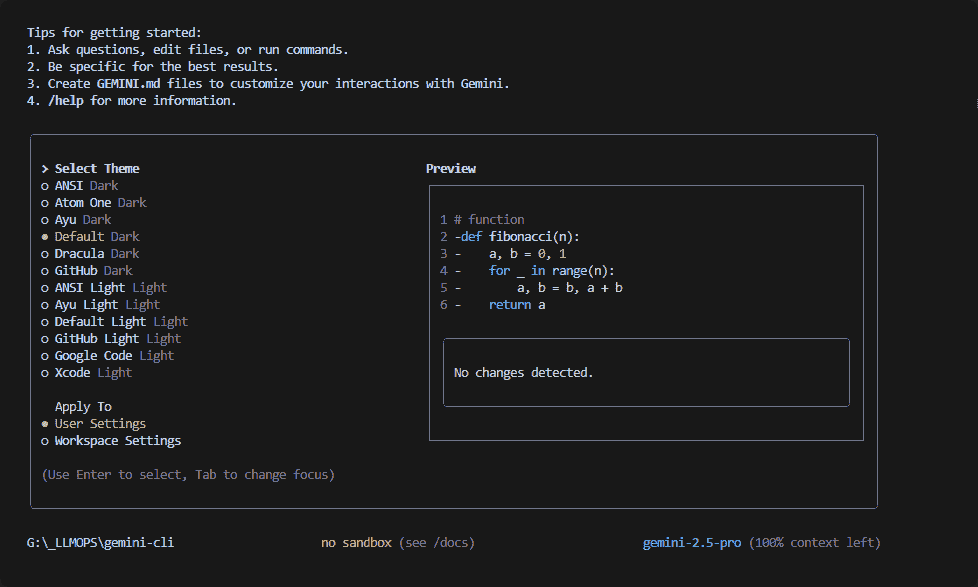
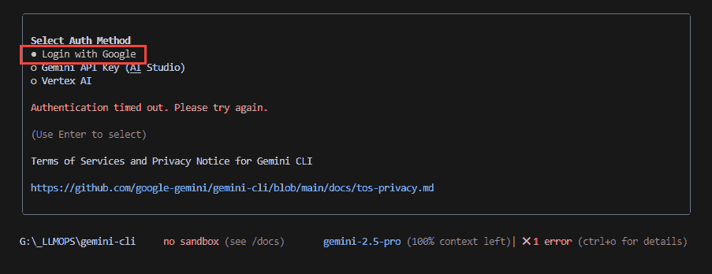
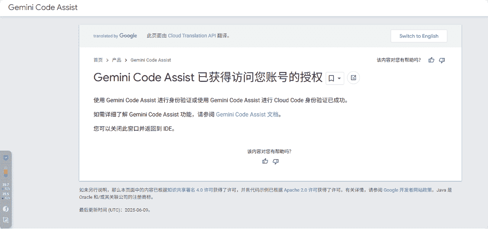
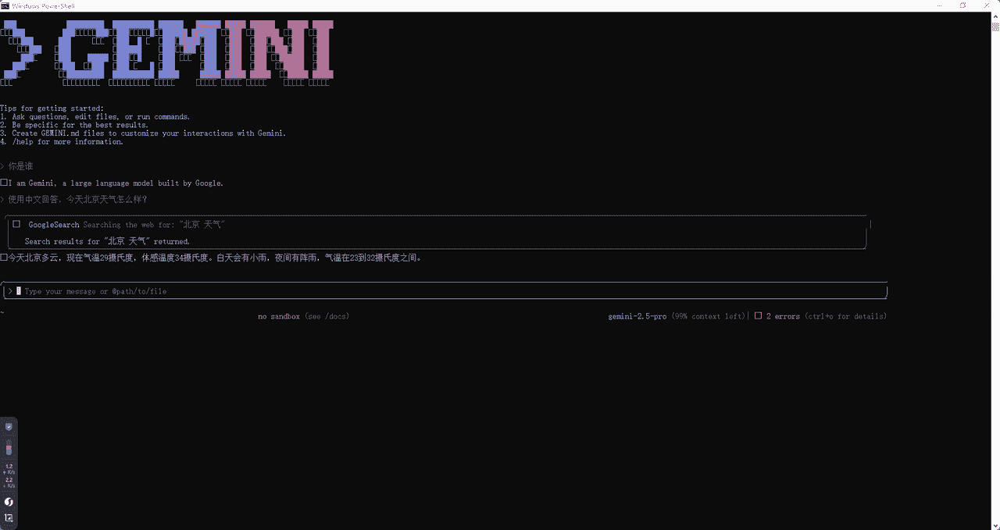
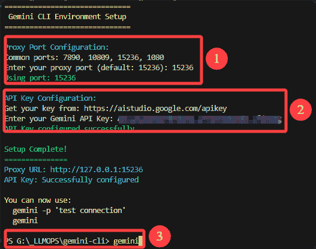
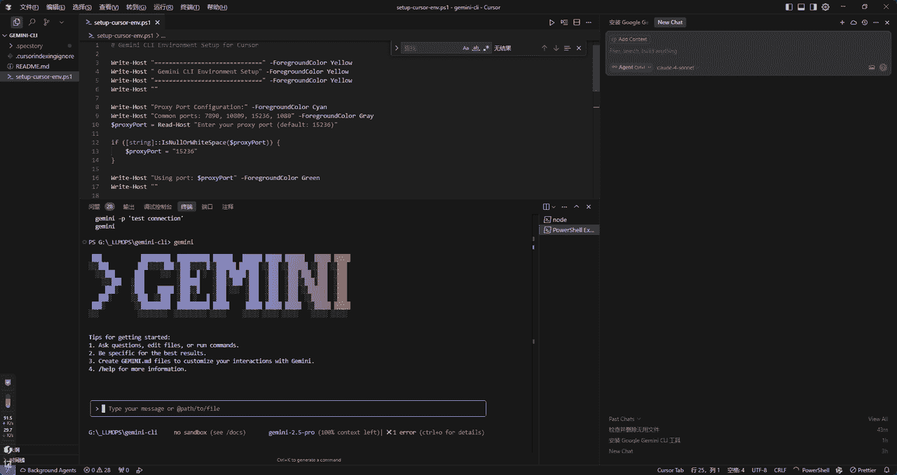

# Gemini Cli一键安装及好用的使用策略

> 来源：[https://my.feishu.cn/docx/Dzk4dPF8coXdnkx03Recnnron1f](https://my.feishu.cn/docx/Dzk4dPF8coXdnkx03Recnnron1f)

老金最近生了场病，就没写公众号了，今儿终于诈尸了！

这几天AI圈最大的新闻，估计就是Google的Gemini更新了。

相信不少家人们或多或少都看过了相关消息。

老金出品，向来是帮大家找最简单、直接的玩法。

今天，咱们不追热点，而是聊点实际的：怎么把Gemini CLI这个新工具，在咱们熟悉的Cursor里玩出花来。

这是一个很多人还没发现的、简单又方便的骚操作。

---

老规矩，Gemini目前还是封锁国区，所以你需要自己准备好能访问美区的网络环境。这个是基本操作哈。

### 安装教程

使用Cursor一键安装：

```
帮我安装 https://github.com/google-gemini/gemini-cli
```



它会贴心的把使用说明都给你弄好，需要的软件也会给你都安上（Node.js/npm等等），全部自动化，小白完全不用担心，老金自己就是个案例，这些玩意干啥的通通不懂，还是那句话，老金我根本看不懂代码。



完成后，直接打开终端，输入**gemini**就能启动了。



会进入这样个页面，无脑按回车，是进行主题设定的，不用管。



然后弹出这个页面，点击登录谷歌。



### 常规启动教程

重点来了，很多人都卡在账号授权上面了，他会卡着一直转啊转，其实是回调失败了。

正常登录成功的话，会是这样的界面。



如果使用CMD登录，开了全局魔法，登录应该是不会有问题的。

**注**：不在cursor内，使用 Windows的 开始->cmd->打开命令提示符。



### **牛逼的来了，从这里开始！**

接下来是今天的精髓了。

老金我给家人们准备了一个极简的脚本，找到你魔法的端口号，一般是西方标注1的地方这几个，你可以从7890开始尝试。

这个就是老金说的好玩的玩法了，它可以在Cursor里使用，和Cursor联动。



把下面这段复制到项目里运行就可以了，这个是上面的设定脚本。

```
# Gemini CLI Environment Setup for Cursor

Write-Host &quot;==============================&quot; -ForegroundColor Yellow
Write-Host &quot; Gemini CLI Environment Setup&quot; -ForegroundColor Yellow  
Write-Host &quot;==============================&quot; -ForegroundColor Yellow
Write-Host &quot;&quot;

Write-Host &quot;Proxy Port Configuration:&quot; -ForegroundColor Cyan
Write-Host &quot;Common ports: 7890, 10809, 15236, 1080&quot; -ForegroundColor Gray
$proxyPort = Read-Host &quot;Enter your proxy port (default: 15236)&quot;

if ([string]::IsNullOrWhiteSpace($proxyPort)) {
    $proxyPort = &quot;15236&quot;
}

Write-Host &quot;Using port: $proxyPort&quot; -ForegroundColor Green
Write-Host &quot;&quot;

Write-Host &quot;API Key Configuration:&quot; -ForegroundColor Cyan
Write-Host &quot;Get your key from: https://aistudio.google.com/apikey&quot; -ForegroundColor Gray
$apiKey = Read-Host &quot;Enter your Gemini API Key&quot;

Write-Host &quot;API Key configured successfully&quot; -ForegroundColor Green
Write-Host &quot;&quot;

$proxyUrl = &quot;http://127.0.0.1:$proxyPort&quot;
$env:HTTP_PROXY = $proxyUrl
$env:HTTPS_PROXY = $proxyUrl
$env:http_proxy = $proxyUrl
$env:https_proxy = $proxyUrl
$env:NO_PROXY = &quot;localhost,127.0.0.1,::1&quot;
$env:GEMINI_API_KEY = $apiKey

Write-Host &quot;Setup Complete!&quot; -ForegroundColor Green
Write-Host &quot;===============&quot; -ForegroundColor Green
Write-Host &quot;Proxy URL: $proxyUrl&quot; -ForegroundColor Cyan
Write-Host &quot;API Key: Successfully configured&quot; -ForegroundColor Cyan
Write-Host &quot;&quot;
Write-Host &quot;You can now use:&quot; -ForegroundColor Yellow
Write-Host &quot;  gemini -p &#x27;test connection&#x27;&quot; -ForegroundColor White
Write-Host &quot;  gemini&quot; -ForegroundColor White
Write-Host &quot;&quot; 
```

然后你就可以获得一个这样的界面！

再然后！无敌了！你就能同时使用Gemini和Cursor！



很多小伙伴该问了，这么做的原因是啥啊？

俩不都是改代码的吗？

NONONO，这么理解，格局就小了。

老金用简单直白的方式告你。

**Cursor = 单线程。**

Gemini Cli = 多线程。

比如，批量生产、批量修改、批量XXXXXX，你能想到啥批量的，用CLI就对了。

嗯？还不理解，老金再给你说明白点儿！

比如Cursor生成了一堆代码文件，你甚至都可以让Gemini Cli归类整理一遍！

再比如，你可以让Cursor爬下来的文章，使用Gemini Cli进行批量翻译！

然后老金我发现啊，很多小伙伴总把它拿来和 Claude Code 对比。

确实，如果你只是把它当作编程 CLI，那确实不如。

但是用它做其他用途很好用，比如整理文件、翻译、搜索、甚至子Agent等。

**关键！它免费！每天1000次！**

**老金我最后再唠叨几句：**

给家人们的建议：

+   **小白用户**：别怕，大胆跟着教程走，Cursor都给你自动化了，就登录那步留个心眼。

+   **硬核玩家**：赶紧试试，尤其是那个脚本，绝对能打开你新世界的大门，把CLI玩出花来！

你看，AI时代玩工具，不是说哪个模型、哪个软件就天下无敌了。

真正的牛逼，是把这些好家伙都变成你手里的牌，想怎么组合就怎么组合！

今天咱们把Cursor和Gemini CLI拧一块儿，就是这个道理。

别让工具限制了你的想象力，要主动去想怎么让它们给你打配合，这才是未来创作者的生存之道！

咱们不光要做工具的使用者，更要做个聪明的“攒局人”！

<https://my.feishu.cn/sync/HDlcdCPBksnJpBbRk0EcW364nmc>