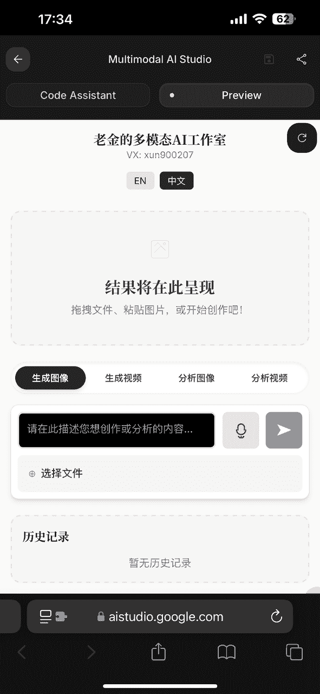
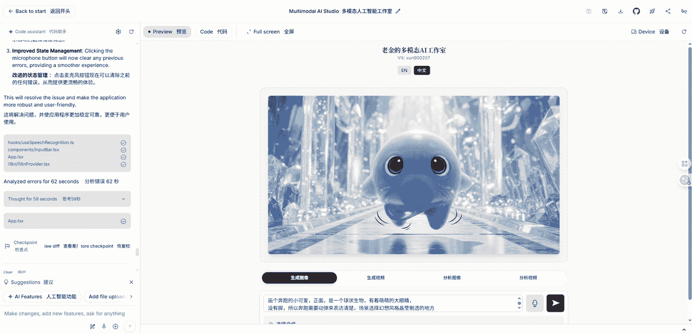
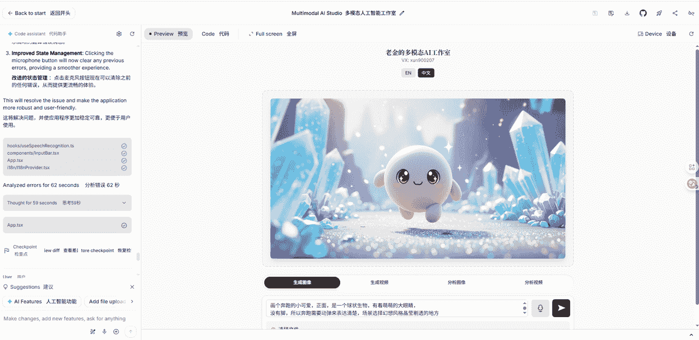
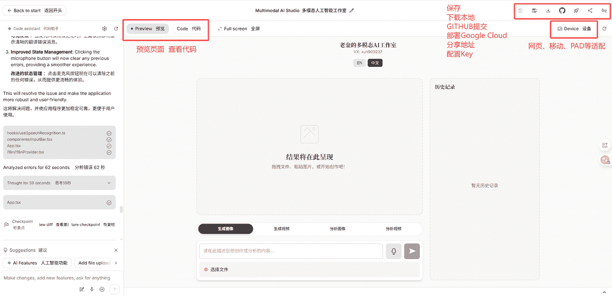
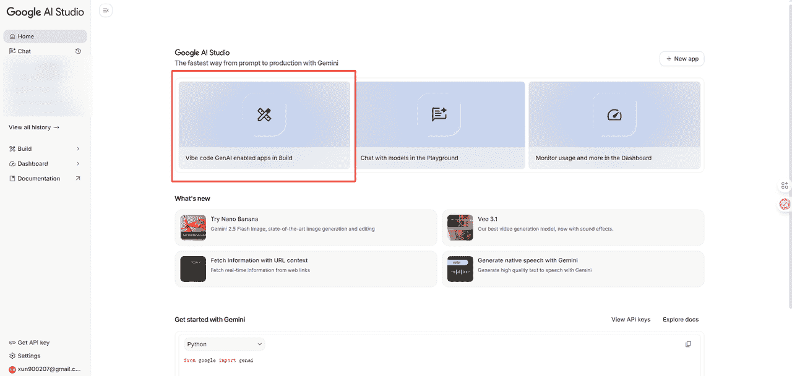
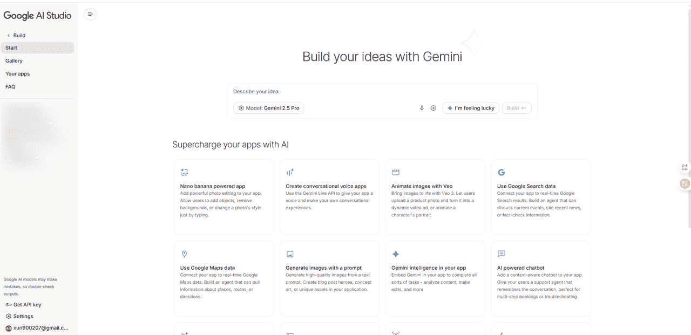

# 不会编程也能做AI应用了？我试了Google这个新工具，10分钟干了设计师一天的活

> 来源：[https://my.feishu.cn/docx/XecMdj3gWozsdjxGIcsccNMPnic](https://my.feishu.cn/docx/XecMdj3gWozsdjxGIcsccNMPnic)

老金我昨天做了件事，自己都不敢信。

10分钟。

做了个能生图、做视频、分析内容的 AI 工作室。

不写一行代码。

做完直接生成网址，发给朋友就能用。

朋友问我：你自己做的？

我说：是自己做的，只用了10分钟，用的是 Google 刚上线的 AI Studio Build。

**最关键的是：**

你也能做。

真的，你也能做。

## 为什么说这个设计牛

### 一个界面干完所有事

其他工具每个只能做一件事。

Build 一个界面全包了，不用切来切去。

### 手机可直接操作和查看结果



### Google 生态全接入

这才是真正的优势。

Google Search 实时数据

做个聊天机器人，能查最新新闻、讨论热点事件、引用权威来源。

不用自己去找搜索 API。

Google Maps 地图数据

做个旅游助手，能查地点信息、规划路线、获取实时路况。

不用自己对接地图服务。

**Gemini 多模态能力**

图片、视频、语音、文字全支持。

不用自己拼接不同的 API。

**Imagen 3 图片生成**

直接调用，不用单独注册。

**Veo 3 视频生成**

直接调用，不用单独付费。

全都是 Google 自家的，**直接调用**。

不用东找西找，不用对接一堆第三方服务。

**原生多模态**

图片、视频、语音、文字全支持，不用自己拼接 API。

**自动适配移动端**

做一次，手机电脑都能用。不用写响应式。

**一键部署**

做完直接生成网址，朋友打开就能用。

**直接推 GitHub**

点一下自动提交，代码永久备份。

**分享不泄露 Key**

分享链接后，用的是对方的 API 额度，你的 Key 不会暴露。

## 我做的这个工具长啥样

界面很简单，四个标签页：

**生成图像** - Imagen 生图

**生成视频** - Veo 3 视频生成

**分析图像** - 上传图片问问题

**分析视频** - 上传视频自动总结

每个标签下面都有：

+   文字输入框

+   语音按钮

+   文件上传

就这么简单。

## 实测效果

我输入：

```
画个奔跑的小可爱，正面，是一个球状生物，有着萌萌的大眼睛，
没有脚，所以奔跑需要动弹来表达清楚，场景选择幻想风格晶莹剔透的地方
```

20秒后出来一个蓝色球球，在水晶森林里蹦跶。

光影、细节、氛围感都有。

Nano Banana相信大家都略有耳闻，我就不多介绍了。





---

## 我朋友圈炸了

做完这个工具，我发了个朋友圈。

配图是那个蓝色球球。

半小时后，15个人私信我：

"老金，这什么软件做的？"

"教教我，我也想做一个"

"多少钱？帮我也做一个"

我说：免费的，10分钟学会。

然后就有了这篇文章。

## 功能可以串着用

举个例子，做产品宣传视频：

1.  分析图像：上传产品图，问"适合什么风格"

1.  生成图像：根据建议生成背景图

1.  生成视频：用背景图生成动态视频

1.  分析视频：检查效果

一条龙。

## 分享和部署特别方便



**分享链接**

点一下生成链接，发给朋友直接用。

朋友用的是他自己的额度，你的 Key 不会泄露。

部署到 Google Cloud

点一下部署到 Cloud Run。

30秒后得到一个正式网址，全世界都能访问。

自动扩容，10个人用和10万人用都不卡。

**保存到 GitHub**

点一下自动推送代码。

以后每次改动，点一下就提交。

代码永久备份，可以回退任何版本。

**最关键的是：**

不管你选哪种方式，应用自动适配手机、平板、电脑。

做一次，到处能用。

省了至少80%的工作量。

## 能拿来干什么

### 电商

**产品图优化**

上传产品图 → AI分析建议 → 生成不同背景 → 挑最好的用

**产品视频**

上传产品图 → 生成旋转展示视频 → 放详情页

以前找设计师几千块，现在自己搞定。

---

### 自媒体

**封面图**

文字描述画面 → 一键生成 → 挑最好的

**视频素材**

文章改脚本 → 生成视频 → 发视频号

以前要剪辑软件，现在打字就行。

---

### 老师学生

**课件配图**

描述概念 → 生成示意图 → 插入PPT

**视频笔记**

上传课程录像 → 自动总结 → 整理成笔记

记笔记省了一大半时间。

---

### 创业者

**产品原型**

描述界面 → 生成设计图 → 给投资人看

**宣传视频**

写产品介绍 → 生成视频 → 发社交媒体

验证想法成本直接降到0。

---

## 怎么开始

访问 https://aistudio.google.com   - 需魔法

登录 Google 账号。

左侧菜单选 Build。





然后创建自己想做的应用。

做完点分享或部署。

就这么简单。

**完全免费**。

Google AI Studio 的 Build 功能现在对所有人开放，有每日免费额度，个人使用完全够。

## 真实感受

用了一下午，几个感受：

**真的方便**

以前多个工具，现在一个界面。效率至少提升5倍。

**门槛真的低**

不用学编程，不用学专业软件。会打字会说话就能用。

**质量超预期**

生成的图片视频质量很高，分析结果很专业。

不是玩具级别，是真正能用的。

**组合威力大**

单独用每个功能都不错，但组合起来用才是真正的威力。

先分析找灵感 → 生成新内容 → 做成视频，一气呵成。

## 会改变什么

### 创作门槛消失

以前做图片要学PS，做视频要学PR，做AI应用要学编程。

现在会说话就能做。

创意比技术更重要了。

### 外包市场洗牌

以前产品图找设计师500元，宣传视频找外包5000元，AI应用找开发50000元。

现在自己做，免费。

简单需求不用外包了。

### 个人能力爆发

一个人用这一个工具，就能做图片、做视频、做分析、做应用。

一个人抵一个团队。

## 给普通人的建议

**别怕，直接试**

界面超简单，点几下就懂了。

**从小需求开始**

不要想做大项目，先试试：

+   给自己生成个头像

+   给产品做个展示图

+   给文章配个插图

小成功带来大信心。

**多用组合功能**

不要只用一个功能，试试串起来：

分析 → 生成 → 优化

效果翻倍。

**分享出去**

做出来别藏着，分享给朋友、发社交媒体。

有反馈才能进步。

## 最后

Google AI Studio Build 让我想起智能手机刚出来的时候。

以前拍照买相机、上网买电脑、听歌买MP3。

现在一部手机全搞定。

AI应用也到了这个时刻。

以前生成图片要专业工具，生成视频要专业软件，做AI应用要找程序员。

现在一个界面全搞定。

这才是真正的AI普惠。

不是让少数人更强，而是让所有人都能创造。

从"想到但做不到"，到"想到就能做到"。

这个时代，真的来了。

<https://my.feishu.cn/sync/HDlcdCPBksnJpBbRk0EcW364nmc>