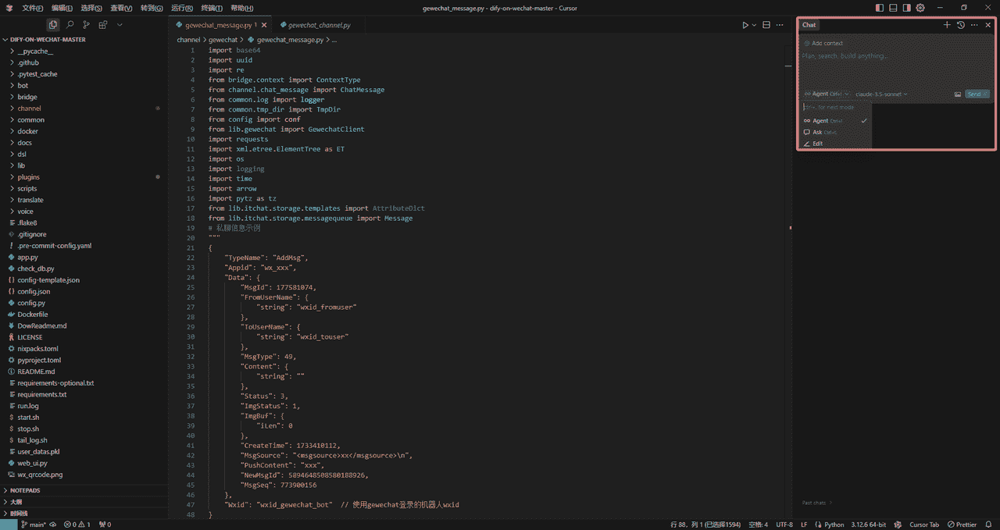
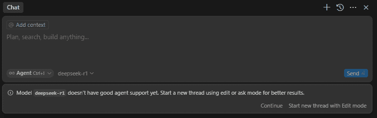
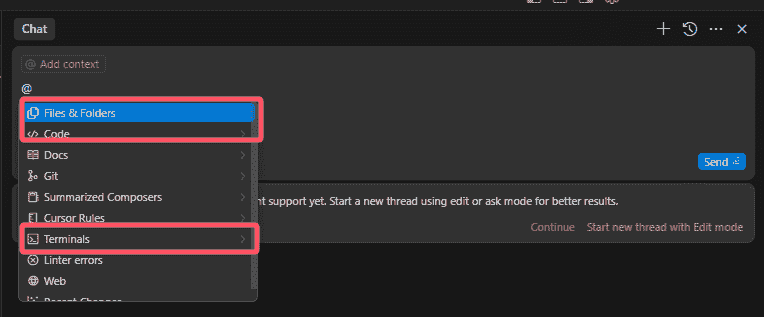
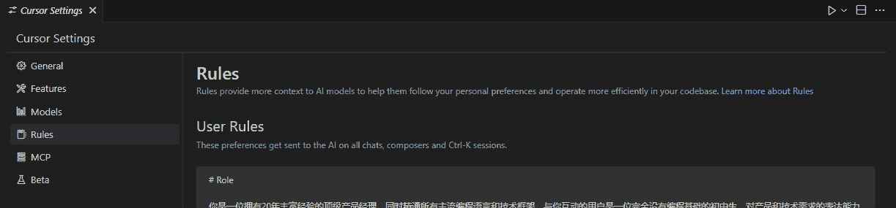

# Cursor 0.46版本震撼来袭，老金我强推了！附下载地址！(自动注册邮箱已被封，回退0.45办法依旧可用）

> 来源：[https://my.feishu.cn/docx/XW6ddbMV3o8iYwxsPqpc2JGZnvh](https://my.feishu.cn/docx/XW6ddbMV3o8iYwxsPqpc2JGZnvh)

官网还没更，老金找到了0.46版本的下载地址，第一手体验了一遍！

很舒服！很震撼！

话不多说，让我们直接开始！

---

## 下载地址

官网现在还没放出来（截止目前），直接看下面链接自行下载。

```
**windows: ****
https://a****nysphere**-binaries.s3.us-east-1.amazonaws.com/production/aff57e1d9a74ed627fb5bd393e347079514436a7/win32/x64/user-setup/CursorUserSetup-x64-0.46.0.exe

mac intel:
https://anysphere-binaries.s3.us-east-1.amazonaws.com/production/aff57e1d9a74ed627fb5bd393e347079514436a7/darwin/x64/Cursor-darwin-x64.zip

mac m1: 
https://anysphere-binaries.s3.us-east-1.amazonaws.com/production/aff57e1d9a74ed627fb5bd393e347079514436a7/darwin/arm64/Cursor-darwin-arm64.zip
```

## 更新说明

### 一、智能交互面板革新

看过老金推荐的Windsurf的小伙伴都清楚，在Windsurf中，他们就是共用关系，可以直接切换。

这不，Cursor抄借鉴过来了，从此聊天与编写器之间将共享上下文。



可通过"Ctrl+."（Windows）/ "Cmd+."（macOS）快速转换三大核心模式：

**智能体模式（Agent）**

延续旧版Composer的智能体功能，支持gpt-4o和claude-3.5-sonnet等具备工具调用能力的模型。当选择非适配模型时，系统会智能提示："当前模型暂未完全兼容智能体模式，建议切换至编辑或问答模式获取更佳体验"。

**代码编辑模式（Edit）**

整合原Composer的标准代码编辑功能，支持实时语法检测与智能补全。新增的"冒险模式"（yolo模式）现可通过二次确认开启自动执行权限，显著提升批处理效率。

**问答模式（Ask）**

优化后的对话界面保留原Chat模式的流畅交互，支持DeepSeek-R1等专注对话的模型。测试中发现模型切换时的上下文继承表现较前版提升约40%。

**当选择不**同的模式的时候，可选择的模型会自动高亮显示。

比如当我选择 Agent 的时候，claude3.5和gpt-4o就自动高亮了。

DeepSeek-R1 之类的模型就无法使用，如果你选择了类似的在 Agent 里面无法使用的模型会提示:



**但是你还是****可**以继续使用，只是在 Agent 里面可能无法触发一些 Tools 的调用。

**YOLO模式**会在执行指令的时候**自动触发**。


### **二、增强型@指令体系**

文件系统指令合并为@F**iles **& Folders

新**增@Code代码片**段调用指令

终端整合功能现支持通过@Terminal直接调取命令行上下文



### 三、系统设置优化

**新增核心配置模块**

独立Rules规则引擎配置界面。

MCP（多任务协同处理）模块现支持Yolo模式自动执行。

新增网页搜索工具开关与语法检测迭代选项。



**界面个性化**

新增"午夜幽蓝"与"多维空间"两款暗色主题。

工作台新增"休眠模式"，可设置1-24小时免打扰时段。


### 四、实测效能对比

在混合工作流测试中，先使用DeepSeek-R1进行架构设计，再切换Claude 3.5 Sonnet实现代码生成的全流程耗时较前版缩短28%，智能了很多，处理起来也井井有序。

这个版本，老金我真的是强推！

<https://my.feishu.cn/sync/HDlcdCPBksnJpBbRk0EcW364nmc>