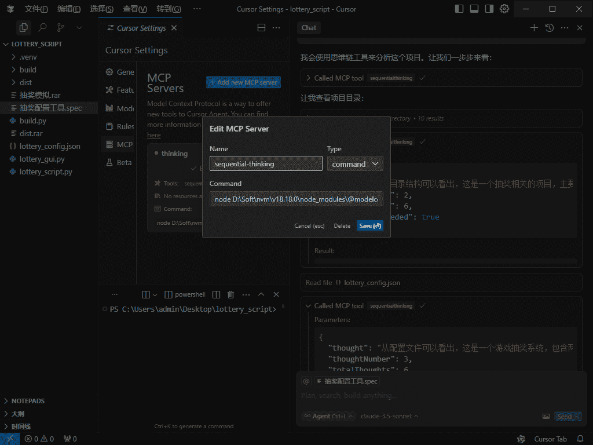
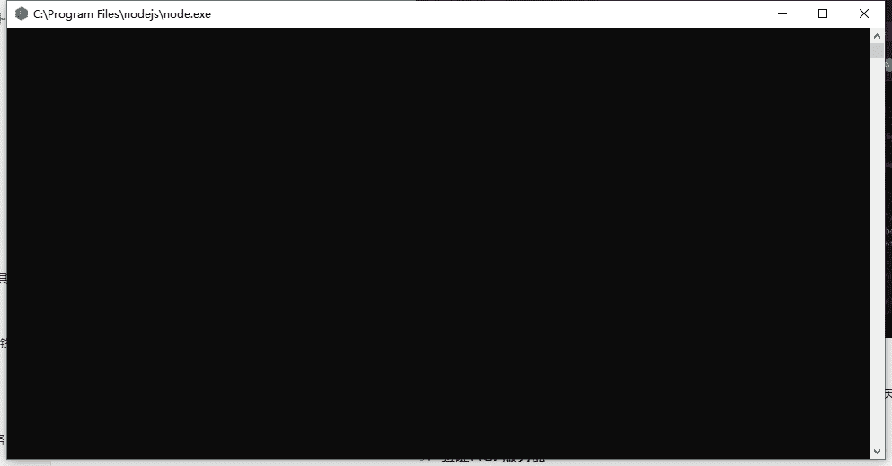
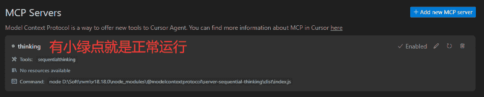
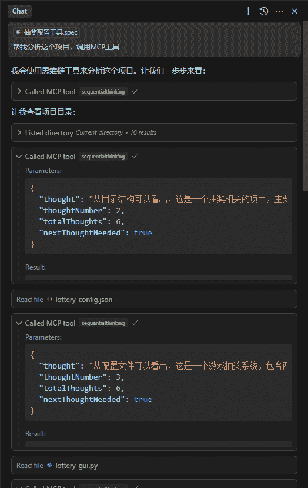

# Win下的Cursor连MCP都是坑？老金手把手教你！

> 来源：[https://my.feishu.cn/docx/LYXEdqBhwozWlYx0Nenc92k9ndc](https://my.feishu.cn/docx/LYXEdqBhwozWlYx0Nenc92k9ndc)

HI，大家好，我是老金，最近研究了下MCP（模型上下文协议），MCP是由Anthropic（Claude母公司）在2024年11月25日提出并开源的，算是一个比较新的东西。

目前已经被Claude桌面端、Cline、Continue、Cursor、Windsurf等工具应用。

在Windows上还是有蛮多坑的，Mac调用会相对简单很多。

**先来说下MCP能做什么？**

假设你有一台只能处理文字的智能音箱（LLM），而MCP就像给它装上了“万能插头”，让它能直接读取你的电脑文件、查询数据库，甚至操作GitHub提交代码，也能调用各种画图的第三方平台等等，就像插上不同设备一样简单。

### 架构说明

MCP基于**客户端-服务器模型**，包含以下核心组件：

1.  **MCP主机（Host）**：如Claude Desktop、IDE等应用程序，负责发起请求。

1.  **MCP客户端（Client）**：在主机内部，与服务器一对一连接，负责协议通信。

1.  **MCP服务器（Server）**：轻量级程序，提供三类功能：

+   **资源（Resources）**：如文件、API响应数据。

+   **工具（Tools）**：可调用的函数（如数据库查询、代码执行）。

+   **提示词（Prompts）**：预定义的模板，简化任务处理。

1.  **数据源**：包括本地资源（如SQLite数据库）和远程资源（如云API）。

**交互流程**：

用户通过主机提问 → 客户端向服务器获取工具列表 → LLM判断是否调用工具 → 客户端执行工具调用 → 结果返回LLM生成最终响应。

### **MCP的核心优势**

+   **数据安全**：敏感数据（如本地数据库）无需上传云端，直接在本地处理。

+   **开发简化**：开发者只需配置MCP服务器，无需为每个数据源编写适配代码。

+   **扩展能力**：LLM可调用外部工具执行复杂操作（如生成图表、操作GitHub），突破纯文本生成的限制。

+   **灵活切换**：支持不同LLM（如Claude、GPT）接入同一套数据源，降低厂商依赖。

### 环境准备（必装组件）

+   **Node.js** ≥v14

官网地址：https://nodejs.org/zh-cn

验证方法：Win+R → 输入node -v → 显示版本号即成功

+   **Git** 最新稳定版

官网地址：https://git-scm.com/

+   **Cursor IDE**（老金亲测0.46.7还可以免费续杯喔！）

官网地址：https://www.cursor.com/cn

### 安装MCP步骤详解

**本次老金教学**中，带大家看看使用量最多的思维链MCP。

1.  **安装Node.js和Git**

首先确保您的Windows系统中安装了Node.js（版本不低于14+）和Git。

1.  **安装Cursor**

下载并安装Cursor软件，确保您使用的是较新版本，例如0.46.7。

1.  **克隆MCP服务器项目**

使用npm安装项目，开始->运行->cmd，命令提示框中输入以下指令。

```
npm install -g @modelcontextprotocol/server-sequential-thinking
```

1.  **配置Cursor的MCP服务器**

打开Cursor软件，进入“设置” > “功能” > “MCP”。点击“+ 添加新的MCP服务器”按钮，填写以下信息：

+   **名称**: 为您的MCP服务器指定一个名称，例如“sequential-thinking”。

+   **类型**: 选择“命令”。

+   **命令****: 输入完整路径到编译**后的Node.js脚本，注意替换自己的实际路径。

+   Mac用户直接用上面的npm指令

```
node D:\Soft\nvm\v18.18.0\node_modules\@modelcontextprotocol\server-sequential-thinking\dist\index.js
```



1.  **启动MCP服务器**

在Cursor中配置完MCP服务器后，自动打开一个对话框，千万不要关闭，因为MCP服务器已经在运行。



1.  **验证MCP服务器**

返回Cursor界面，检查MCP服务器是否已显示为可用状态。



然后就可以正常调用了，随便打开个项目，让它做个分析，就可以看到Called MCP tool。



**MCP汇总网址：**

https://smithery.ai/

https://github.com/smithery-ai/reference-servers

<https://my.feishu.cn/sync/HDlcdCPBksnJpBbRk0EcW364nmc>