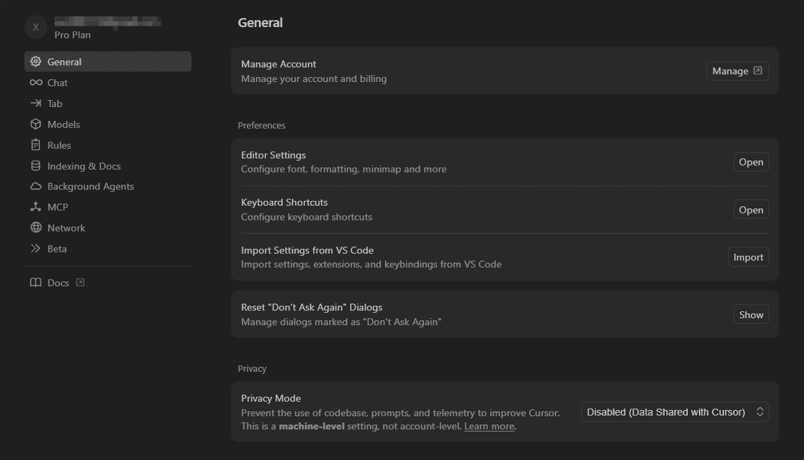
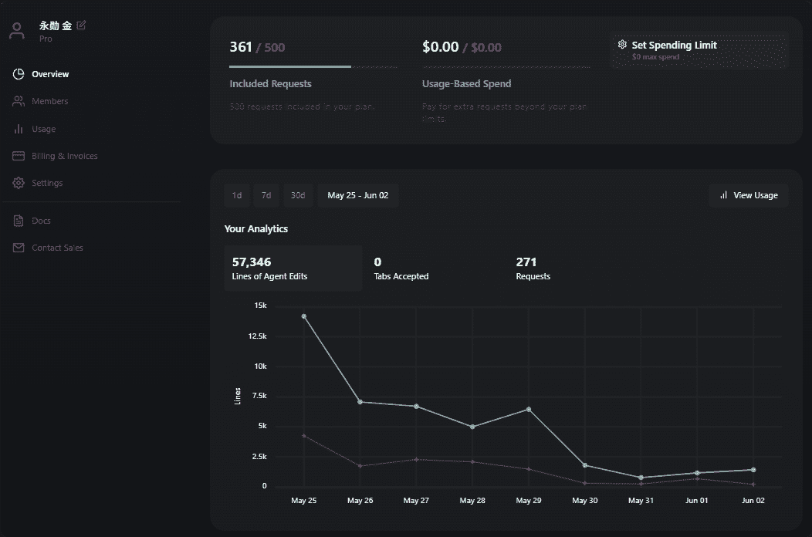
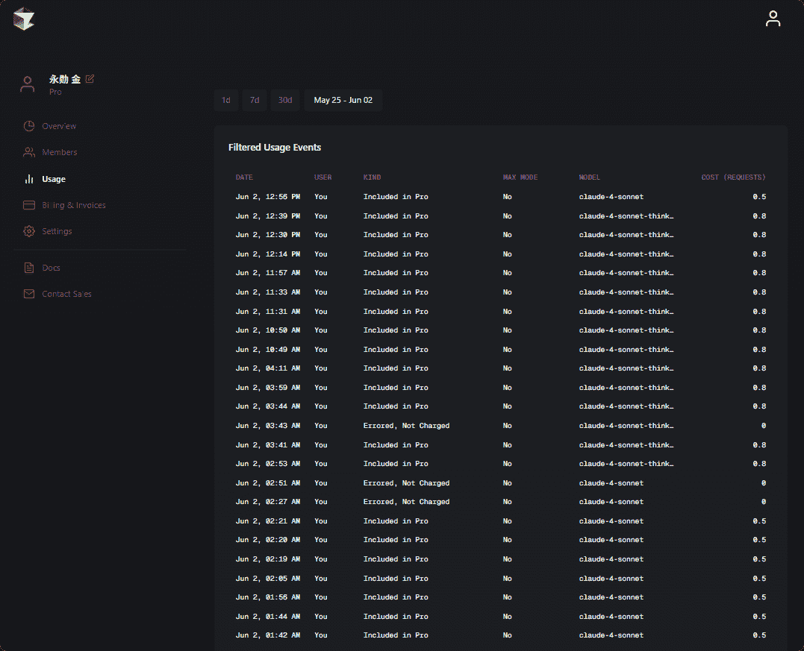
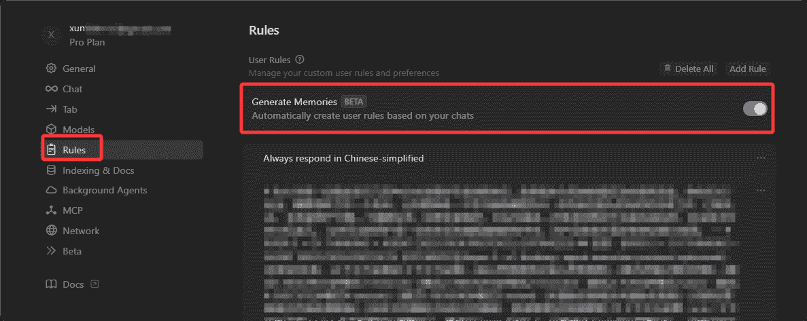
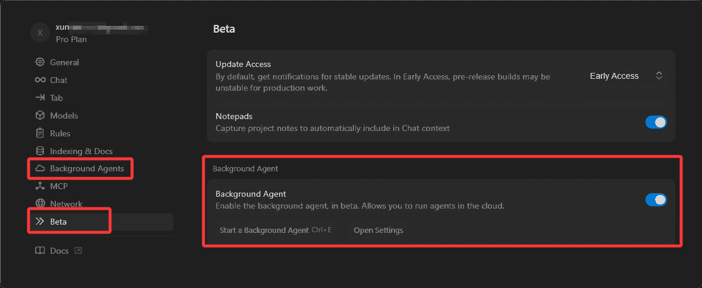
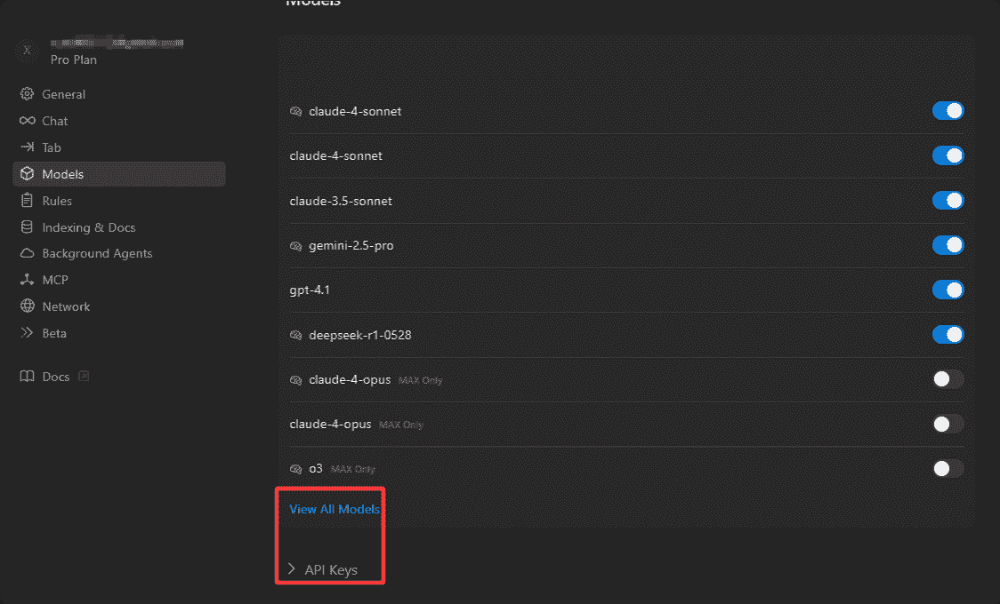
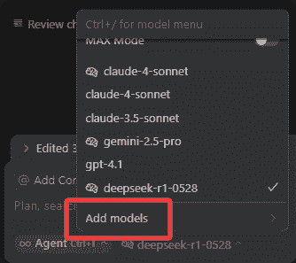
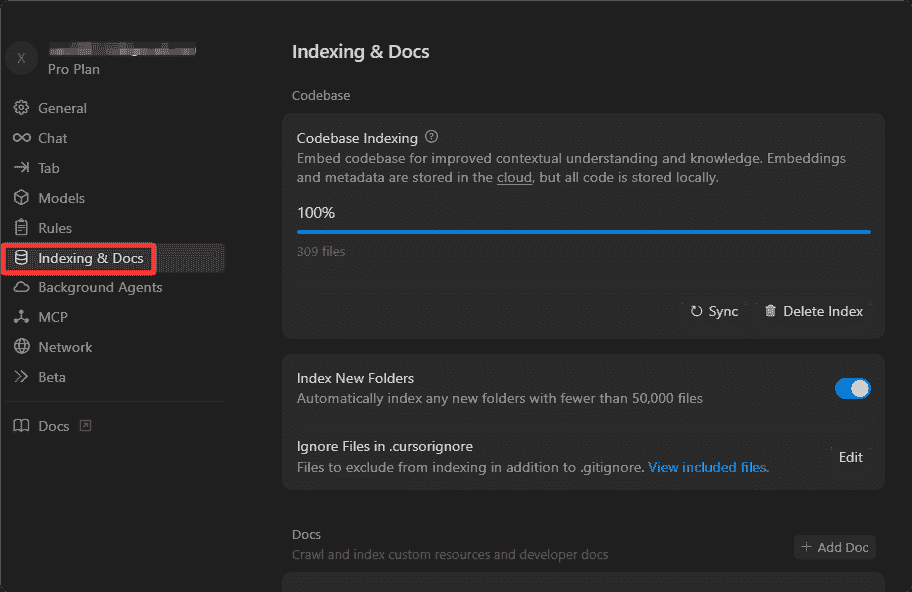
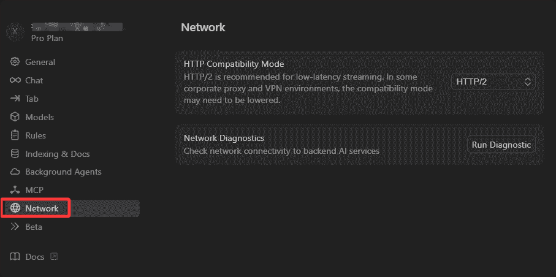
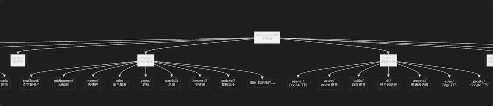

# 老金带你玩转 Cursor v0.51 版本！深度特性解析！

> 来源：[https://my.feishu.cn/docx/BJxvdmhSDosRWpxjdaEc8BEonyb](https://my.feishu.cn/docx/BJxvdmhSDosRWpxjdaEc8BEonyb)

家人们！

Cursor 又双叒叕升级了！

`Cursor v0.51` 版本 带着一身“新皮肤”和一肚子“黑科技”闪亮登场！

老规矩，`Cursor v0.51` 版本核心特性一览！

根据 X 上各路大神和热心家人们的分享，再结合老金我的火眼金睛。

v0.51 版本主要在提升用户界面（UI）、增强AI功能和优化生产力工具方面下了不少功夫。

**特别提醒！特别提醒！特别提醒！**（重要的事情说三遍！）

更新前，你之前辛辛苦苦配的 `User Rules` 可能会被覆盖掉！

老金我这次就中招了，之前的配置直接变白板！

不知道是升级了 `0.51.1` 版本，还是因为开启了自动记忆，后面被还原了。

强烈建议在执行更新操作前，务必！务必！务必备份你的 `Rules`！

尤其是那些配置复杂又没备份的兄弟姐妹们，不然到时候哭都没地方哭去！

**新功能深度游，老金带你逐个盘！**

---

## 一、设置面板大变样：老地方，新感觉！

家人们，这次变化最大的，必须是 `Cursor Settings` 面板！

简直是改头换面，焕然一新啊！

其他大大小小的功能更新，基本也都能在这儿找到踪影。所以老金把它放第一个说！

### 两大变化，一眼看穿：

第1，账户信息直接怼脸上了！更清晰！

你的邮箱、订阅情况（`Pro` 还是 `Business`）明明白白告诉你，不用再东点西点了。

点进 `General-Manage Account-Manage`，你会发现整个账号面板也大变样！

简单说，就是把你用 `Cursor` 的各种消耗（比如 `token`）都给你整得清清楚楚，明明白白消费！

这种改变，不仅仅是方便你瞅瞅，更重要的是让你，特别是那些掏了腰包的 `Pro` 用户，能一眼看到自己花的钱，换来了啥服务，用了多少资源。

这样一来，心里是不是对这钱花得值不值，更有数了？

第2，设置分类逻辑优化！从 6 个暴增到 10 个！

设置项目的组织结构从原先的 6 个主要类别扩展至 10 个。

啥 `Chat`、`Tab`、`Indexing & Docs`、`Background Agents`、`Network`，以前都挤在别的分类里，现在都“自立门户”了！

诸如 `Chat`、`Background Agents`、`Network` 等关键功能模块被提升为独立的分类入口，有助于用户更快定位所需配置项。找起来更方便，条理也更清晰了！

这可不是瞎分的，你想想，`Cursor` 这家伙功能越塞越多，越来越细，要是还跟以前一样堆成一坨，你找个设置项不得翻个底朝天？体验能好才怪！

现在这么一拆分，清爽！

这也说明白了，`Cursor` 可能把像 `Chat`、`Background Agents` 这些功能，当成是能独立发展、不断升级的核心模块来对待。

这么一来，以后再加啥新奇玩意儿，往对应的模块里一塞，设置界面也不会乱成一锅粥。

## 二、新增“自动记忆”功能：Cursor 变身“懂你模式”？

这个功能叫 `Generate Memories`，藏在 `Rules` 配置下，是个实验性功能。

简单来说，就是 `Cursor` 会偷偷“学习”你跟它的聊天记录，然后通过分析用户与 `Cursor` 的交互历史，辅助用户自动生成和维护 `User Rules`！

想想看，你项目持续迭代，这 `User Rules` 也能自动更新，是不是有点“养成系”AI 的味道了？

理论上是越用越懂你，越用越贴心！

一个能“记住”你编程习惯、项目特点的 AI，可比那种一问三不知的通用 AI 强太多了。

这要是真做好了，`Cursor` 就不再仅仅是个工具，更像是个贴身小秘，甚至是能跟你并肩作战的伙伴。用惯了这种为你量身定制的服务，你还舍得换别家吗？粘性不就上来了？

## 三、`Background Agent` 功能强化：后台默默搞大事！

还记得 `v0.50` 版本里那个 Beta 功能 `Background Agent` 吗？

这次它“转正”了，在 `Settings` 里有了自己的专属分类项！

这玩意儿之前老金也详细扒过，简单说就是能在后台帮你跑一些任务。

### 隐私模式下的可用性

即使在启用隐私模式（`Enabled (Code Remains Private)`）的情况下，用户现在也可以使用 `Background Agent`。

但若未开启隐私模式，`Cursor` 仍将按默认策略收集必要数据以优化服务。

别高兴太早，区别还是有的：如果你没开隐私模式，`Cursor` 还是会默认收集数据。老规矩了属于是。

### 使用成本考量（钱包预警！）

当前，`Background Agent` 的高级功能主要在 `Max` 模式下提供，其计费方式基于 `token` 消耗。

官方亦提及未来可能针对开发环境的计算资源引入额外费用，因此，使用此功能需关注其潜在成本。

翻译一下：用这个功能，不便宜！

这个定价策略，明摆着告诉你，`Background Agent` 不是给咱普通用户随便点点着玩的，它是冲着那些有复杂需求、愿意花钱买效率的专业开发者或者团队去的。

这也符合 AI 服务，特别是那种吃计算资源大户的商业逻辑。

该功能的一项前瞻性应用是允许通过外部指令远程调用 `Cursor` 执行编程任务，例如自动化构建页面等，这预示了 `Cursor Agent` 在未来自动化开发流程中的潜力。

`Cursor` 的首席设计师 `Ryo Lu` 最近秀了一波操作：远程指挥 `Cursor` 执行了一堆任务！

比如为一个网站构建新页面，要求用户身份验证、输入框、列表展示、响应式设计，用 `React` 和 `Tailwind`，还附带了设计图参考！

虽然这个牛逼功能不一定在 `v0.51` 就完全开放，但光是想想就让人激动啊！

这不就是 AI 帮你打工的现实版吗？

`Ryo Lu` 演示的这个场景，可远远超出了一个编辑器里敲敲代码、补全一下那么简单了。

这说明 `Cursor` 的野心大着呢，它不甘心只做个“智能编辑器”，它想让 `Agent` 变成一个能被外部系统调用、能独立完成复杂开发流程的“超级智能体”。

这给 `Cursor` 打开了新的想象空间，也创造了新的价值点。

如果 `Agent` 真能通过 `API` 或者像 `Slack Bot` 这样被远程控制和管理，那它就能轻松融入到企业现有的工作流程里，比如 `CI/CD`、项目管理工具啥的。

这对 `Cursor` 打入企业市场，提供更牛的自动化解决方案，那可是太重要了。

## 四、模型库集成 `DeepSeek-R1-0528`：AI 大脑升级！

`Cursor` 团队迅速响应AI技术前沿动态，在新版本中集成了近期受到广泛关注的国产大语言模型 `DeepSeek-R1-0528`。

`Cursor` 对于新模型的接入速度，那叫一个快！`LLM` 技术那是一天一个样，新的、更强的模型跟下饺子似的。`Cursor` 作为一个靠 `LLM` 吃饭的 AI 编程工具，能不能第一时间把这些顶尖模型弄进来，直接关系到它好不好用，能不能吸引到你。

火速接入 `DeepSeek` 这种当红炸子鸡，就是这个道理。

### 配置与使用：

`DeepSeek-R1-0528` 模型并非默认启用，用户需要在 `Cursor Settings-Models` 路径下手动激活该模型。

想用它？得自己动手去把它开启。

因为 `Cursor` 支持的模型越来越多了，估计大家也发现了，每次更新，默认的模型列表都可能变脸，有些老模型就“失踪”了。

模型多了是好事，但要是选起来费劲、管起来麻烦，那不就成了负担？

默认列表老变来变去，用户肯定懵圈。

为了便于用户管理日益丰富的模型选项，`v0.51` 版本在聊天界面的模型选择器底部增设了 `Add models` 快捷按钮，点击后可直接跳转至模型配置页面进行个性化添加与管理。

一点，直接跳到 `Cursor Settings-Models`，搜个模型名字（比如 `DeepSeek-R1-0528`），就能快速添加！

再也不怕找不到心仪的模型了！爽歪歪！

这个小小的按钮，就把选择权又交回了咱用户手里，用起来方便多了。

这也看出来，`Cursor` 不想把自己吊死在哪一个模型供应商身上，它更像是在搭一个开放的平台，让你能根据自己的口味和需求，挑最合适的“大脑”来用。

这样一来，平台的灵活性和吸引力不就更强了？

## 五、`Indexing` 与 `Docs` 功能整合：项目理解一条龙！

原先分散在 `Features` 类目下的 `Indexing`（代码索引）和 `Docs`（文档参考）功能，在 `v0.51` 版本中被整合为一个统一的配置入口。

在新的 `Settings` 面板里，以前 `Features` 选项卡下面的 `Indexing` 和 `Docs` 这俩兄弟，现在“喜结连理”，合并成一个新的选项页了！

`Codebase Indexing` 解决的是让你看懂“项目自己的代码”，`@Docs` 解决的是让你参考“外部的说明书和知识库”。这两样东西，在咱平时码代码的时候，那可是经常要一块儿用的。

现在把它们在设置里放一块儿，可能就是个信号，以后在功能上也会配合得更紧密，给咱提供一个统一管理代码和文档信息的地方。

`Codebase Indexing` 功能旨在通过建立项目代码的本地索引，提升大规模代码库的理解与导航效率。其大致工作流程包括：

1. 在用户本地环境中对代码库进行分片处理。
2. 将代码片段发送至服务器端进行向量化嵌入。
3. 生成的嵌入向量及元数据存储于远程向量数据库（注意：原始代码本身不被存储）。
4. 用户可以根据需要在设置中停用此功能。

尽管基于向量索引的方法存在一定局限性，但在当前技术条件下，它仍是处理复杂代码库的一种有效辅助手段。“代码要发到服务器”，这话一听就容易让人担心代码会不会泄露。

所以 `Cursor` 创始人赶紧出来解释，说只发代码块、不存原始代码、请求完了就删掉，这些都是在拍着胸脯跟你保证数据安全和隐私。

对于一个要处理咱程序员核心资产（代码）的工具来说，这点太重要了。

当然，这种方法虽然牛，但也有它的局限性。

不过，在目前模型上下文窗口还不够大的情况下，`Cursor` 用这招来处理大型代码库，还是有它的优势。能主动承认现有技术（比如简单的 `embedding` + 向量搜索）有不足，还关注竞品或者相关技术（比如 `Cline` 可能用的更高级的 `RAG` 方法），这说明 `Cursor` 团队对行业发展门儿清，而且可能已经在琢磨更好的解决方案了。

这种坦诚的态度，更容易赢得咱技术用户的信任。

关于 `@Docs` 功能的详细运用，可参考此前的相关介绍与实践。简单说就是能让 AI 参考你指定的文档来回答问题或生成代码。

## 六、新增网络连接诊断与模式配置：网络连接稳如老狗！

`Settings` 中新增了 `Network` 专区，为用户提供了管理和诊断 `Cursor` 与后端 AI 服务之间网络连接状态的工具。

应该是从以前“首选项-设置”里单独拎出来的。

主要干啥的？

就是帮你管理和诊断跟后端 AI 服务的网络连接，确保 `Cursor` 的核心功能（比如代码补全、聊天、`Agent` 这些）能正常跑起来。

AI 工具好不好用，很大程度上就看它跟云端服务器的连接稳不稳定。

网络一出问题，AI 工具就跟瘫痪了没啥区别。特别是在那些复杂的公司网络里，连接问题更是家常便饭。

`Cursor` 把网络设置和诊断工具单独拎出来，还提供兼容性选项，摆明了就是要下大力气解决这个核心痛点，保证你用得顺畅。

`v0.51` 版本默认采用 `HTTP/2` 协议进行通信，以期获得更优的传输效率。速度更快，效率更高。

`HTTP/2` 比起 `HTTP/1.1`，在同时处理多个请求、压缩数据头这些方面都有明显优势，能让延迟更低，数据传输更快。

默认用 `HTTP/2`，说明 `Cursor` 在技术上也是追求极致性能的，想让 AI 功能响应更快，用起来更爽。

针对部分企业内部网络或特定 `VPN` 环境下可能出现的连接兼容性问题，新版本允许用户手动切换至 `HTTP/1.1` 等备选通信模式。

个人用户网络环境一般比较简单，但公司用户经常会碰到各种防火墙、代理服务器的限制。提供详细的网络配置和诊断工具，能帮公司里的 IT 大佬们更方便地把 `Cursor` 弄到公司网里去，扫清障碍。

这对 `Cursor` 开拓企业市场，那可是相当重要。

用户可通过 `Run Diagnostic` 按钮启动网络诊断程序，以检验连接的通畅性与稳定性。

网络到底通不通？有没有问题？点一下按钮，手动跑个诊断，几秒钟就知道结果了！

要是全都绿勾勾，那就说明你的网络跟 `Cursor` 的服务器“心连心”，没毛病！

## 七、聊天界面实现 Mermaid 图表即时可视化：

在 `v0.51` 版本之前，若要在 `Cursor` 中将 Mermaid 语法的文本描述转换为可视化图表，用户通常需要借助外部编辑器或预览插件。

家人们，以前在 `Cursor` 里用 Mermaid 这种文本画图语言来梳理项目结构或者依赖关系，是不是有点小折腾？咱人脑处理图片可比处理文字快多了。

把那些抽象的 Mermaid 代码直接变成直观的图表，能让咱开发者更快看明白复杂的结构、流程或者依赖关系，省得在文字和图形之间来回切换，脑子都大了。

要么，你得先让 AI 生成一堆 Mermaid 语法的代码，然后复制粘贴到 Mermaid Live Editor 或者 draw.io 这种第三方工具里才能看到图。

要么，你就得在 `VSCode` 里装个 `PlantUML` 插件或者 Markdown Preview Mermaid 插件，才能预览。

新版本改进：这些麻烦事儿统统不需要了！

`Cursor v0.51` 现在支持在聊天界面内直接渲染符合 Mermaid 规范的文本，生成交互式的可视化图表。所见即所得！

编程可不光是写代码，还得做大量的分析、设计和沟通。

通过内置 Mermaid 可视化，`Cursor` 把一部分以前得靠外部工具帮忙的“思考辅助”功能也给包进来了，让咱开发者能在一个更统一的环境里干更多的活儿，少受点工具来回切换的打扰。

用户可以对图表进行缩放操作，并能方便地复制原始 Mermaid 代码或将图表导出为 `SVG` 格式。

看得清清楚楚！想复制原始的 Mermaid 语言？或者直接把图复制成 `SVG` 格式？

没问题，一键搞定！

目前 AI 聊天主要还是文字对喷，能支持 Mermaid 可视化算是个不错的开始。

没准以后 `Cursor` 的聊天界面还能支持更多花里胡哨的内容。

结构非常清晰：

## 八、探索性功能：多 `Agent` 并行处理，科幻片走进现实？

最后这个，是个“彩蛋”！

据 `Cursor` 首席设计师 `Ryo Lu` 透露，团队正在探索一项支持多个 `Agent` 并行协作处理任务的功能，预计将在未来的子版本（如 `v0.51.x`）中推出。老金我在 `v0.51` 正式版里还没摸到这个功能。

这玩意儿有多科幻？

从 `Ryo Lu` 大佬的演示视频来看，它支持 多个 `Agent` 同时运行，并行处理任务！

现在的 AI 编程工具，大多还是扮演一个“一对一”的助手角色。

多 `Agent` 并行就不一样了，它能模拟一个小型的“AI 专家团”，每个 `Agent` 负责一摊子事儿或者一个方面，大家一块儿使劲，完成一个更复杂的总任务。

这可是对 AI 能力运用方式的一次大升级。

一个可能的应用场景是，利用此功能让多个 `Agent` 分工协作，同时完成一个多语言 `README` 文档的撰写与翻译工作。

以前可能得一个一个语言地让 AI 生成，或者自己翻译。

有了这个新功能，你就可以让几个 `Agent` 一起开干，分分钟给你搞定多语言版本！

如果多 `Agent` 并行这技术真能成熟用起来，那咱开发者在处理一些能拆分的复杂任务时，工作模式就可能从“一步步发指令-执行”变成“拆分任务-并行委托-整合结果”。

这效率提升可不是一星半点，甚至可能催生出新的编程方法或者项目管理方式。

此功能若能成功落地，有望显著提升处理复杂、可并行化任务的效率，但同时也对底层的算力调度、任务分解与 `Agent` 间的协同机制提出了较高要求。

虽然现在还只是个“期货”，但光是看演示就足够让人流口水了！

这效率，想想都刺激！

当然，这玩意儿也不是那么容易搞定的。

同时跑好几个 `Agent`，对电脑或者云服务器的算力要求肯定蹭蹭往上涨。

怎么把任务拆得明白、分得合理，怎么让这些 `Agent` 之间互相通气、协同工作，最后怎么保证结果质量过硬、不出岔子，这些都是实现多 `Agent` 并行必须啃下的硬骨头。

这可不光是加几个功能那么简单，是对整个系统架构和 AI 能力的综合大考。

## 总结与更新建议：老金叨逼叨几句

好家伙，一口气扒了这么多 `Cursor v0.51` 的新玩意儿，家人们是不是已经眼花缭乱了？

`Cursor v0.51` 版本的确带来了一系列旨在改善用户体验和扩展核心能力的更新。

总的来说，老金觉得 `Cursor` 这波 `v0.51` 更新，诚意还是相当足的！

不少功能都直击咱们开发者的痛点和爽点。设置面板更清晰了，自动记忆有点意思（虽然隐私要注意），`Background Agent` 潜力巨大，新模型跟得快，网络和图表可视化也都是实打实的体验提升。

Cursor 保持快速迭代是其发展策略，用户也需适应并关注版本更新可能带来的各项调整。

有时候步子迈大了也容易扯着那啥，咱们用户也得多个心眼。

希望本次基于X平台讨论的解析能为您理解 Cursor v0.51 版本的新特性提供有价值的参考。

觉得老金这篇扒得还行，干货够足的家人们，点赞、评论、转发走一波，给老金点动力！

关注老金，一起玩转 AI！

后续有啥新发现、新玩法，老金我肯定第一时间给家人们安排上！

咱们下次更新再见！掰掰！

`https://my.feishu.cn/sync/HDlcdCPBksnJpBbRk0EcW364nmc`
