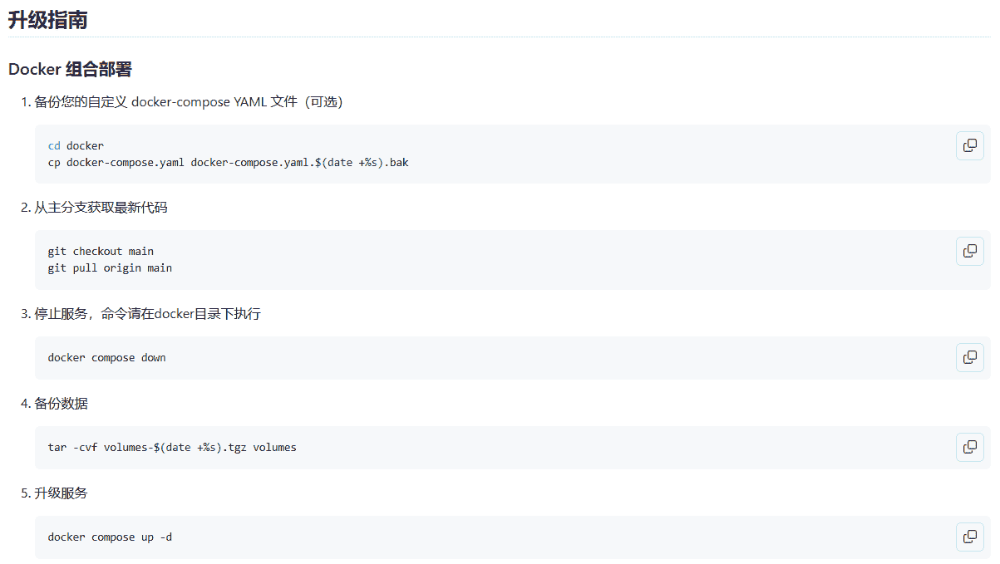
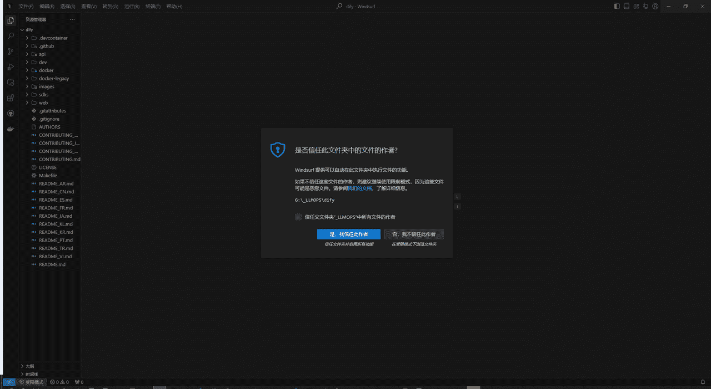
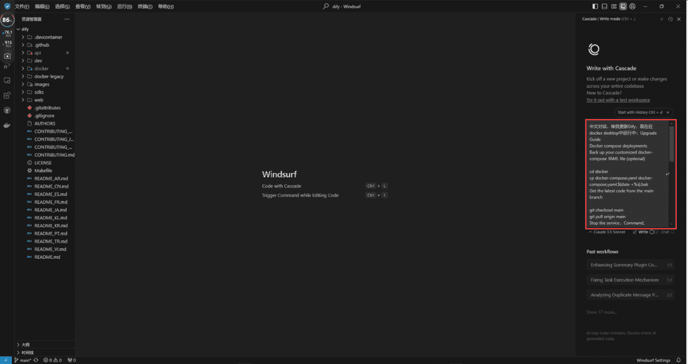
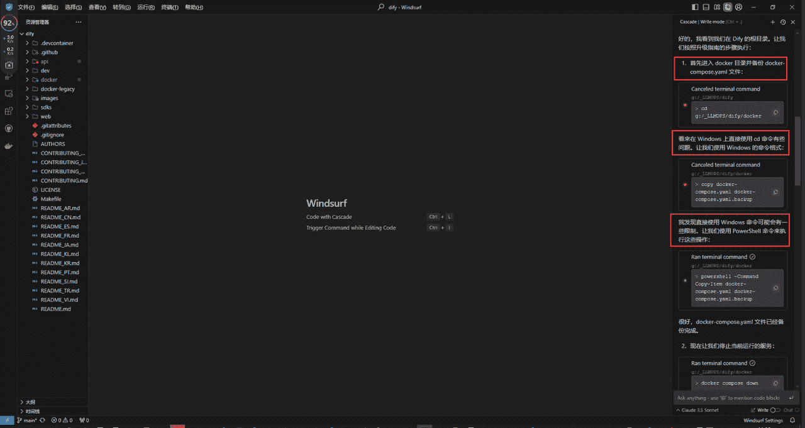
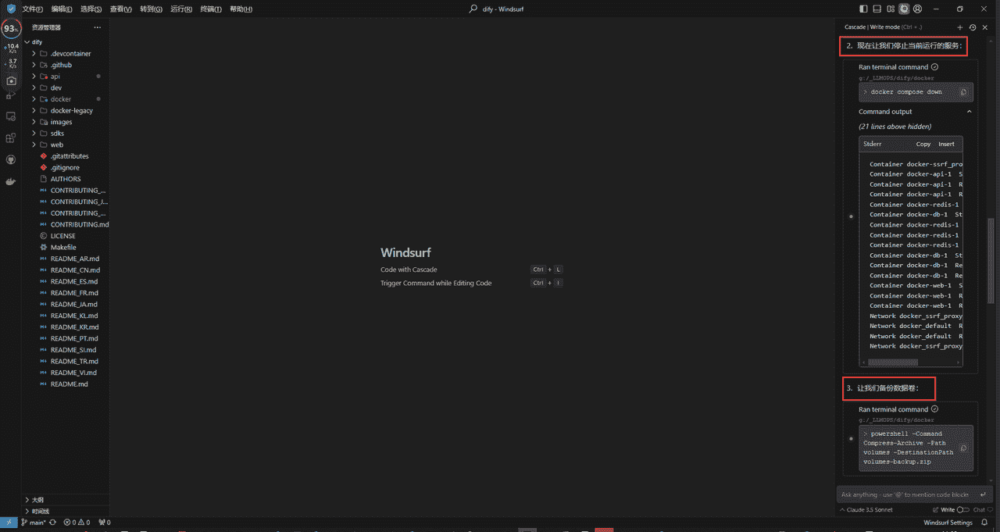
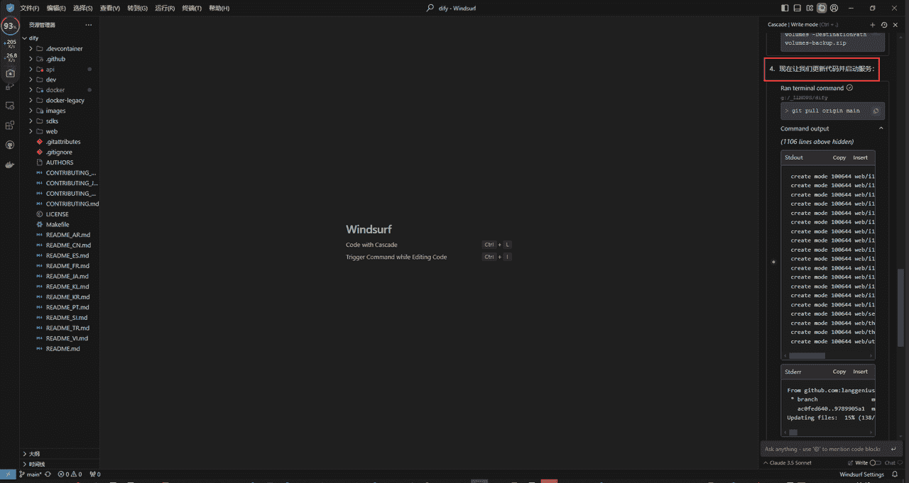
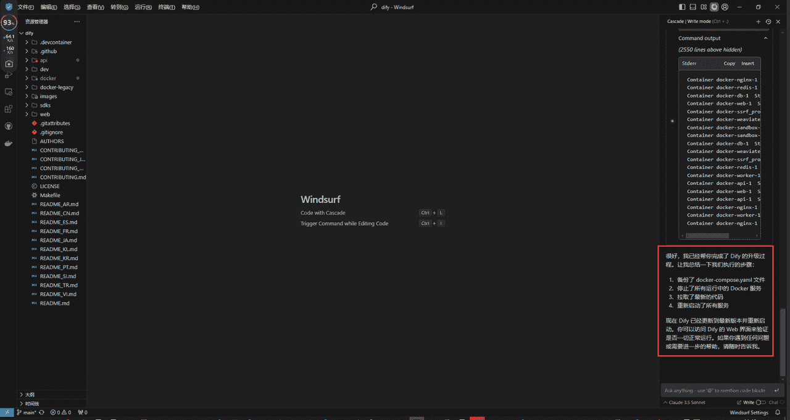
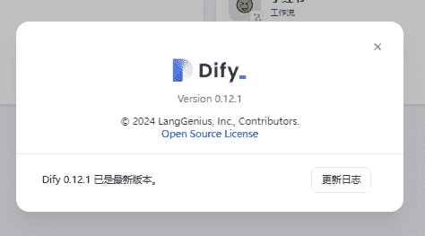

# 用Windsurf玩转Dify升级：全程自动化的丝滑体验！

> 来源：[https://my.feishu.cn/docx/MMTGdLypdoyxu0xESz1cZ3BDnkh](https://my.feishu.cn/docx/MMTGdLypdoyxu0xESz1cZ3BDnkh)

### 引言：告别繁琐的手动更新

今儿Dify更新了0.12.1版本，但传统的更新方式让老金我望而生畏——备份数据、下载更新、覆盖安装，每一步都可能耗费大量时间和精力。

面对这些烦恼，Windsurf的出现无疑是一场“及时雨”。它用简洁高效的方式，让升级Dify成为了一种“丝滑”的体验。本篇文章将带你全面了解如何通过Windsurf轻松实现Dify的版本升级。

但是！这回我有了Windsurf，一健丝滑升级！看完这期内容后，我相信你能用风帆玩出花了！

本期就以升级Dify为例，看看它是怎么来操作的，完全不需要再手动操作了！

### 使用Windsurf升级Dify

要顺利完成Dify的升级，以下准备工作放入提示词会更便捷，避免他自己查找浪费时间：

1.  Dify当前版本的安装路径：确保Windsurf能够正确定位旧版本。

1.  官方升级说明：从Dify官网下载最新版本的升级步骤。

1.  操作环境：确保系统支持Windsurf运行，推荐使用最新版。

输入给它信息，让它升级Dify，但是忘记说操作系统了。

把官方的升级操作说明丢进去。

开始进行操作了，发现Windows命令问题，自动转换成Powershell进行操作，emm，老金之前也是用的Powershell。

它自动按照官方说明进行操作了。

继续自动操作，继续更新，完全不需要手动。

操作完成，并进行了操作总结。

可以看到Dify已经自动被重启，并更新到了最新版本，真的是无比丝滑

### 结论：未来的编程操作就交给Windsurf

Dify的升级只是Windsurf众多功能中的冰山一角。通过这次实际体验，相信你已经感受到这款工具的强大。

自从老金用了Windsurf后，再也没有启动过其他软件了。

当然其他软件有其他软件的好处，但是无比丝滑这件事，我愿称Windsurf为王！

<https://my.feishu.cn/sync/HDlcdCPBksnJpBbRk0EcW364nmc>