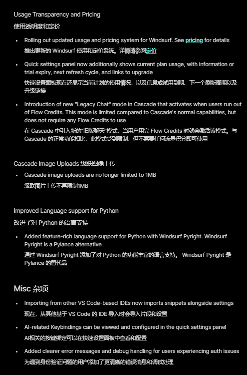
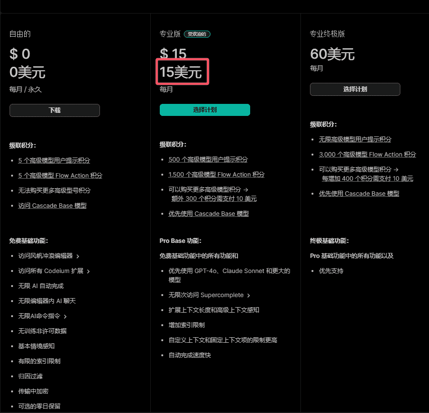

# Windsurf提价了，对比Cursor，开发者该如何选择适合自己的 AI 编程助手？

> 来源：[https://my.feishu.cn/docx/DgLCdOJBkozvO8xaxlVcOGCVncw](https://my.feishu.cn/docx/DgLCdOJBkozvO8xaxlVcOGCVncw)

今儿在使用时候看到Windsurf（风帆）更新了。

老金我就趁此机会给大伙做个和Cursor的对比，看看哪个更适合你。

上次没截到，这次能看到了，在编辑器的右上角有个蓝色的“重启更新”按钮。

点击后，自动安装更新。

功能看起来没啥重点内容，改进了Python的语言支持，之前一运行Python就卡住的情况不知道是否有好转，老金还没进行测试。

哦豁，订阅价格从10刀变成了15刀一月，但是还是比cursor便宜。

而且还学Cursor进行了次数限制。

再来对比下Cursor的。

对于Windsurf和Cursor，老金的体验目前如下：

| **维度** | **Windsurf** | **Cursor** |
| --- | --- | --- |
| 价格 | $15/月 | $20/月 |
| 上下文理解 | 优秀 | 良好，内容一多，容易遗忘，导致瞎写 |
| 性能 | 运行Python时总会卡住转圈圈 | 稳定，未出现过卡死之类的情况 |
| 自动化 | 丝滑！无比的丝滑！自动化运转 | 操作需要略多，更注重安全稳定 |
| AI模型集成 | 相对单一 | 多模型灵活支持 |
| 协作能力 | 基础功能 | 更完善的团队协作工具 |

因此，老金的个人判断如下，大伙可以借鉴一下：

1.  如果你是个人开发或创业型小团队，建议使用Windsurf：

1.  价格比Cursor便宜，不过看起来次数和价格都有要追平的趋势。

1.  对于小项目来讲，自动化省时更重要，风帆的自动化要好很多。

1.  如果你是中大型项目，且涉及团队型多人配合（和上面小团队不一样，俩三人来回传一下小文件不是啥难事儿），建议使用Cursor：

1.  性能和稳定性良好，老金使用下来不像Windsurf一样总卡死。

1.  具备团队协作和代码一致性的开发环境。

**结语：**

选择一个工具，不只是一次技术的对比，更是一种未来工作方式的选择。Windsurf 的丝滑自动化让创意畅行无阻，而 Cursor 的稳定协作为团队开发保驾护航。

它们不仅是工具，更是迈向高效、自由开发的桥梁。在这场变革中，每一位开发者都能找到属于自己的方向。

**未来，属于敢于突破的你。**

你，准备好了吗？

<https://my.feishu.cn/sync/HDlcdCPBksnJpBbRk0EcW364nmc>