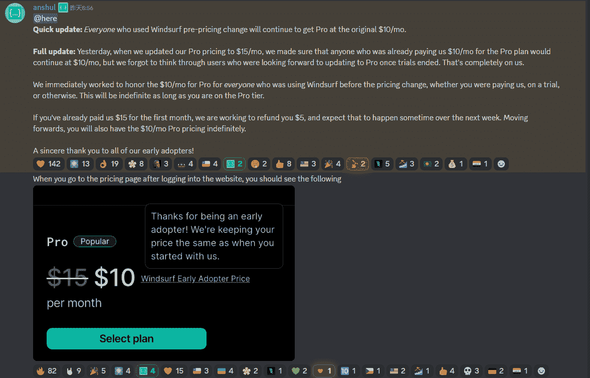
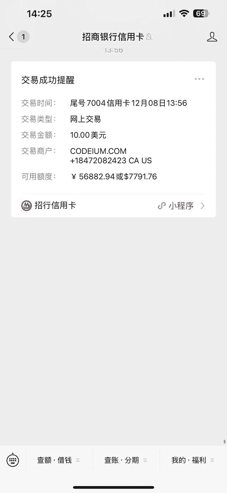
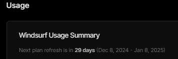

# 速报！Windsurf又降价回去了，但是有条件！这回老金没憋住充值了！

> 来源：[https://my.feishu.cn/docx/OcmXdNE69o1QjaxT9UpcwvuRnfg](https://my.feishu.cn/docx/OcmXdNE69o1QjaxT9UpcwvuRnfg)

**翻译：**

**快速更新：**

所有使用 Windsurf 预定价变更的用户都将继续以原价 10 美元/月的价格获得 Pro。

**完整更新：**

昨天，当我们将 Pro 定价更新为 15 美元/月时，我们确保任何已经为 Pro 计划支付 10 美元/月的用户将继续以 10 美元/月的价格使用，但我们忘记考虑那些希望在试用期结束后升级到 Pro 的用户。这完全是我们的责任。

我们立即努力为在**定价变更之前使用 Windsurf 的*所有***用户提供 10 美元/月的 Pro 价格，无论您是付费给我们、试用还是其他方式。只要您处于 Pro 级别，这将是无限期的。

如果您已经为我们支付了第一个月的 15 美元，我们正在努力退还您 5 美元，并预计在下周的某个时候完成。展望未来，您还将无限期地享受 10 美元/月的 Pro 定价。

真诚感谢我们所有的早期采用者！

---

**这套路，**

**让你充钱，又让你觉得赚了。**

**玩的可真厉害。**

老金我就上车了，国内Visa卡直充即可。

当然你也可以选择在某鱼拼团，但是是多人用账号，有次数限制后，老金我觉得慎选此方法。

**注意：**

充值后，**原来试用剩余的日期直接会被覆盖**，变成充值日期。

用了两天后，我发现充值的要比试用Pro还要顺畅，还要更快，不知道是不是幻觉。

等老金我再用一段时间后来和大家说。

<https://my.feishu.cn/sync/HDlcdCPBksnJpBbRk0EcW364nmc>