# 真·保姆级入门教程

> 来源：[https://my.feishu.cn/docx/B62adUj35oigGZxmLUUcVbgHnwg](https://my.feishu.cn/docx/B62adUj35oigGZxmLUUcVbgHnwg)

建议打开电脑浏览器，直接跟着步骤走一遍：

# Discord入门教程

## 注册Discord

Discord 官网：https://discord.com/

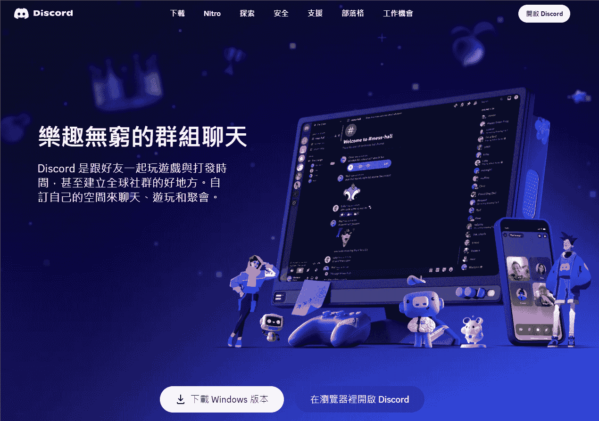

老样子，[Gmail注册](https://tffyvtlai4.feishu.cn/wiki/H4zdwOoKciIV2AkaSPKc1y14nJ9)。

根据反馈现在需要手机验证了，没关系，支持中国地区，验证时候选（+86 中国）就行了。

## 订阅计划

要开始使用 Midjourney 生成图像，您需要订阅一个计划。

+   访问[Midjourney.com](https://www.midjourney.com/)。

+   使用您已验证的Discord 帐户登录。

+   选择适合您需求的订阅计划。

请参阅[订阅计划](https://docs.midjourney.com/plans)，了解定价和每个层级可用功能的信息。

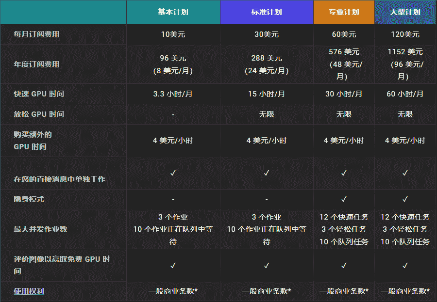

## 在 Discord 上加入Midjourney 服务器

要开始与 Midjourney Bot 交互，请加入 Midjourney 服务器

+   打开 Discord 并在左侧边栏找到服务器列表。

+   按下**+**服务器列表底部的按钮。

+   在弹出的窗口中，单击**Join a Server**按钮。

+   粘贴或输入以下 URL：ht**tp:/**/discord.gg/midjourney并按Join。

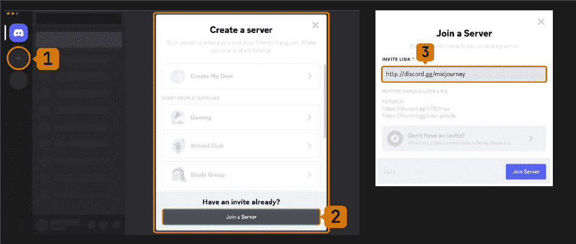

## 前往任意 #General 或 #Newbie 频道

加入 Discord 上的 Midjourney 服务器后，您将看到侧边栏中列出的几个频道。

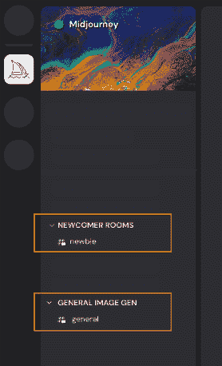

### 在 Midjourney 服务器上

找到并选择标有**general-#**或 的任何频道**newbie-#**。这些频道专为初学者设计，可帮助您开始使用 Midjourney Bot。

Midjourney Bot 不会在其他频道中生成图像。

### 在其他服务器上

您可以在已邀请 Midjourney Bot 的任何 Discord 服务器上使用 Midjourney Bot 生成图像。在您的服务器上查找有关在何处使用 Bot 的说明。

参考说明：[将MJ机器人添加到你的Discord服务器](https://tffyvtlai4.feishu.cn/wiki/NqS6wiEtziAM2skasH6cyJpRnFc)

## 使用/imagine命令

**关于 Discord 命令使用**

与 Discord 上的 Midjourney Bot 交互。命令用于创建图像、更改默认设置、监控用户信息和执行其他有用的任务。该命令根据简短的文本描述（称为提示）生成唯一的图像。

**如何使用****/imagine**

+   **在消息字段中输入**“/imagine prompt:”。您也可以/imagine从输入“/”时弹出的可用斜线命令列表中选择命令。

+   **在字段中输入**您想要创建的图像的描述prompt。

+   发送您的消息。机器人将解释您的文本提示并开始生成图像。

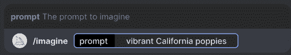

## 接受服务条款

[在生成任](https://docs.midjourney.com/docs/terms-of-service)何图像之前，Midjourney Bot 会提示您接受服务条款。您必须同意这些条款才能继续创建图像。

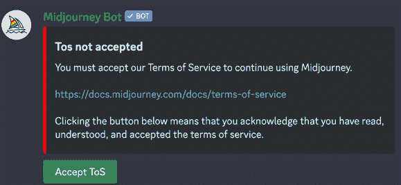

## 图像生成过程

提交[文本提示后，](https://docs.midjourney.com/fast-relax)**Midjo**urney Bot 会处理您的请求，在一分钟内创建四个独特的图像选项。此过程利用先进的图形处理单元 (GPU)，每次图像生成都计入Midjourney 订阅中包含的GPU 时间。要监控您的可用 GPU 时间（剩余时间快）使用该/info命令。

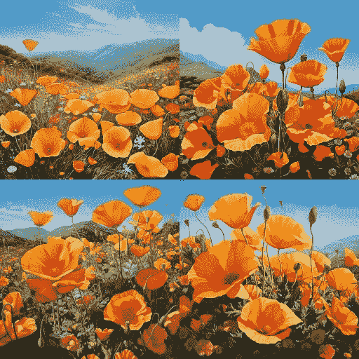

## 选择图像或创建变体

一旦生成了初始图像网格，图像网格下方就会出现两行按钮。

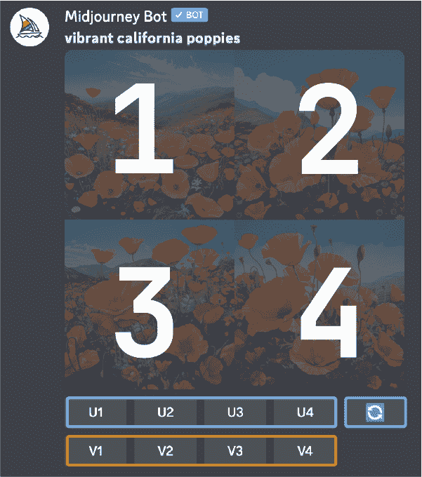

U1 U2 U3 U4图像选择

**在** Midjourney 的早期版本中，U按钮用于放大图像。使用最新型号，图像会立即以 1024 x 1024 像素大小生成。现在，“U”按钮可帮助您将所选图像从网格中分离出来，使其更易于下载，并让您能够访问其他编辑和生成工具。

🔄重新运行或重新滚动作业

此🔄按钮可重新运行作业。在本例中，它将重新运行原始提示并生成新的图像网格。

V1 V2 V3 V4图像变化

这些V按钮用于创建所选图像的变体。每个按钮都会生成一个新的图像网格，该网格保留所选图像的一般风格和构图。

## 增强或修改你的形象

挑选出一张图片后，就会出现一组扩展的选项可供选择。

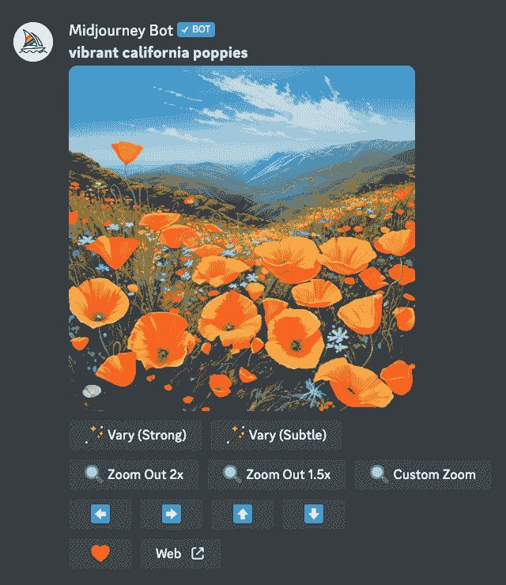

🪄 Vary (Strong) 🪄 Vary (Subtle)

创建所选图像的更强烈或更微妙的变体，生成一个包含四个选项的新网格。

🔍 Zoom Out 2x 🔍 Zoom Out 1.5x 🔍 Custom Zoom

缩小图像，将画布扩展到其原始边界而不改变原始图像的内容。新扩展的画布将使用提示和原始图像的指导进行填充。

⬅️ ➡️ ⬆️ ⬇️

平移按钮可让您沿选定方向扩展图像的画布，而不会更改原始图像的内容。新扩展的画布将使用提示和原始图像的指导进行填充。

❤️ Favorite

标记您最好的图像，以便在 Midjourney 网站上轻松找到它们。

Web ↗️

在midjourney.com 的图库中打开图片

## 10.保存你的图像

**点击图片将其全尺寸打**开，然后右键单击并选择Save image。在移动设备上，长按图片，然后点击右上角的下载图标。

所有图片均可立即在midjourney.com/imagine上查看

**需要帮助或****有疑问？**尝试以下命令：

/help显示有关 Midjourney Bot 的有用信息和提示。

/ask提供有关 Midjourney Bot 的问题的答案。

# Prompt（提示语）

Prompt是 Midjourney Bot 解释以生成图像的短文本短语。Midjourney Bot 将Prompt中的单词和短语分解成更小的部分（称为标记），并将其与训练数据进行比较，然后用于生成图像。精心制作的Prompt可以帮助制作独特而令人兴奋的图像

## 基本提示

基本提示可以简单到一个单词、短语或表情符号😊。

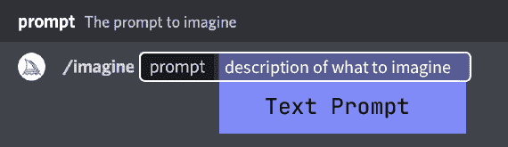

Midjourney Bot 最适合使用简单、简短的短语来描述您想要看到的内容。避免使用长列表的请求和说明。

不要：**给我看一张盛开的加州罂粟花的照片，把它们画成明亮、鲜艳**的橙色，然后用彩色铅笔以插画风格画出来。

尝试：**用彩色铅笔画出明亮的橙色加州。**

## 高级提示

更高级的提示可以包括一个或多个[图像 URL](https://docs.midjourney.com/image-prompts)、[多个文本短语](https://docs.midjourney.com/multi-prompts)以及一个或多个[参数](https://docs.midjourney.com/parameter-list)

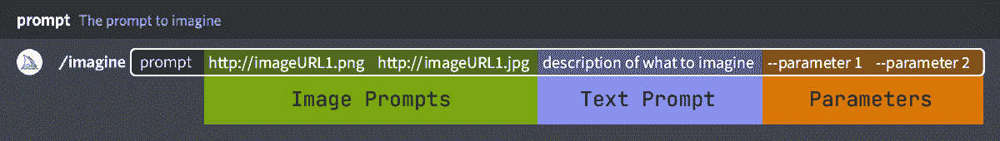

**Image Prompts**

可以将图像 URL 添加到提示中，以影响最终结果的样式和内容。图像 URL 始终位于提示的最前面。

**Text Prompt**

您要生成的图像的文本描述。请参阅下面的提示信息和提示。写得好的提示有助于生成令人惊叹的图像。

**Parameters**

参数改变图像的生成方式。参数可以改变纵横比、模型、升级器等等。参数位于提示的末尾。

## 提示说明

### 词汇选择

词汇选择很重要。在许多情况下，更具体的同义词效果更好。

比如 big这个词语，尝试 tiny、huge、giantic、enlarge 或 infinite，效果会更好。

### 复数词和集合名词

复数词的使用有很多不确定性。尝试使用具体数字。“三只猫”比“猫”更具体。集体名词也适用，例如“一群鸟”而不是“鸟”。

### 专注于你想要的

最好描述你想要什么，而不是你不想要什么。如果你要求举办一场“不带蛋糕”的派对[**，你的图**](https://docs.midjourney.com/multi-prompts)[片中](https://docs.midjourney.com/multi-prompts)可能会有一个蛋糕。为了确保物体不在最终图片中，请尝试使用参数进行高级--no提示。

### 提示长度和详细信息

提示可以很简单。一个单词或表情符号就可以了。但是，简短的提示依赖于 Midjourney 的默认样式，允许它创造性地填写任何未指定的详细信息。在提示中包含对您来说重要的任何元素。细节越少，多样性就越强，但控制力越弱。

尽量清楚说明对您来说重要的任何背景或细节。思考一下：

+   **主题：** 人物、动物、角色、地点、物体

+   **材质：** 照片、绘画、插图、雕塑、涂鸦、挂毯

+   **环境：** 室内、室外、月球上、水下、城市中

+   **照明：** 柔和、环境光、阴天、霓虹灯、影室灯

+   **颜色：** 鲜艳、柔和、明亮、单色、彩色、黑白、柔和

+   **心情：** 稳重、平静、喧闹、精力充沛

+   **构图：** 肖像、头像、特写、鸟瞰图

## 探索提示

即使是简短的单词提示也会以 Midjourney 的默认风格产生精美的图像，但您可以通过结合艺术媒介、历史时期、地点等概念来创建更有趣的个性化结果。

### 选择媒介

拿出颜料、蜡笔、刮板、印刷机、亮粉、墨水和彩色纸。创造时尚形象的最佳方式之一是指定一种艺术媒介。

提示示例：**/imagine prompt** <any art style> style cat

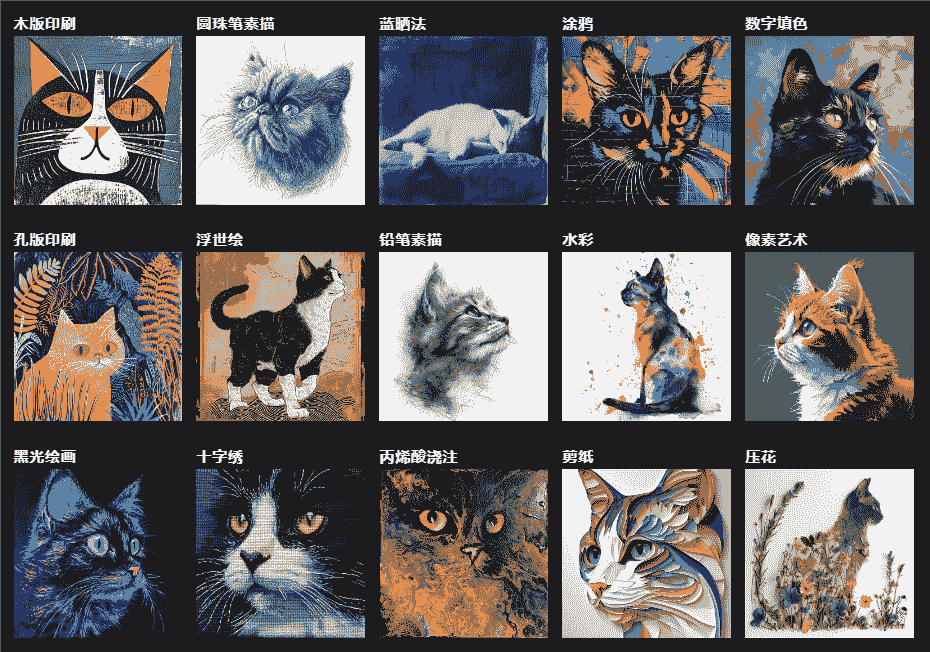

### 明确目标

更精确的单词和短语将有助于创建具有完全正确的外观和感觉的图像。

提示示例：**/imagine prompt** <style> sketch of a cat

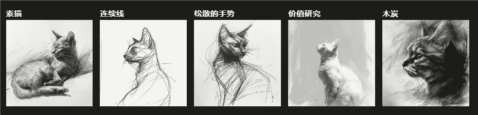

### 时间旅行

不同时代有不同的视觉风格。

提示示例：**/imagine prompt** **an illustration of** a <time period> cat

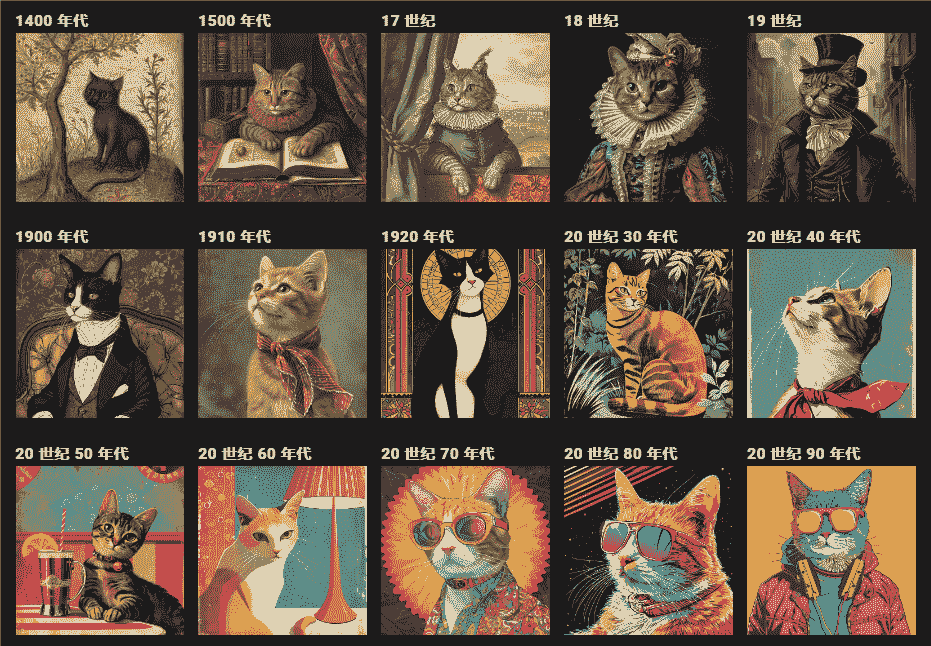

### 表情

用情感词语赋予人物个性。

提示示例：**/imagine prompt** **<emotion> cat**

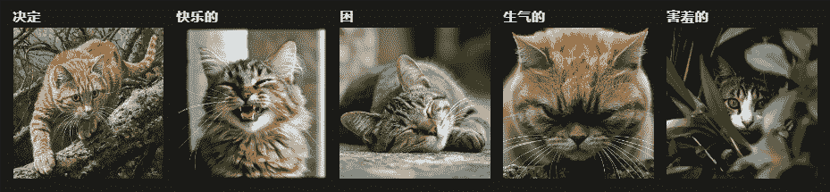

### 色彩缤纷

各种可能性。

提示示例：**/imagine prompt** <color word> colored cat

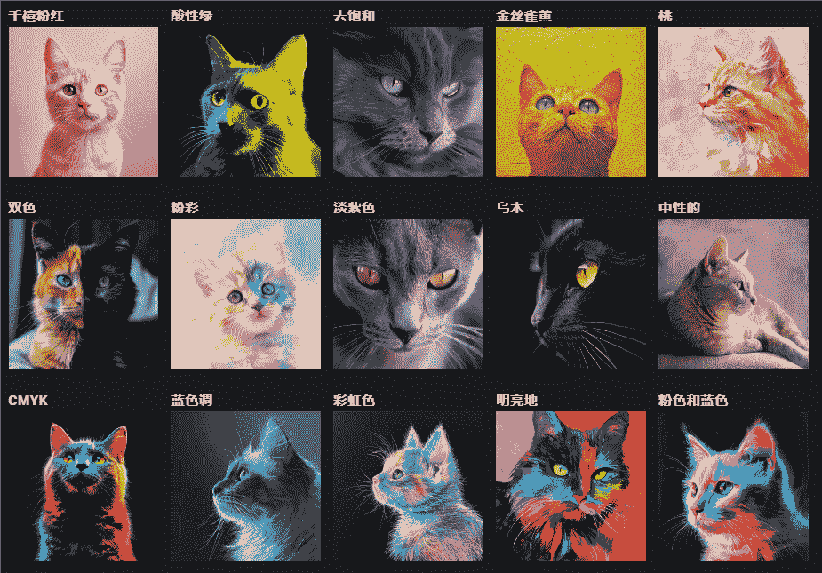

### 环境探索

不同的环境可以营造独特的氛围。

提示示例：**/imagine prompt** **<location> cat**

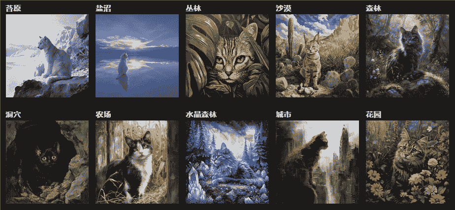

# Vart（变体）

使用V1 V2 V3 V4每个图像网格下的按钮，或使用放大图像下的Vary (Strong)和按钮来生成该图像的不同版本。Vary (Subtle)

+   这些**V**按钮与每个生成的网格中的图像从左到右、从上到下相对应，如下所示：🔢。

+   在您的设置中使用和**V**按钮时，控制默认变化量。是默认值。🎨 High Variation Mode 🎨 Low Variation Mode 🎨 High Variation Mode

+   您还可以使用该/prefer variability命令在高变化模式和低变化模式之间切换。

+   在放大图像下，🪄 Vary (Strong)按钮对应于🎨 High Variation Mode，而🪄 Vary (Subtle)对应于🎨 Low Variation Mode。这些按钮忽略您的个人设置。

想要在进行变体时更改提示？

请**Remix Mode**在设置中启用。在[此处](https://docs.midjourney.com/v1/docs/remix)详细了解如何使用混音模式以及它如何与您的变体设置交互。

**变体示例**

当使用Midjourney 版本 5 或 6，或 Niji 版本 5 或 6时，您可以选择高或低变化模式。

默认设置🎨 High Variation Mode将生**成**与原始图像在构图、元素数量、颜色和细节类型方面不同的新图像。要使用高变化模式，请V在设置中选择网格时单击其下方的按钮，或单击🪄 Vary (Strong)放大图像下方的按钮。

🎨 Low Variation Mode将**生成保留原始构图和**颜色的**新**图像，但图像细节会略有变化。要使用低变化模式，请选择它/settings并单击V与要变化的图像相对应的按钮，或单击🪄 Vary (Subtle)放大图像下方的按钮。

提示示例：**/imagine prompt** a cute robot holding flowers

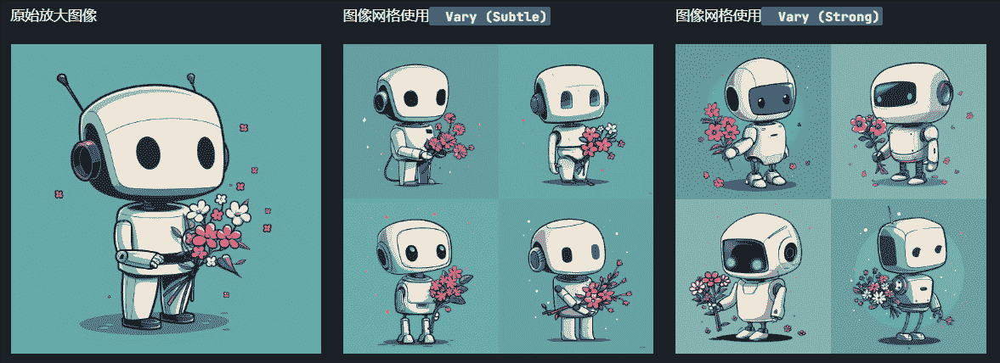

提示示例：**/imagine prompt** a bird watching a butterfly

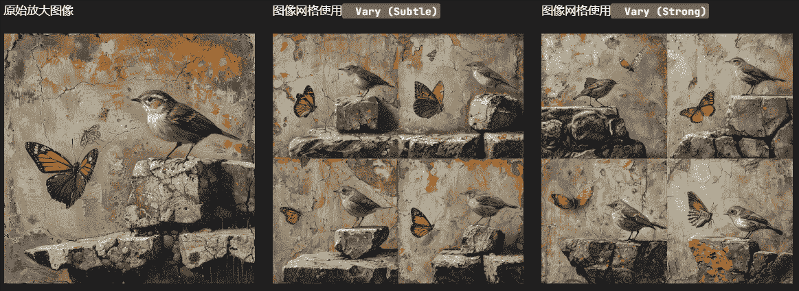

# Upscale（放大）

当前的Midjourney 和 Niji 模型版本生成 1024 x 1024 像素图像的网格。使用U1 U2 U3 U4每个图像网格下方的按钮将所选图像与其网格分开。然后，您可以使用Upscale (Creative)或Upscale (Subtle)工具增加图像的大小。

该Upscale (Subtle)选项可使图像尺寸翻倍，同时保留与原始图像非常相似的细节。该选项Upscale (Creative)还可使图像尺寸翻倍，但会为图像添加新的细节。尝试每个升级选项，找到最适合您图像风格的选项。

+   **Upscale**工具使用您订阅的GPU 分钟数。升级所需的 GPU 分钟数可能是生成初始图像网格所需的两倍。

+   **Upscale**工具与--tile 参数不兼容。

---

**如何使用高档工具**

1.  生成图像

使用命令创建图像**/imagine**。

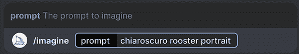

1.  **选择**图片

使用**U**按钮将您选择的图像与网格分离。

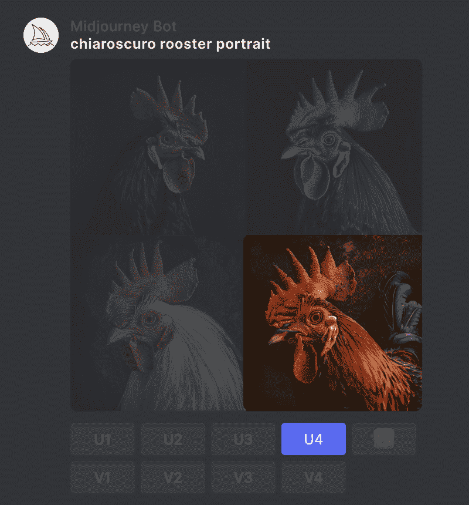

1.  选择高档

单击Upscale (Subtle)或Upscale (Creative)按钮放大图像。放大器将把图像尺寸翻倍至 2048 x 2048 像素。

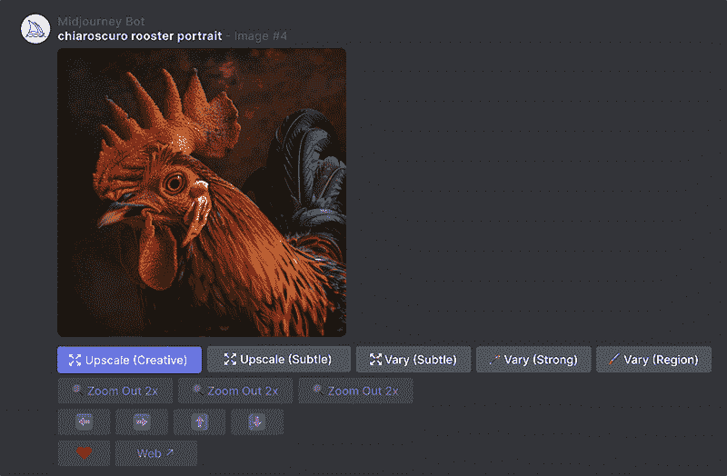

**高档比较**

提示：chiaroscuro rooster portrait

原始图像为 1024 x 1024 像素。

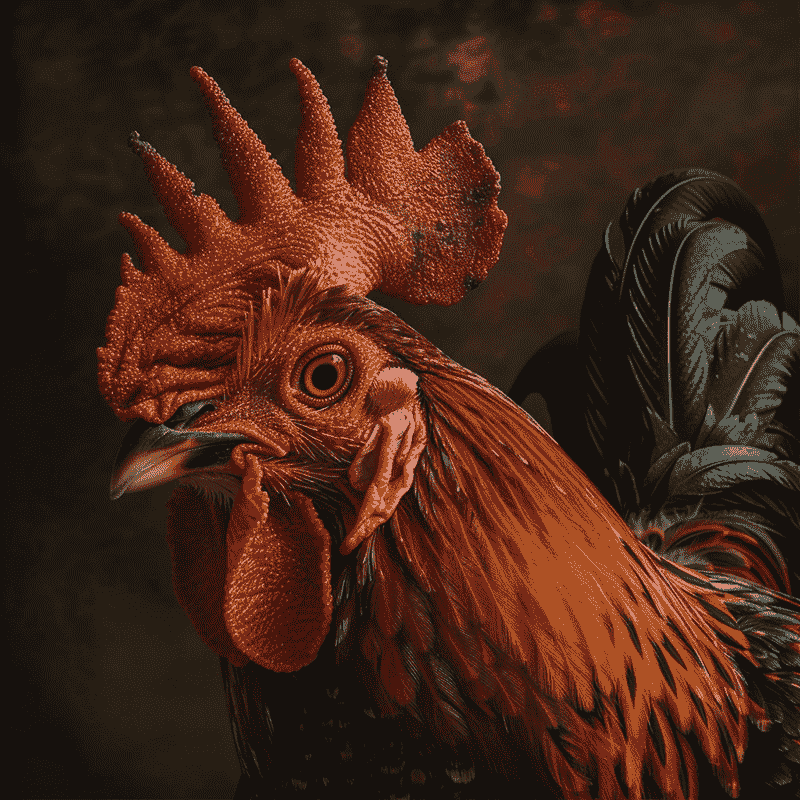

**原始图片细节**

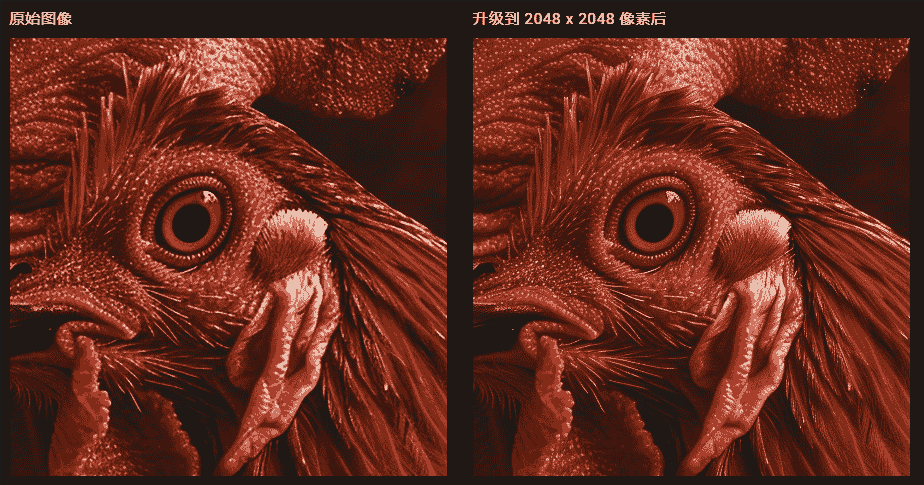

**高档比较**

迅速的：**1960s pop-art acrylic painting of a** stream running through a redwood forest

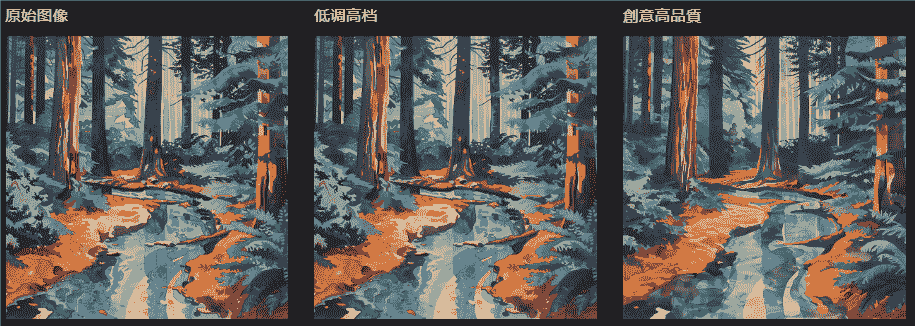

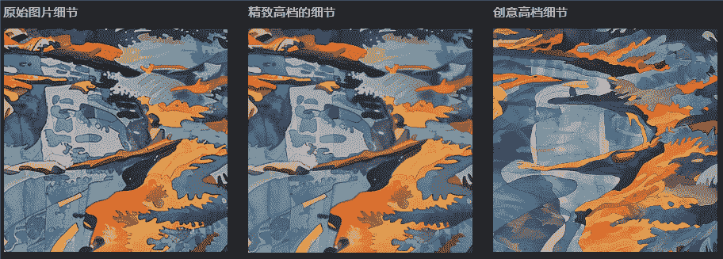

使用/show命令刷新您在新升级器发布之前生成的升级作业。与该图像兼容的所有升级器的按钮将显示在刷新后的作业下。

# Vary Region（局部修改）

使用“中间区域”编辑器选择并重新生成放大图像的特定部分。

+   **Vary (Region)**Midjourney 图像被放大后，会出现此按钮。

+   区域变化由原始图像中的内容和您选择的区域决定。

+   **Vary (Region)**与Midjourney 模型 版本**V5**、**V6**、**niji 5**** **和**niji 6**兼容。

---

如何使用 Vary Region

1.  生成图像

使用命令创建图像**/imagine**。

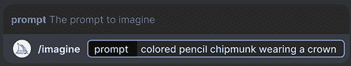

1.  提升图像质量

使用 U 按钮来升级您选择的图像。

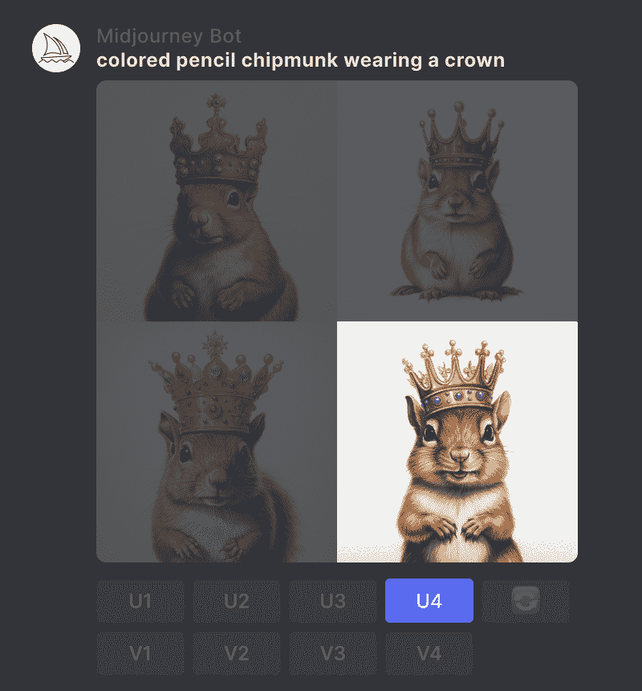

1.  选择不同区域

点击🖌️ Vary (Region)按钮，打开编辑界面。

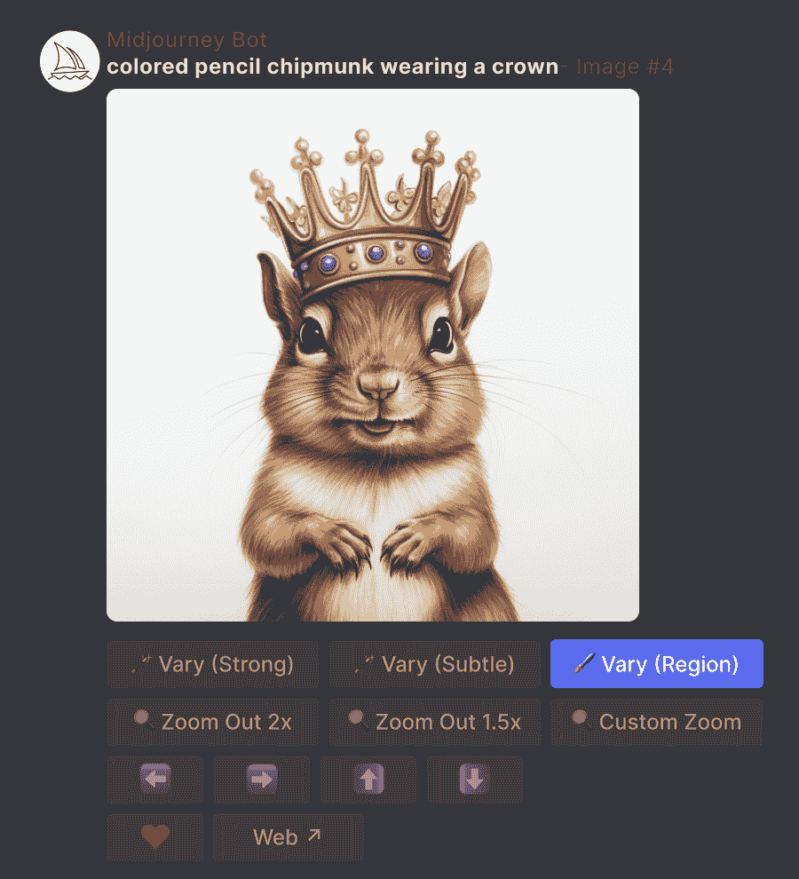

1.  选择要再生的区域

+   选择编辑器左下角的自由选择工具或矩形选择工具。

+   选择您想要重新生成的图像区域。

+   您的选择大小会影响结果。选择越大，Midjourney Bot 就有更多空间来生成新的创意细节。选择越小，变化就越小、越细微。
注意：您无法编辑现有选择，但可以使用右上角的撤消按钮撤消多个步骤。

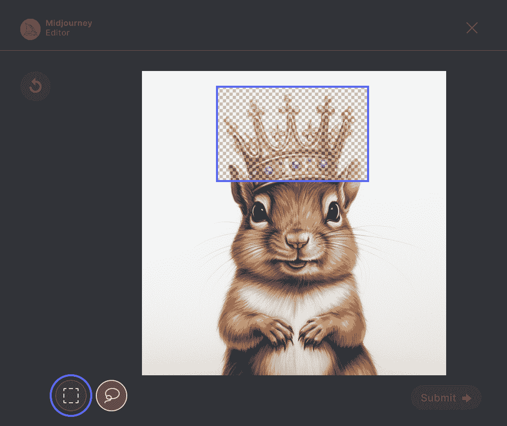

1.  提交您的工作

单击Submit →按钮将您的请求发送到 Midjourney Bot。现在可以关闭 Vary Region 编辑器，您可以在处理作业时返回 Discord。

注意：您可以🖌**️ Va**ry (Region)多次使用放大图像下方的按钮来尝试不同的选择。您之前的选择将被保留。您可以继续添加到现有选择中，或使用按钮undo清除选择。

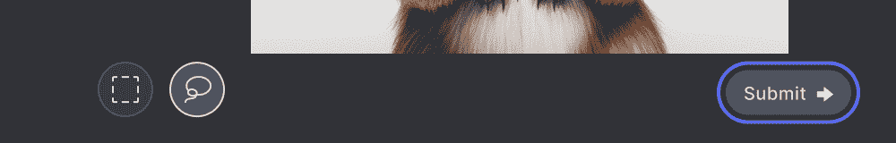

1.  查看结果

Midjourney Bot 将处理您的工作并在您选择的区域内生成新的变化图像网格。

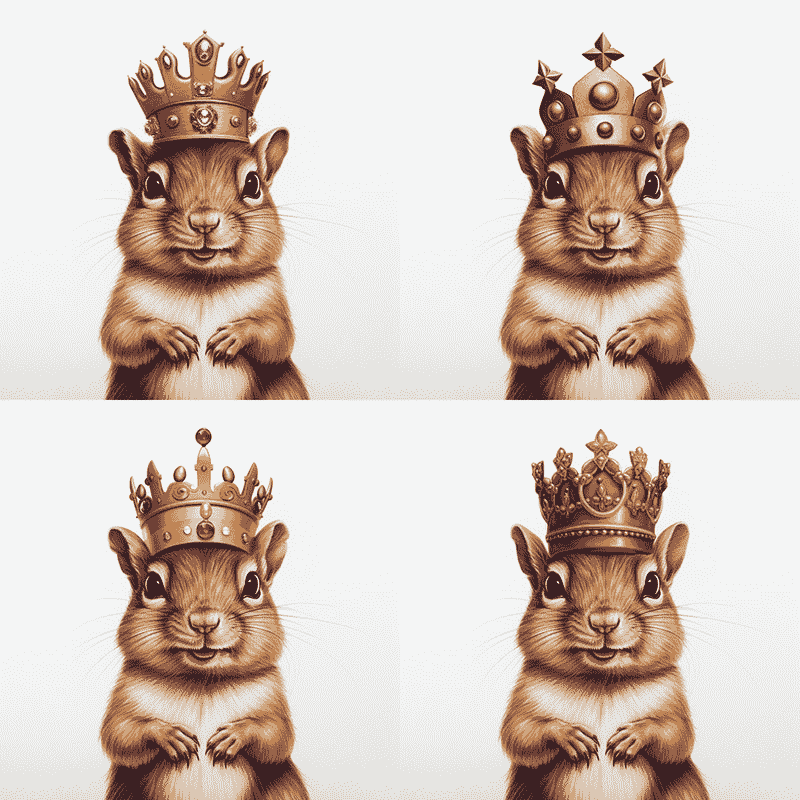

**改变区域示例**

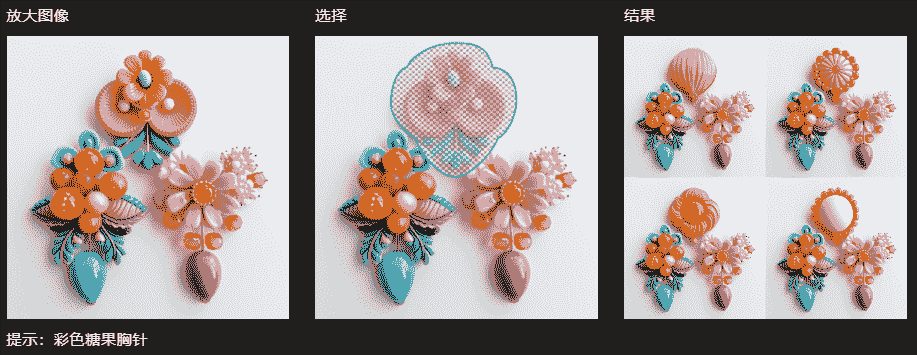

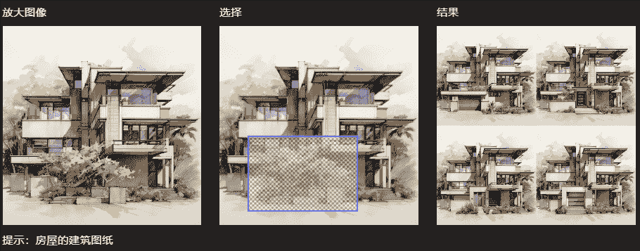

**技术细节**

**使用**** **Vary（区域）生成的作业将遵循以下参数：

--chaos

--fast

--iw

--no

--stylize

--relax

--style

--version

--video

--weird

#  Remix + Vary （局部混合修改）

结合Remix 模式和 Midjourney Vary Region 编辑器，使用新的或修改后的提示选择并重新生成放大图像的特定部分。

+   **Vary (Region)**Midjourney 图像被放大后，会出现此按钮。

+   区域变化结果由原始图像中的内容、您选择的区域和使用的修改提示决定。

+   **Vary (Region)**与Midjourney 模型 版本**V5**、**V6**、**niji 5****、****niji 6**兼容。

---

如何将 Remix 模式与 Vary (Region) 结合使用

1.  启用** **Remix** **模式

使用[**/settings**](https://docs.midjourney.com/settings-and-presets)[命令](https://docs.midjourney.com/settings-and-presets)并🎛️ Remix从弹出窗口中选择。

1.  生成图像

使用命令创建图像**/imagine**。

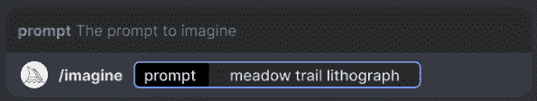

1.  提升图像质量

使用 U 按钮来升级您选择的图像。

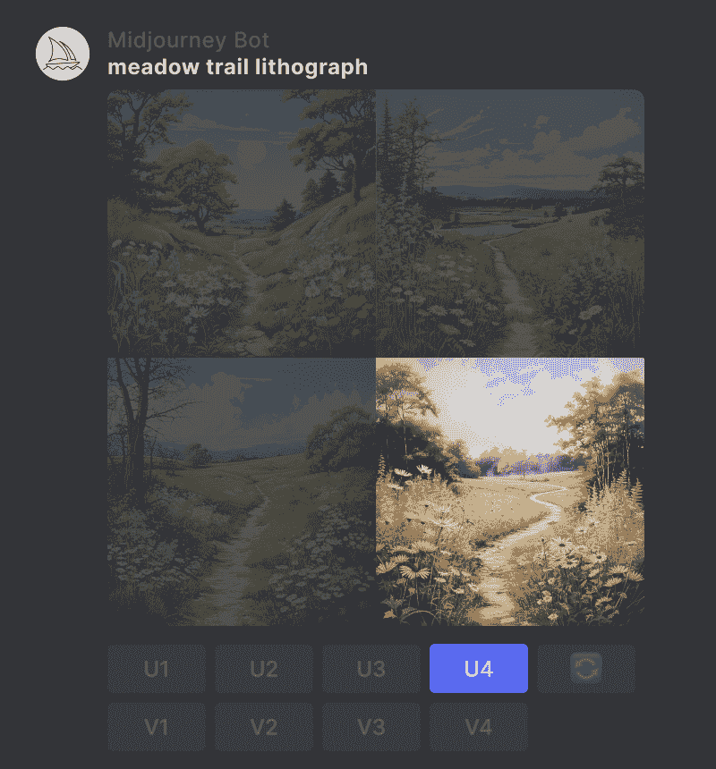

1.  选择不同区域

点击🖌️ Vary (Region)按钮，打开编辑界面。

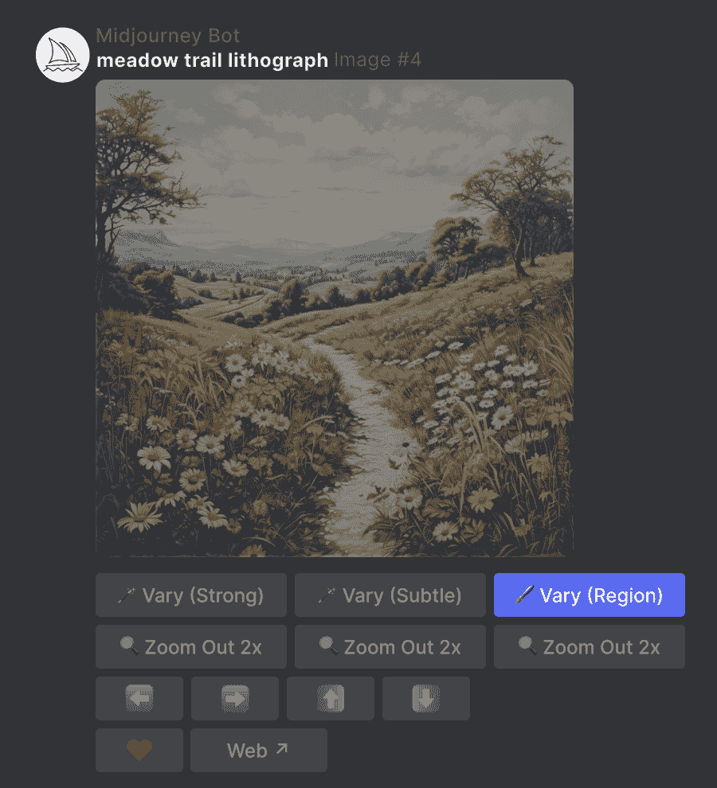

1.  选择要再生的区域

+   选择编辑器左下角的自由选择工具或矩形选择工具。

+   选择您想要重新生成的图像区域。

+   您的选择大小会影响结果。选择越大，Midjourney Bot 就有更多空间来生成新的创意细节。

+   选择越小，变化就越小、越细微。

+   注意：您无法编辑现有选择，但可以使用右上角的撤消按钮撤消多个步骤。

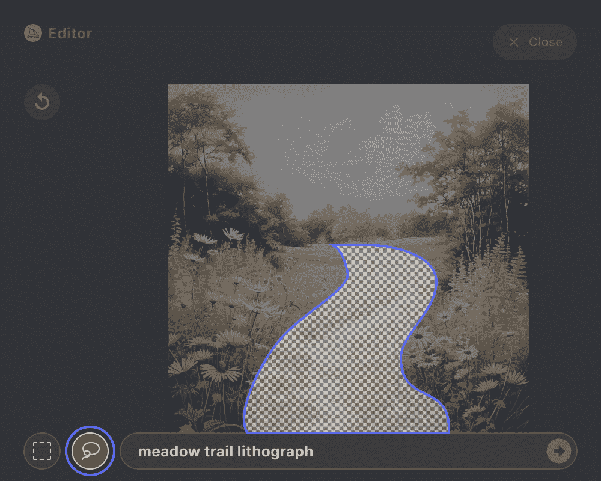

1.  修改提示

使用更新后的提示描述您想要在所选区域中生成的内容。您的修订提示应重点关注您想要引入或更改的细节。

1.  提交您的工作

单击Submit →按钮将您的请求发送到 Midjourney Bot。现在可以关闭 Vary Region 编辑器，您可以在处理作业时返回 Discord。

**注意**您可以多次使用放大图像下方的编辑器按钮来尝试不同的选择和提示。

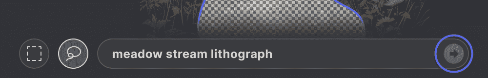

1.  查看结果

Midjourney Bot 将处理您的工作并使用原始图像中的信息和新提示的指导生成新的图像网格。

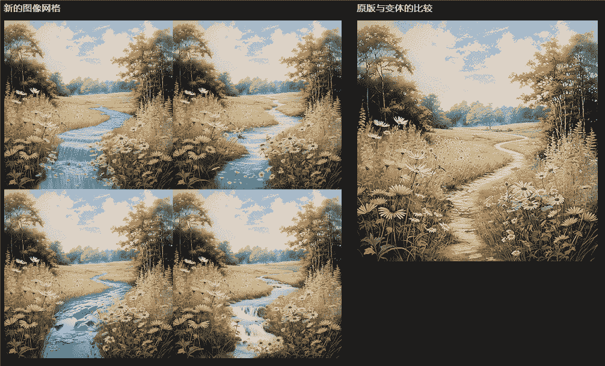

1.  再次升级并改变区域

您可以升级其中一张新图像，然后再次使用“变化区域编辑器”继续优化您的图像。

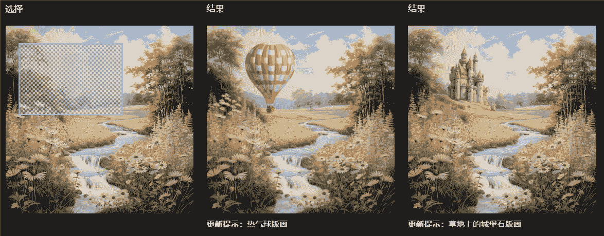

**Vary + Remix提示**

+   **选择**选择的大小会影响结果。选择越大，Midjourney Bot 就越能提供更多上下文信息，从而改善新添加内容的缩放和上下文。但选择过多可能会导致新生成的元素混合或替换您希望保留的原始图像的部分。

+   **提示**尝试使用“改变区域 + 重混模式”修改提示。提示应重点关注您希望在选定区域发生的事情。Midjourney Bot 在生成选定区域时还会考虑现有图像，因此较短的重点提示通常更有效。Midjourney 提示不应是对话式的。不要说“请将草地小径改成美丽的溪流”，而要直接提示“草地溪流”。

+   **循序渐进地进行操作**

如果您想要更改图像的多个部分，请一次处理一个部分。这样，您可以为每个部分创建一个有针对性的提示。

**Vary +Remix示例**

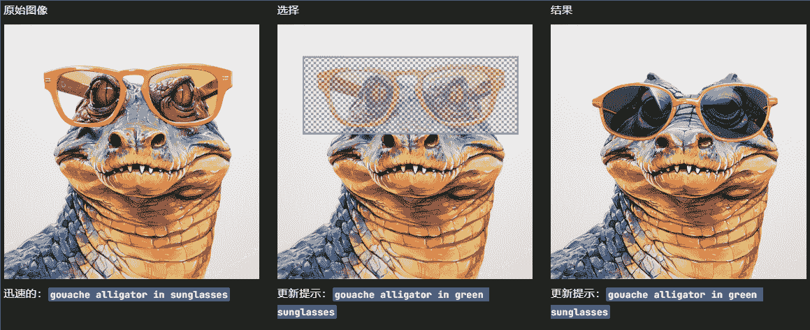

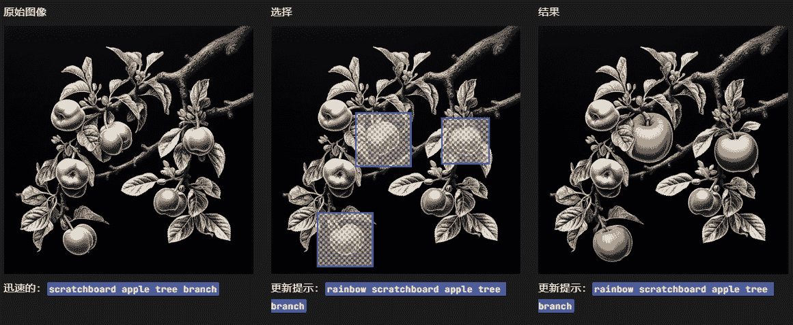

**技术细节**

**使用 Vary (Region) + R**emix 模式生成的作业将遵循以下参数：

--chaos

--fast

--iw

--no

--stylize

--relax

--style

--version

--video

--weird

# Version（版本）

Midjourney 定期推出新的模型版本，以提高连贯性、效率、质量和风格。您可以使用 --version 或 --v 参数切换模型版本，也可以使用 /settings 命令并选择您喜欢的模型版本。不同的模型擅长生成不同类型的图像。

+   **--version**接受值 1、2、3、4、5、5.0、5.1、5.2、6 和 6.1。

+   **--version**可以缩写**--v**。

+   **--v 6.1**是最新的和当前的默认模型。

---

## 模型版本 6.1

6.1 版于 2024 年 7 月 30 日发布，作为新的默认模型。它能生成更连贯的图像，细节和纹理更精确，生成图像的速度比 6 版快约 25%。

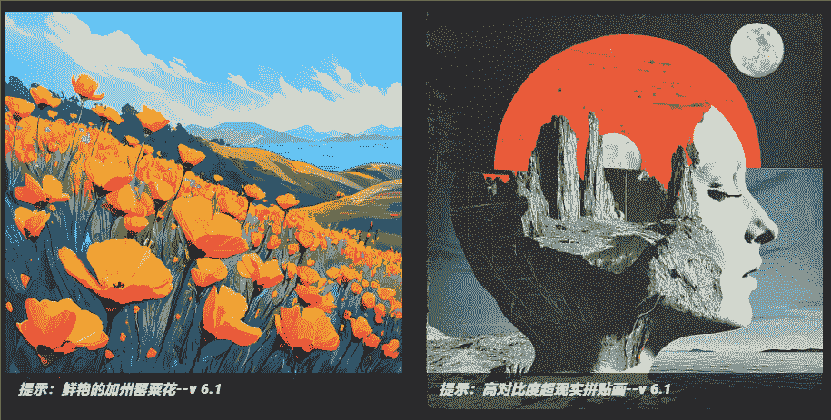

## 模型版本 6

Midjourney Model Version 6 提高了较长输入的提示准确性、提高了连贯性和知识性，并具有先进的图像提示和混音功能。

Midjourney 模型第 6 版于 2023 年 12 月 20 日发布，并于 2024 年 2 月 14 日至 7 月 30 日期间作为默认模型。

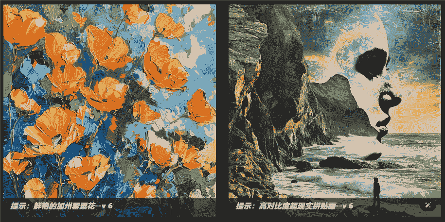

## Niji 模型 6

[Niji 模型是 M](https://spellbrush.com/)idjourney 和Spellbrush合作推出的，旨在通过对动漫、动漫风格和动漫美学的深入了解，制作动漫和插画风格。它擅长拍摄动态和动作镜头以及以角色为中心的构图。

要使用此模型，请将**--niji 6****参数添加到提示的末**尾，或使用命令/settings并选择🌈 Niji version 6

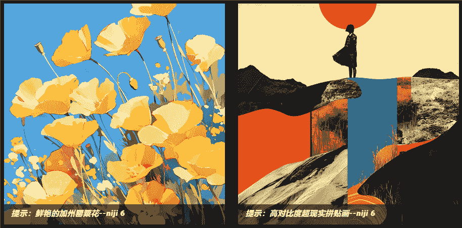

## Niji 6 与 Midjourney 版本 6

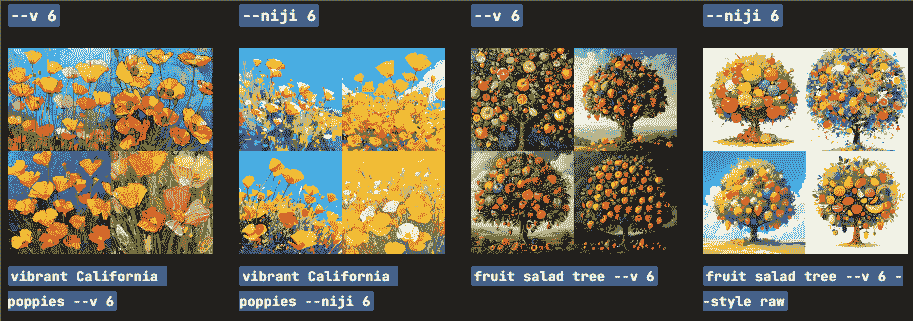

## 如何切换模型

### 使用版本参数

使用**--version**或**--v**参数更改模型版本。例如，**--v 5.2**使用版本 5.2，或**--niji 6**使用 Niji 版本 6。

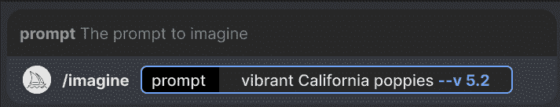

### 使用 Discord 设置命令

**/settings**从下拉列表中输入并选择您喜欢的版本。

6️⃣ MJ Version 6.1 6️⃣ MJ Version 6 🌈 Niji Version 6

[想要了解有关 ](https://docs.midjourney.com/v1/docs/legacy-model-version-parameters)Midjourney 旧型号的更多信息？请查看旧型号版本页面。

### 网站设置

您可以使用想象栏中的“设置”按钮设置默认版本：

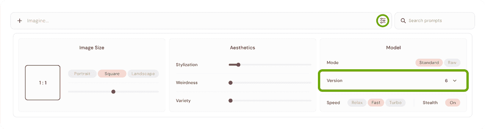

**从下拉菜单中选择您****喜欢的**版本。除非您在单个提示中使用--version或参数指定不同的值，否则您的图像将使用该版本生成。--v

<https://my.feishu.cn/sync/HDlcdCPBksnJpBbRk0EcW364nmc>