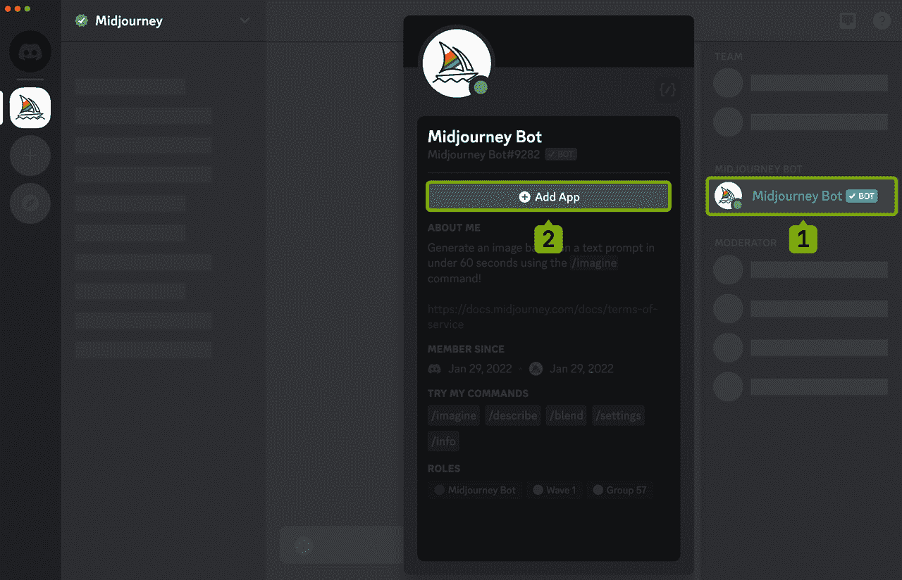
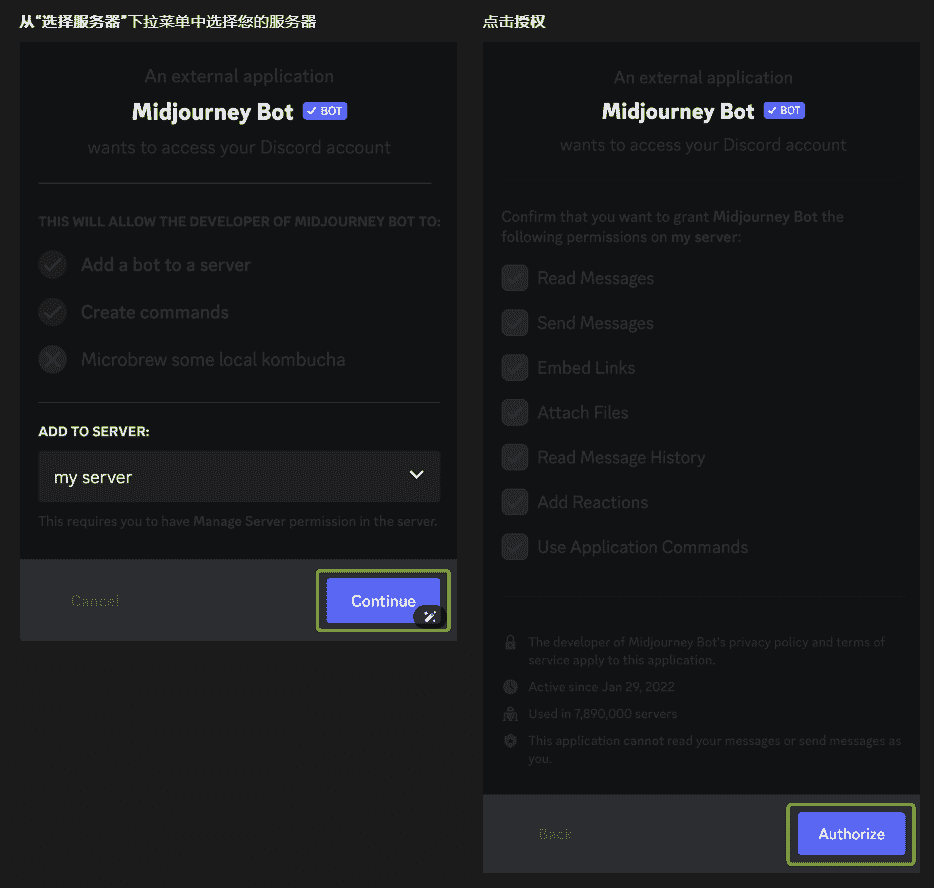
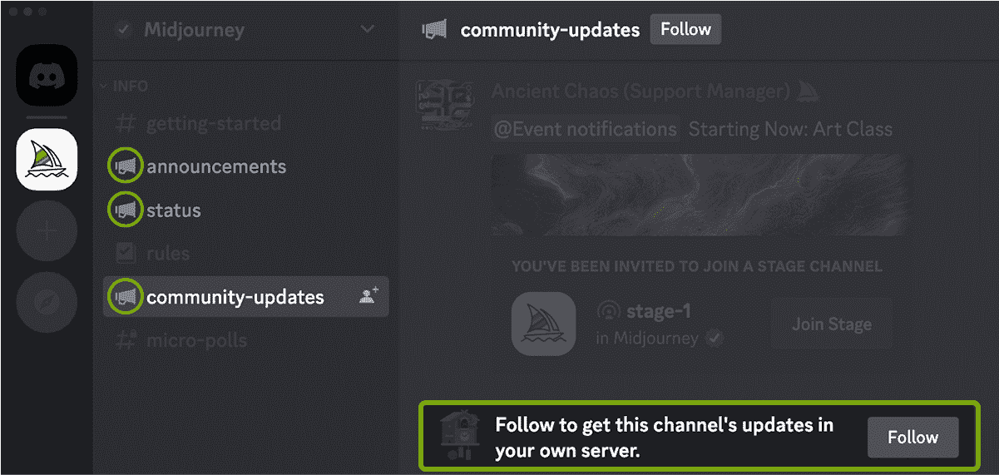

# 将MJ机器人添加到你的Discord服务器

> 来源：[https://my.feishu.cn/docx/BIaDd1lpjoR5U4x8IQlcDVLQnud](https://my.feishu.cn/docx/BIaDd1lpjoR5U4x8IQlcDVLQnud)

**将** Midjourney Bot 添加到任何 Discord 服务器以便与朋友一起创建，或者创建个人 Discord 服务器来组织您的工作。

+   在私人服务器上生成的 Midjourney 图像仍受 Midjourney社区准则的约束。

+   除非是在隐身模式下生成的，否则私人服务器上生成的图像仍然对midjourney.com上的其他用户可见。

+   [要在任何服务器中使用 Mi](https://docs.midjourney.com/plans)djourney Bot，您必须拥有有效的Midjourney 订阅。

## 创建您自己的服务器

创建自己的私人 Discord 服务器来整理您的工作、笔记和灵感非常简单。了解如何创建自己的 Discord 服务器。

## 添加应用程序

**从用户列表中**选择 Midjourney Bot，然后单击添加应用程序：

**您还可以使用Discord** 的应用程序目录中其页面Add to Server上的按钮将 Midjourney Bot 添加到服务器。

## 机器人管理

### 将机器人限制在特定频道

**如果您不希望** Mi**djou**rney **Bot 在特定**频道中**使用，请转到“编辑频道**”，选**择“权限****”选项卡，在“角色/成**员”下选择“@everyone”，然后取消选中“使用应用程序命令”。尝试在禁用这些权限的频道中使用 Midjourney Bot 的用户将看不到该命令。

如需更精细的控制，请转到**“设置”**，选择**“集成”**，**“权限”**选项卡，Mid**journey B**o**t 的 +，然后选择“管理**集成”。 slash command然后可以为各个角色和渠道设置权限。

### 获取服务器上的状态更新和公告

[关注您服务器上的 Midjo](https://discord.com/channels/662267976984297473/952771221915840552)ur[ney 官方 ](https://discord.com/channels/662267976984297473/942231458918064148)Discord #announcements、#community updates和#status频道，以随时了解 Midjourney 的最新动态。

<https://my.feishu.cn/sync/HDlcdCPBksnJpBbRk0EcW364nmc>