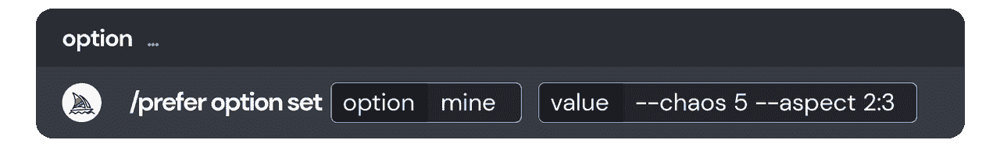
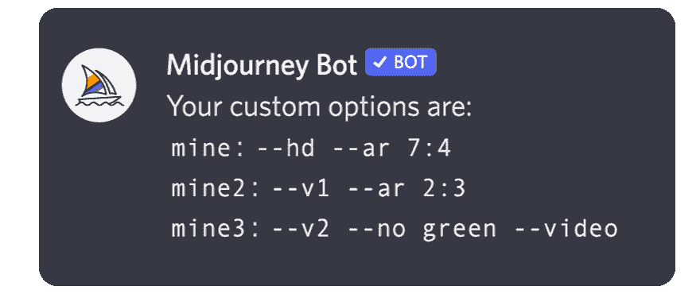

# Discord 中的设置和预设

> 来源：[https://my.feishu.cn/docx/QoBld507Qo2Qo6xguRQc3HQdnKb](https://my.feishu.cn/docx/QoBld507Qo2Qo6xguRQc3HQdnKb)

该/settings命令提供了常用选项的切换按钮，例如模型版本、样式值、质量值和升级版本。设置中还提供了/stealth和/public命令的切换按钮。

**添加到提示末尾的参**数将覆盖使用 做出的选择/settings。

---

### 模型版本下拉菜单

选择生成图像时要使用的**Midjou**rney 模型版本。使用最新模型是默认选择，将始终使用最新的 Midjourney 模型版本。

Use the latest Model (V6) 6️⃣ Mjourney Model V6 [ALPHA] 🌈 Niji Model V6 [ALPHA] 5️⃣ Mjourney Model V5.2 5️⃣ Mjourney Model V5.1 🍎 Niji Model V5 5️⃣ Mjourney Model V5.0 🌈 Niji Model V4 4️⃣ Mjourney Model V4 3️⃣ Mjourney Model V3 2️⃣ Mjourney Model V2 1️⃣ Mjourney Model V1

### 样式原始参数

Midjourney 模型版本 5.1[、5.2、6 和 Niji ](https://docs.midjourney.com/docs/models#model-version-52-style-raw-parameter)6 可以使用--style raw 参数进行微调，以降低 Midjourney 默认美感。如果选择了其他模型版本，则此切换不可用。

🔧 Raw Mode

### 风格化参数

Midjourney Bot 经过训练可以生成具有艺术色彩、构图和形式的图像。-- stylize 或 --s 参数会影响此训练的应用强度。低风格化值生成的图像与提示非常匹配，但艺术性较差。高风格化值生成的图像非常具有艺术性，但与提示的联系较少。

🖌️ Stylize Low 🖌️ Stylize Med 🖌️ Stylize High 🖌️ Stylize Very High

风格化低 = **--s 50**，风格化中 = **--s 100**，风格化高 = **--s 250**，风格化非常高 = **--s 750**，

### 公开和隐身模式

[在公开和隐身模式](https://docs.midjourney.com/stealth)之间切换。对应于**/public**和**/stealth**命令。

🧍‍♂️Public

### 混音模式

使用[Remix 模式](https://docs.midjourney.com/remix)在变体之间更改提示、参数、模型版本或宽高比。Remix 将采用起始图像的一般构图并将其用作新作业的一部分。Remix 可以帮助更改图像的设置或灯光、演变主题或实现复杂的构图。

🎛️ Remix

### 高低变化模式

[在高变化和低变化模式](https://docs.midjourney.com/variations)之间切换。

🎨 High Variation Mode 🎨 Low Variation Mode

### 粘性风格

[**粘性样式将保存**](https://docs.midjourney.com/style-tuner)[您个人后](https://docs.midjourney.com/style-tuner)**缀中使用的最后**一个--style代码参数，因此您不必在将来的提示中重复该代码。使用新的--style或取消选择粘性样式来更改代码。

📌 Sticky Style

### 涡轮、快速和放松模式

在Turbo、F**ast 和 **R**elaxe**d 模**式之间切换。**对应于/**turbo、/**f**ast、 和**/re**lax命令以及**--turbo、--fast、 和--relax参数。

⚡ Turbo Mode 🐇 Fast Mode 🐢 Relax Mode

### 重置设置

返回默认设置：。您的公开/隐身模式、混音、变化和生成速度偏好不受影响。Use the latest Model (V6) 🖌️ Stylize Med

Reset Settings

---

## 自动直接发送消息结果

用于**/prefer auto_dm**打开或关闭将已完成的作业自动发送到您的直接消息。

---

## 自定义首选项

使用首选命令创建自定义选项，以便自动将常用参数添加到提示的末尾。

+   **/prefer suffix**指定添加到每个提示末尾的后缀。

+   **/prefer option**创建或管理自定义选项。

+   /prefer option list查看您当前的自定义选项。

### 首选后缀

**/prefer suffix**在所有提示后自动附加指定的后缀。

命令示例：**/prefer suffix** --ar 16:9 --video

要清除设置后缀，请使用**/settings**命令并选择 Reset Settings，或**/prefer suffix**再次使用而不向命令添加可选的 new_value 字段。

### 选项集

/prefer option set <name> <value>命令允许您创建自定义快捷方式，向提示中添加多个参数或文本片段。

/**pref**e[r ](https://docs.midjourney.com/chaos)o[pti](https://docs.midjourney.com/aspect-ratios)on set mine --chaos 5 --aspect 2:3创建一个名为“我的”的选项，其中包含混乱和纵横比参数。

使用**/imagine prompt** vibr**ant California **p**oppies --mine，解释为/imagine pro**mpt vibrant California poppies --chaos 5 --aspect 2:3。

+   您可以在同一个提示中使用多个选项集。

+   您可以在选项集中混合使用提示文本和参数。如果这样做，则集合中的所有参数都必须放在最后，就像在正常提示中一样。

+   您的选项集将“扩展”其在提示中的位置，因此您需要将所有提示参数放在选项集之后。

/prefer option list列出所有创建的选项，prefer option set.用户最多可以有 20 个自定义选项。

要删除自定义选项，请使用/prefer option set <name to delete>而不将可选值字段添加到命令中。

<https://my.feishu.cn/sync/HDlcdCPBksnJpBbRk0EcW364nmc>