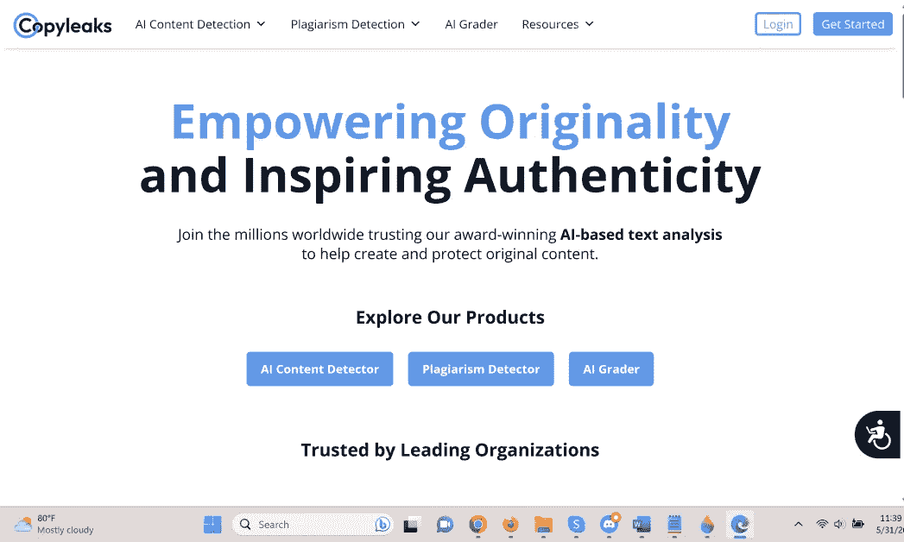
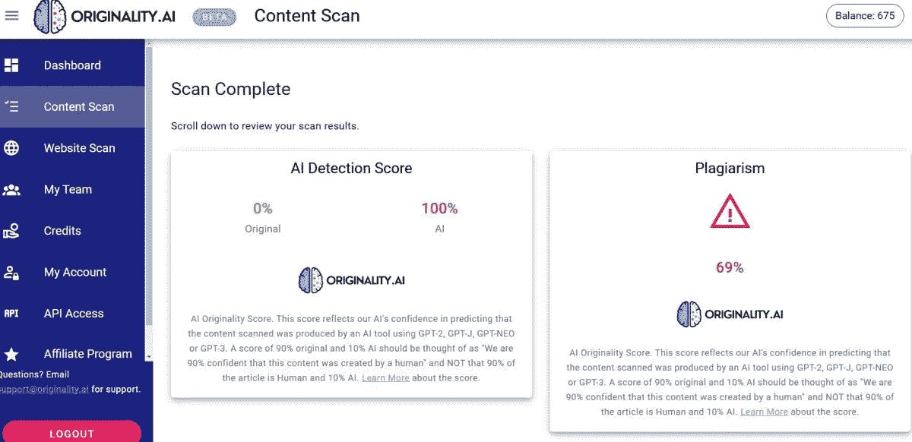
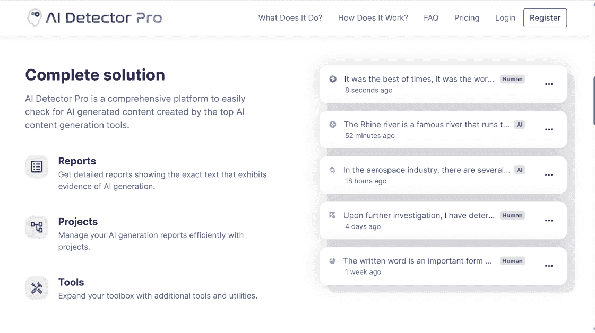
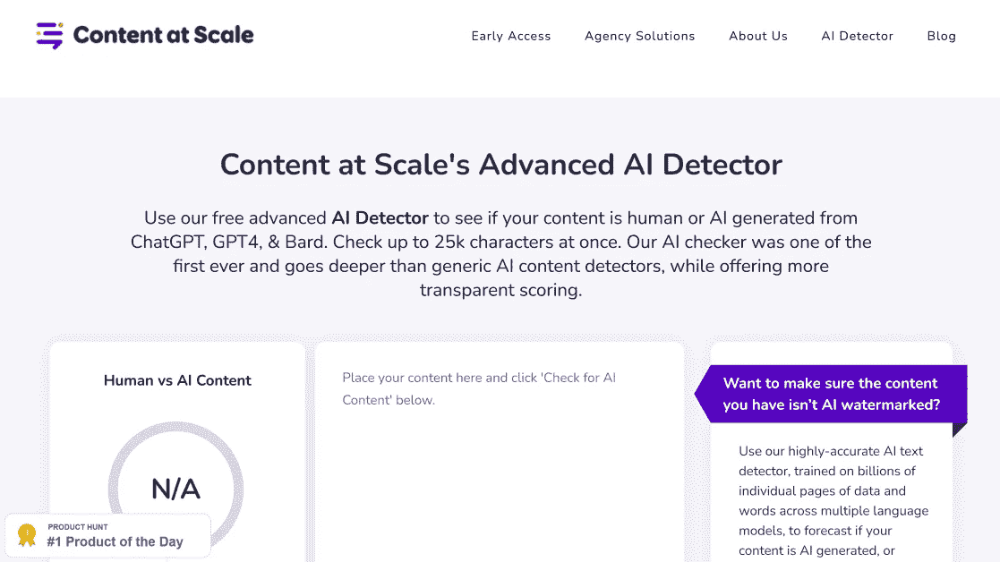
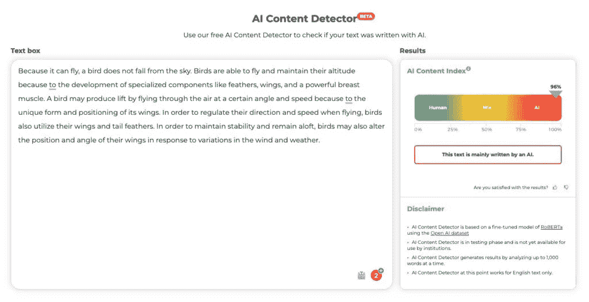
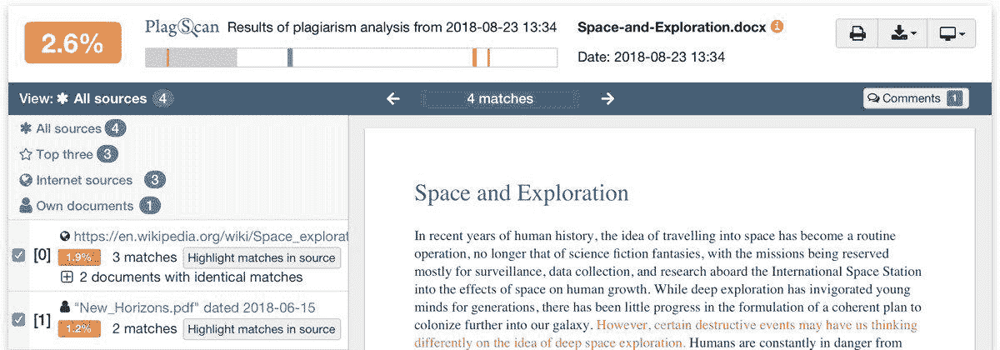

# AI写小说-7个“最佳”AI 内容检测工具

> 来源：[https://rq547mr4oez.feishu.cn/docx/HNz2d8DCIoCVGIxyBYpcMpFqnOc](https://rq547mr4oez.feishu.cn/docx/HNz2d8DCIoCVGIxyBYpcMpFqnOc)

### 前言

> **😎AI 时代来临，很多平台都开始**使用AI来检测，确保作品的原创性👀！

> **市场上有许多优秀的这种检测器，今天就分享一下**主流好用的7个。做到知敌之必，百战不殆！

> **目的：**

> 1、让你用AI生成的作品做个基本评估，再去投稿的时候心里有底~~

> **2、反向审核，优化AI生成不合适的**文案内容~~链接已经整理好，开箱即食~~

## 1. Copyleaks

> **Copy**leaks 是一款出色的人工智能内容检测器，它是一种人工智能驱动的抄袭检测工具，可通过扫描互联网和各种数据库中的重复内容来帮助用户确保其内容的原创性。 该平台支持多种文件格式和语言，使其成为内容创作者、教育机构和企业的多功能解决方案。 Copyleaks 还提供详细的相似性报告，强调潜在的抄袭问题并提供修改建议。

> **Co**pyleaks 的突出功能之一是其 API，它允许开发人员将抄袭检测功能集成到自己的应用程序和平台中。 这种灵活性使 Copyleaks 成为寻求构建自定义内容验证解决方案的公司的热门选择。

> 以下是 Copyleaks 的一些主要功能：

+   基于人工智能的互联网和各种数据库的抄袭检测

+   **支持多种文件格式和语言**

+   **详细的相似性报告以及修改建议**

+   供开发人员将抄袭检测集成到自定义应用程序中的 API

[**访问 Copyleaks →**](https://www.unite.ai/zh-CN/%E8%BD%AC%E5%88%B0/%E5%A4%8D%E5%88%B6%E6%B3%84%E6%BC%8F)

## 2. Originality

> **排名第一的另一个工具是 Originality，它是一种尖端的人工智能内容检测器，旨在识别重复内容、衡量文本的独特性并提供可操作的见解以提高写作质量**。该平台利用机器学习算法对内容进行全面分析，将其与庞大的来源数据库进行比较，以确保原创性。 AI 内容检测器还提供深入的相似性报告，突出潜在问题并提供改进建议。

> **除了**强大的抄袭检测功能外，Originality 还包括内容优化功能，例如替代措辞建议和提高可读性。该平台的用户友好界面和强大的分析功能使其成为寻求保持内容原创性和质量高标准的作家、教育工作者和出版商的宝贵工具。

> 以下是 Originality 的一些主要功能：

+   使用机器学习算法进行全面的抄袭检测

+   深入的相似性报告以及可操作的改进见解

+   内容优化功能，包括替代措辞和可读性的建议

+   **用户友好的界面和强大的分析**

[**访问Originality →**](https://www.unite.ai/zh-CN/%E8%BD%AC%E5%88%B0/%E5%8E%9F%E5%88%9Bai)

## 3. AI Detector Pro

> **AI** Detector Pro 是一个综合平台，可轻松检查由顶级 AI 内容生成工具创建的 AI 生成内容。 该平台每天分析ChatGPT、GPT 3、GPT 4和BARD的最新输出，以不断更新其识别算法。

> **它易于使用，只需几秒钟，检查您的内容，将其粘贴**或输入 URL，系统就会为您获取该内容。

> **它们提供以下功能：**

+   获取详细报告，显示展示人工智能生成证据的确切文本。

+   每份报告都给出了人工智能生成一段文本的可能性的置信度。

+   报告强调了哪些句子或措辞暗示使用人工智能。

+   通过项目有效管理您的 AI 生成报告。

+   使用其他工具和实用程序扩展您的工具箱。

访问 AI Detector  Pro →

## 4. Content at Scale

> **Co**ntent at Scale 提供了先进的 AI 检测器来验证您的内容是人类生成的还是 AI 生成的。 该工具能够检测来自 ChatGPT、GPT4 和 Bard 的内容。 一次最多检查 25000 个字符。

> **高精度 AI 文本检测器使用自然语言处理和经过训练的 AI 模型，利用 AI 来**检测模式、预测可能的单词选择，以及理解句子结构和其他导致更高 AI 概率的特征。

> **几秒**钟内即可知道您的内容读起来是否像是由人类编写的，或者听起来是否像是来自 AI（ChatGPT、GPT-4、Bard）等。所有内容都会给出 AI 概率分数，这使您能够对内容是否符合您的要求做出执行决定。

+   适用于多种用例，包括 SEO、学术、教育和营销内容。

+   一次最多检查 25000 个字符。

+   检测来自 ChatGPT、GPT4 和 Bard 的内容。

访问 Content at Scale  →

## 5. CrossPlag

> **CrossPlag 是一种先进的人工智能内容检测器，专注于识别和防止学术和专业写作中的抄袭行为。 该平台使用自然语言处理 (NLP) 和机器学习算**法来分析文本，将其与庞大的源数据库进行比较，并生成详细的相似性报告。 CrossPlag支持各种文件格式并提供用户友好的界面，使用户可以轻松检查其内容的原创性。

> **该人工智能内容检测器还提供内容优化功能，例如提高可读性和清晰度的建议。 这些附加**工具使 CrossPlag 成为保持内容创作的原创性和质量高标准的综合解决方案。

> 以下是 CrossPlag 的一些主要功能：

+   使用自然语言处理和机器学习算法进行高级抄袭检测

+   详细的相似性报告可轻松识别潜在的抄袭问题

+   内容优化功能，例如提高可读性和清晰度的建议

+   支持多种文件格式和友好的用户界面

[**访问 CrossPlag →**](https://crossplag.com/)

## 6. Plagscan

> **Plagscan 是一款人工智能驱动的抄袭检测工具，可提供快速、准确的文档分析，确保内容的原创性。 该平台支持各种文件格**式，适合广泛的用户，包括学生、教师和内容创作者。 Plagscan 提供深入的报告，强调潜在的抄袭问题，并提供改进建议。

> **该**平台还具有 API，允许与其他软件和应用程序集成，使其成为希望将抄袭检测纳入其工作流程的企业和教育机构的灵活解决方案。

> 以下是 Plagscan 的一些主要功能：

+   **快速准确的人工智能抄袭检测**

+   深入报告强调潜在的抄袭问题并提供改进建议

+   支持各种文件格式并通过 API 与其他软件和应用程序集成

+   适合广泛的用户，包括学生、教师、内容创作者

[**访问Plagscan  →**](https://www.plagscan.com/)

## 7. [Quetext](https://www.quetext.com/)

> **Qu**etext 是一款人工智能驱动的抄袭检测和引文辅助工具，旨在帮助作家、教育工作者和学生确保其作品的原创性。 该平台使用先进的算法将文本与数十亿来源进行比较，为用户提供详细的相似性报告并突出显示潜在的抄袭情况。

> **Qu**etext 提供引文助手功能，帮助用户创建准确的引文并轻松管理其参考书目。 该平台的用户友好界面和全面的功能使其成为任何希望在写作中保持高标准原创性和正确引用的人的绝佳选择。

> 以下是 Quetext 的一些主要功能：

+   先进的抄袭检测算法，将文本与数十亿来源进行比较

+   详细的相似性报告，其中突出显示了潜在的抄袭情况

+   引文助手功能用于创建准确的引文和管理参考书目

+   为作家、教育工作者和学生提供友好的用户界面和全面的功能

[**访问Quetext →**](https://www.quetext.com/)

## 总结

人工智能驱动的内容检测器正在成为作家、教育工作者和出版商不可或缺的工具，以确保其内容的原创性和质量。 通过利用先进的算法和广泛的数据库，这些工具可以快速准确地识别重复内容，提供可操作的见解，甚至提供内容优化建议。