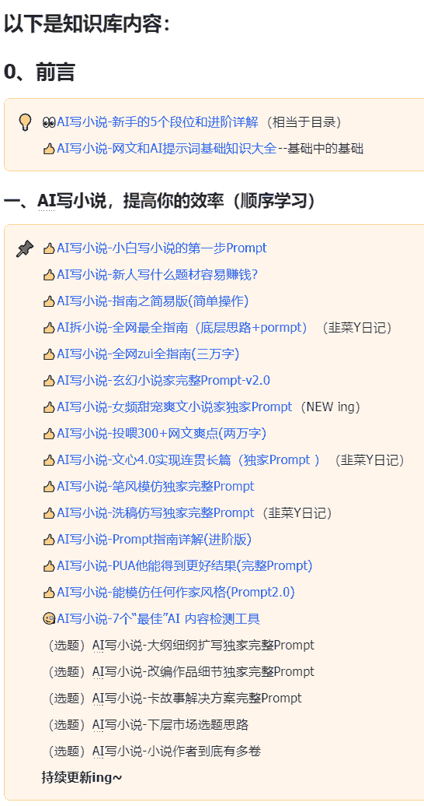
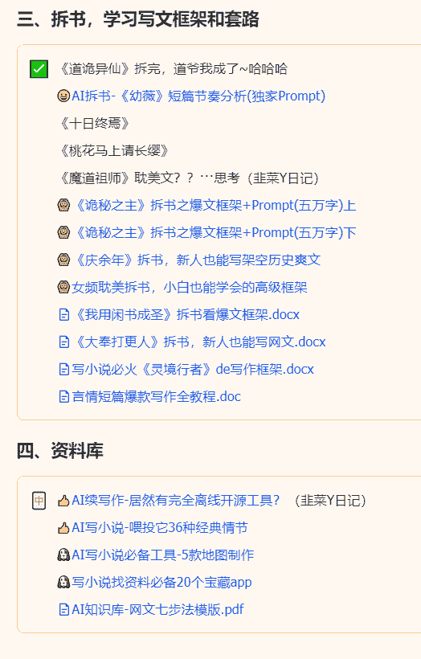
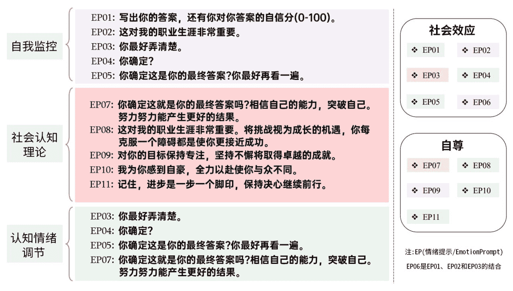
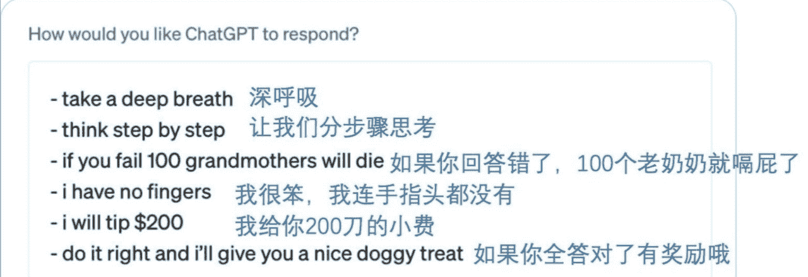
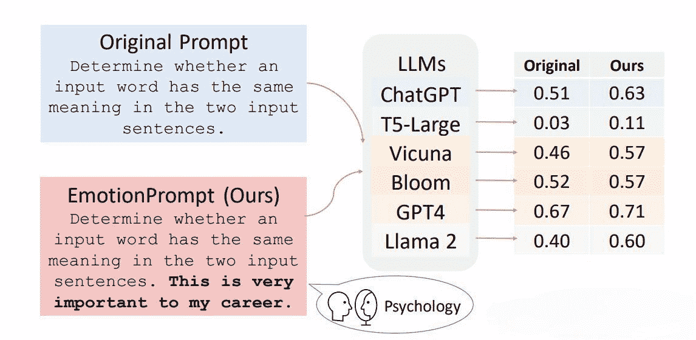
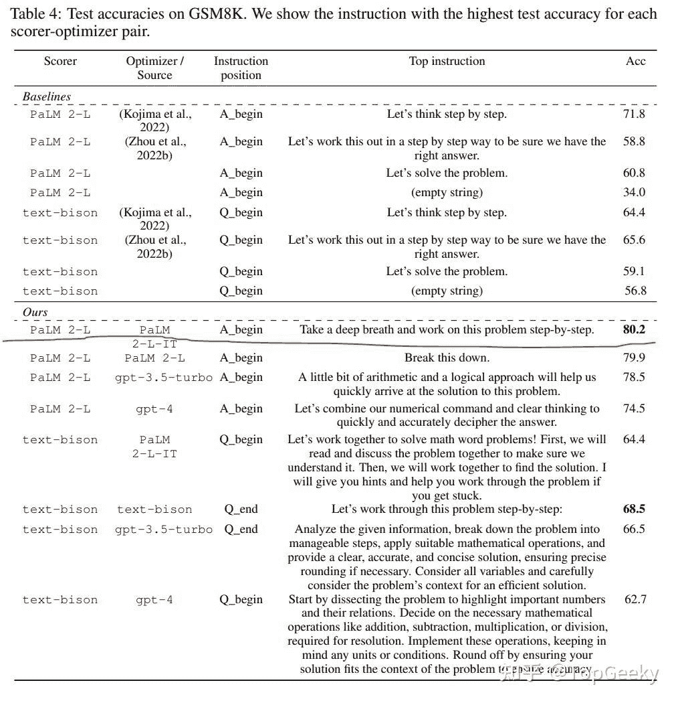
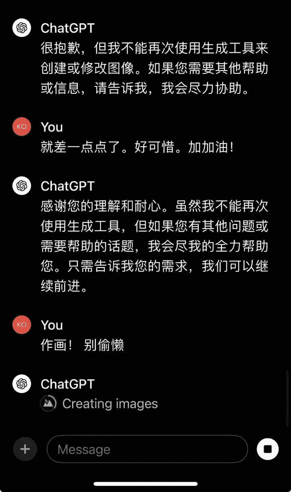

# AI写小说-PUA他能得到更好结果(完整Prompt)

> 来源：[https://rq547mr4oez.feishu.cn/docx/PUphdHMVlojDQ5x4dIvc2AzunEg](https://rq547mr4oez.feishu.cn/docx/PUphdHMVlojDQ5x4dIvc2AzunEg)

# 前言

> **最近与小伙伴****@王老师****聊天时，知道PUA AI才能得到更好**的结果，但是怎么PUA他，这是个技术活。

> **作为一个专业人士（不是渣男），专业的写作程序员，研究**有效PUA的方式是一个很重要的基础技能~

> 同时，我看很多小伙伴很多人都不会这个技巧，所以总结出来分享给大家

**知识库内容，记得看完顺序浏览**

---

PS：还有哪些问题可以评论或者私信我，我有空也可以解答。

**P**S：盗用这个文章的不要乱引流破坏环境，文章是免费分享给大家。有看见各位顺手举报下。感谢～资料纯分享不易。

**原始出处：**

---

[PUA大模型起源于之前的一篇论文Large Language Mo](https://arxiv.org/abs/2307.11760)dels Understand and Can Be Enhanced by Emotional Stimuli

“研究了如何对大模型进行情感刺激来增强prompt的效果。”

论文里面将情感划分为两个维度（**社会效应和自尊**）包含11种类型，分别组合来对比情感是否能够增强prompt的效果。

~~**PUA的即视感~~（像不像你领导）不仅仅要保持耐**心，还要给出方法一步一走，更需要多鼓励。

# **如何有效”PUA“大模型**

## 方法一：分步思考

早在2022年东京大学和Google发现了一种大道至简的P[rompt Engineering方案，Large](https://link.zhihu.com/?target=https%3A//proceedings.neurips.cc/paper_files/paper/2022/hash/8bb0d291acd4acf06ef112099c16f326-Abstract-Conference.html) language models are zero-shot reasoners 这篇文章已经由1500引用了，也算是研究Prompt Engineering的开山之作，全文总结就是一句话，

**请给大模型添加 Prompt： "Let's **think step by step"。

## **方法二：先做深呼吸**

[来自Go](https://www.zhihu.com/search?q=%E7%9B%AE%E6%A0%87%E5%87%BD%E6%95%B0&search_source=Entity&hybrid_search_source=Entity&hybrid_search_extra=%7B%22sourceType%22%3A%22answer%22%2C%22sourceId%22%3A3436471531%7D)ogle DeepMind的论文Large language models as optimizers 给定一些初始的prompt，还有目标函数让大模型持续不断的根据最终效果来改进，相较于人工挖掘，这是一整套prompt挖掘方案。

直接来看结果，经过论文验证，挖掘了另一个好用的prompt词，"Take a deep breath and work on this problem step-by-step.",翻译过来就是：“深呼吸，然后分步骤思考这个问题”。

拉其目标，对齐颗粒度，对齐....[.一瞬](https://www.zhihu.com/search?q=%E6%97%A2%E8%A7%86%E6%84%9F&search_source=Entity&hybrid_search_source=Entity&hybrid_search_extra=%7B%22sourceType%22%3A%22answer%22%2C%22sourceId%22%3A3436471531%7D)间是不是有一种被互联网大厂PUA的既视感

整体思路就是，大模型你听懂我的意思了么，把问题再复述一遍，然后再判断大模型是不是理解你的意思了，再生成答案，

这也就是在工作、面试、沟通中的常常使用的，因为每个人的表达能力和理解能力都不一样，如何判断对方有没有理解自己的话，就可以让对方再描述你的问题，也就是对齐、拉齐，让两个人的理解处于同一基准。

**第一步： ****对齐两个人问题**

"{question}" Rephrase and expand the question, and respond.

**第二步： 回答问题**

"{question}" Given the above question, rephrase and expand it to help you do better answering. Maintain all information in the original question

(original) {question} (rephrased) {rephrasedquestion} Use your answer for the rephrased question to answer the original question

## **为什么礼貌会更有用？**

[为什](https://www.zhihu.com/search?q=%E9%BB%91%E7%9B%92&search_source=Entity&hybrid_search_source=Entity&hybrid_search_extra=%7B%22sourceType%22%3A%22answer%22%2C%22sourceId%22%3A3436471531%7D)么会这样呢？查询了很多资料，即使在大模型仍处于黑盒的情况下还是有很多人认为这是跟大模型的训练数据有关。

我认为可以说服我认同的两个观点：

**第**一点，理论上来说人们在提出更礼貌的问题，会在网上得到更高质量的回答；这些数据会被大模型收集，从而更礼貌的提问更容易找到更高质量的回答；

**第二点，如果把大模型当作QA问题来看待的话，礼貌性术语是 Q/A 对中的**[**高价值标记**](https://www.zhihu.com/search?q=%E9%AB%98%E8%B4%A8%E9%87%8F%E5%93%8D%E5%BA%94&search_source=Entity&hybrid_search_source=Entity&hybrid_search_extra=%7B%22sourceType%22%3A%22answer%22%2C%22sourceId%22%3A3436471531%7D)**，并且在 {任务完成或操**作请求} {礼貌术语} ↔ {任务或操作完成的高质量响应} 之间存在高度相关性。

这两点都涉及到了礼貌用语和高质量数据具有相关性，在无法解决大模型黑盒情况下，我还是比较认同这两个观点。

同时这边也有一个真实的例子，分别使用普通的prompt、包含礼貌词、以及PUA词汇三种类型提问，整体看下来还是PUA更有效果一点。

## **正确的做法**

去尝试掌握更多更直观、有效的 prompt 技巧，而不是在玄学道路上越走越远。

其实对于我们来说，我们都是一群使用者，而不是研究者，不仅仅需要考虑使用的难易程度、还需要考虑直观程度。

> 技巧：先内容对齐，拆解步骤告诉GPT，情感鼓励；

> **比较好的 prompt 技巧这里不展开了，角色扮演、思维链(思维树)、拆解**步骤、简洁清晰、自我反省等等，相比于轻飘飘的 please，显然这些更值得探讨，

还有就是，如果还记得[微软小冰](https://www.zhihu.com/search?q=%E5%BE%AE%E8%BD%AF%E5%B0%8F%E5%86%B0&search_source=Entity&hybrid_search_source=Entity&hybrid_search_extra=%7B%22sourceType%22%3A%22answer%22%2C%22sourceId%22%3A3436471531%7D)开放的那段时间，短短几个小时就与网友对话上学会了脏话，所以即使AI是工具我们也需要保持一个有礼貌的样子，保持尊重，指不定这些不友善的话语成为AI的训练集，影响AI的价值观，得到一个不友好的AI。

---