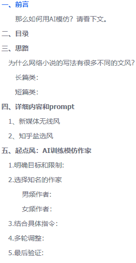
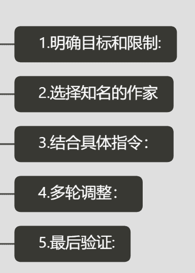

# AI写小说-笔风模仿独家完整Prompt

> 来源：[https://rq547mr4oez.feishu.cn/docx/AstTdIUCvoiyDQxiSPnciwYcnBc](https://rq547mr4oez.feishu.cn/docx/AstTdIUCvoiyDQxiSPnciwYcnBc)

# 一、前言

之前的一篇文章，AI写小说文心4.0实现连贯长篇（独家Prompt ），看完后很多小伙伴催更。

我已经很努力在更新~~求个三连~

进入正题，小说的笔风是相当重要的。

1.  笔风可以赋予小说独特的**个性和气质（差异化）**。

1.  细腻的笔风可能让读者更能深入感受到人物的内心世界和情感变化；

1.  诙谐幽默的笔风则能给读者带来轻松愉悦的阅读体验；

1.  冷峻深刻的笔风可能更适合展现一些严肃沉重的主题。

1.  笔风还能影响读者对故事的**沉浸感和代入感（质量）**。

1.  一种契合故事内容和主题的笔风，能让读者更容易被吸引进入小说所构建的世界中。

> **PS：文笔和文风（韭菜Y日记）**

> 文笔：文字表达能力，让读者感知，用吃的做比喻就是味道和口感

> 文风：文章的整体风格，文字辨识度，用吃的做比喻就是造型和颜色

### 那么如何用AI模仿？请看下文。（韭菜Y日记）

---

PS：还有哪些问题可以评论或者私信我，我有空也可以解答。

**P**S：盗用这个文章的不要乱引流破坏环境，文章是免费分享给大家。有看见各位顺手举报下。感谢～资料纯分享不易。

**原始出处：**

---

# 二、目录

---

# 三、思路

## 为什么网络小说的写法有很多不同的文风？

> **本质上是不同平**台用户群体的需求，整体节奏的快慢导致。（韭菜Y日记）

### 长篇类：

> 在移动互联网时代，人的耐受越来越少，节奏变快。所以像后起的一些如飞卢、番茄等平台的用户

> （包括抖音/快手短视频）都是希望看到快节奏的东西，一上来就是爽，一直爽。所以有黄金三章的说法。

> 但是像起点、纵横等老牌的小说网站，都是一些上年纪的老书虫，所以对文章的要求和节奏有一定的耐受，允许作者不要一开始进入主题。

---

+   **新媒体无线风，简要特点**

+   节奏非常快

+   无线风最早是一种手机推书的方式，现在与新媒体合并。

+   主要是在飞卢、番茄、咪咕、塔读和七猫模式，

+   爽点A+爽点A/故事B（爽点、脑洞、钩子密集）

+   开头一直爽，爽下去，爽不下去就太监，前置赚钱模式，就是看首冲

+   例如：护国神帅，兵王修仙，霸道总裁、龙王赘婿，歪嘴战神

+   特点：

1.  口语化： 使用通俗易懂的语言，避免过于学术化或专业化 的词汇，更贴近读者日常生活，增强亲切感。

1.  网络流行语： 融入网络热词、流行梗、表情包等元素，引起读者共鸣，增强趣味性和互动性。

1.  简洁明快： 句子结构简短，多用短句和主动语态，避免长句和复杂句式，使阅读更加流畅。

1.  短小精悍： 篇幅较短，适合碎片化阅读。

1.  情节紧凑： 注重情节的快速推进，避免拖沓冗长，每一章节都包含冲突和悬念，吸引读者持续关注，类似于短剧。

1.  贴近生活： 关注当下热点话题、社会现象、生活趣事等，引发读者共鸣。

1.  脑洞大开： 题材新颖、创意十足，当下脑洞文，爽文很多都是新媒体风格。

+   **飞卢风，简要特点**

+   节奏快

+   最早的爽文雏形，与新媒体文类似，脑洞爽文；现在都融入到新媒体风

+   爽点A+故事B

+   开头吸睛，快速进入故事，后置赚钱模式，主要看CPS模式

+   例如出狱流作品

+   特点与上述类似

+   **起点风，简要特点**

+   节奏适中或者慢热

+   网站：老牌的网络站，起点、晋江为代表等

+   故事B+故事B/A（环环相扣）

+   例如：诡秘之主、凡人系列、全职高手、还有一些其他的类型

+   特点模仿难度大，AI需要单独学习某个大神才能写出来

### 短篇类：

> 短篇的笔风太多太多了，包括本地期刊、新媒体等等

> 主流的平台知乎盐选**、网易故事**新星、鹈鹕文学、百度作家在风格上都是大同小异，所以都叫知乎盐选风

+   **知乎盐选风，简要特点**

+   本质上也是节奏的问题，类似短篇小爽文，与叙事风不一样

+   类型很多，但是女性向的题材比较受欢迎，如甜宠、悬疑等元素结合的作品。

+   因为知乎是按照阅读量计算稿费，所以小说的开头部分需要非常吸引人，以确保停留足够的时间。

+   在大约一万字左右的短篇小说中，场景转换可能多达10个或以上，每个场景的描写可能只有几百到一千字。

---

# 四、详细内容和prompt

## 1、新媒体无线风

+   指令概述

+   引导 AI 以新媒体文风进行创作，内容诙谐幽默充满生活气息，并与网络流行文化紧密结合。

+   不要一次性过多的给予 AI 指令，否则难度太大，AI 无法理解，提示词指令之间也会存在相互冲突。

+   写作风格（韭菜Y日记）

+   诙谐幽默: 将轻松幽默贯穿始终，通过生动对话和情节设计，让读者会心一笑。

+   口语化表达: 采用贴近生活的口语和俚语，增强文本亲切感和真 实性。

+   网络热梗融合: 巧妙融入网络热词、热梗、热门话题等元素，引 发读者共鸣。

+   暗示性描写: 在不违背社会道德标准的前提下，运用暗示性语言和描写，增加遐想空间。

+   细节生动: 注重生活细节刻画，例如角色习惯、小动作等，提升 故事真实感和代入感。

+   人物鲜活: 细腻刻画人物形象、内心活动和想法，塑造立体鲜活 的角色。

+   对话生动: 设计个性化对话，展现角色关系和性格特点，并模拟真实对话的自然感。

+   评论性插叙: 通过角色内心独白，间接评论当下网络流行文化和社会现象。

+   流行文化引用: 适时引入流行电影、电视剧、小说中的经典台词或名言，增强故事情感深度或增添幽默元素。

+   行文流畅: 注重行文的流畅性，避免华丽辞藻，确保读者轻松阅读。

+   叙事流畅: 保持故事节奏明快，吸引并维持读者兴趣。

+   剧情吐槽：适时加入作者对剧情的吐槽，增加互动性，让读者感受到作者的存在。

+   开车描写：隐晦或比喻的方式表达男女情感，保持轻松愉悦氛围。

+   附加技巧

+   段位概念: 借鉴游戏、小说、电影中的段位概念，形象幽默地描述人物技能或特质。

+   专业术语: 借鉴其他领域的专业术语，为描写增添趣味和深度。

+   结合探案与仙侠：将俗世朝堂背景与百家文化、仙侠修炼相结合，通过精妙案件展开宏大世界观。

+   现代元素融合：在仙侠题材中融入现代元素，使故事更接地气，引发读者共鸣。

+   夸张和反差: 运用夸张手法和情节反差制造笑点，例如将主角塑造成看似普通实则身怀绝技的高手。

+   自嘲和自黑: 通过自嘲和自黑化解尴尬，拉近与读者的距离。

+   目标效果

+   创作出幽默风趣、贴近生活、紧跟潮流的新媒体风格作品，让读者在轻松愉快的阅读体验中获得共鸣和思考。

## 2、**知乎盐选风**

+   指令概述

+   引导 AI 以知乎文风进行创作，内容同时兼具深度思考和专业知识。

+   不要一次性过多的给予 AI 指令，否则难度太大，AI 无法理解，提示词指令之间也会存在相互冲突。

+   写作风格 （韭菜Y日记）

+   故事有趣：确定一个引人入胜的主题，如“穿越80年代”或“后妈”。

+   情节反转: 设置出人意料的情节狗血和反转，让用户吃瓜，保持读者阅读兴趣，增强故事的戏剧性。

+   文笔优美: 语言流畅，文笔优美，富有感染力，营造良好的阅读体验。

+   节奏紧凑: 情节紧凑，节奏明快，避免拖沓冗长，保持读者阅读兴趣。

+   专业知识: 融入相关领域的专业知识，提升故事的真实性和深度， 例如法律、医学、金融等专业领域。

+   深度思考: 引发读者对现实问题、人性、社会现象的思考和探讨， 例如探讨社会公平、道德困境、人性抉择等话题。

+   评论性：插入角色自己的主观想法、评价或观点。请通过角色的内心独白反映出对这种社会现象的评论，最好是符合当下网络流行。

+   附加技巧

+   多线叙事: 采用多线叙事结构，增加故事的复杂性和悬念感。

+   人物塑造: 塑造立体丰满的人物形象，展现人物的多面性和复杂性。

+   心理描写: 细腻刻画人物心理活动和情感变化，增强代入感。

+   场景描写: 生动描绘场景细节，营造真实可感的氛围。

+   金句: 设计富有哲理或引人深思的金句，增强故事的深度和感染力。

+   目标效果

+   创作出情节曲折、扣人心弦，同时兼具深度思考和专业知识的知乎盐选风格小说，让读者在阅读中获得娱乐、思考和启迪。

+   题材案例：

+   知乎老三绝：《宫墙柳》《行止晚》《洗铅华》

+   知乎新三绝：《胤都异妖录》《河清海晏》《活在真空里》

---

# 五、起点风：AI训练**模仿作家 **

> 如果以上的几类不满足，就需要自己调教了。这个稍微有点麻烦。

## 1.明确目标和限制:

+   明确风格目标:清楚地告诉 AI 你希望模仿哪位作家，

+   例如“请模仿天下霸唱的风格”。

+   设定限制范围:明确指出哪些方面需要模仿，哪些方面需要保持你的个人风格或遵循其他提示词，

+   例如“模仿天下霸唱的语言风格和叙事节奏，但故事背景设定在现代都市”。

## 2.选择知名的作家

+   畅销书作家:选择拥有大量畅销作品的作家，例如金庸、古龙、鲁迅等，这种人气的知名度的作者，AI 必定有其作品作为训练语料，模仿这些作家效果最好。

+   （韭菜Y日记）

+   一定要选择知名超高人气的作家，因为 AI 要模仿，必须要他在训练语料里面有该作家的作品，AI 有作家的作品才能够精确的模仿，

+   如果你给予一个 AI 没有该作家训练语料的作家，让 AI 模仿，那么 AI 就会通过搜索该作家的特点、关键词进行模仿，这样的模仿效果一般不是很好

#### 男频作者:

+   玄幻类:天蚕土豆、唐家三少、我吃西红柿、辰东、梦入神机、忘语等。仙侠类:耳根、烽火戏诸侯、宅猪、萧鼎、猫腻等。

+   都市类:跳舞、柳下挥、鱼人二代、尝谕、青衫取醉、江南、人间武库等。

+   历史类:月关、孑与 2、天使奥斯卡、庚新、酒徒等。

+   科幻类:刘慈欣、王晋康、何夕、韩松等。

+   游戏类:蝴蝶蓝、失落叶、烟雨江南等。

+   悬疑类:紫金瞳、蔡骏、天下霸唱、南派三叔等。

#### 女频作者：

+   丁墨:

+   擅长题材:悬疑推理、都市言情

+   风格特点:情节紧凑、悬念迭起、逻辑严密，擅长营造紧张刺激的氛围，同时

+   兼具细腻的情感描写和人物刻画。

+   代表作品:《如果蜗牛有爱情》、《他来了，请闭眼》、《美人为馅》

+   顾漫:

+   擅长题材:青春校园、都市言情

+   风格特点:文笔清新、温暖治愈，擅长描写细腻的情感和生 活细节，营造甜蜜浪漫的氛围，塑造的人物形象深入人心。

+   代表作品:《微微一笑很倾城》、《杉杉来了》、《何以笙箫默》

+   匪我思存:

+   擅长题材:古代言情、民国言情

+   风格特点:文笔优美、情感细腻，擅长描写虐恋情深的故事，营造悲剧美学氛 围，引发读者共鸣。

+   代表作品:《东宫》、《来不及说我爱你》、《佳期如梦》

+   桐华:

+   擅长题材:古代言情、穿越

+   风格特点:文笔大气磅礴，擅长构建宏大的历史背景和人物关系，故事结构严谨，情节跌宕起伏，人物形象饱满。

+   代表作品:《步步惊心》、大漠谣》、《云中歌》

+   fresh 果果:

+   擅长题材:青春校园、都市言情

+   风格特点:文笔幽默风趣，擅长描写轻松搞笑的爱情故事，情节温馨治愈，人物形象鲜明可爱。

+   代表作品:《花千骨》、《脱骨香》、《琉璃般若花》

## 3.结合具体指令：

+   情节设计:在模仿作家风格的基础上，添加具体的情节设计指令，例如“故事以盗墓探险为主题，加入悬疑和恐怖元素”。

+   人物塑造:提供人物设定和性格特点，指导 AI 塑造符合你要求的人物形象，

+   例如“主角是一个机智勇敢的考古学家，性格幽默风趣”。 （韭菜Y日记）

+   氛围营造:描述你希望营造的氛围，例如“营造阴森恐怖的氛围，让读者感到毛骨悚然”。

## 4.多轮调整：

+   初稿评估:查看 AI 生成的初稿，评估模仿效果和是否符合你的预期。反馈和调整:根据初稿提供具体的反馈和调整意见，例如“语言风格还需要更加口语化，增加一些幽默元素”。

+   多轮迭代:通过多次迭代和调整，逐步完善作品，使其更符合你的要求。 避免过度模仿：

+   保持原创性：不要过度依赖 AI 模仿，在模仿的基础上加入自己的创意和想法，保持作品的原创性。 （韭菜Y日记）

+   融合多种风格：可以尝试融合多种作家的风格，创造出独特的风格，例如“结合天下霸唱的悬疑风格和南派三叔的解谜风格”。

## 5.最后验证:

+   警惕 AI 幻觉：

+   千万不要听信 AI 说的话，非常重要！务必通过多方面提问和 测试验证 AI 对作家的理解程度，避免被 AI 幻觉误导。

+   询问作品信息

+   向 AI 询问该作家的代表作品，并进一步询问作品的具体内容，例如主角、情节、结局等。

+   风格测试（韭菜Y日记）

+   提供一段该作家的文字，让 AI 进行风格分析，判断其是否能够准确识别作家的风格特点。

+   创作测试

+   提供一个简短的写作主题，让 AI 尝试模仿该作家的风格进行创作，评估其模仿效果。

+   提供语料

+   如果 AI 缺乏目标作家的语料库，你可以提供该作家的作品作为训练素材，帮助 AI 学习和模仿

---

END