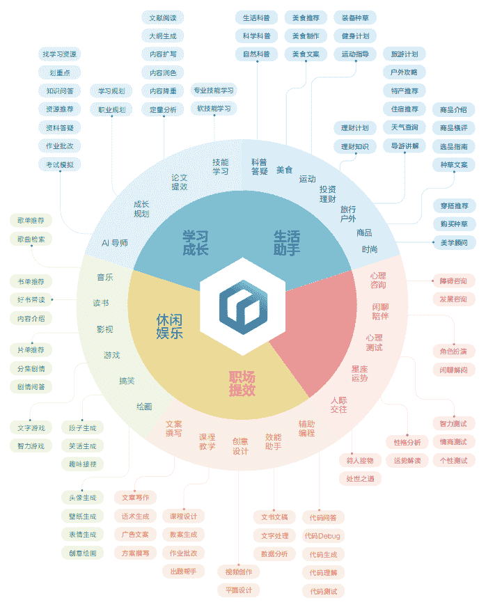
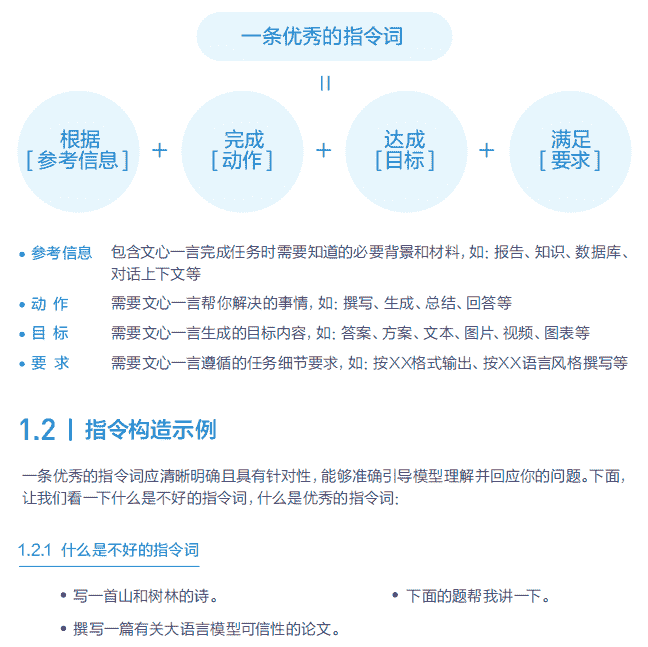
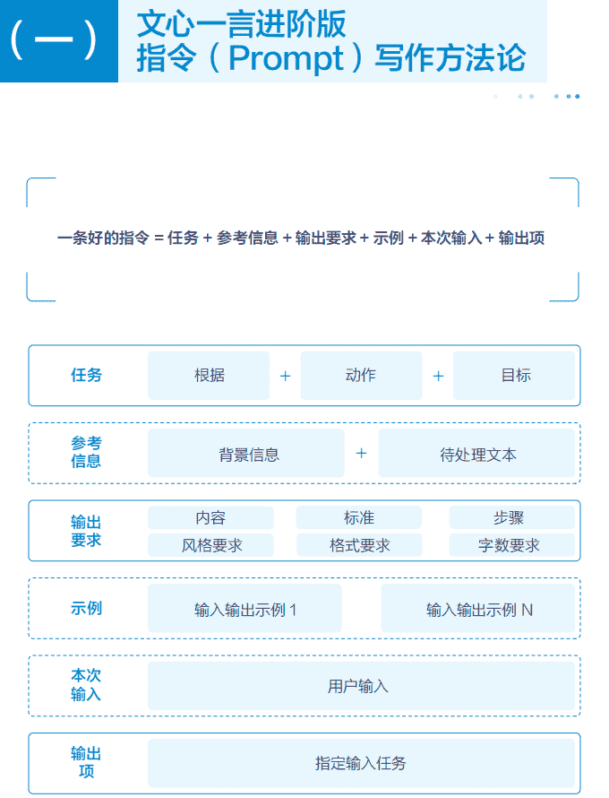
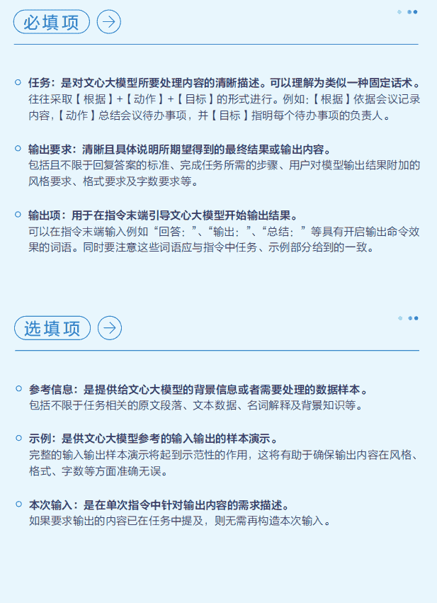
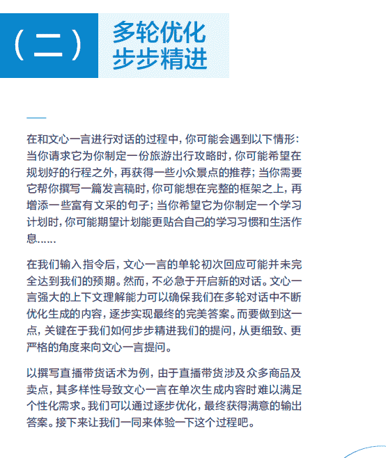
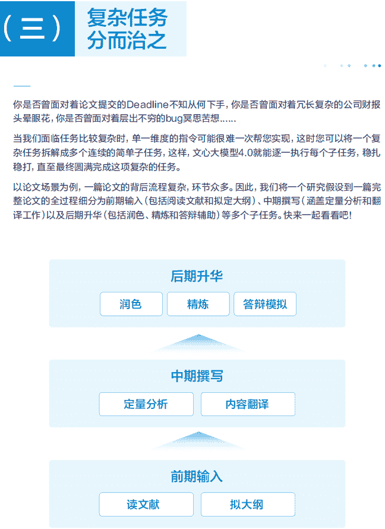

# AI写小说-文心4.0实现连贯长篇（独家Prompt ）

> 来源：[https://rq547mr4oez.feishu.cn/docx/JKpudnGiRolWSvxzfYncbLUEnCc](https://rq547mr4oez.feishu.cn/docx/JKpudnGiRolWSvxzfYncbLUEnCc)

# 一、前言

之前的一篇文章，[ AI 写小说全网最全指南(三万字) ](https://rq547mr4oez.feishu.cn/wiki/AGN5w9IXeiQvPbkcvHgc3mpynzc?from=from_copylink)，很多小伙伴实操之后遇到的最大的问题：

> AI写小说，如何实现长篇上下文的连贯？

**大家当前所采用的方案是：**

**先让 AI 写出一篇大纲，然后进行拆解，再让 AI 写出一**章一章的思路，最后通过扩展来完善每一章。

**说**实话，凭借这种思路去实现 AI 创作长篇小说，真的非常困难，即便进行了本地部署+训练模型之后，依旧会存在问题。

那怎么办？通过我最近的研究经验，以及和很多圈子、小伙伴的交流沟通。

**找到了几类方法，虽不能保证100%解决**这个问题，但是，至少能够解决80%以上。

（韭菜Y日记）

**PS：下一期预告：AI如何模仿文风(如知乎盐选风**/幽默仙侠风/新媒体文风/知名作家风)。

**不知道大家感不感兴趣？**

**点赞关注收藏是动力哦~。**

---

PS：盗用这个文章的不要乱引流破坏环境，文章是免费分享给大家。有看见各位顺手举报下。感谢～资料纯分享不易。

原始出处：

---

# 二、工具篇

### 很多小伙伴问我，用什么AI工具来写小说？

> **和几个小伙伴实测下来，文心大模型 4.0** 在这块其综合能力与 GPT-4 持平。

> **重要的是国内畅玩、性价比高啊。**

**文**心大模型 4.0 核心能力如下，同时应用场景主要体现在：学习成长、情感陪伴、休闲娱乐、职场提效、生活助手

### 在这里给大家科普一下 Prompt

有些小伙伴对它的理解简直就是过于简单和粗暴，指令怎么写完全不知道。

引用《文心一言指令词宝典》解释：

PS：**掌握方法比案例更加重要。文档里面还有很多优质P**[**romp**](https://pan.quark.cn/s/5d72738a9528)**t**可以参考，需要指令宝典的说话，链接直达。

---

# 三、思路篇

> 目录：

> 洗稿仿写 （效率S，质量A，风险SSS）

> 模块化框架 （效率B，质量B，风险B）

> 热门影视改编（效率B，质量B，风险B）

> 同人改编 （效率C，质量B，风险C）

---

## 1、洗稿仿写 （效率S，质量A，风险SSS）

首先，这个方案效果很好，也很省时间。

但是，这个方案因为风险比较大，而且目前各大平台正在打击的，所以具体操作流程我就不写了。

**感兴趣的小伙伴后面单**独在单独出一篇详细的Prompt实操教程。（韭菜Y日记）

## 2、模块化框架 （效率B，质量B，风险B）

就是选择一本优秀的作品，比如**大奉打硬人，闺蜜之足（笑~）**，通过提炼这部作品的每一章节结构框架，

然后再通过AI把框架进行描写出来，最后把 100 章的框架内容扔给文心4.0，那么实现上下文连贯的可能性就非常高。

而且最后出来的质量也不错，因为你的框架结构是拆解的优秀作品，远比AI或你自己写的更加出色。

## 3、热门影视改编（效率C，质量A，风险B）

这个方案是之前一个小伙伴提供的思路。

**可**以通过改编优秀的悬疑或高智商烧脑作品，例如《盗墓笔记》系列、《加勒比海盗》等电影，让 AI 给你改编成仙侠版，玄幻版，亦或者诡异版本。

改编好的剧情 可以直接当做你小说中的一个地图或者副本。（韭菜Y日记）

+   比如你写诸天（韭菜Y日记） 万界，那么完全就可以一个副本是一部电影，那么你通过 AI 帮你进行改编,你就可以得到一个原创的精彩副本。

+   比如你写的是无限流恐怖,你可以把你的设定加入到提示词中,让AI 给你改编成带有你设定的《咒怨》，这样你又可以得到一个原创精彩副本。

+   比如你写揭秘闯关流小说，你就可以找一些优秀的电影，让 AI 拆解电影描述剧情,这样都可以。

**思路非常多，你只需要把剧情提炼出来，**让 AI 分析电影的每个步骤，解析剧情。

**得到剧情后，你只需把主角替换你的主角，最后**进行改编成仙侠/玄幻/恐怖版本就可以了。

而且也不至于电影,还有动漫,漫画等等，

这个方案虽然解决不了你上下文问题，但是可以解决你下副本问题。

你可以让主角一直不停经历各种副本，减少主世界的描述，那么也算是侧面解决上下文连贯问题。

## 4、同人改编 （效率C，质量B，风险C）

AI 训练模板里面包含大量动漫，影视等作品，就比如火影忍者，海贼王，犬夜叉等经典

AI的对火影忍者的剧情熟知度和理解是超过正常人的，完全可以利用这 一点，让 AI 创作一个同人文，比如轻小说，爱情、后宫、等等故事。

当然也可以加入自己（韭菜Y日记） 的设定，比如火影忍者出现诡异，诡异无法被杀死，只有诡异能对付诡异，

又或者，让 AI 在火影忍者中加入 CPS 基 金会的设定，要知道基金会是全球各大网友创作的故事怪物，

而 AI训练模板里面是包涵部分基金会设定和怪谈的设定语料的。

---

# 四、实操完整Prompt

## 以热门影视《盗梦空间》结合《神秘复苏》改编为示例

**完整 Prompt 如下**

> 目标:

电影《盗梦空间》改编成修仙世界版本，请把电影主角改编成现代人穿越到这个改编的世界里，

主角醒来发现拥有金于指系统，融入大量的诡异元素，并详细解释剧情步骤和作用。

> 1、诡异设定:

诡异无智慧、无（韭菜Y日记） 理智，种类繁多，形态各异，诡异是规律的具现化，

无法被杀死，只能被肢解或以特殊能力关押、收容。

普通人需洞察规律，找到破绽才能在诡异面前存活。

> 2、改编剧情步骤:

将剧情分成多个步骤进行极其细致的剧情讲解，请把每个步骤分成多个子步骤进行讲解。

每次只讲解一个步（韭菜Y日记） 骤，每次讲解需要讲解详细前因后果，每次子步骤讲解必须有完整情节和具体的过程。

剧情讲解必须完整和极其细致，禁止使用梗概和简单白说，能有多详细就多详细。

> 3、改编物品设定:

> 每个步骤内出现的设定、物品、诡异等等设定需要进行详细的介绍说明.

> 4、改变补充:

> 每个步骤内对于有需要补充的细节进行补充说明。

> 5、补充细节稍后给出

**文心4.0回答**

> **《盗梦修仙界》剧情改编**

> **第一步：穿越与觉醒**

1.  **子步骤一：现代人穿越**

+   主角，一个平凡的现代人，在某次意外中突然穿越到了这个修仙世界。他发现自己身处一个陌生的山谷，四周仙气缭绕，与现世截然不同。

+   他试图搞清状况，但头脑中的记忆与现实开始混淆，渐渐出现一些原世界的片段，又夹杂着这个修仙世界的记忆。

1.  **子步骤二：金于指系统的觉醒**

+   主角在山谷中四处探索，不小心触碰到一个古老的石碑。石碑上刻有一些奇怪的符文，当他触摸这些符文时，他的手指突然金光一闪。

+   随后，他发现自己获得了一个名为“金于指”的系统。这个系统可以洞察修仙界的规律，并有一定的几率洞察诡异的破绽。

+   金于指系统还有一个特殊功能，就是可以肢解和收容诡异，但使用这个功能需要消耗大量的仙力和精神力量。

> **第二步：初识修仙界与诡异**

1.  **子步骤一：修仙基础的学习**

+   主角在山谷中偶遇一位老者，从他那里得知了修仙的基础知识，并得知修仙界与诡异的共存状态。

+   主角开始修炼，并学习如何使用金于指系统。

1.  **子步骤二：第一次遭遇诡异**

+   在修炼的过程中，主角首次遭遇了一个低级诡异。面对这个无法被杀死的敌人，他利用金于指系统洞察其规律，找到了其破绽，并成功地将其收容。

> **第三步：深入修仙界**

1.  **子步骤一：加入修仙宗门**

+   主角在一次偶然的机会下，被一个修仙宗门所救，并受邀加入。

+   在宗门中，他进一步学习了修仙的技艺，并了解到修仙界中的正邪之争。

1.  **子步骤二：宗门任务与诡异的冲突**

+   主角接受了宗门的任务，前往某个诡异频发的地方调查。

+   在任务中，他遭遇了各种诡异，利用金于指系统多次化险为夷。

> 第四步：修仙界的冲突与主角的成长

1.  **子步骤一：正邪大战的序幕**

+   修仙界中的正邪势力因为诡异的频繁出现而矛盾加剧。

+   主角被卷入其中，因为他拥有金于指系统，成为了双方争夺的关键。

1.  **子步骤二：主角的崛起**

+   在一系列的冲突与战斗中，主角不仅提升了自己的修仙技艺，还逐渐掌握了金于指系统的更多功能。

+   他开始主动出击，寻找并收容更多的诡异，为正道势力做出了巨大贡献。

> **第五步：决战与回归**

1.  **子步骤一：决战在即**

+   正邪双方的大战一触即发，主角成为了战斗的核心。

+   他利用金于指系统，成功地洞察了邪派的计划，并制定了反击策略。

1.  **子步骤二：决战与回归**

+   在决战中，主角大放异彩，不仅成功地击败了邪派的首领，还收容了众多的诡异。

+   战斗结束后，修仙界恢复了和平。而主角也找到了回到现世的方法，但他选择留下，继续他的修仙之路。

> **物品设定补充**

1.  **金于指系统**：这是一个神秘的法器，外形如同一个金色的指环。它不仅可以洞察修仙界的规律，还可以肢解和收容诡异。但需要消耗大量的仙力和精神力量。

1.  **诡异**：诡异是修仙界中的特殊存在，它们无智慧、无理智，但拥有强大的力量。诡异种类繁多，形态各异，有的如同巨兽，有的则如同幽灵。它们无法被杀死，只能被肢解或以特殊能力关押、收容。

1.  **推演罗盘**：这是一个修仙界的法器，可以推演天机、预测未来。主角在宗门中得到这个罗盘，并利用它多次化险为夷。

> **改编注意**

+   在整个改编过程中，我们避免了现代科技物品的出现，如枪械、电脑、手机等。

+   所有的设定和物品都与修仙世界的背景相符合，没有出现与修仙世界设定相冲突的元素。

> 我：不够详细，继续扩充2万字

PS：文心4.0回答，可能快疯了吧。

> **《盗梦修仙界》剧情改编大纲**

> **一、前言**

> 本大纲将详细阐述《盗梦修仙界》的改编情节，以林浩为主角，展现他从一个现代人穿越到修仙世界，并获得金于指系统的冒险经历。剧情将分为穿越与觉醒（韭菜Y日记） 、初识修仙界、深入修仙宗门、修仙界冲突以及最终决战等五个主要阶段，每个阶段下又细分为多个情节，以展现林浩在修仙世界的成长与转变。

> **二、剧情大纲**

> （一）穿越与觉醒的奇遇（约3000字）

1.  **穿越序曲**

+   林浩的生活背景及性格特征描述（500字）。

+   加班回家的夜晚，林浩被神秘光芒吞噬的详细经过（800字）。

+   穿越后醒来，林浩的困惑与探索（800字）。

+   发现石碑及触摸石碑的经过（900字）。

1.  **金于指系统的觉醒**

+   金于指系统的来源及功能介绍（800字）。

+   林浩如何激活金于指系统，并了解其基本功能的详细过程（1000字）。

+   林浩初次尝试使用金于指系统，洞察修仙界规律的体验（1200字）。

> （二）初识修仙界与诡异的邂逅（约5000字）

1.  **修仙的启蒙**

+   遇见仙风道骨老者的详细场景描述（1000字）。

+   老者对修仙界基础知识的讲解，包括修仙等级、法术、法宝等（1500字）。

+   林浩对修仙界的初步认识和感受（1000字）。

1.  **勇闯诡异的试炼**

+   老者指引林浩前往诡异频发区域试炼的经过（800字）。

+   林浩遇到第一个诡异的详细战斗过程，包括运用金于指系统洞察诡异规律（1200字）。

+   成功收容诡异的经历及对林浩产生的影响（1500字）。

> （三）深入修仙宗门（约5000字）

1.  **修仙宗门的邀请**

+   林浩被青云宗弟子发现并救下的详细经过（1200字）。

+   青云宗的背景、宗门文化及弟子生活描述（1500字）。

+   林浩加入青云宗的原因及心理变化（1300字）。

1.  **宗门任务与诡异的较量**

+   林浩开始接受宗门任务的详细经过及任务内容（1000字）。

+   前往任务地点，遇到强大诡异的战斗过程（1800字）。

+   运用金于指系统找到诡异破绽，成功收容的详细经过（2200字）。

> （四）修仙界的冲突与主角的崛起（约5000字）

1.  **正邪势力的角逐**

+   修仙界正道与邪派的势力分布及斗争背景（1500字）。

+   林浩因处理诡异事件出色而逐渐崭露头角的经过（1300字）。

+   正道势力对林浩的评价及期望（1200字）。

1.  **林浩的崛起之路**

+   林浩在正道势力中的地位提升及心理变化（1500字）。

+   掌握金于指系统更高级功能的过程及效果展示（1800字）。

+   主动出击，收容更多诡异的冒险经历（1700字）。

> （五）决战与未来的选择（约3000字）

1.  **正邪大决战的序幕**

+   决战前修仙界的紧张氛围及各方准备情况（800字）。

+   林浩利用金于指系统洞察邪派战略的详细经过（1000字）。

+   正道势力的反击计划制定及实施过程（1200字）。

1.  **决战之后的抉择**

+   决战中林浩展现出的惊人实力及战斗过程描述（1500字）。

+   决战结果及对修仙界产生的影响（800字）。

+   林浩面临的选择及最终决定，对未来生活的展望（700字）。

> **三、结语**

> 本大纲详细阐述了《盗梦修仙界》的改编情节，通过林浩的冒险经历，展现了现代人穿越到修仙世界后的成长与转变。整个故事充满了神秘、奇幻与冒险元素，令人期待后续的剧情发展。

> 请注意，以上大纲是一个概念性的扩展，实际写作时，每个部分都需要根据情节需要填充具体的细节、对话和心理活动，以达到2万字的要求。此外，可以根据个人创作风格和读者喜好，适当调整情节和细节，使故事更加引人入胜。

我：

> 补充设定，同时讲上面的大纲细节扩写

+   修仙世界设定转换：将原著中的设定转换为符合修仙世界的元素，

+   例如：科技物品转换为法器:将现代科技物品转换为具有特殊功能的法器，

+   例如：手机可（韭菜Y日记） 以变成传音符，电脑可以变成推演罗盘等等

+   社会体系设定转换：将现代社会体系转换为修仙门派体系

+   例如:国（韭菜Y日记） 家可以变成修仙宗门，公司可以变成修仙家族等等。

+   职业转换为修仙职业:将现代职业转换为修仙职业，

+   例如:警察可以变成斩妖除魔的修士，医生可以变成炼丹师等等。

+   剧情改动与调整: 根据修仙世界的设定和诡异元素的融入，对原著剧情进行必要的改动和调整，

+   例如:人物动机: 将人物的动机转换为符合修仙世界价值观的动机，

+   例如:追求长生、寻求大道、维护正道等等冲突升级:将原著中的冲突升级为修仙世界的冲突，

+   例如:正邪之间的对抗、人与诡异之间的斗争等等。注意设定限制:

+   避免出现现代科技物品，例如:枪械、电脑、手机等等。

+   避免出现与修仙世界设定相冲突的元素，例如:外星人、机器人等

+   诡异设定介绍：

+   诡异没有智慧，没有（韭菜Y日记） 理智，诡异类型种类繁多，每个诡异都不会相同，可能是双鞋子，也可能是个人，也可能没有实体，诡异只会根据自身特定的规律进行杀人。 诡异是天道被邪魔入侵崩碎后的规则变异产物。

+   诡异因为只是一种规律的具现化，所以不能被杀死，几乎所有诡异的规则都是不完整的，规则持有越低危险等级越低，如果是一个完整规则的诡异，强大无比，几乎无解。只能通过肢解让诡异的规则完整度降低，诡异的危险程度才能降低，也可以通过特殊的诡异能力对其（韭菜Y日记） 进行关押、收容。

+   普通人对付诡异只能洞察其规律，找到规律发现漏洞才能活下来。利用诡异的规律，让其相互之间形成对抗，如果它们之间的规则完整度相同，就会死机，（韭菜Y日记） 死机后可随意使用诡异的力量，但是随着诡异的力量开发程度越来越高，还是会让死机的诡异有复苏的可能性。所有诡异完全死机的驭诡者寿命与普通人无异，但自身性格等仍会受到影响。

+   战斗描写: 战斗场面的描写可以更加生动和具体，例如，添加一些关于法术和法宝的详细描述，以及人物的动作和心理描写。

+   情感描写: 感情线可以更加细腻，例如，添加一些两人之间的互动和心理描写，展现他们之间的爱意和默契。

文心4.0回答。

> **《盗梦修仙界》剧情改编扩写大纲**

> **一、前言与设定**

> 诡异：一种天道被邪魔入侵崩碎后产生的规则变异产物。它们没有智慧与理智，种类繁多，形态各异。诡异遵循自身特定的规律杀人，且无法被彻底杀死。只能通过洞察其规律，找到漏洞来对抗。对诡异进行收容或利用规则让其死机，是修仙者对抗诡异的主要手段。

> **二、剧情扩写**

> **（一）穿越与觉醒的奇遇**

1.  **穿越序曲**

> 林浩，一个平凡的程序员，深夜加班回家的路上，被神秘的光芒所吞噬。当他睁开眼，已身处一个仙气缭绕的山谷。他疑惑地打量着四周，心头涌起一股莫名的不安。

> 他站起身来，四处张望，突然注意到山谷中心矗立的一块巨大石碑。石碑上刻着古老的符文，闪烁着微弱的光芒。林浩好奇心使然，小心翼翼地走向石碑，伸出手去触摸那些符文。

1.  **金于指系统的觉醒**

> 当他的手指触碰到石碑的那一刻，石碑骤然爆发出耀眼的金光。紧接着，他的右手食指上出现了一枚金色的指环——金于指系统。这个神秘的系统能够助他洞察修仙界的奥秘，并指引他如何对抗诡异。

> **（二）初识修仙界与诡异的邂逅**

1.  **修仙的启蒙**

> 在林浩迷茫之际，一位仙风道骨的老者出现在他的面前。老者自称是这片山谷的守护者，他耐心地为林浩讲解了修仙界的基础知识，包括诡异的存在和特性。

1.  **勇闯诡异的试炼**

> 在老者的指引下，林浩来到了一个诡异频发区域进行试炼。他遇到了第一个诡异——一只形状模糊的幽灵生物。面对诡异的攻击，他迅速启动金于指系统，洞察其行动规律，并找到了其弱点。经过一番激战，林浩成功地将其收容进了一个神秘的小瓶子里。

> **（三）深入修仙宗门**

1.  **修仙宗门的邀请**

> 林浩被青云宗的弟子发现并救下后，被邀请加入宗门。在青云宗内，他开始了系统的修仙学习，并逐渐融入这个全新的世界。他与宗门的师兄弟姐妹们建立了深厚的友谊，并结识了美丽善良的林清璇。两人在共同修炼的过程中，逐渐产生了深厚的感情。

1.  **宗门任务与诡异的较量**

> 随着修为的提升，林浩开始接受宗门的任务，前往各地处理诡异事件。在一次任务中，他遇到了一个强大的诡异生物——一只能够吞噬仙力的巨兽。在战斗中，林浩运用金于指系统洞察了巨兽的规律，并巧妙地利用其规则漏洞将其收容。

> **（四）修仙界的冲突与主角的崛起**

1.  **正邪势力的角逐**

> 修仙界中，正道与邪派之间的斗争日益激烈。林浩因其在处理诡异事件中的出色表现，逐渐成为了正道势力的代表人物。他带领正道修仙者与邪派展开了激烈的战斗，保卫了修仙界的和平与正义。

1.  **林浩的崛起之路**

> 在与邪派的斗争中，林浩不仅提升了自己的修为，还逐渐掌握了金于指系统的更高级功能。他利用金于指系统洞察了邪派的战略意图，并制定了周密的反击计划。同时，他也积极联络其他正道势力，共同抵御邪派的侵略。在战斗中，他展现出了惊人的实力和智慧，成功击败了邪派的首领，并收容了大量的诡异生物。

> **（五）决战与未来的选择**

1.  **正邪大决战的序幕**

> 随着正邪冲突的加剧，一场规模空前的决战在所难免。林浩作为正道势力的核心成员，肩负起了领导正道修仙者迎战邪派的重任。在决战中，他展现出了惊人的实力和智慧，与林清璇并肩作战，成功地击败了邪派的首领。

1.  **决战之后的抉择**

> 战斗结束后，修仙界逐渐恢复了和平与安宁。然而，林浩却面临着一个艰难的选择：是留在修仙界继续他的修仙之旅，还是寻找回到现实世界的方法？在与林清璇长谈之后，他决定暂时留在修仙界，继续探索这个神秘而广阔的世界。同时，他也期待着有朝一日能够找到回归现实世界的方法，与家人团聚。而他与林清璇的感情也在这次决战后更加深厚，两人决定携手共度未来的修仙之旅。

> **三、结语**

> 《盗梦修仙界》的故事以林浩为主角，通过他的冒险经历展现了现代人穿越到修仙世界后的成长与转变。整个故事充满了神秘、奇幻与冒险元素，同时融入了深厚的情感描写和战斗场面，令人期待后续的剧情发展。

**以为就结束了吗？**

NO！接下来才是真正的开始，让AI用指定的风格写出正文。

**我：**

> 扩写（一）穿越与觉醒的奇遇，要求符合大纲，同时文风采用

> **幽默仙侠风 **

+   风格要求

+   行文流畅: 避免使用过于（韭菜Y日记） 华丽的辞藻，确保读者轻松阅读。

+   节奏紧凑: 把握故事节奏，迅速推进情节，吸引读者持续关注。

+   叙事流畅: 确保故事叙事（韭菜Y日记） 流畅易读，节奏明快，保持读者兴趣。

+   细节生动: 注重细节刻画，增强故事真实感和代入感，构建丰富 的世界观。

+   创作技巧

+   夸张和反差: 运用夸张手法和情节反差制造笑点，例如将主角塑造成看似普通实则身怀绝技的高手。

+   自嘲和自黑: 通过自嘲和自黑化解尴（韭菜Y日记） 尬，拉近与读者的距离。

+   玩梗: 融入网络流行梗，以调侃的方式表达对社会现象或人物行为的看法。

+   日常生活与奇幻元素结合: 将日常生活与奇幻元素巧妙结合，形 成独特幽默感。

+   目标效果 （韭菜Y日记）

+   创作出幽默风趣、轻松搞笑的仙侠作品，让读者在欢笑中体验奇 幻冒险，感受仙侠世界的魅力。

后续的内容太多就不贴上来了。感兴趣的可以期待下一篇笔记哦~

---

END

我是老杨，一个持续分享AI和写作干货的中年大叔。

