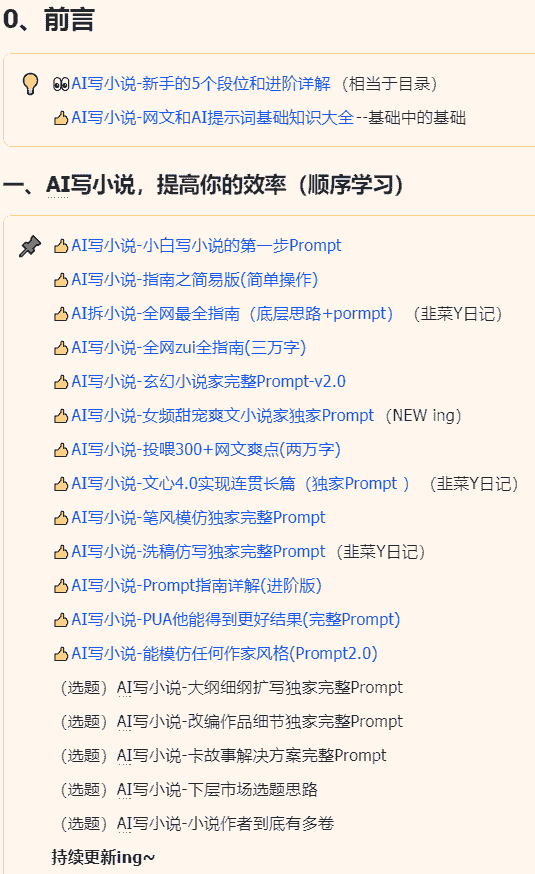
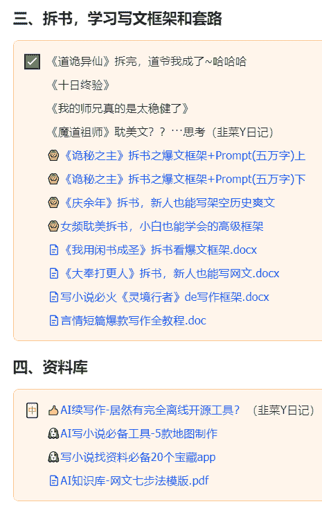

# AI写小说-新人写什么题材容易赚钱？

> 来源：[https://rq547mr4oez.feishu.cn/docx/SUN9dx26qopjRXxx8OmcYo2hnRg](https://rq547mr4oez.feishu.cn/docx/SUN9dx26qopjRXxx8OmcYo2hnRg)

# 前言：

> **最近，总有很多新的小伙伴问我：**

> 知识库学习完，太干货。但是刚开始写小说，什么题材容易赚钱 ？

---

---

PS：还有哪些问题可以评论或者私信我，我有空也可以解答。

**P**S：盗用这个文章的不要乱引流破坏环境，文章是免费分享给大家。有看见各位顺手举报下。感谢～资料纯分享不易。

**原始出处：**

---

---

> 我思考很久，一句话总结：适合你的就是最好的题材。

> **如果你听懂，那么我就只能长篇大论一番：~要**回答的话，大体来说就是要从两个角度来说。

# 第一：就是你自己有相关积累的题材

**写作之路，非一日之功。**

对于渴望创作百万字巨著的新人作者来说，深厚的阅读积累是不可或缺的基石。

这种积累，如同细水长流，需要时间的沉淀，绝非一蹴而就。

面对市场上的热门题材，即便是资深作者，也需要扎实的基本功和长期的积累才能驾驭。

对于新人而言，除非已经对特定题材有了深入的了解和研究，否则想要在短时间内通过写作赚取名声和财富，几乎是不现实的。

> **技巧：**

> **1、****找到平日你喜欢看什么类型的电影，**书籍等作品，你能耐下心看下去的就是你喜欢的类型。看不下去，你怎么写出好故事？

> [AI拆小说-全网最全指南（底层思路+pormpt）](https://rq547mr4oez.feishu.cn/wiki/OMY9woSQWiD3ZEkZf5ncJYCFnff?from=from_copylink)**、随**手记录下来，让AI跟你总结成故事。参考“ ”；

> **3、将这些故事汇总****整理成你自己的知识库****，按照题材、类型、人物等分类；**

> 4、目的就是积累，拼命的积累。（韭菜Y日记）

# 第二：就是今天说的关键：

> 在自己积累方向比较狭窄、没多少选择的情况下，新人该怎么选?

> 首先我把一个最大的影响因素搬出来，就三个字：

> **智能推。**

就是不再是十年五年前那种纯粹以编辑个人的眼光来判断该不该给某本书流量，而是通过网站ai给書打标签的方式，借由大数據，定向將打了标签的书，自动推送到“喜好这类标签”的读者的视野中。

相比以往的模式，它的效率提升了太多。所以在大规模普及后，直接改變了网文作者选择题材的思路逻辑

**以前的很多观念都要直接**推翻，比如第一个，就是：新人必须扫榜跟風热点。

**这样的做法，飞卢番茄等其他网站依日是适用的**，但是在如今的起点这里，完全可以放下了。

为什么?因为一个起点编辑承认的事实是：

> **当流量推送效率的大幅度提昇后，除了各位能看到的那些几万訂**爆火头部书籍以外，绝大部分中下层盈利书，

> **在完整更新百万宁周期内，有60-70%**的流量(甚至更多)都是来源于智能推薦的。

（韭菜Y日记）

尤其是十万字的一波流量，和上架后多更新带来的流量，都非常多，编辑原话说就是完全不亚于某些強推。

而起点读者数量多，多年以来他们的閱读口味也不像小网站那样偏好明显，而是什么偏好都有。

所以这样的情况下，新人如果积累的面比较窄、只会写一些起点以前火过的题材、不会跟风热点行不行?

行!(但別激动，仔细读后面的内容。)

> **因**为只要是曾经火起来过的題材，读者群体大概率会一直存在，哪怕很长时间没人写这个題材了，你写了，智能推按照标签推过去，往往依旧有人看，能賺到钱。

当然这里所谓能賺到钱，是说新人写的靠譜的话，冷门题材可能会有幾百均订，

上架以后努努力坚持多更，可能有个一兩千均订乃至精品。热一些的就不用说了，状况会更好。

**换句话说，只要你上架后**更新能跟得上（尤其是八千字每天不间断），就算前期推荐pk失利，

**你的书都借助智能推而拥有足够证明你实力的流量，再也不用埋怨“被**网站雪藏不给推荐”、“题材冷門”之类的。

什么奇幻、体育、武俠等等并不是赚不到钱，甚至你现在写“冷门”反而可能成为一种优势，让你竞争力更强。

> **当然，如果你写的质量没有那么理想，这些流量也会給你帶来足夠的反馈，让你意识到自己哪里出了问題**，从追读、追訂的变化看出什么地方写偏写岔了，从而累积正确的经验，下一本寫得更好。

> **还有就**是你写的题材不是“以前火过”,而是一直火并且一直迭代的，以至于如今的形態你没认出来，所以以为不火了的——典型例子就是“都市异能”,你單純在起点写都市異能就是作死，因为这玩意形态早就迭代了无数次，进化成了各类其他形态，你认不出来然后去写，签約都夠嗆。

这是从网站智能推，和作者个人积累方向结合来说的。

那如果单纯从写作难度来给各类题材排个序，起点现在是什么样的?

从起点编辑长期总结的几十篇文章、上百个小时直播的内容，结合各类样本来看，起点已经和数年之前的市场发生了显著变化。

明显特征：新人入门同人易，老手原创内卷难。

> **编辑的原话是：**

> **如**果是同人或者原创的特定題材(包括大眾和小众),其实现在更容易，如果是腦洞原创或者是生僻题材，那确实现在比以前难。

所以起点如今的难易程度排序如下。

## 上手简单題材第一梯队：毫无争议的“同人”

> 要说具体什么同人，这个根本没辦法排，如果加个限定词，

> 那就是所有擁有大量正在连載的万訂、精品的同人题材，对新人来说最简单。

从动漫(死火海等)到影视剧(《四合院》、《亮劍》、漫威宇宙)，

再到火热的起点网文同人(《吞噬星空》、《斗罗大陆》、《斗破苍穹》等)这都是最常见最好写的同人。

说白了这就是最适合新人的“财富密码”。

至于“原创的特定題材”,等下在第二梯队说。

+   同人这边也分大众小众，有一些冷门同人受众比较窄，又或者已经很久没人写的，你一翻，发现当下没有正在连载的，最近的精品都是三五年前了，那这类不是说不能写，写了也能賺，但赚的很少。

+   毕竟你都決定写同人了，干嘛在金子里非得挑个石头走呢?除非积累限定+兴趣浓厚，否则都推荐选擇人气比较旺的同人去写。

> **梳理一下同人好写的本质逻辑，你要仔细看明白，写**的时候利用优势、摒弃劣势，别自找麻烦——

> **1.从市场角度来说，同人读者群体可以被智能推精准的推**送，没签约都能通过智能推帶来不错的流量。

> 所以你根本不用内投，直发即可，编辑直接看数据捞人。

> **2.从作者角度来说，同人阅读门槛是全网文行业最低的，世界背景设定、人物设定、乃至主线剧**情甚至都不用你多说什么读者就自动理解了，由此对“文笔”的要求也幾乎达到了无限低。

> **所以写同人不用担心任何有关文筆方面的问題，哪怕**你初中生水平，一样可以写，能写通顺就行。

你甚至只凭着热情莽都有很大概率賺到钱，这是实话，因为智能推给的流量多得很，你写的烂也总有人买单，事实就是如此。

所以知道这些，就要明白：同人文里不要搞大规模原创人物、原创设定；

**开头最好凸显原著人物、剧情等来拉期待；要让受众**看明白你具体想要怎么切入和推進主线等等。

别干傻事，不懂就看同类作品怎么做，学人家的做法和逻辑，别抄袭剧情就行。

## 上手简单题材第二梯队：类“同人”/可复制的原创题材

> 所謂“类同人”,本质上就是你写的作品有和同人类似的逻辑——即不用完全原创，有现成的、大家熟知的信息(多数都是各类设定、约定俗成的内容等)可以直接降低阅读門槛。

+   比如历史文，一上来就是众所周知的朝代、众所周知的名人、眾所周知的剧情。

+   代表案例：《大明国师》这类历史文，其他所有你看到带着朝代名字开头，尤其“大明：XXX”之类的，都算。

+   比如都市文，你写大家熟知的城市、年代、事件、明星、流量作品等，哪怕是架空世界搞諧音来规避，但读者一眼就能明白，一秒就能代入，门槛极低，并不需要花费太多筆墨去进行铺垫、塑造。

+   代表案例：《开局顶流得我怎么会煳》等文娱作品、各类年代文等。

+   再比如一些各分区内的知名流派、诸天无限等。你可以直接套用那些设定，而无需担心抄襲，从而让读者轻松进入剧情。

+   代表案例：凡人流作品使用《凡人修仙传》设定和黑社会修仙背景模式，比如《苟在妖武亂世修仙》、再比如洪荒流大背景，像《我师兄实在太稳健了》有十万均订。

但这一步仅仅是“降低作者写作门槛”的一种做法，如果你只是借用设定却不会写套路，依日赚不到钱，所以核心关键能够大幅度降低“写作门槛”的，是去学和写“具备可复制性”的題材。

> **啥叫“可复制性”?**

> **第一**，它的最大特点就是这类题材【已经培养了足够养活作者的读者群体】——如果把选題材比喻成“选擇去哪里钓鱼”,“可复制性”題材就是已经养了很多鱼的成熟鱼池，只要你愿意来这里下杆，鱼上钩的概率都会比较大。

> **第**二，題材的写作套路并不难学，是可以供多数人学会，並拿来赚钱的。比如固定的昇级套路、劇情运行套路、人设模板、主线逻辑等。

这些东西你使用底层邏辑、写自己的劇情并不算抄襲，但是又始終有那么一群人爱看，

所以叫“可复制性”題材。让你学大神的那些，你根本看不明白用的是什么套路，学都学不会，写也写不出来，根本不适合模仿。

这类“可复制”題材有边界感，你通过大量阅读后能把握到边界感，内投签约易如反掌，

具体什么是边界感、怎么扫題材，办法都放在最后上连接。

## 上手困难第三梯队：纯原创+内卷题材

这里开始说的其实就是DEBUFF了，也就是说占得要素越多，你就越容易提升自己作品的“阅读门槛”,成功难度越高。

+   第一就是所有设定纯原创，连套皮都不套，名字什么的都自己想，我知道很多萌新喜欢沉迷于此，但这纯属自己找罪受，属于完全的反效果操作。

+   想创新可以，你和日有读者熟知的框架設定縫合更好。

+   第二就是专門去“大神才卷的动”的題材领域进行竞争，比如传统玄幻、變种古典仙侠、历史权谋文等等——这些作品因为长期的高度竞争，

+   如今能出头的全都是大神级别，早已经不再拘泥于普通套路，新人连普通套路都不会呢，就跑去写什么搞笑+恋爱+长线布局+群像，基本一写一个不吱声。

+   至于到底什么題材可以选、什么题材不推荐，这个下面会挨个上连接，起点的编輯尤其是青狐已经研究的很详细了，大家可以多參考同人和“具备可复制性”题材来结合自己的积累方向决定写什么。

而最后一个，则是需要彻底改變的习惯：

## 还扫榜吗?不扫榜该怎么找书?

> **建议是现在的新人别扫榜了，或者说对于萌新来说，你扫榜去找爱看的书积累素材没问題，如果**是想針对性的找自己想写的題材、尤其是一些不那么热门的内容，现在没必要去看榜单了。

不是说一本都不能续，而是因为榜单上的书往往都是佼佼者，套路无形、套路难学者十之八九，

新人分不清哪个适合学，自己强行去学真的事半功半，所以如果你通过上面说的那些建议，

找到了一个适合自己的题材，并且这个題材也的确有不少精品乃至万订書籍，你该怎么扫”?

**建议是：好好利用智能推找书!**

具体操作：

+   先添加自己要写的題材书籍，比如你想写巫师流，那就先至少找到叁本。

+   然后你就在这些书的下面(app里),“看过此书的人还看过”位置去翻，然后找成绩比较靠谱的先收藏了再说。

+   尤其是有精品徽章而不是万订徽章的，这类往往是典型可以学習的样本。

+   其他智能推比如“猜你喜欢”、“潛力新书”,“每日导读”这种定期更新的，你只要保持这幾天不点开别的題材书看，基本都会给你推这个标签下的其他同标签同題材的书籍。

+   而这种“精准推送”,能够更好的帮助你理解什么叫題材的“标签”。

+   所以别总问上哪里扫榜、让别人给自己推荐什么书之类的问题了。如果你想在起點赚钱，首先学会—

+   自己动手找书，自己收藏，自己挑选，自己判断留哪个，自己学会分析和总结。

+   【找书】这种事，不是要不要求别人的事，而是本质上你就应该完全自己判斷!

+   自己有腦子就自己动一动，不动腦子永远学不会属于自己的东西，除了理论知识，学会“做判断”更是每個人独立自主走出一条路最需要做的事。

+   如果找书这类屁大点的事都要去问別人、必须让別人来给自己做决定，本质上就是自己不敢为自己的选择担责，优柔寡断到这个地步是永远成不了事的，这点别嫌说话难听，事实就是这样。