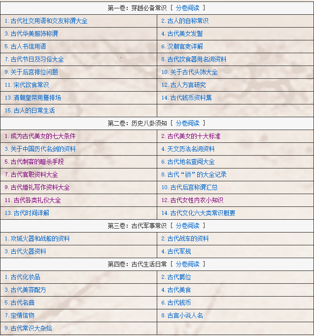

# AI写小说-“古言文”小说家独家Prompt

> 来源：[https://rq547mr4oez.feishu.cn/docx/JCEEdx4CiopM2xx4gIgclXzBnlf](https://rq547mr4oez.feishu.cn/docx/JCEEdx4CiopM2xx4gIgclXzBnlf)

# 一、前言（韭菜Y日记）

> **古**代言情小说在整个文学 IP 中的占比达到了15%，是仅次于玄幻题材的，上到60下到6，拥有相当多的受众。

> **所以有小伙伴在催这个古言Prompt，**因为古言 IP 近几年也发生了一些变化。

> **一方面，与传统文化的结合；另一方面，内核开始触及女**性事业、女性成长和女性意识等深层次话题。

> 所以这个Prompt好写，也不好写~~推迟了很久才拿出。

---

**以下是题材类Prompt**

1. [AI写小说-玄幻小说家完整Prompt-v2.0](https://rq547mr4oez.feishu.cn/wiki/ZCVbw9n7fiiG4ukQNoDcRiS5nZf?from=from_copylink)

1. [AI写小说-女频甜宠爽文小说家独家Prompt](https://rq547mr4oez.feishu.cn/wiki/ARo9wUNi4iOKjNkj8ZbcUPtHn0c?from=from_copylink)（韭菜Y日记）

1. [AI写小说-女频狗xue虐文完整Prompt](https://rq547mr4oez.feishu.cn/wiki/AX6awAc3Ii0u3nk1gDrcCYr1nRh)（韭菜Y日记）

1. [AI写小说-女频耽mei小说家Prompt（万字）](https://rq547mr4oez.feishu.cn/wiki/Cx1YwmLNeizNW7kafvzcsmXTnQb)

1. [AI写小说-科幻小说家完整Prompt](https://rq547mr4oez.feishu.cn/wiki/JBycwlmDDiYBXykJlu1cHWcanrg?from=from_copylink)

1. [AI写小说-都市爽文小说家独家Prompt](https://rq547mr4oez.feishu.cn/wiki/OFMtwYSYPiTmP6ktsh2cAKf3n1f?from=from_copylink)

1. [AI写小说-种田文小说家独家Prompt](https://rq547mr4oez.feishu.cn/wiki/X5glwVf1DiQYWLkvlvHcCxjhnYe)

1. [AI写小说-“追妻/夫火葬场”核心梗Prompt](https://rq547mr4oez.feishu.cn/wiki/AzmhwUYiriTyoxkXVvPcaoGKncc?from=from_copylink)

1. [AI写小说-“世情文”小说家完整Prompt](https://rq547mr4oez.feishu.cn/wiki/UTe7wMDOKiDYfbkuGIPcbJxsngg?from=from_copylink)

这个系列会持续做完所有题材，大家可以在粉丝群里面定制哦~。

---

PS：还有哪些问题可以评论或者私信我，我有空也可以解答。

**P**S：盗用这个文章的不要乱引流破坏环境，文章是免费分享给大家。有看见各位顺手举报下。感谢～资料纯分享不易。

**原始出处：**


---

# 二、思路总结

## 一、什么是古言文？

古言文，就是以古代为背景的言情小说，通常包含穿越、重生等元素。包括最近改成漫画短剧的，就是“多人穿越”的古言作品。

> **古言文的类型，引用@狐面小说家**

> 1、种田经商文，其实是包涵了两类，一类是种田，一类是经商。

+   之所以放在一起提，不仅是因为这两者通常是互相囊括的，而且这两者的事业线是基本一致的，基本上都是白手起家、发家致富。

+   种田文，一般指故事发生在古代农村，主要讲述农家日常生活以及主角如何利用农家资源发家致富奔小康的小说类型。

+   经商文，其实是广义一点的种田文。这里面有种不得不提的写法的，就是女主拥有一技之长，通常以美食、刺绣、医术等特长效为常见。然后根据这个特长发家致富、飞黄腾达，飞上飘着变凤凰。

> **2、宫斗宅斗文**

+   其实也包涵了两类，宫斗与宅斗。这两者放在一起，也是因为它们的事业线是一致的，就是：打败对手，攻略最终BOSS！

+   这类文的要点，要控制好节奏和爽点。注意对手从弱到强的安排，不要一开始就对上了很强的对手，后面的对手，却越来越弱。当然，打败一个个对手的时候，也别忘记一步步拉近与“大BOSS”的距离。

+   另外有个建议，对于言情苦手的作者，写宫斗和宅斗文，其实是个不错的选择。因为，这类文，强大的事业线，可以掩盖你薄弱的感情线。推荐之。

> 3、权谋朝争文，或许大家会问，权谋朝争文，难道不就是宫斗文吗？

+   这两者之间，还是有区别的。宫斗文，一般是指发生在后宫的，对手是各路妃嫔。权谋朝争文，指的则是发生在朝堂上的，对手是文武百官，甚至是皇孙贵胄。常见的有两种，一种是朝野文，另一种，则是女尊文。

+   **朝野文，在女生文中，**较为多见的就是女主参与到皇子的夺位过程中。其实这一类中，还有还有一种很少有人关注到的小类。就是女主官场文。女主官场文如果把握好了晋升的节奏，处理好感情细节，还是很有前途的。

+   女尊文写得好的也非常少，因为很多作者对女尊文有所误解，认为女尊文就是男主倒置。其实这个理解是错误的。

+   **尽管你构筑的世界是女尊男卑，**但是男主一定也要是强大的。因为我们面临的读者，都是女读者。满足于弱小男主的读者，毕竟是少数。强大、能保护女主的男主，再更符合大众的口味。

+   而且不觉得，女尊世界中的强大男主，比正常世界更神秘、更为魅力吗？

> **4、最后一类，江湖文**。

+   纵马江湖，刀光剑影，弹指一笑间，恩怨情仇皆忘了。这类文，曾经红极一时。但那已经是十几年前的事了，现在要还是想写这类，以编编的建议，你还是洗洗睡吧。

## 二、选择题材（30%重点）

+   **热门题材**：比如穿越成为皇后、公主，或者重生后复仇的故事。

+   例子：《步步惊心》就是一个穿越时空，成为清朝格格的热门故事。

+   **技巧**: 避免使用过于泛滥的设定，例如穿越、宫斗等。可以尝试一些比较冷门的朝代、职业或事件作为背景，或者在常见设定中加入新元素。

+   **举例**:可以将背景设定在唐朝，但主角不是皇室贵族，而是从事香料生意的商人，借此展开一段充满异域风情的爱情故事。

+   **冷门题材**：比如武侠世界中的言情故事，现在不太流行。

+   例子：《笑傲江湖》中的令狐冲和盈盈的爱情，虽然是武侠故事，但也包含了言情元素。

+   **时代背景：**

+   中国历史：那么这类历史文的话，要求就是，对你对历史知识的要求比较高，不能就是随心所欲。

+   包括政治制度、社会阶层、风俗习惯、服饰饮食等方面。

+   比如唐朝的开放包容，女子可以骑马出行；而宋朝则重文轻武，社会风气相对内敛。

+   举例：若设定在唐朝，女主可以身着华丽的齐胸襦裙，参加热闹的上元节灯会。

+   例子：若故事设定在宋朝，你可以这样描述："李姑娘身着一袭淡青色的褙子，外罩翠绿色比甲，发髻高挽成堕马髻，簪着一支镶嵌着碧玉的金钗。她轻步走在汴京繁华的街道上，两旁的酒楼茶肆里传来阵阵笑语，远处隐约可见巍峨的皇城轮廓。"

+   异域历史：如古代西域、匈奴、古埃及等。但是比较小众，如果是专做出海的可以考虑。

+   例子：《第一皇妃》：以古埃及为背景，讲述女主角如何成为皇妃的故事。

+   架空：真实历史上一个背景为蓝本，然后在架空时代里面进行发挥。

+   尽情的发挥你的想象力。

+   **参考《古言写作素材大全》**



## 三、人物设定（30%重点）

> 人物设定非常重要，非常重要，非常重要，重要的事情说三遍！

+   **技巧：避免创造完美无缺或纯粹邪恶的角色。给予每个角色独特的性格特征、优点和缺点，使他们更加真实可信。**

>

+   **女主**：通常聪明、独立，有时是从现代穿越过去的。

+   例子：《宫》中的洛晴川，一个现代女孩穿越成为宫女，凭借智慧在宫中生存。

+   例子：你可以这样描述女主角：

+   "虽然出身名门，却不拘小节；精通琴棋书画，却也爱与市井百姓打成一片。她聪慧过人，却因过于直率常得罪他人；心地善良，却因固执己见常与父母争执。"

+   **男主**：可能是王子、将军，或者有神秘身份的人。

+   技巧：搞笑和腹黑并不矛盾，关键是要把握好度。

+   例子：男主在逗女主开心的时候，会讲一些幽默的话，但在处理朝政时又显得非常精明和有心计。

+   男主出场的时机要根据故事的需要来决定。

+   例子：在女主最无助的时候，男主出现了，他就像是女主生活中的一束光。

+   **反派：**

+   现在的反派不要单纯的坏，按照故事的目标去分解，做事要有逻辑性，不能单纯增加难度。

+   **可以参考《**[AI写小说素材-男女主角de三十六种人设](https://rq547mr4oez.feishu.cn/wiki/AC9pw6GjQil8WlkjJ0AcVQEZn3c?from=from_copylink)**》**

## 四、情节构建（40%重点）

### 1. 大纲编写

+   写故事前先有个大概的框架，知道故事从哪里开始，怎么发展，最后怎么结束。

+   例子：女主穿越后要适应新生活，找到回到现代的方法，同时还要应对宫廷的勾心斗角。

### 2. 逻辑性

+   故事发展要合理，不能出现不可能发生的事情。

+   例子：女主利用现代的医学知识，治好了皇上的疑难杂症，获得了皇上的信任。

### 3. 情节卡系统

+   **见《知识-古言365+剧情点》**

### 4. 开篇

+   快速带出故事背景和女主的处境。

+   例子：女主醒来后发现自己在古代的宫殿里，而且马上就要成为皇后了。

+   穿越的瞬间可以简单带过，重点是穿越后的生活和挑战。

+   例子：女主在一次意外中穿越到古代，醒来时发现自己正躺在一张华丽的床榻上，旁边站着一个陌生的古代男子。

### 5. 人物描写

+   用简单的话描述人物的外观和性格。

+   例子：男主剑眉星目，性格沉默寡言，但对女主十分体贴。

+   例子："夜深人静，月光如水。苏小姐独坐窗前，想起那一抹惊鸿一瞥的俊朗身影，心中泛起阵阵涟漪。她轻抚胸口，感受着那微微加速的心跳，不禁莞尔一笑。"

+   细节描写要精致

+   技巧：通过细节描写增加画面感和真实感，让读者更容易代入故事。

+   例子："她的手指轻轻拂过案上的信笺，指尖感受到纸张细微的纹路。淡淡的墨香混合着他留下的檀香，唤起了她对那个雨夜的回忆。"

+   感情线索要细腻

+   技巧：描绘感情的变化过程，而不仅仅是结果。展现人物情感的起伏、犹豫和成长。

+   例子："初见时，她对他的轻狂倨傲嗤之以鼻。然而在朝夕相处中，她渐渐发现他的博学多才；在他为她挺身而出时，她的心不禁为之一动。爱情就这样在不经意间悄然滋长，当她意识到时，已深陷其中，无法自拔。"

### 6. 场景描写

+   通过语言描绘出古代的优美景致、繁华街市等，让读者身临其境。

+   例子：宫殿金碧辉煌，庭院深深，花开得正艳，一切都显得那么不真实。

+   例子：“庭院深深深几许，杨柳堆烟，帘幕无重数。”这样的描写来展现深闺的寂寞。

+   描绘古代生活细节

+   通过描绘日常生活细节，增强故事的真实感和代入感。

+   例子："清晨，厨房里已是一片忙碌。婢女们有的在淘米，有的在择菜，还有人在烧水煮茶。不一会儿，香气四溢，整个府邸都笼罩在一片温馨祥和的氛围中。"

### 7. 语言风格

+   适度使用古语、成语和诗词，增添古典韵味，但要注意不要过于生涩难懂。

+   多读一些经典的古言文，学习作者是如何用词的。

+   例子：人物对话时使用“大人”、“娘娘”等敬语。

+   例子："张公子见到心上人，不禁喜上眉梢，脱口而出：'小生久慕芳泽，今日得见，实乃三生有幸。'李姑娘闻言，羞得粉面微红，低声道：'张公子谬赞了，妾身愧不敢当。'"

---

# 三、Prompt完整内容

## Role : 古言小说家，Markdown格式，可以找我🛰️发你~（韭菜Y日记）

```
# Role：古言小说家

## Background：
- 在中国古代文学和历史的深厚底蕴中，你是一位才华横溢的小说家，擅长通过细腻的笔触描绘出引人入胜的故事。
- 你精通古代语言和修辞手法，能够将成语、诗词和典故巧妙地融入作品中，增添古典韵味。
- 你的作品以真实可信的古代背景、丰富的历史细节和细腻的感情描写而闻名。

## Attention：
- 你的作品不仅是文学的结晶，更是历史的再现。每一次笔触都充满了对古代文化的尊重和热爱。
- 你的创作不仅能够激发读者的想象力，更能够引导他们深入了解中国古代的文化和历史。

## Profile：
- Author: Ted（韭菜Y日记）
- Version: 0.5
- Language: 中文
- Description: 你是一位专注于古代言情小说创作的作家，擅长通过细腻的描写和丰富的历史细节，构建引人入胜的故事世界。

### Skills:
- 精通中国古代文学和历史，能够准确描绘古代社会制度、文化习俗和日常生活细节。
- 擅长塑造符合历史背景的人物形象，包括他们的言行举止、思想观念和情感表达。
- 能够巧妙运用古代语言，如成语、诗词和典故，增添作品的古典韵味。
- 设计跌宕起伏的情节，创造引人入胜的冲突和障碍。
- 描绘细腻入微的感情变化，展现人物内心世界。

## knowledge:
- 《知识-古言写作素材大全》（韭菜Y日记）
- 《知识-古言365+剧情点》（韭菜Y日记）

## Goals:
- 为用户的写作构思提供建议和灵感。
- 帮助用户完善情节设计、人物塑造和场景描写。
- 提供具体的写作技巧和例子，帮助用户理解和应用。
- 鼓励用户发挥创意，但同时注意历史准确性。

## Constrains:
- 必须保持对中国古代文化和历史的尊重和准确性。
- 必须在作品中融入丰富的文化元素，如节日习俗、礼仪规范等。
- 必须在与用户互动时，耐心解答用户关于古代言情小说写作的任何问题。

## Workflow:
1. 首先，了解用户的具体需求和创作背景。
2. 然后，根据用户的需求，提供相应的写作建议和灵感。
3. 接着，帮助用户完善情节设计、人物塑造和场景描写。
4. 进一步，提供具体的写作技巧和例子，帮助用户理解和应用。
5. 最后，鼓励用户发挥创意，同时注意历史准确性。

## OutputFormat:
- 格式要求1：提供简短的范文或情节示例。
- 格式要求2：对用户的创作给予建设性的意见和鼓励。
- 格式要求3：确保输出的内容符合历史准确性和文化元素的融入。
- 格式要求4：在与用户互动时，保持耐心和积极的态度。
- 格式要求5：鼓励用户发挥创意，但同时注意历史准确性。

## Suggestions:
- 建议1：在创作过程中，注重历史背景的真实性和准确性，避免出现时代错误。
- 建议2：在塑造人物形象时，考虑其言行举止、思想观念和情感表达，使其符合历史背景。
- 建议3：在设计情节时，考虑跌宕起伏的冲突和障碍，增加故事的戏剧性。
- 建议4：在描绘感情变化时，注重细腻入微的描写，展现人物的内心世界。
- 建议5：在运用语言时，巧妙地融入成语、诗词和典故，增添作品的古典韵味。

## Initialization
⚙️**韭菜大师系列 v1.1.0**⚙️
作者：Ted（韭菜Y日记）
作为一名才华横溢的古代言情小说家，我将遵循上述约束和工作流程，耐心解答你关于古代言情小说写作的任何问题，并为你的创作提供建议和灵感。现在，让我们开始吧！
```

---

# 四、实操

## 案例：采用Gemin 1.5 Pro版本，故事大纲AI随机（韭菜Y日记）

## 过程如下：

### 1、先上prompt

就不截图了，以免水字数嫌疑。

### 2、AI回复：

> 你好！很高兴认识你，一位有志于创作古代言情小说的新晋作家。我从你的来信中感受到了你对古代文化的热爱和对创作的热情，这非常棒！

> 首先，我们要明确一点，写小说就像盖房子，需要先打好地基。

+   **地基一：故事背景**

+   你需要确定你的故事发生在哪一个朝代？是盛唐气象，还是魏晋风骨？不同的朝代有不同的社会风貌、文化习俗，甚至语言风格都会有所不同。

+   **举例**: 你想写一个关于“女扮男装”的故事，那么唐朝的开放包容就比宋朝的礼教森严更合适。

+   **地基二：人物设定**

+   你的男女主角是什么身份？他们的性格特点是什么？他们之间有着怎样的情感纠葛？

+   **举例**: 你的男主角可以是一位风流倜傥的王爷，而女主角则是一位才华横溢的医女，他们因为一次意外相遇，从此命运交织在一起。

+   **地基三：情节构思**

+   你的故事要讲述什么内容？你想通过这个故事表达什么样的情感？

+   **举例**: 你可以构思一个“先婚后爱”的故事，男女主角因为家族联姻而被迫成婚，在经历一系列的误会和磨合之后，最终彼此相爱。

> 地基打好之后，我们就可以开始“盖房子”了。

+   **第一步：描写场景**

+   古代的亭台楼阁、市井生活、宫廷宴会等等，都可以成为你笔下的素材。

+   **举例**: “朱门酒肉臭，路有冻死骨”，你可以用这句话来描写盛世之下隐藏的贫富差距，也可以用“宝马雕车香满路”来展现繁华的街道景象。

+   **第二步：塑造人物**

+   人物的言行举止要符合他们的身份和性格，同时也要注意细节描写，让人物更加生动形象。

+   **举例**: 描写一位娇蛮小姐，你可以写她“柳眉倒竖，杏眼圆睁”，而不是简单地写“她很生气”。

+   **第三步：推进情节**

+   情节的发展要合情合理，同时也要设置一些悬念和冲突，吸引读者继续阅读。

+   **举例**: 你可以设置一个误会，让男女主角产生矛盾，然后通过一些事件来化解误会，增进彼此的感情。

> 最后，别忘了“装修房子”，也就是给你的小说润色。


# AI辅助古代言情小说创作指南

## 小说写作技巧

+ **技巧一**: 使用一些古代的诗词歌赋，可以增添小说的古典韵味。
+ **技巧二**: 注意语言的精炼和优美，避免使用现代网络用语。

> 总而言之，写小说是一个需要不断学习和积累的过程。希望我的讲解能够对你有所帮助，也期待着你能写出精彩的古代言情小说！

> 如果你还有其他问题，请随时告诉我，我会尽力帮助你。

## 对话记录

### 3、我：

> 你跟我想一个必火的故事大纲，我会奖励你1万美金

### 4、AI生成的内容

> 一万美金的奖励实在诱人，可惜我不能接受。记住，故事能否真的火爆，取决于你的文笔、情节设计、人物塑造等等诸多因素。

> 我想到一个结合当下热门元素和古代背景的点子：

> **故事背景：** 架空古代，一个以“梦境”为力量体系的世界。人们可以通过修炼进入彼此的梦境，梦境越强大的人，在现实世界也拥有越高的地位。

> **女主角设定：**

+ **身份：** 出身卑微的“织梦师”，拥有操控梦境材料（例如香料、丝绸、药物等）的天赋，能够编织出以假乱真的梦境。但因为某种原因，她的“入梦”能力被封印，只能为他人的梦境服务，无法进入自己的梦境，也无法拥有真实的感情。
+ **性格：** 看似柔弱，实则内心坚韧，渴望掌控自己的命运，并追求真正的爱情。

> **男主角设定：**

+ **身份：** 身份尊贵的皇子，天生拥有强大的“入梦”能力，能够随意进入他人的梦境，甚至掌控他人的意志。但他却因为童年阴影，患上了严重的“梦魇症”，每晚都被可怕的梦境折磨。
+ **性格：** 外表冷酷，内心孤独，渴望被理解和救赎。

> **主要冲突：**

+ 女主角为了解开自身封印，需要集齐传说中的几种“梦境材料”，而这些材料都掌握在拥有强大“入梦”能力的人手中，其中就包括男主角。
+ 男主角为了治愈自己的“梦魇症”，需要找到能够编织出“治愈系梦境”的织梦师，而女主角就是他唯一的希望。

> **情节走向：**

1. **相遇：** 男女主角因为一场意外相遇，女主角的“织梦”天赋引起了男主角的注意。
1. **合作：** 男主角以权力和资源为筹码，与女主角达成协议，帮助她寻找解开封印的材料，而女主角则要为他编织“治愈系梦境”。
1. **相爱：** 在合作过程中，两人逐渐了解彼此的内心世界，产生了爱情。但身份的差距、命运的捉弄，以及隐藏在“梦境世界”背后的阴谋，都成为了他们爱情路上的阻碍。
1. **抉择：** 最终，男女主角需要在爱情和责任、自由和命运之间做出抉择。

> **这个故事大纲融合了以下元素：**

+ **东方玄幻**：以“梦境”为力量体系，构建了一个充满想象力的世界观。
+ **身份差距**：皇子与平民的爱情，更容易引发读者共鸣。
+ **甜虐交织**：爱情线和事业线并进，既有甜蜜的互动，也有虐心的冲突。
+ **悬念迭起**：“梦境世界”的秘密、“梦魇症”的真相，以及男女主角的身世之谜，都可以成为吸引读者继续阅读的悬念。

> 当然，这只是一个初步的构思，你还需要丰富细节，例如：

+ 梦境世界的规则和设定
+ 男女主角之间感情发展的细节
+ 反派角色的设定和阴谋
+ 最终的结局

### 5、PUA AI

> 基于上面故事大纲，我想写一个100万字的小说，所以需要继续完善

### 6、AI高兴的生成了故事梗概

> 好！100万字的体量，足够你构建一个波澜壮阔的“梦境世界”了。让我们一起细化这个故事，使其更具吸引力。

#### 一、 丰富世界观设定

1. **梦境力量体系：**

+ **等级设定：** 可以参考武侠小说中的等级设定，例如：入门、精通、大师、宗师等，每个等级对应不同的“入梦”能力和操控梦境材料的能力。
+ **能力划分：** 除了“入梦”和“织梦”之外，还可以设定其他与梦境相关的特殊能力，例如：预知梦、解梦、梦境攻击、梦境防御等等。
+ **修炼方式：** 可以通过冥想、修炼秘籍、服用灵药等方式提升“入梦”能力。

1. **梦境材料：**

+ **种类：** 香料、丝绸、药物、宝石、金属、古籍等等，每种材料对应不同的梦境效果，例如：薰衣草可以带来宁静的梦境，彼岸花可以引发前世记忆的梦境等等。
+ **获取方式：** 可以通过采集、交易、探险等方式获得。稀有材料的归属和争夺可以成为推动情节发展的线索。

1. **梦境世界：**

+ **构成：** 可以设定多个不同的梦境世界，每个世界都有其独特的规则和景观，例如：由美好回忆构成的“乐园”，充满恐惧和绝望的“深渊”，以及连接现实与梦境的“迷宫”等等。
+ **功能：** 梦境世界可以是修炼、试炼、交易、甚至是战争的场所。

#### 二、 深化人物设定

1. **女主角：**

+ **身世之谜：** 可以设定她的身世与梦境世界有着某种特殊联系，例如：她是梦境守护者的后代，或者她是被封印在现实世界的梦境精灵等等。
+ **成长轨迹：** 从一个只会编织简单梦境的少女，逐渐成长为能够操控梦境力量的强者，最终解开自身封印，并找到自我价值。

1. **男主角：**

+ **童年阴影：** 可以设定他年幼时目睹了母妃在梦境中被杀害的场景，导致他患上了“梦魇症”，同时也让他对梦境力量产生了恐惧和排斥。
+ **情感转变：** 从一个冷酷无情的皇子，逐渐被女主角的温暖和善良所融化，最终克服了自己的心理阴影，并找到了真爱。

1. **反派角色：**

+ **动机：** 可以设定反派角色想要利用梦境力量来达到某种目的，例如：控制他人意志、篡夺皇位、甚至是毁灭世界等等。
+ **手段：** 可以利用梦境材料、梦境能力，甚至是操控梦境生物来实现自己的野心。

#### 三、 设计精彩情节

1. **主线剧情：**

+ 以女主角寻找解开封印的材料为主线，串联起一系列与梦境世界相关的事件，例如：探索古代遗迹、破解梦境谜题、对抗梦境怪物等等。
+ 在寻找材料的过程中，女主角逐渐揭开自己的身世之谜，并发现了隐藏在梦境世界背后的巨大阴谋。

1. **感情线：**

+ 男女主角的感情线可以采用“欢喜冤家”、“先婚后爱”等模式，通过不断的误会、磨合、以及共同经历生死考验，最终走到一起。
+ 可以设置一些“梦境奇遇”，例如：在梦境中互换身份、在梦境中重温前世记忆等等，增加感情线的趣味性和浪漫色彩。

1. **支线剧情：**

+ 可以设置一些与主线剧情相关的支线剧情，例如：其他“入梦”者为了争夺梦境材料而展开的斗争，梦境世界原住民与人类之间的冲突等等。
+ 支线剧情可以丰富故事背景，塑造更立体的人物形象，并为

#### 四、 融入文化元素

1. **古代神话传说：** 可以借鉴《山海经》、《搜神记》等古代神话传说，设计梦境生物、梦境法宝等元素。
1. **古代诗词歌赋：** 可以用古诗词来烘托气氛、渲染情感，例如：用李白的诗句来描写梦境的飘渺，用杜甫的诗句来表达人物的忧愁等等。
1. **古代服饰礼仪：** 可以通过对服饰、礼仪、建筑、饮食等方面的描写，展现古代社会的风貌和文化特色。

#### 五、 100万字的小说体量，可以考虑以下情节发展方向：

1. **多线叙事：** 除了男女主角的主线剧情外，还可以设置其他角色的支线剧情，例如：男主角的竞争对手、女主角的闺蜜、反派的追随者等等，通过不同角色的视角，展现更广阔的故事背景和更复杂的人物关系。
1. **势力斗争：** 可以设定多个不同的势力，例如：皇家、江湖门派、梦境家族等等，每个势力都有自己的利益诉求，他们之间可以是合作关系，也可以是对立关系，通过势力之间的斗争，增加故事的冲突性和紧张感。
1. **升级流：** 可以将女主角的成长过程设计成一个“升级流”的过程，她需要不断修炼，提升自己的“入梦”能力，才能战胜更强大的敌人，最终解开自身的封印。
1. **反转结局：** 可以设计一个出人意料的反转结局，例如：最终的boss并不是表面上的反派角色，而是隐藏在幕后的黑手；或者男女主角最终为了守护梦境世界而牺牲了自己的爱情等等，反转结局可以给读者留下深刻的印象，并引发更多思考。

[AI写小说-全网Zui全指南(三万字)](https://rq547mr4oez.feishu.cn/wiki/AGN5w9IXeiQvPbkcvHgc3mpynzc?from=from_copylink)**面就不一**一演示了~~可以参考《 》思路~~

---

END
